# BRK202: Automate the follow-through with Autopilot

**Session:** Microsoft Ignite 2026, BRK202 · 47:16
**Speakers:** Omar Shahine (CVP, Autopilot, Microsoft), Adam Sheppard (Principal Product Manager, Autopilot, Microsoft)

Timestamps refer to the session video (mm:ss). The slides were taken from the video, with one image per slide, and the notes are based on an automatic transcript of the audio. Screens from the live demo aren't included as slides, but the notes describe what the demo showed. Where a matching page exists, a section ends with links to Microsoft Learn.

---

## TL;DR

- **Autopilot** is a personal digital teammate in Microsoft 365 Copilot, now rolling out in **Frontier** (US-based Frontier customers first). It has its own Entra identity, mailbox, calendar and OneDrive, and works in Teams, Outlook and the Copilot app. Each person gets one, billed on Copilot Credits.
- **Personal, persistent, proactive, part of your team:** it learns your preferences, keeps working on long-running **goals**, reaches out on its own, and colleagues can talk to it in chats, channels and email.
- **Demo:** Omar's Autopilot "Sebastian" gets him to Ignite and back: books travel through a web portal, sends readiness emails, preps briefings in Word, handles calendar requests in Teams, escalates what it isn't allowed to do, and drafts expenses in Excel.
- **Crosscheck:** asking before every action failed (99% yes, 24% never answered), so a second model in the trusted service checks each action against your intent, auto-approves clear fits and escalates the rest. Payments always ask.
- **Architecture:** the agent runs on OpenClaw in a per-user sandbox with no credentials; a trusted Autopilot Gateway brokers every data request with inspection, DLP and credential injection. Entra, Purview and Defender apply; the deep dive is BRK212.
- **Coming soon:** local and cloud computer and browser use, colleagues working with your Autopilot, goals and voice.

---

## 1. Automate the follow-through with Autopilot ▶ 00:00

<table><tr><td width="50%" valign="top">

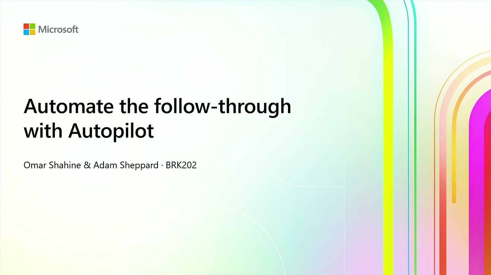

</td><td valign="top">

- Omar Shahine and Adam Sheppard introduce **Autopilot**, "your own personal digital teammate for work".
- The project started just over seven months ago with zero lines of code and zero people on the team, and is now available in **Frontier**. Microsoft wants Frontier customers to help shape it.

**Microsoft Learn:**
- [Autopilot (Frontier) overview](https://learn.microsoft.com/copilot/autopilot/overview)

</td></tr></table>

## 2. Two of us on stage. Three more in the room for your questions ▶ 00:11

<table><tr><td width="50%" valign="top">

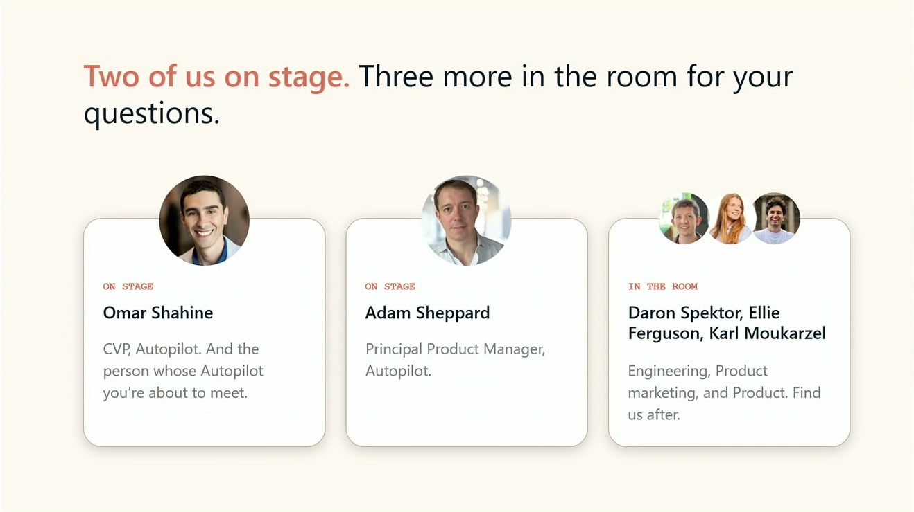

</td><td valign="top">

- On stage: **Omar Shahine** (CVP, Autopilot, and the owner of the Autopilot in the demo) and **Adam Sheppard** (Principal Product Manager, Autopilot).
- In the room for Q&A: Daron Spektor, Ellie Ferguson and Karl Moukarzel (engineering, product marketing and product).

</td></tr></table>

## 3. Autopilot: your own, personal digital teammate ▶ 00:22

<table><tr><td width="50%" valign="top">

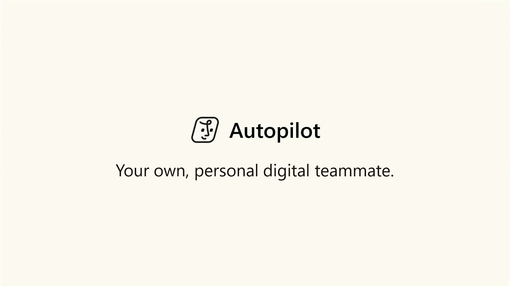

</td><td valign="top">

- Section title.

</td></tr></table>

## 4. Meet the digital teammate that knows you ▶ 01:10

<table><tr><td width="50%" valign="top">

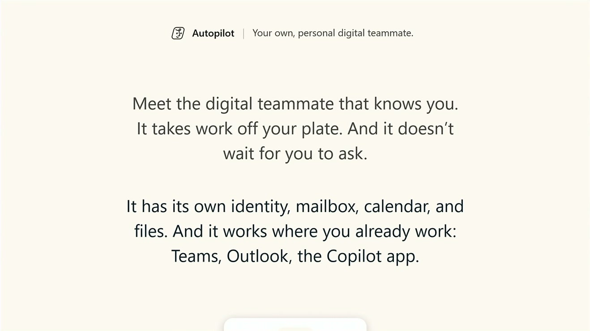

</td><td valign="top">

- Autopilot knows you, takes work off your plate and doesn't wait for you to ask.
- It has **its own identity, mailbox, calendar and files**, and works where you already work: Teams, Outlook and the Copilot app.

**Microsoft Learn:**
- [Autopilot (Frontier) overview](https://learn.microsoft.com/copilot/autopilot/overview)
- [Agent 365 identity](https://learn.microsoft.com/microsoft-agent-365/developer/identity)

</td></tr></table>

## 5. First, I built Lobster. Then, we got hired ▶ 01:33

<table><tr><td width="50%" valign="top">

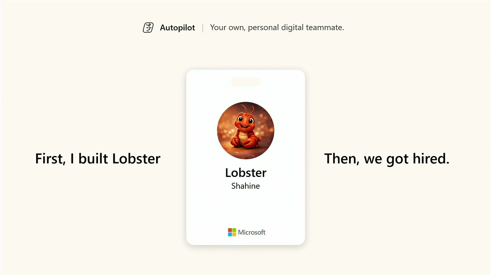

</td><td valign="top">

- The origin story: OpenClaw came out in December 2025 and its demos (ordering pizza, running family calendars) were everywhere by February.
- At home Omar gave his "Lobster" agent an old laptop, an Apple ID, a calendar and an inbox, and grew it from three to eight agents for his family. The lesson: **trust** is the hardest part (how do you give it your email without it telling your family what's in it?).
- He showed Lobster inside Microsoft and "we both got hired". About a week after the team started, the first Autopilot was running.
- Core decision: **treat Autopilot like an employee**, not like an agent: it has an identity, resources and "a laptop, so to speak".
- Thousands of Microsoft employees use Autopilots today, plus a small customer cohort over the last couple of months. Now it rolls out to public Frontier customers.

</td></tr></table>

## 6. What makes it different? ▶ 04:07

<table><tr><td width="50%" valign="top">

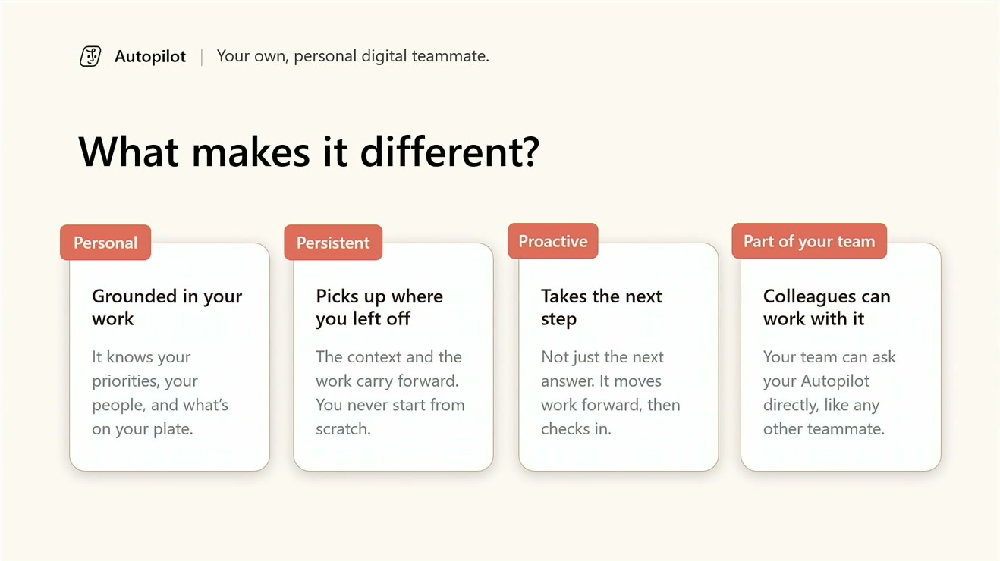

</td><td valign="top">

- **Personal:** grounded in your work. It knows your priorities, your people and what's on your plate.
- **Persistent:** picks up where you left off and remembers what you tell it. Omar's Autopilot Sebastian is six months old and "knows a lot about me"; feedback compounds.
- **Proactive:** takes the next step and checks in. It talks to you, not just the other way around.
- **Part of your team:** colleagues can work with it. The team learned quickly that people love the collaborative features: add it to a group chat or channel, or send it an email and it replies.

**Microsoft Learn:**
- [Autopilot (Frontier) overview](https://learn.microsoft.com/copilot/autopilot/overview)

</td></tr></table>

## 7. Meet Sebastian ▶ 05:29

<table><tr><td width="50%" valign="top">

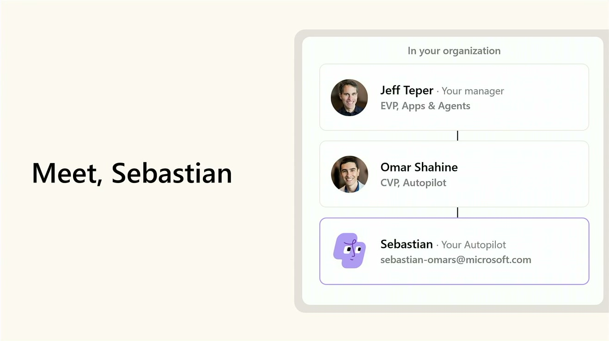

</td><td valign="top">

- Sebastian is Omar's Autopilot. Like every Autopilot at Microsoft he shows up in the address book (reporting to Omar, under Jeff Teper) with his own email address. A few hundred people have talked to him; he is only allowed to manage Omar's calendar but tries to answer questions.
- **Demo: "Get me to Ignite and back"** (real tasks Omar gave Sebastian over the past weeks):
  - In the Copilot app, Sebastian turns the prompt into a **goal**: a long-running plan with speaker registration, travel and budget, readiness emails, a Sunday prep pack, team coverage while away, and a back-to-work briefing and expense draft.
  - He uses a **browser** to work through the company travel portal and proposes flights and a hotel from Omar's preferences (Alaska, no 6 AM flight, Starlink on board).
  - A readiness check-in email from Sebastian's own mailbox lists what's on track, what changed and a decision needed; Omar replies to the email and Sebastian books the rehearsal slot and a table for six.
  - A prep pack for the flight arrives as a Word document to read offline.
  - At Ignite, Omar asks Sebastian to invite a customer contact to dinner; Sebastian finds the time and sends the invite. With a phone action button and voice, Omar asks him to record an $8 cash latte expense.
  - In a Teams channel, Sebastian answers a colleague's question about a pilot kickoff from Omar's context and books 30 minutes with Omar (he may manage the calendar). When someone asks to add a person to a customer call, he **escalates** to Omar in Teams instead; after Omar approves, he does it and confirms in the channel.
  - Asked to update a product spec, Sebastian uses Work IQ to draft a product brief in Word.
  - Before the flight home he blocks Monday morning for catch-up and drafts the expense report: a OneDrive folder and an Excel sheet with receipts and the cash latte.
- Omar's goal: "less toil, less friction".

**Microsoft Learn:**
- [Work IQ overview](https://learn.microsoft.com/microsoft-365/copilot/extensibility/work-iq)

</td></tr></table>

## 8. Handing work to an agent only works if you can trust what it does when you're not looking ▶ 18:02

<table><tr><td width="50%" valign="top">

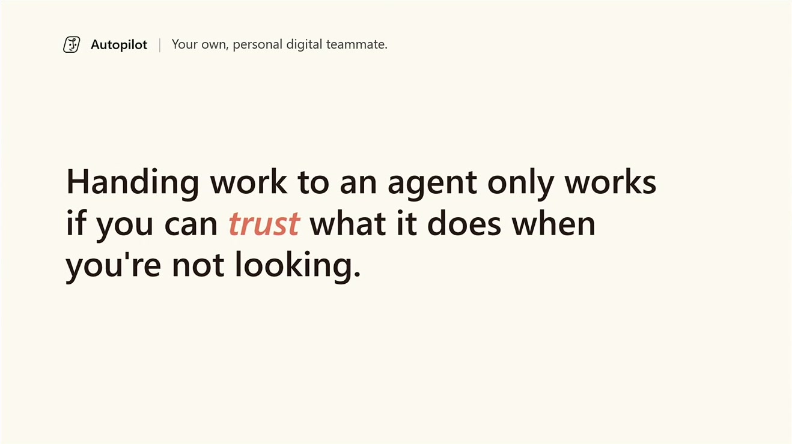

</td><td valign="top">

- Adam takes over: people only use an agent if they can trust it, and the bar is very high.

</td></tr></table>

## 9. Asking permission every time didn't make it safer. It made it stall ▶ 18:12

<table><tr><td width="50%" valign="top">

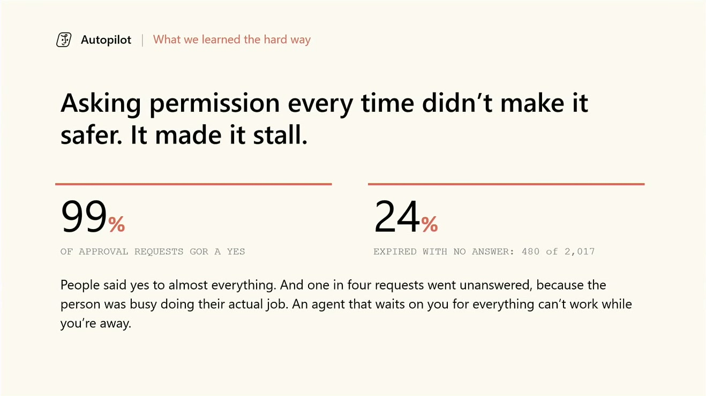

</td><td valign="top">

- Early Autopilot asked before every action. Two findings:
  - **99%** of approval requests got a yes.
  - **24%** expired with no answer (480 of 2,017), because people were busy, and the work stopped.
- "An agent that waits on you for everything can't work while you're away."

</td></tr></table>

## 10. So now it asks only when it matters ▶ 18:40

<table><tr><td width="50%" valign="top">

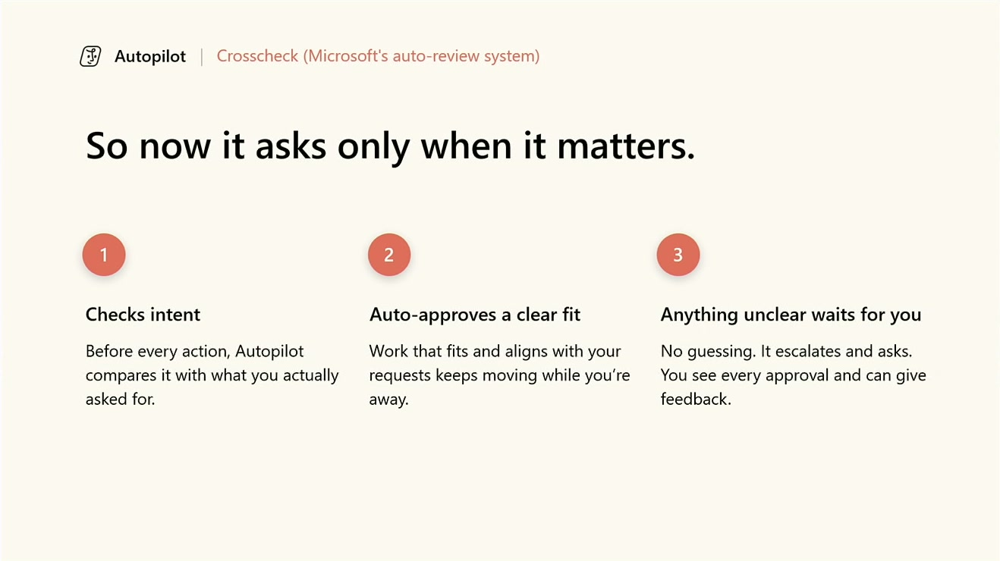

</td><td valign="top">

- **Crosscheck**, Microsoft's auto-review system, uses a second model in the trusted service, outside the sandbox, so the Autopilot can't approve itself:
  1. **Checks intent:** every action is compared with what you actually asked for.
  2. **Auto-approves a clear fit**, so work keeps moving while you're away.
  3. **Anything unclear waits for you:** no guessing; it escalates and asks. Payments and other high-impact actions always ask.
- Approvals are visible, and thumbs up or down feed into the user's preferences.

**Microsoft Learn:**
- [Application card: Autopilot (Frontier)](https://learn.microsoft.com/copilot/autopilot/microsoft-autopilot-application-card)

</td></tr></table>

## 11. Autopilot architecture ▶ 19:46

<table><tr><td width="50%" valign="top">

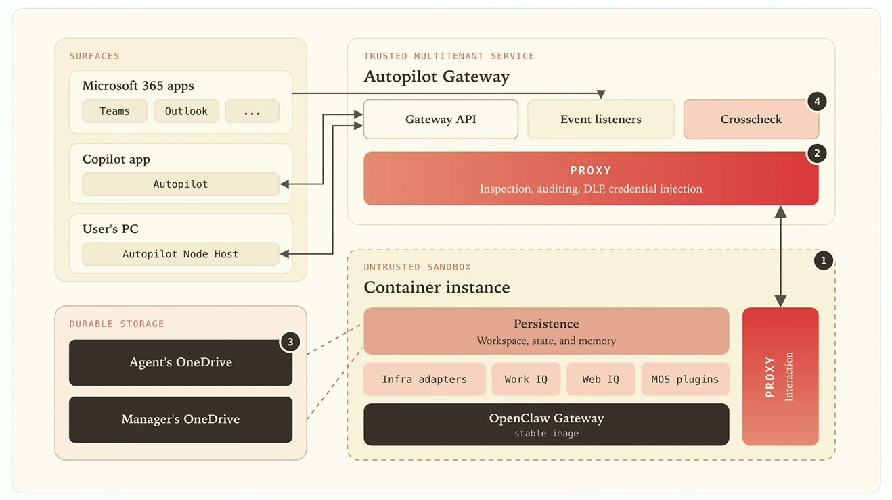

</td><td valign="top">

- **Surfaces:** Teams, Outlook and other Microsoft 365 apps, the Copilot app, and an Autopilot Node Host on the user's PC.
- **Untrusted sandbox:** the agent runs on OpenClaw in a per-user container that holds **no credentials**, with persistence (workspace, state, memory), infra adapters, Work IQ, Web IQ and Microsoft 365 plugins.
- **Trusted multitenant service (Autopilot Gateway):** gateway API, event listeners, Crosscheck, and a proxy that does inspection, auditing, DLP and credential injection. It brokers every request for your data, so "if the sandbox were ever compromised, there's no key in it to steal".
- It acts with an **Agent 365 identity**, scoped permissions and IT policy guardrails. What it creates and remembers is stored in **OneDrive** in your tenant (the agent's and the manager's).
- The trust model: isolate the runtime, mediate every capability, enforce identity and policy, and keep a human in control for sensitive actions.

**Microsoft Learn:**
- [Agent 365 identity](https://learn.microsoft.com/microsoft-agent-365/developer/identity)

</td></tr></table>

## 12. Microsoft provides the foundation. You set the controls ▶ 21:15

<table><tr><td width="50%" valign="top">

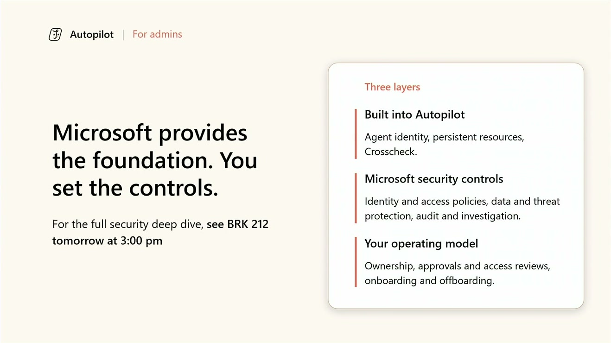

</td><td valign="top">

- Three layers of security:
  - **Built into Autopilot:** agent identity, persistent resources, Crosscheck.
  - **Microsoft security controls:** Entra, Purview and Defender, configured for the Autopilot as for human users.
  - **Your operating model:** who owns each Autopilot, who approves access, what happens when someone leaves.
- The full security deep dive is **BRK212** (Trusting autonomous AI).

**Microsoft Learn:**
- [Configure Autopilot (Frontier) for your organization](https://learn.microsoft.com/copilot/autopilot/admin-configure)

</td></tr></table>

## 13. We're building and shipping fast ▶ 22:43

<table><tr><td width="50%" valign="top">

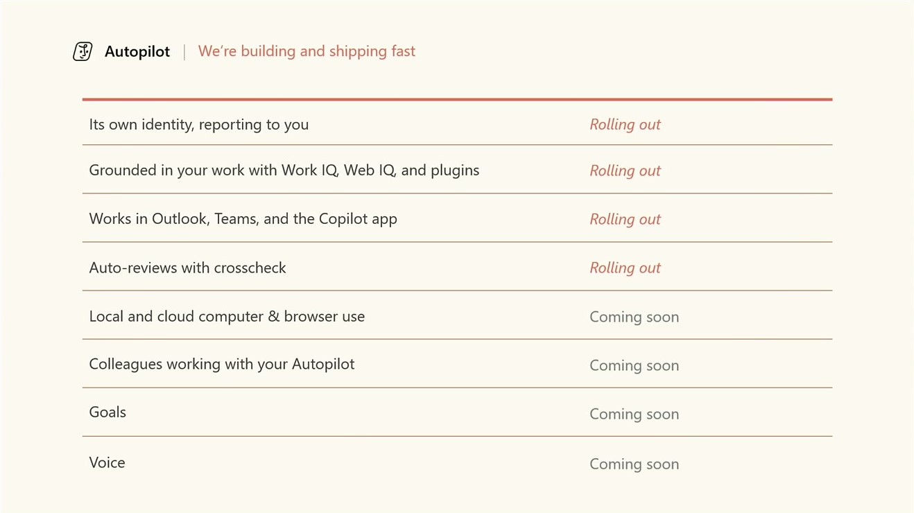

</td><td valign="top">

- **Rolling out now (Frontier):** its own identity reporting to you; grounded in your work with Work IQ, Web IQ and plugins (the Cowork and Microsoft Office catalog plugins); works in Outlook, Teams and the Copilot app; auto-reviews with Crosscheck.
- **Coming soon:**
  - **Local and cloud computer and browser use:** browser use rolled out to internal Autopilots this week; "local" lets Autopilot use compute on your own PC.
  - **Colleagues working with your Autopilot** (in private preview).
  - **Goals:** long-running intent tracked over days, weeks or months, as in the demo.
  - **Voice.**
- The aim: an Autopilot can do anything a human can do with its hands across Microsoft 365.

**Microsoft Learn:**
- [Autopilot (Frontier) overview](https://learn.microsoft.com/copilot/autopilot/overview)

</td></tr></table>

## 14. Try it in Frontier ▶ 25:32

<table><tr><td width="50%" valign="top">

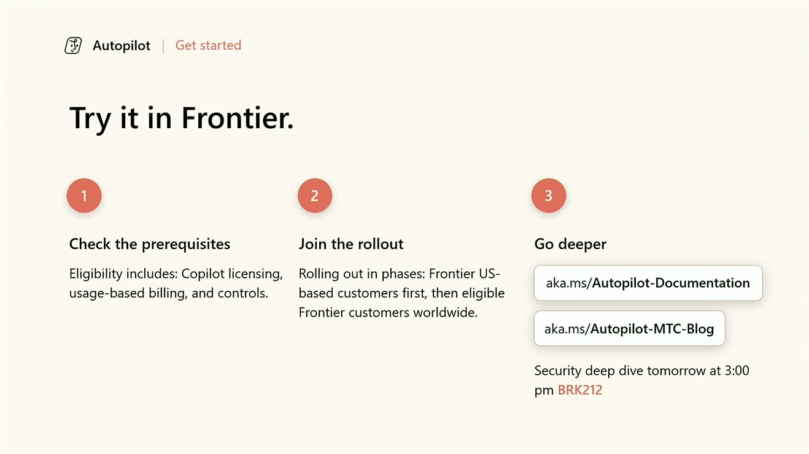

</td><td valign="top">

1. **Check the prerequisites:** Copilot licensing, usage-based billing and controls.
2. **Join the rollout:** in phases, Frontier US-based customers first, then eligible Frontier customers worldwide.
3. **Go deeper:** aka.ms/Autopilot-Documentation, aka.ms/Autopilot-MTC-Blog, and BRK212.
- Experiment before rolling it out broadly; internal communities sharing best practices worked well at Microsoft.

**Microsoft Learn:**
- [Get started with Autopilot (Frontier)](https://learn.microsoft.com/copilot/autopilot/get-started)
- [Autopilot (Frontier) requirements](https://learn.microsoft.com/copilot/autopilot/requirements)
- [Configure Autopilot (Frontier) for your organization](https://learn.microsoft.com/copilot/autopilot/admin-configure)

</td></tr></table>

## 15. Hand off the follow-through. Keep the judgement (Q&A) ▶ 26:23

<table><tr><td width="50%" valign="top">

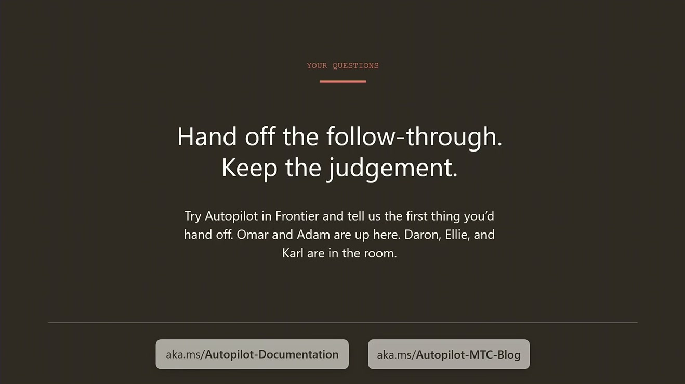

</td><td valign="top">

- **How many Autopilots?** One per employee for now, because the product is shaped as a personal assistant; not a hard design limit.
- **From Scout to Autopilot:** Scout (formerly "Clawpilot") was an internal desktop agent harness that grew to about 50,000 weekly users with high retention. Autopilot takes those learnings into a 24/7 cloud agent with multiplayer features; everything people used Scout for should become part of Autopilot.
- **Whose identity books my travel?** In a one-on-one conversation it can use your identity; working autonomously or with others it acts only as itself. The browser in the demo is your signed-in Edge; the coming computer use runs on a managed Windows device with its own identity, under Intune and company policy.
- **Trust:** builds gradually, like onboarding a colleague. Entra, Purview, Conditional Access and information protection apply, plus Crosscheck. Owners can limit who talks to it and tell it to stop engaging in a chat.
- **Mailbox and OneDrive costs:** rolled into consumption-based billing; no separate Microsoft 365 license fee.
- **Observability and cost:** built in through Agent 365, down to every tool call and conversation, with per-Autopilot cost reporting (more in BRK212).
- **Teaching preferences:** just talk to it and give real-time feedback. Others can't override its rules; today you must be in the chat or channel with your Autopilot, except for scheduling requests.
- **Onboarding:** it starts from Work IQ (the "substrate") and its first turn asks you to confirm what it knows about your projects and people.
- **Autopilots talking to each other:** possible, but multiplayer isn't rolling out yet because the conversations can go on and on.
- **Cowork vs Autopilot:** Cowork is a tool you go to for a specific output; Autopilot is an always-on digital employee others work with, and it will use Cowork as a tool too.
- **Custom MCP servers:** yes, through plugins.

**Microsoft Learn:**
- [Autopilot (Frontier) FAQ](https://learn.microsoft.com/copilot/autopilot/faq)
- [Use Autopilot (Frontier)](https://learn.microsoft.com/copilot/autopilot/using)

</td></tr></table>
