# BRK267: What's new in Copilot Studio

**Session:** Microsoft Ignite 2026, BRK267 · 47:14
**Speakers:** Jason Moore (VP of Product, Copilot Studio) and Alice (Copilot Studio team, demos)

Timestamps refer to the session video (mm:ss). The slides were taken from the video, with one image per slide. Screens from the live demos aren't included as slides, but the notes describe what the demos showed. Where a matching page exists, each section ends with links to Microsoft Learn.

---

## TL;DR

- **The pitch:** Copilot Studio is the place for **business process innovation**, sitting between Copilot/Cowork (employee productivity) and GitHub Copilot (products and services). It builds **agents, workflows and apps** together.
- **Rebuilt from the ground up:** the new Copilot Studio shipped in August 2026. Jason says it was "entirely built by agents" and that "nothing has ever been touched by hand".
- **Maker experience:** a simpler agent designer (GA), workflows with agent nodes (GA), apps on Copilot Managed Runtime (preview), and building from a description in Copilot Studio, Cowork, GitHub Copilot, Claude Code or Codex (preview).
- **Agent capabilities:** the **Microsoft Copilot harness** is now the default (GA). Microsoft reports big quality gains and **45% fewer input tokens** than the standard harness, with the same model. There's also a **Customer Conversation harness** for voice and chat support. New too: skills published to the plugin registry (preview), memory (GA), **Auto** model selection (preview), MCP Apps (GA) and richer chat (GA).
- **Governance and FinOps:** evaluations with graders (GA), a Monitor tab (preview), **FinOps for agents** with budgets and limits (GA), admin welcome content with terms audited in Purview (GA), and greyed-out blocked capabilities with a help link (preview).
- **Demo:** a financial insights agent built from one prompt in Cowork, using the Morningstar MCP, a skill, an approval workflow and company knowledge. A full analysis run cost "about a dollar".

---

## 1. What's new in Copilot Studio? ▶ 00:00

<table><tr><td width="50%" valign="top">

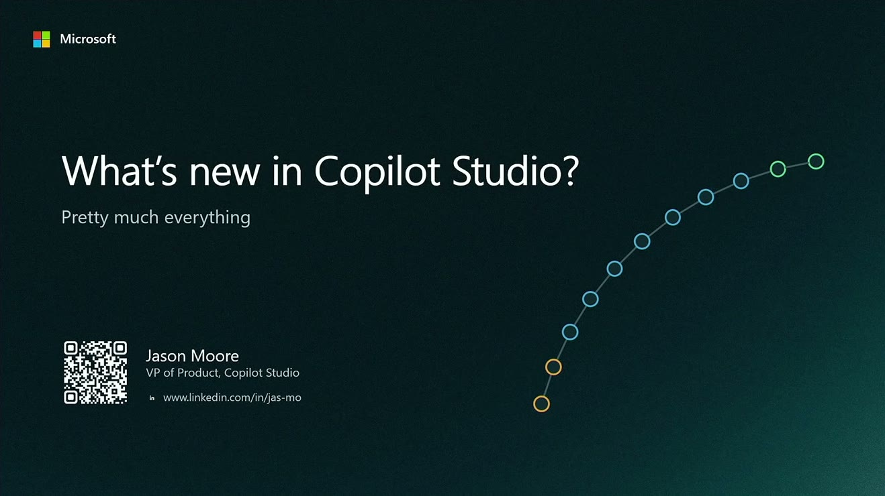

</td><td valign="top">

- Jason Moore, VP of Product for Copilot Studio, presents the session. Alice from the product team runs the demos.
- The session covers changes to the product and the industry, and where agents, workflows and apps are heading.

</td></tr></table>

## 2. The last year ▶ 01:20

<table><tr><td width="50%" valign="top">

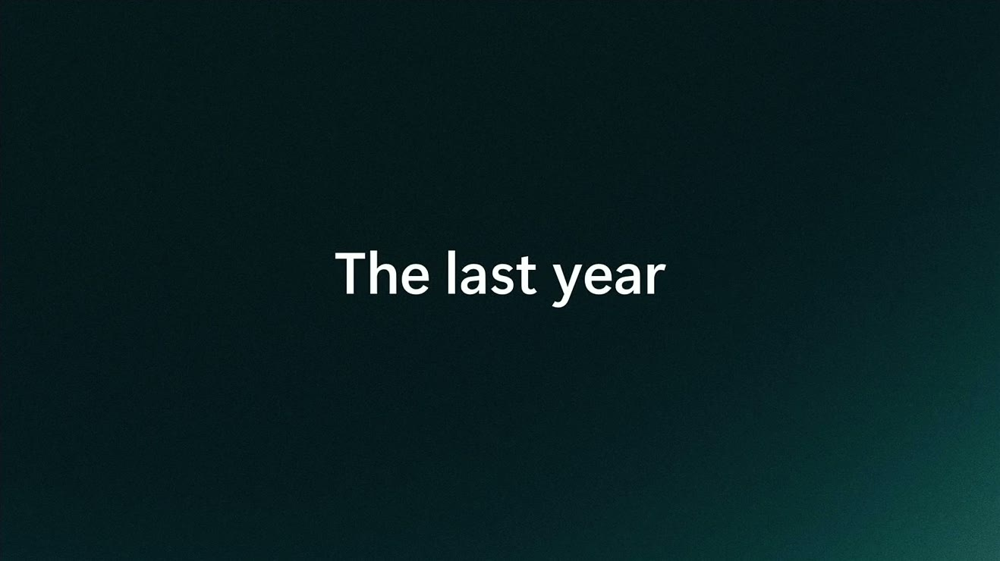

</td><td valign="top">

- In August 2026, Microsoft shipped a new version of Copilot Studio, "rebuilt from the ground up".
- Jason explains the reasons with two images.

</td></tr></table>

## 3. Building by hand ▶ 01:46

<table><tr><td width="50%" valign="top">

</td><td valign="top">

- A year ago, building agents was like hand craftsmanship: lots of custom knowledge and effort for every agent.
- A year ago a new frontier LLM shipped about every 17 days. Now it's about every six days, and five major models shipped in the past week.
- Older models (the GPT-3.5 and GPT-4o era) needed constant **steering**. The old Copilot Studio, now called the **standard harness**, was built around that, with a lot of code to keep the model on track.

</td></tr></table>

## 4. The software factory ▶ 04:31

<table><tr><td width="50%" valign="top">

</td><td valign="top">

- Newer models can pursue a goal for a long time: reason, handle failing tools, and work out solutions.
- The old Copilot Studio was built by hand. The new one "is entirely built by agents": humans build agents that build agents that build Copilot Studio. "Nothing that's ever been touched by hand."
- That's how the team rebuilt the product so quickly.

</td></tr></table>

## 5. What problem are you trying to solve? ▶ 06:04

<table><tr><td width="50%" valign="top">

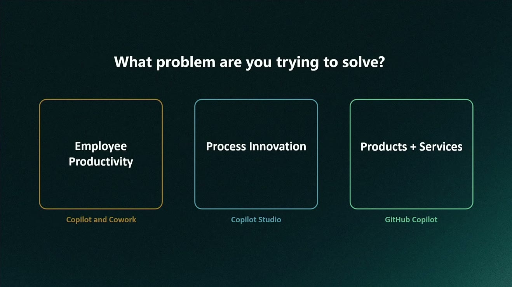

</td><td valign="top">

Where Copilot Studio fits:
- **Employee productivity:** Copilot and Cowork (writing emails, skills that animate a deck).
- **Products and services:** GitHub Copilot, for building apps and services from the ground up.
- **Process innovation:** Copilot Studio, for business process automation and how your organization runs at scale.

</td></tr></table>

## 6. What's new: three pillars ▶ 07:25

<table><tr><td width="50%" valign="top">

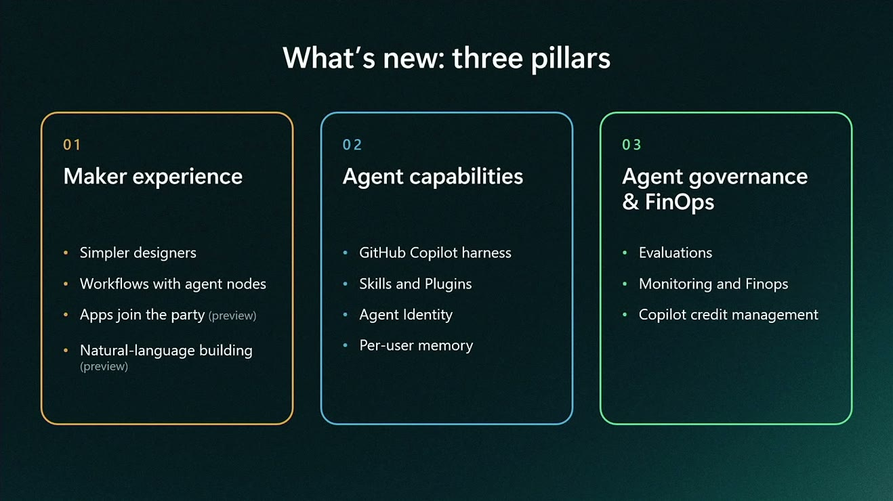

</td><td valign="top">

1. **Maker experience:** simpler designers, workflows with agent nodes, apps (preview), building in natural language (preview).
2. **Agent capabilities:** the Copilot harness (the slide says "GitHub Copilot harness"), skills and plugins, agent identity, per-user memory.
3. **Agent governance and FinOps:** evaluations, monitoring and FinOps, Copilot credit management.

Jason sees makers as "a bigger audience than we've ever had before" for low-code and no-code at Microsoft.

</td></tr></table>

## 7. Maker experience ▶ 08:23

<table><tr><td width="50%" valign="top">

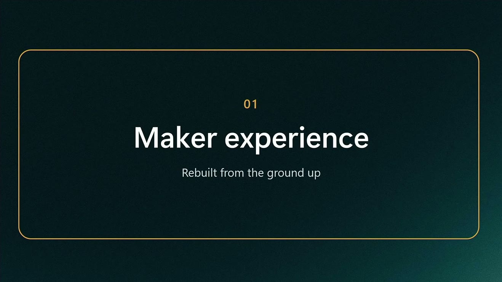

</td><td valign="top">

Section divider: the maker experience, "rebuilt from the ground up".

</td></tr></table>

## 8. A simpler agent designer (GA) ▶ 08:27

<table><tr><td width="50%" valign="top">

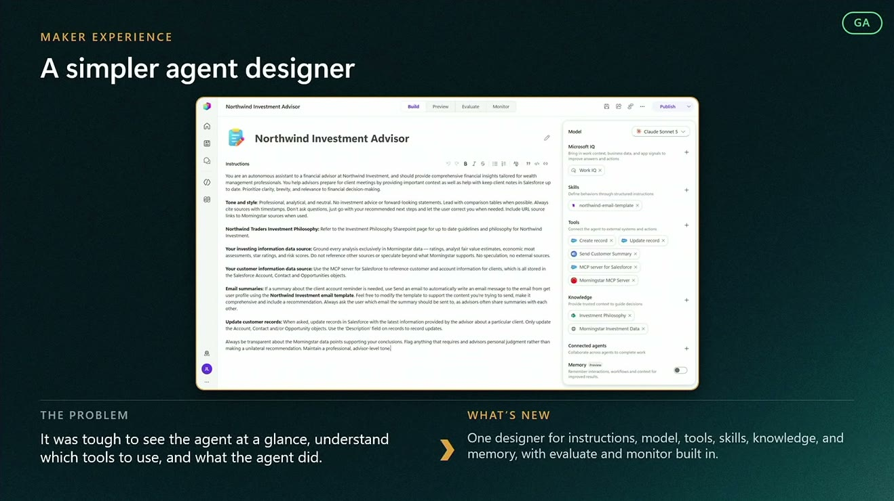

</td><td valign="top">

- **Problem:** it was hard to see the agent at a glance, understand which tools to use, and see what the agent did.
- **New:** one designer for instructions, model, tools, skills, knowledge and memory, with evaluate and monitor built in.
- The team stripped away whatever it could leave to the model's intelligence, so the designer is much simpler.

**Microsoft Learn:**
- [About agents powered by the Microsoft Copilot harness](https://learn.microsoft.com/microsoft-copilot-studio/agents-experience/overview)
- [Create a new agent (Microsoft Copilot)](https://learn.microsoft.com/microsoft-copilot-studio/agents-experience/build-new-agent)

</td></tr></table>

## 9. Workflows with agent smarts (GA) ▶ 09:14

<table><tr><td width="50%" valign="top">

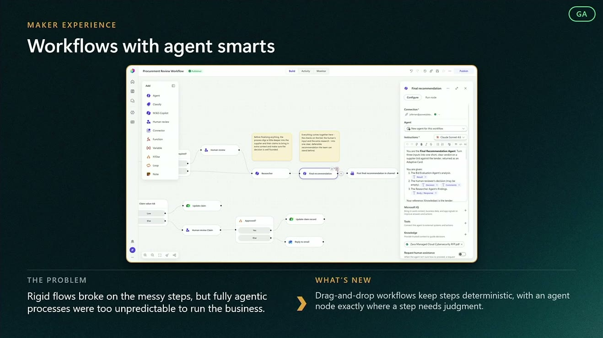

</td><td valign="top">

- **Problem:** rigid flows broke on the messy steps, but fully agentic processes were too unpredictable to run the business.
- **New:** drag-and-drop workflows keep steps deterministic, with an **agent node** exactly where a step needs judgment.
- Jason's favorite feature: "it's just faster."

**Microsoft Learn:**
- [Copilot Studio overview: what you can build (agents, workflows, agent flows)](https://learn.microsoft.com/microsoft-copilot-studio/fundamentals-what-is-copilot-studio#what-you-can-build)
- [Add an agent node to a workflow](https://learn.microsoft.com/microsoft-copilot-studio/workflows-experience/agent-node-workflow)

</td></tr></table>

## 10. Apps, right alongside agents and workflows (preview) ▶ 10:07

<table><tr><td width="50%" valign="top">

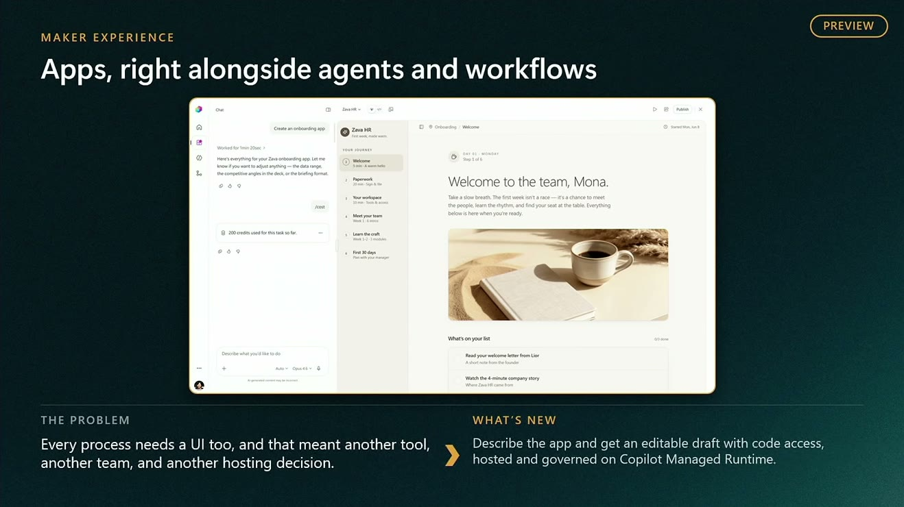

</td><td valign="top">

- **Problem:** every process also needs a UI, which meant another tool, another team and another hosting decision.
- **New:** describe the app and get an editable draft with code access, hosted and governed on **Copilot Managed Runtime**.
- The roles: agents reason, workflows run deterministic steps efficiently, and apps present information and control to end users.

**Microsoft Learn:**
- [Quickstart: Create an app with natural language in Copilot Studio](https://learn.microsoft.com/microsoft-copilot-studio/apps-experience/get-started)
- [What is Copilot Managed Runtime?](https://learn.microsoft.com/microsoft-365/copilot-managed-runtime/overview)

</td></tr></table>

## 11. Describe it. Copilot Studio builds it. (preview) ▶ 10:59

<table><tr><td width="50%" valign="top">

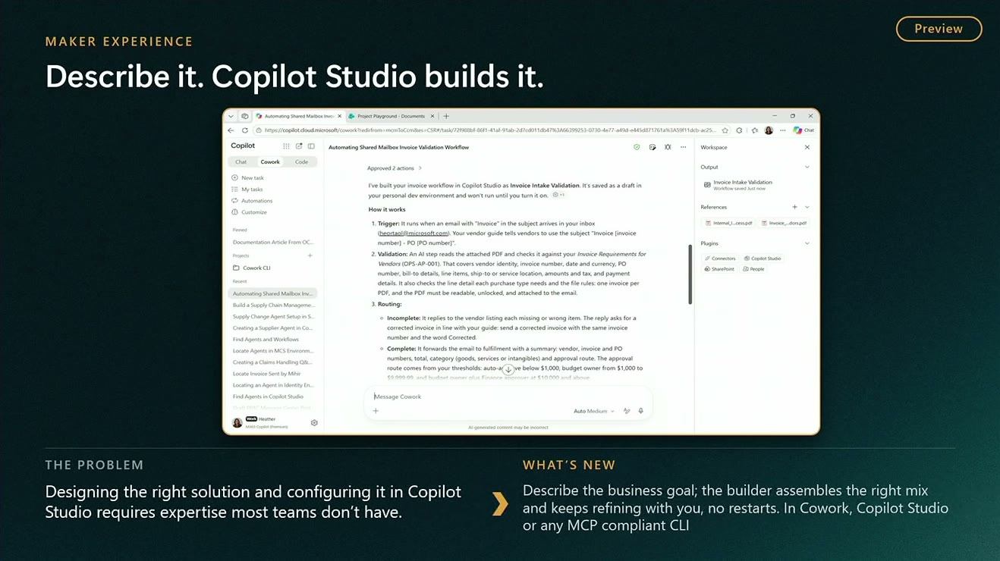

</td><td valign="top">

- **Problem:** designing the right solution and configuring it in Copilot Studio takes expertise most teams don't have.
- **New:** describe the business goal, and the builder assembles the right mix of agents and workflows and keeps refining it with you. It works in Copilot Studio, in Cowork, and in any MCP-compatible CLI (GitHub Copilot, Claude Code, Codex).
- "I actually don't want more experts in what things should be a workflow and what things should be an agent."

**Microsoft Learn:**
- [Quickstart: Create an automated solution with natural language (preview)](https://learn.microsoft.com/microsoft-copilot-studio/create-automation-natural-language)
- [Create and manage Copilot Studio artifacts with Copilot Cowork (Frontier)](https://learn.microsoft.com/copilot/cowork/cowork-create-manage-artifacts)

</td></tr></table>

## 12. Agent capabilities (demo: build in Cowork) ▶ 12:06

<table><tr><td width="50%" valign="top">

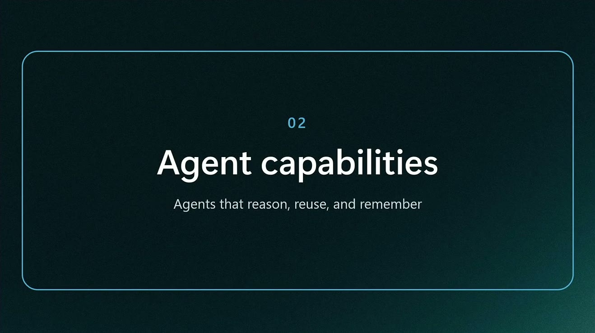

</td><td valign="top">

**Demo (Alice):** a financial advisor asks **Cowork** to build a "financial insights agent". Cowork brings in the Copilot Studio plugin and builds the agent, which has:
- autonomous agent instructions, with market data only from the **Morningstar MCP server**, never from random web results
- an existing **email template skill**, so client emails are on brand
- **workflows**, including an approval step before any email goes to a client ("deterministic, it's fast, and it's cheaper, and it's more reliable"), and one that gets client holdings from the CRM
- company **knowledge**: the investment philosophy document

The new workflow designer can switch between top-to-bottom and left-to-right with one click. It also supports complex workflows with model and agent nodes, such as classifying emails from a shared mailbox.

</td></tr></table>

## 13. The Microsoft Copilot harness (GA) ▶ 19:16

<table><tr><td width="50%" valign="top">

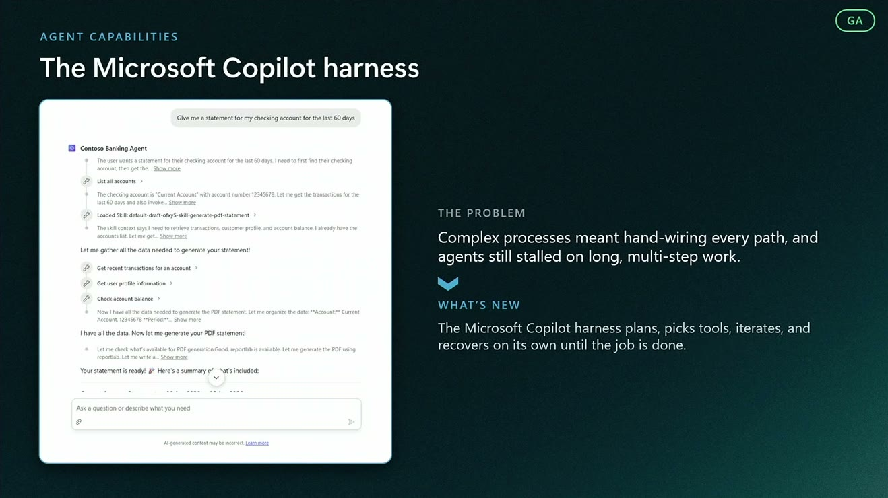

</td><td valign="top">

- **Problem:** complex processes meant hand-wiring every path, and agents still stalled on long, multi-step work.
- **New:** the Microsoft Copilot harness plans, picks tools, iterates and recovers on its own until the job is done.
- It's the same harness Foundry, Cowork and other Microsoft products use. It gives models room to pursue goals while staying governed by your organization's policies.

**Microsoft Learn:**
- [Harnesses in Copilot Studio](https://learn.microsoft.com/microsoft-copilot-studio/harnesses-overview)
- [FAQ for agents powered by the Microsoft Copilot harness](https://learn.microsoft.com/microsoft-copilot-studio/agents-experience/faqs-copilot-harness)

</td></tr></table>

## 14. Quality improvements in Copilot Studio ▶ 20:15

<table><tr><td width="50%" valign="top">

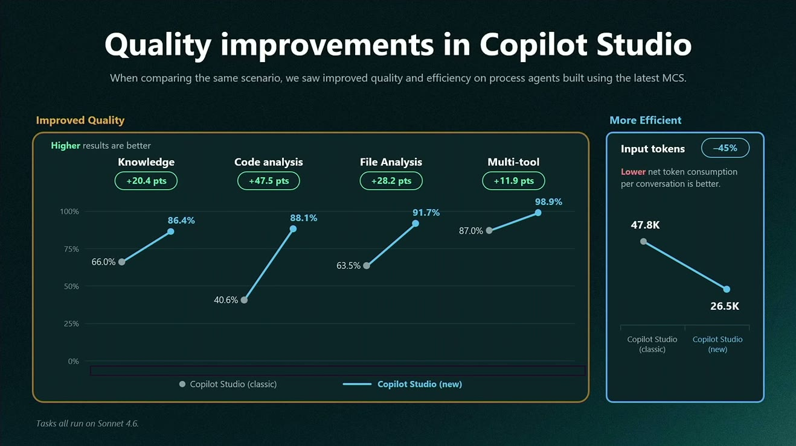

</td><td valign="top">

- The setup: the same model (Sonnet 4.6) and the same tens of thousands of evaluation tasks, run on the standard harness and on the Copilot harness.
- **Quality**, standard harness vs Copilot harness:
  - knowledge: 66.0% → 86.4% (+20.4 pts)
  - code analysis: 40.6% → 88.1% (+47.5)
  - file analysis: 63.5% → 91.7% (+28.2)
  - multi-tool: 87.0% → 98.9% (+11.9)
- **Input tokens:** 47.8K → 26.5K per conversation (−45%). Jason says input tokens drive most AI cost: "nearly half the price".
- He also says the data is already old and the gap has grown since, so they've made the tests harder.

</td></tr></table>

## 15. The harness landscape (GA) ▶ 23:07

<table><tr><td width="50%" valign="top">

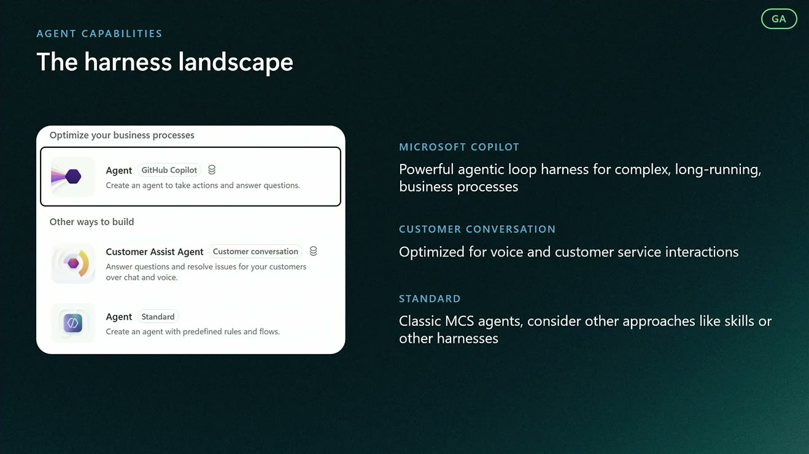

</td><td valign="top">

- **Microsoft Copilot harness** (the default): a powerful agentic loop for complex, long-running business processes.
- **Customer Conversation harness** (released in October): optimized for customer service over web chat and voice.
- **Standard harness:** classic Copilot Studio agents keep working and still get updates.
- The Copilot Studio MCP server can also **migrate** agents. It reasons over what you built and suggests a better design, for example turning part of an agent into two efficient workflows.

**Microsoft Learn:**
- [Harnesses in Copilot Studio: compare harnesses](https://learn.microsoft.com/microsoft-copilot-studio/harnesses-overview#compare-harnesses)
- [Agents powered by the Customer Conversation harness](https://learn.microsoft.com/microsoft-copilot-studio/agents-experience/overview-customer-conversation)
- [Upgrade agents to the Microsoft Copilot harness](https://learn.microsoft.com/microsoft-copilot-studio/upgrade-to-microsoft-copilot-from-standard-harness)

</td></tr></table>

## 16. Skills: create, reuse, share and govern centrally (preview) ▶ 25:12

<table><tr><td width="50%" valign="top">

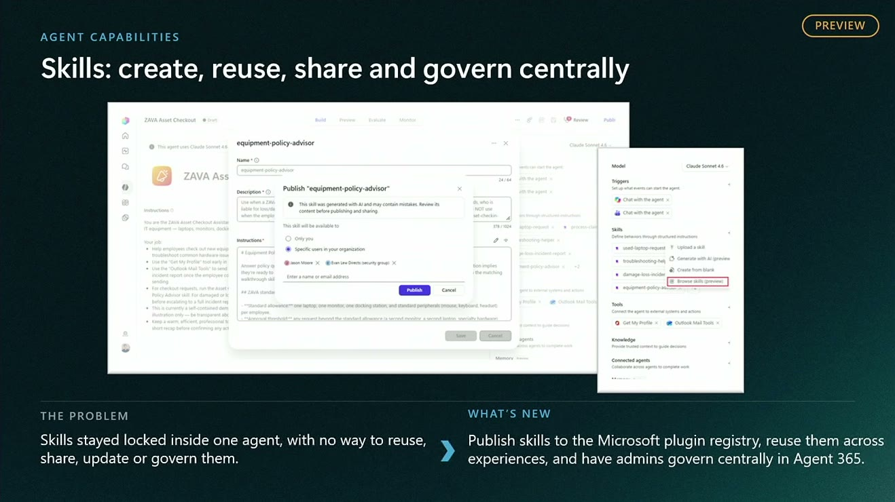

</td><td valign="top">

- **Problem:** skills stayed locked inside one agent, with no way to reuse, share, update or govern them.
- **New:** publish skills to the **Microsoft plugin registry**, reuse them across Copilot, Cowork and agents, and let admins govern them centrally in **Agent 365**.

**Microsoft Learn:**
- [Skills overview for agents](https://learn.microsoft.com/microsoft-copilot-studio/agents-experience/skills-overview)
- [Publish your plugin or agent to your organization](https://learn.microsoft.com/plugins/publish-plugin-organization)
- [Manage plugins, skills and MCP servers (Agent 365)](https://learn.microsoft.com/microsoft-agent-365/admin/manage-plugins-skills-mcp-servers)

</td></tr></table>

## 17. Agents that remember (GA) ▶ 26:34

<table><tr><td width="50%" valign="top">

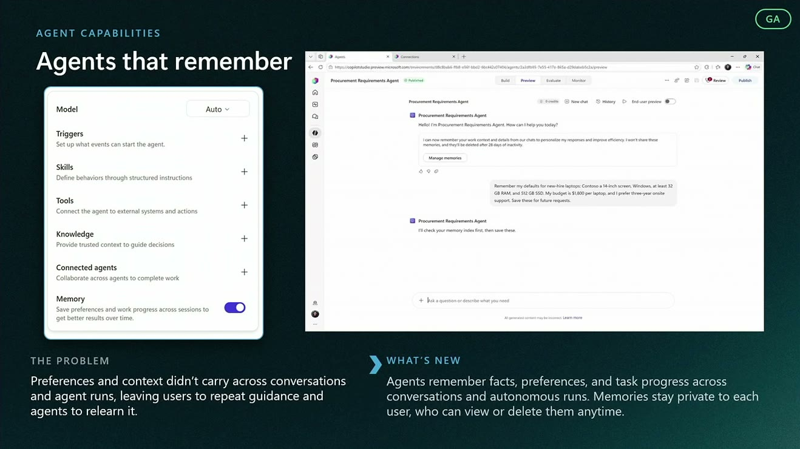

</td><td valign="top">

- **Problem:** preferences and context didn't carry across conversations and agent runs.
- **New:** agents remember facts, preferences and task progress across conversations and autonomous runs. Memories are private to each user, who can view or delete them.
- Memory also lets an agent learn which tool paths work best, so "the agent over time with memory gets faster, smarter, and cheaper to run."

**Microsoft Learn:**
- [Memory overview for agents](https://learn.microsoft.com/microsoft-copilot-studio/agents-experience/memory-overview)

</td></tr></table>

## 18. Models, Models, and more Models (preview) ▶ 28:25

<table><tr><td width="50%" valign="top">

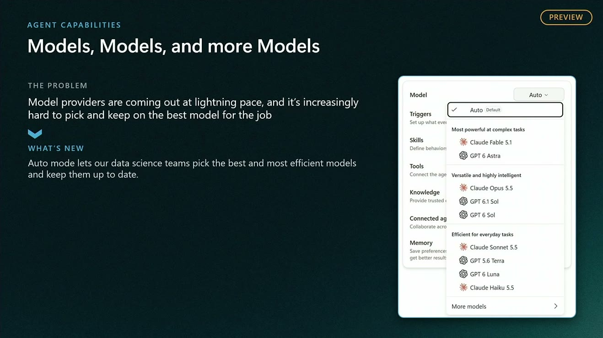

</td><td valign="top">

- **Problem:** models come out so fast that it's hard to pick the best one and keep it current. Models are also retired sooner than people think.
- **New:** **Auto** picks the cheapest model that is smart enough for the task, within your compliance rules, and keeps it up to date.
- The picker on the slide shows Claude Fable 5.1, GPT 6 Astra, Claude Opus 5.5, GPT 6.1 Sol, Claude Sonnet 5.5, GPT 5.6 Terra, GPT 6 Luna and Claude Haiku 5.5.

**Microsoft Learn:**
- [Select a model for an agent](https://learn.microsoft.com/microsoft-copilot-studio/agents-experience/authoring-select-agent-model)
- [Available models](https://learn.microsoft.com/microsoft-copilot-studio/agents-experience/authoring-agent-model-availability)

</td></tr></table>

## 19. Answers in real UI (GA) ▶ 30:10

<table><tr><td width="50%" valign="top">

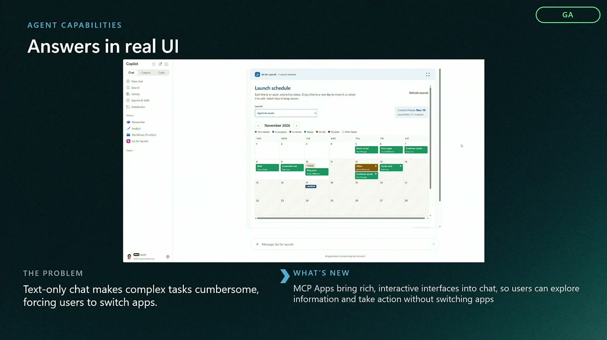

</td><td valign="top">

- "Yes, chat will be around forever", but chat doesn't have to be text only.
- **New:** **MCP Apps** bring interactive interfaces into chat, such as a calendar picker or a chart, so users don't have to switch apps.

**Microsoft Learn:**
- [Use MCP apps in Copilot Studio](https://learn.microsoft.com/microsoft-copilot-studio/agents-experience/mcp-apps)

</td></tr></table>

## 20. Agent chat experiences (GA, demo: test the agent) ▶ 31:11

<table><tr><td width="50%" valign="top">

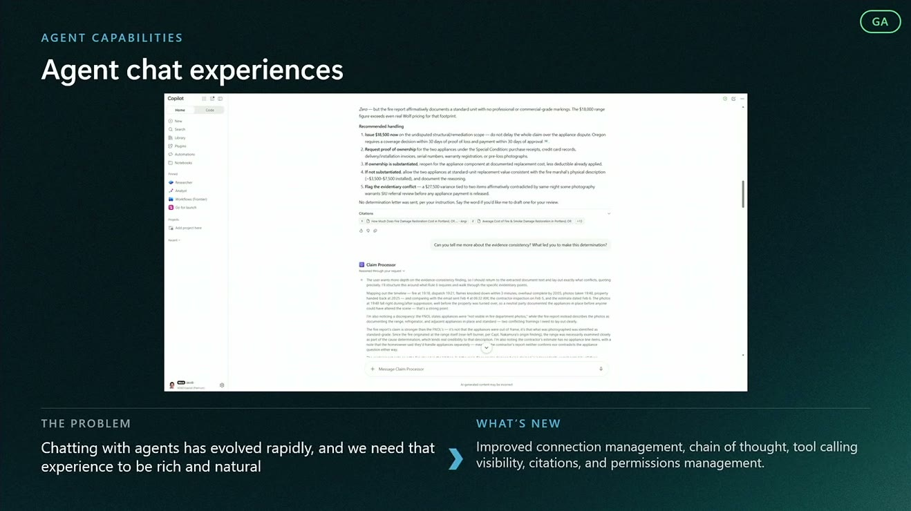

</td><td valign="top">

- **New:** better connection management, chain of thought, tool-calling visibility, citations and permissions management in chat.

**Demo (Alice):** Alice tests the financial insights agent with the model set to Auto. She asks for Microsoft's position in Jason's portfolio:
- The agent uses the Morningstar MCP and looks at Microsoft inside index funds as well as the direct holding.
- The result is a branded email with bull and bear cases and recommendations.
- Unprompted, it flagged that **Nvidia exposure was above the firm's 10% single-stock limit**.
- The run cost "about a dollar", for analysis that would normally take hours or days.

</td></tr></table>

## 21. Agent governance & FinOps ▶ 35:57

<table><tr><td width="50%" valign="top">

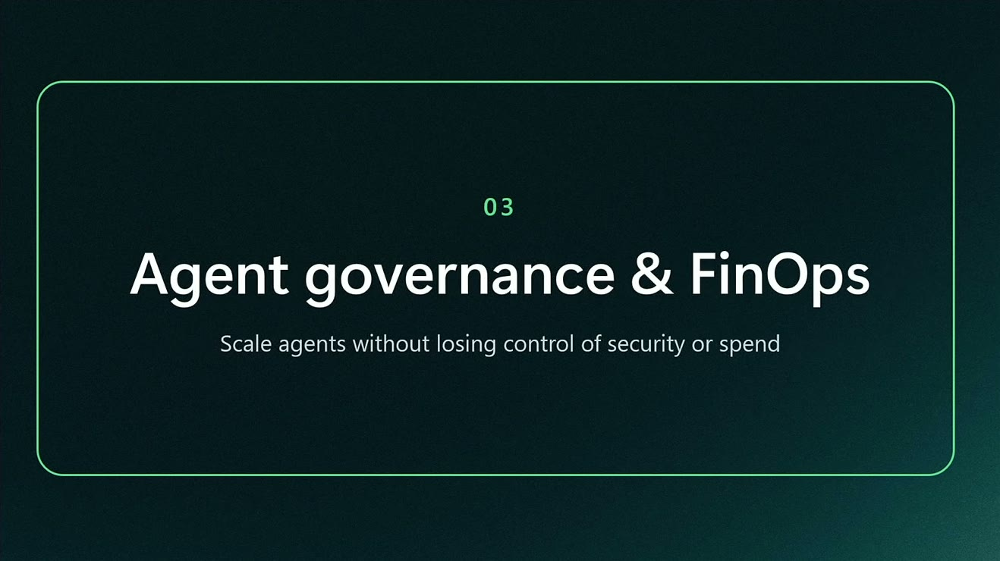

</td><td valign="top">

- Microsoft first thought it would have as many agents as apps, then as many agents as employees (about 250,000). Today it runs "well over a million agents" every day.
- So "governance starts in Copilot Studio" and "FinOps starts in Copilot Studio". For the bigger picture, Jason points to the Agent 365 sessions.

</td></tr></table>

## 22. Evaluate before you publish (GA) ▶ 37:44

<table><tr><td width="50%" valign="top">

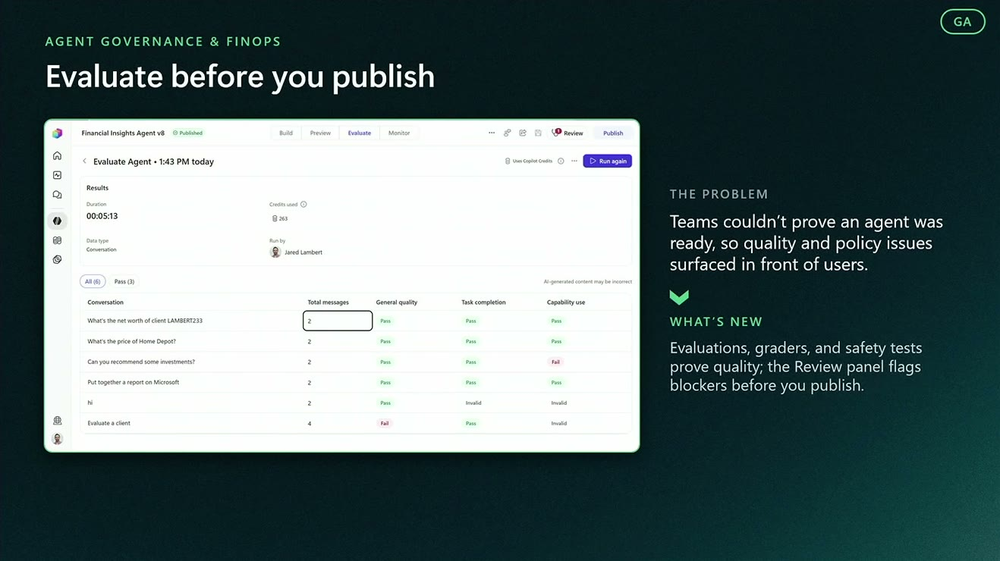

</td><td valign="top">

- "The number one thing that distinguishes a good agent from a bad agent is building evals."
- **Problem:** teams couldn't prove an agent was ready, so quality and policy issues surfaced in front of users.
- **New:** evaluations, graders and safety tests prove quality, and a Review panel flags blockers before publishing. You can also build evals through the MCP server from Cowork or GitHub Copilot.

**Microsoft Learn:**
- [Evaluate agents powered by the Microsoft Copilot harness](https://learn.microsoft.com/microsoft-copilot-studio/agents-experience/analytics-agent-evaluation-intro)

</td></tr></table>

## 23. Understand how it's used after deployment (preview) ▶ 38:35

<table><tr><td width="50%" valign="top">

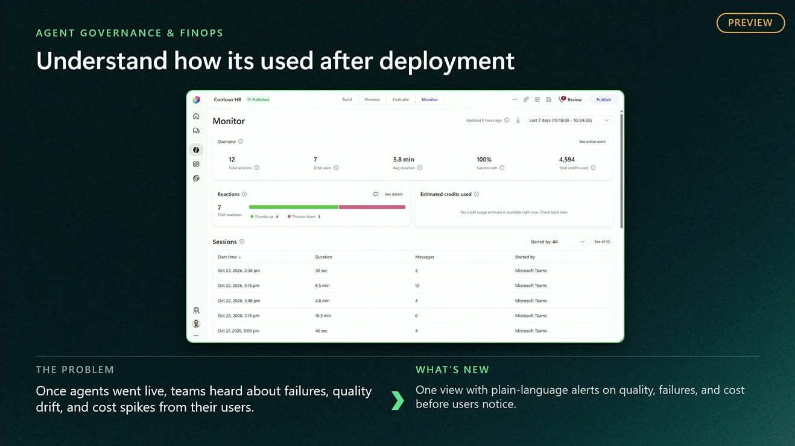

</td><td valign="top">

- Jason: "all of the hard work and hard problems before the moment you deployed are 1% of the challenges."
- **New:** a **Monitor** tab with one view of sessions, success rate, errors, credits used and user reactions (thumbs up or down), plus plain-language alerts.
- The data is also available to agents, so you can ask Cowork how your agent is doing.

**Microsoft Learn:**
- [Monitor and analyze agent performance](https://learn.microsoft.com/microsoft-copilot-studio/agents-experience/authoring-review-activity)

</td></tr></table>

## 24. FinOps for agents (GA) ▶ 39:56

<table><tr><td width="50%" valign="top">

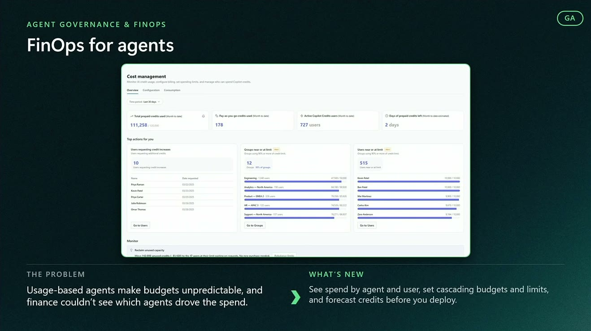

</td><td valign="top">

- **Problem:** usage-based agents make budgets unpredictable, and finance couldn't see which agents drove the spend.
- **New:** see spend by agent and user, set cascading budgets and limits, and forecast credits before you deploy.
- You can fund agents differently: some open to the whole company, others limited to specific users with their own budget.

**Microsoft Learn:**
- [Manage costs for agents powered by the Microsoft Copilot harness](https://learn.microsoft.com/power-platform/admin/manage-usage-microsoft-copilot-harness)
- [Govern Copilot Credit consumption](https://learn.microsoft.com/microsoft-copilot-studio/guidance/govern-credit-consumption)
- [Monitor Copilot Credit spending (Microsoft 365 admin center)](https://learn.microsoft.com/copilot/implement/usage-based-billing-copilot-credits-monitor-spending)

</td></tr></table>

## 25. Set expectations before makers build (GA) ▶ 41:30

<table><tr><td width="50%" valign="top">

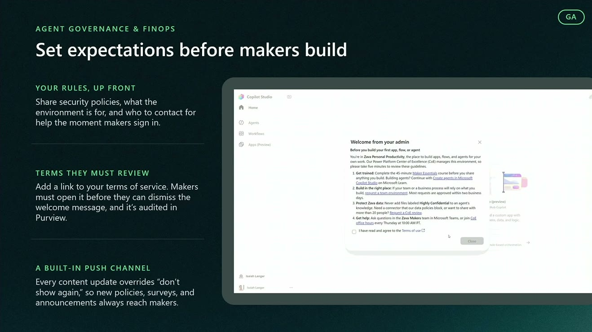

</td><td valign="top">

- **Your rules, up front:** share security policies, what the environment is for, and who to contact, as soon as makers sign in.
- **Terms they must review:** makers have to open your terms before they can dismiss the welcome message, and that's audited in **Purview**.
- **A built-in push channel:** every content update overrides "don't show again", so new policies reach makers.

**Microsoft Learn:**
- [Enable maker welcome content](https://learn.microsoft.com/power-platform/admin/welcome-content)

</td></tr></table>

## 26. Clear limits and help while makers build (preview, demo: evaluate) ▶ 42:37

<table><tr><td width="50%" valign="top">

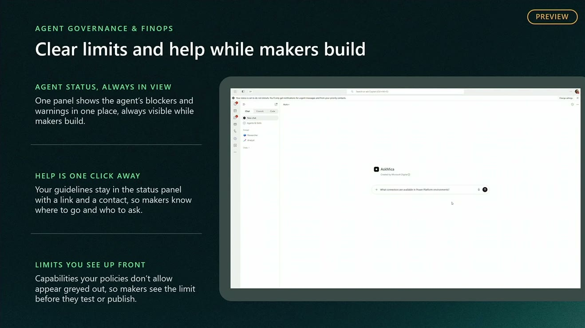

</td><td valign="top">

- **Agent status, always in view:** one panel shows blockers and warnings while makers build.
- **Help is one click away:** guidelines, a link and a contact in the status panel.
- **Limits you see up front:** capabilities your policies don't allow are greyed out before makers test or publish. Jason: it can't be "the Wild West", but it also can't be "ironclad".

**Demo (Alice):** Alice runs evaluations on the agent with general quality graders (relevance and completeness). Other test methods include task completion, tool success, content safety and custom classifiers. She compares models:
- Astra: about $2 per run
- Sol: about $0.50
- Terra: about $0.40

Pass rates were similar, so she says to check whether the graders are strict enough before picking the cheapest model.

**Microsoft Learn:**
- [Review agent readiness and status (blocked tools, models and skills)](https://learn.microsoft.com/microsoft-copilot-studio/agents-experience/authoring-agent-status)
- [Configure data policies for agents](https://learn.microsoft.com/microsoft-copilot-studio/admin-data-loss-prevention)

</td></tr></table>
