# BRK293: Build your IQ using your unique enterprise context with Microsoft IQ

**Session:** Microsoft Ignite 2026, BRK293 · 45:28
**Speakers:** Dipti Borkar (Vice President, Microsoft IQ & OneLake, Microsoft), Josh Caplan (Partner Director Product, Microsoft IQ & OneLake, Microsoft), Jeremy Kolpak (Managing Director, US Microsoft Solutions Lead, EY), Marc Kinast (Senior Vice President, Corporate Development, Celonis)

Timestamps refer to the session video (mm:ss). Notes are based on the official English captions. The slides were taken from the video, with one image per slide. Screens from the two live demos and the Celonis video aren't included as slides, but the notes describe what they showed. Where a matching page exists, a section ends with links to Microsoft Learn.

---

## TL;DR

- **Context is your IP:** every company can use the same models and agents, but only you have your context. Skills work for single tasks, but for multi-step processes agents pick different skills, files and policies on every run, which leads to inconsistent answers, token bloat, duplicated retrieval and weak governance.
- **Microsoft IQ as enterprise context management:** a layer that curates, maintains, governs and distributes context from Work IQ, Fabric IQ, Foundry IQ, Web IQ and third-party IQs to any agent: Copilot, ChatGPT, Claude, Gemini or your own.
- **Business plugins (announced):** playbooks built by business experts (not admins) at iq.microsoft.com, by hand or with Copilot, that say which source to use when. One prompt searches every plugin active for you and returns a small ranked, cited list, so the agent doesn't scan the whole tenant.
- **Governance:** nested sections with inheritance (add people once, update once and it flows down), curators and read-only members, promoted and certified plugins (certified ones are injected automatically, without accepting), and Purview sensitivity labels.
- **Open and portable:** the same plugins reach GitHub Copilot through the Work IQ MCP server, plus 350+ third-party Copilot plugins and Fabric IQ sharing with partners. EY plans to codify knowledge for 400,000 people; Celonis launched **Process IQ** in Fabric, which publishes a process as a business plugin that Copilot Studio agents follow.
- **Demos:** a Customer Support plugin answers a P1 incident question from its playbook, and a Legal and Compliance plugin with a Contracts section says who has signature authority for a $500K contract and cites the policy.

---

## 1. Build your IQ using your unique enterprise context with Microsoft IQ ▶ 00:00

<table><tr><td width="50%" valign="top">

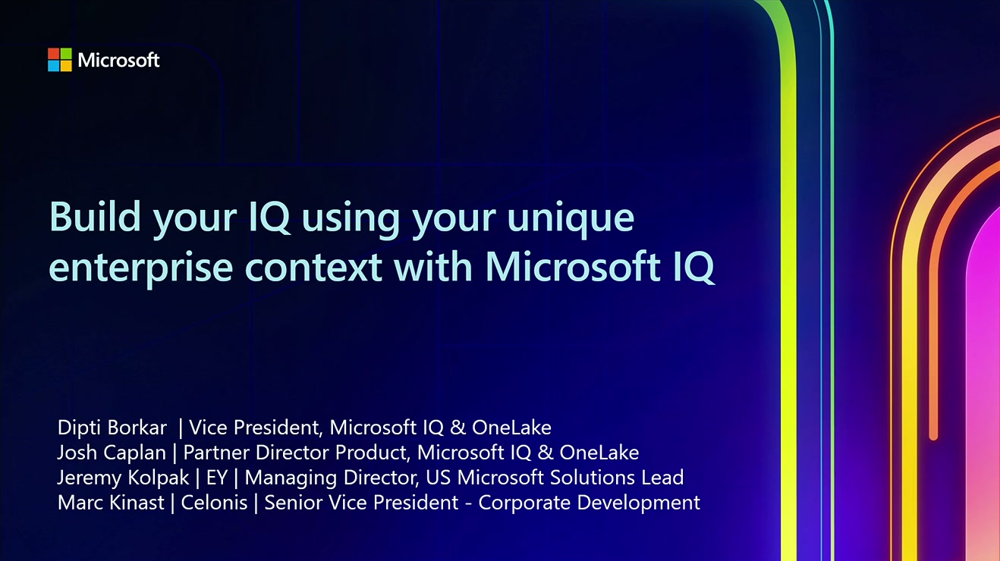

</td><td valign="top">

- Dipti Borkar (VP, Microsoft IQ & OneLake) opens the session on building your organization's context with Microsoft IQ and **business plugins**.
- Speakers on the slide: Dipti Borkar, Josh Caplan (Partner Director Product, Microsoft IQ & OneLake), Jeremy Kolpak (EY) and Marc Kinast (Celonis).

</td></tr></table>

## 2. Four acts. Two live demos. One scenario. ▶ 00:32

<table><tr><td width="50%" valign="top">

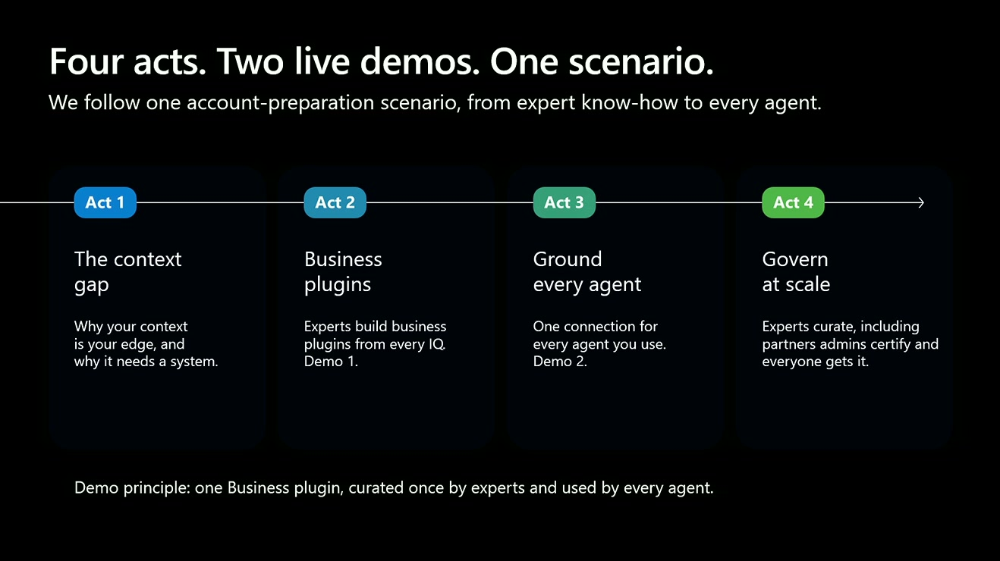

</td><td valign="top">

- One account-preparation scenario, followed from expert know-how to every agent, in four acts:
  1. **The context gap:** why your context is your edge, and why it needs a system.
  2. **Business plugins:** experts build business plugins from every IQ (demo 1).
  3. **Ground every agent:** one connection for every agent you use (demo 2).
  4. **Govern at scale:** experts curate, partners plug in, admins certify, everyone gets it.
- Demo principle: one business plugin, curated once by experts and used by every agent.

</td></tr></table>

## 3. Your IQ: context is your organization's IP ▶ 00:53

<table><tr><td width="50%" valign="top">

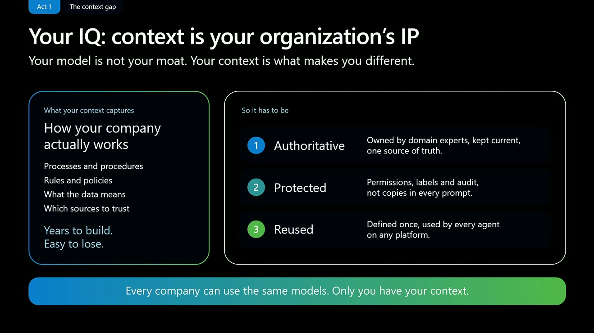

</td><td valign="top">

- "Your model is not your moat." Every company can use the same models and agents; only you have your context.
- Your context captures **how your company actually works**: processes and procedures, rules and policies, what the data means (which semantic model, which ontology, what's in OneLake), which sources to trust. Years to build, easy to lose.
- So it has to be **authoritative** (owned by domain experts, kept current, one source of truth), **protected** (permissions, labels and audit, not copies in every prompt) and **reused** (defined once, used by every agent on any platform).

</td></tr></table>

## 4. 1B+ agents by 2028 ▶ 02:03

<table><tr><td width="50%" valign="top">

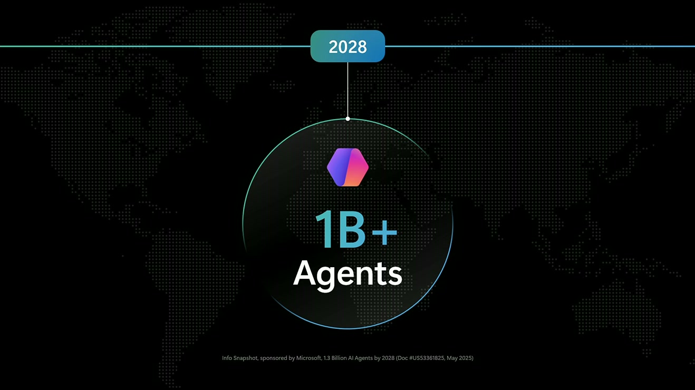

</td><td valign="top">

- By 2028 there will be more than a billion AI agents (the slide cites a Microsoft-sponsored Info Snapshot with 1.3 billion), many of them in your organization and your ecosystem.

</td></tr></table>

## 5. You empower your agents with the same knowledge and context ▶ 02:20

<table><tr><td width="50%" valign="top">

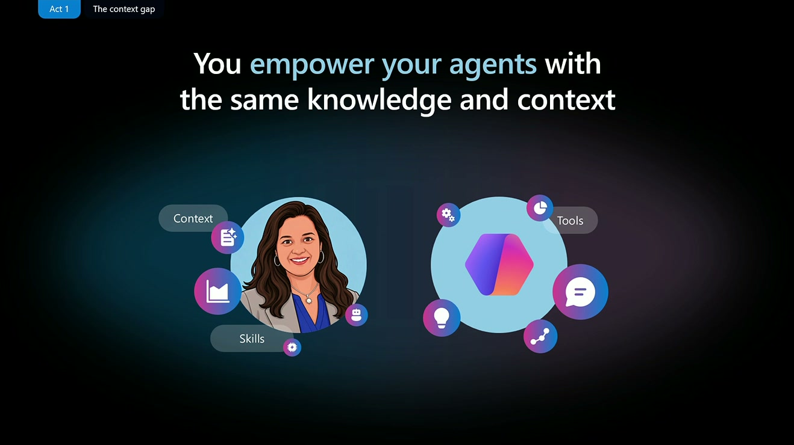

</td><td valign="top">

- How do you make agents as trusted and productive as your employees? Give them the same context, skills and tools, in the right form.

</td></tr></table>

## 6. Your agents need the right context, not just more context ▶ 02:40

<table><tr><td width="50%" valign="top">

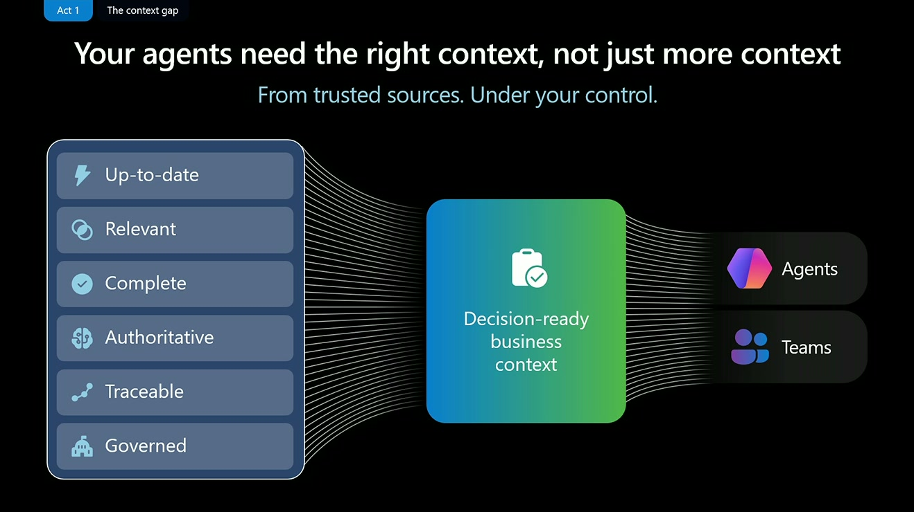

</td><td valign="top">

- Not more data, metadata and context, but context that is **up-to-date, relevant, complete, authoritative, traceable and governed**, from trusted sources under your control.
- That's what goes into the "decision-ready business context" box that both teams and agents use.

</td></tr></table>

## 7. How do we provide context to agents today? ▶ 03:11

<table><tr><td width="50%" valign="top">

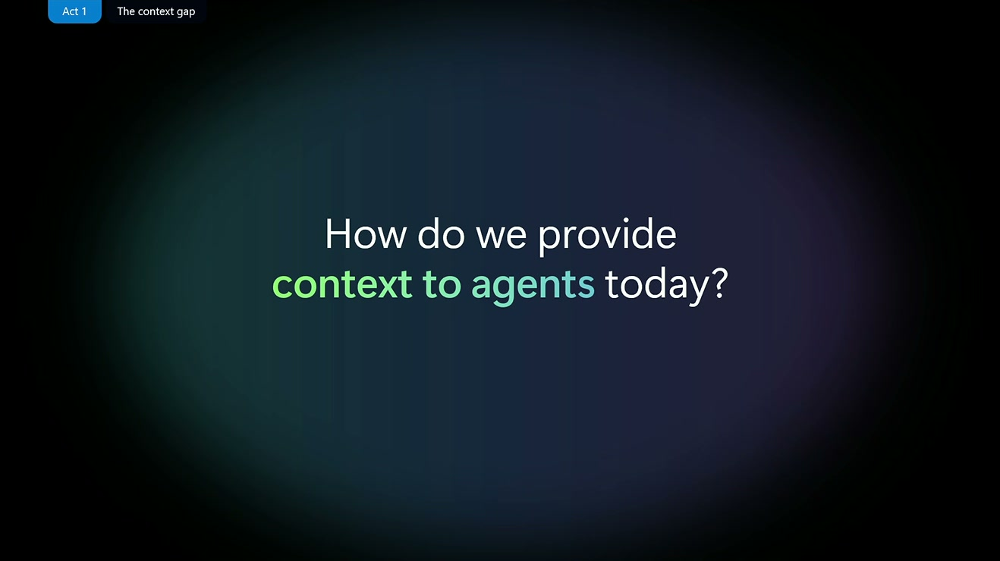

</td><td valign="top">

- A transition question: how is context provided to agents in today's AI tooling?

</td></tr></table>

## 8. Skills are great for individual tasks, not processes ▶ 03:18

<table><tr><td width="50%" valign="top">

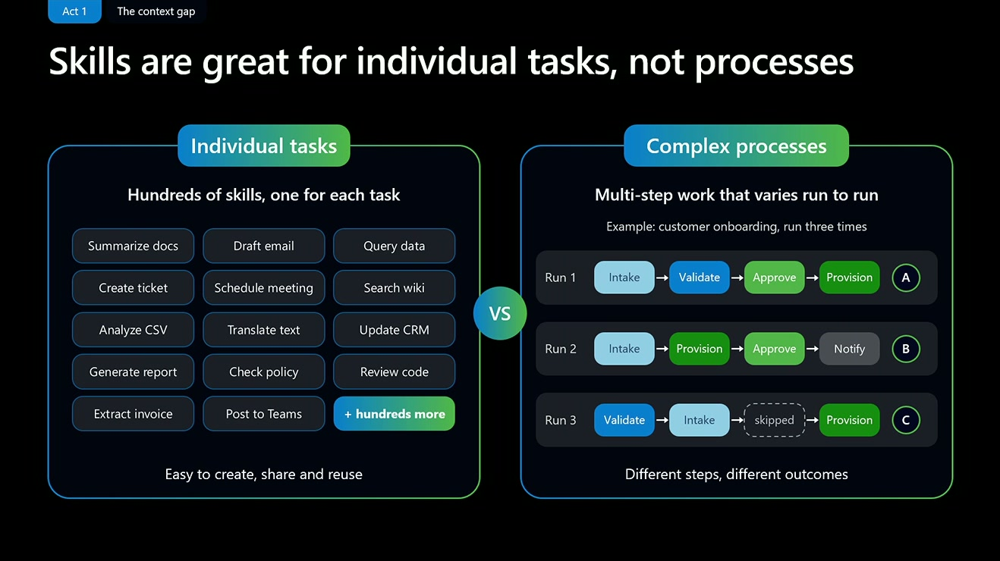

</td><td valign="top">

- Today it's mostly **skills**: there's a skill for everything (summarize a doc, draft an email, query data), easy to create, share and reuse.
- Complex, multi-step processes are different: without the right context, every run takes different steps and produces a different outcome (the slide shows three customer-onboarding runs that each skip or reorder steps).

</td></tr></table>

## 9. Same goal, three analysts, three different answers ▶ 03:51

<table><tr><td width="50%" valign="top">

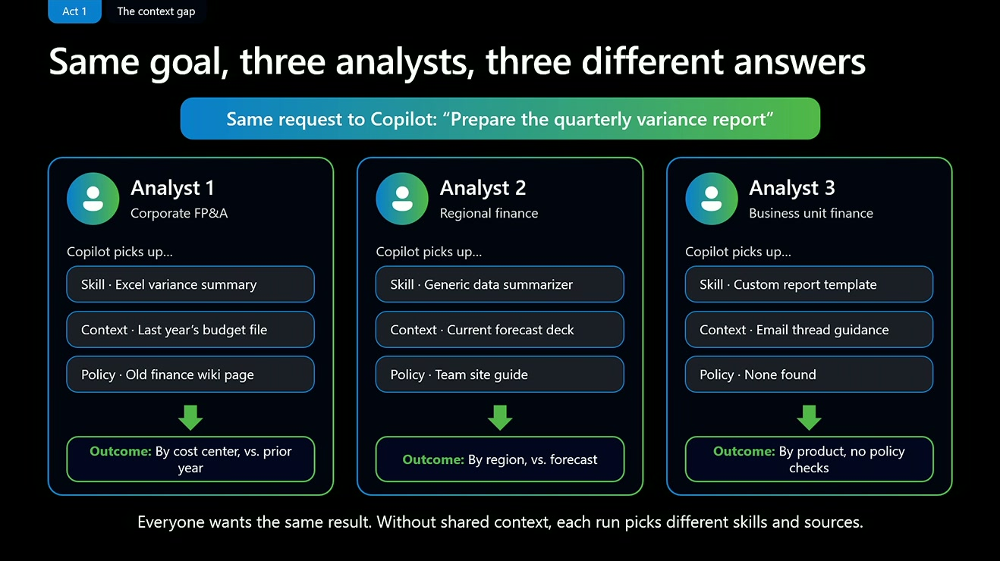

</td><td valign="top">

- A real case from a CFO round table: three analysts ask Copilot the same thing, "Prepare the quarterly variance report".
- Each run picks up a different skill, a different context file and a different policy (or none), so the outcomes differ: by cost center versus prior year, by region versus forecast, by product with no policy checks.

</td></tr></table>

## 10. Context breaks at enterprise scale ▶ 04:25

<table><tr><td width="50%" valign="top">

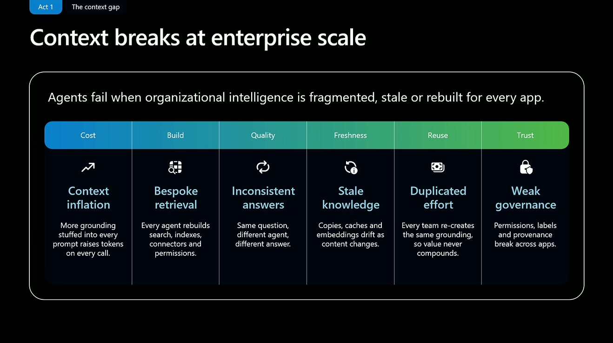

</td><td valign="top">

- Agents fail when organizational intelligence is fragmented, stale or rebuilt for every app:
  - **Cost:** context inflation; more grounding stuffed into every prompt (a thousand skills and many MCP endpoints means more tokens to reach an answer).
  - **Build:** bespoke retrieval; every agent rebuilds search, indexes, connectors and permissions.
  - **Quality:** inconsistent answers to the same question.
  - **Freshness:** stale knowledge as copies, caches and embeddings drift.
  - **Reuse:** duplicated effort, so value never compounds.
  - **Trust:** weak governance; permissions, labels and provenance break across apps.

</td></tr></table>

## 11. Context management is going mainstream ▶ 05:01

<table><tr><td width="50%" valign="top">

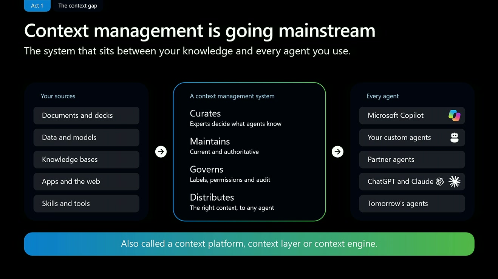

</td><td valign="top">

- You need a system between your knowledge and every agent, whether you call it a context platform, context layer or context engine (also covered in the morning keynote). It:
  - **curates:** experts (supply chain, tax advisory) decide what agents know,
  - **maintains:** keeps context current and authoritative,
  - **governs:** labels, permissions and audit,
  - **distributes:** the right pieces of context for each question, to any agent.
- That agent can be Microsoft Copilot, your custom agents, partner agents, ChatGPT, Claude or tomorrow's agents.

**Microsoft Learn:**
- [Microsoft IQ documentation](https://learn.microsoft.com/microsoft-iq)

</td></tr></table>

## 12. Introducing Microsoft IQ: Enterprise Context Management ▶ 06:04

<table><tr><td width="50%" valign="top">

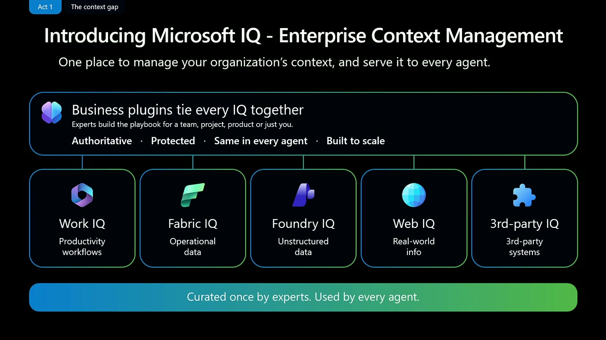

</td><td valign="top">

- **Microsoft IQ** is the enterprise context management layer. **Business plugins** tie every IQ together: experts build the playbook for a team, a project, a product or just you. Authoritative, protected, the same in every agent, model agnostic.
- Underneath are the existing IQs:
  - **Work IQ:** productivity workflows (email, SharePoint, Teams, chats and meetings),
  - **Fabric IQ:** operational data (semantic models, ontologies, OneLake, reports),
  - **Foundry IQ:** unstructured data (knowledge bases, compliance information),
  - **Web IQ:** real-world, public information,
  - **3rd-party IQ:** partner products and systems you use every day.

**Microsoft Learn:**
- [Microsoft IQ documentation](https://learn.microsoft.com/microsoft-iq)
- [Work IQ overview](https://learn.microsoft.com/microsoft-365/copilot/extensibility/work-iq)
- [What is Fabric IQ?](https://learn.microsoft.com/fabric/iq/overview)
- [What is Foundry IQ?](https://learn.microsoft.com/azure/foundry/agents/concepts/what-is-foundry-iq)

</td></tr></table>

## 13. Microsoft IQ in the Microsoft stack ▶ 07:41

<table><tr><td width="50%" valign="top">

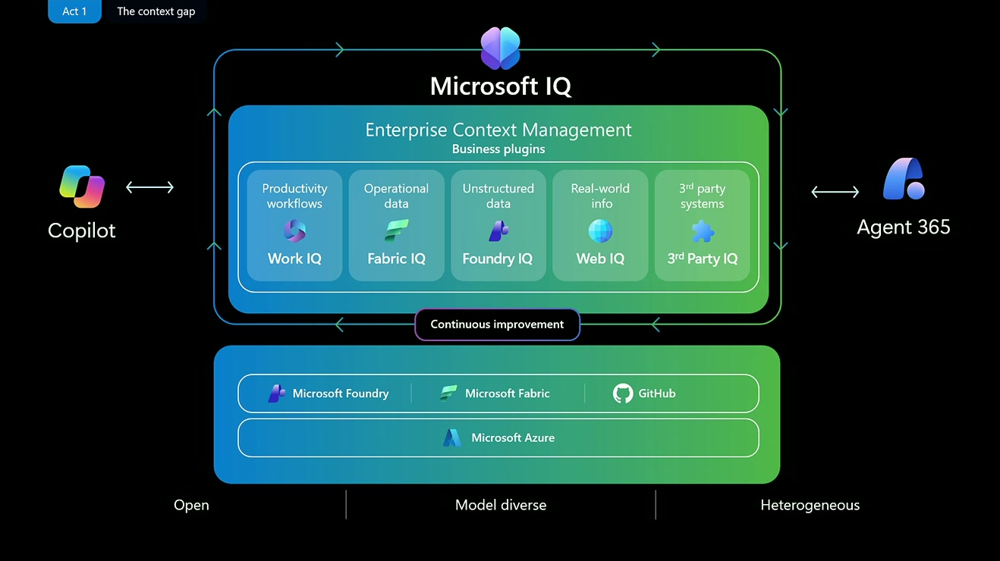

</td><td valign="top">

- Microsoft IQ sits between **Copilot** and **Agent 365**, with continuous improvement (continuous relevance) around the enterprise context management layer.
- Underneath: Microsoft Foundry, Microsoft Fabric and GitHub, all running on Azure. The principles: open, model diverse, heterogeneous.

**Microsoft Learn:**
- [Microsoft Agent 365 overview](https://learn.microsoft.com/microsoft-agent-365/overview)

</td></tr></table>

## 14. Customer conversation: EY ▶ 08:06

<table><tr><td width="50%" valign="top">

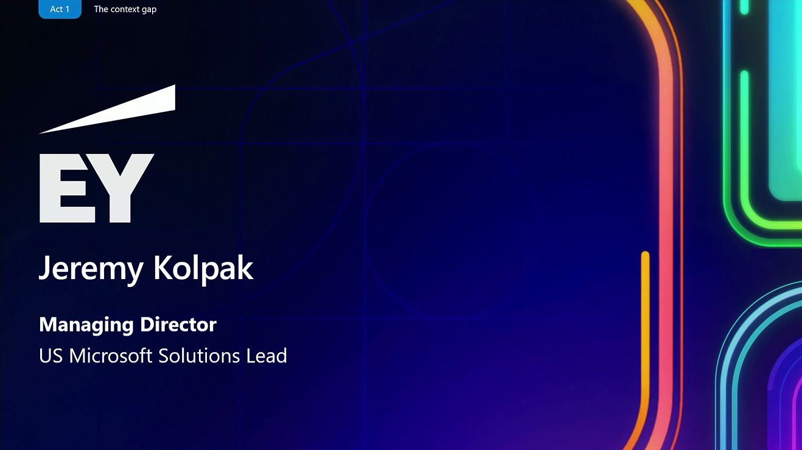

</td><td valign="top">

- Jeremy Kolpak (EY, Managing Director, US Microsoft Solutions Lead) on how EY builds its IQ:
  - EY (technology, tax and audit, about 400,000 people) has spent years consolidating knowledge that used to live in "phone a friend" relationships. Microsoft IQ is "the perfect place to land this information".
  - Consultants need authoritative answers quickly: on audit and tax controls "we can't guess, we must know the answer".
  - Internally, probably 10,000 people ask the same question every day and get slightly different answers. Codifying that knowledge gives better results and lowers token spend.
  - For clients: on a legacy modernization project EY was about to build its own system to capture how users actually work across old systems. With business plugins they can skip that and expose the business logic through Copilot instead.

</td></tr></table>

## 15. Announcing: Microsoft IQ Business Plugins ▶ 11:19

<table><tr><td width="50%" valign="top">

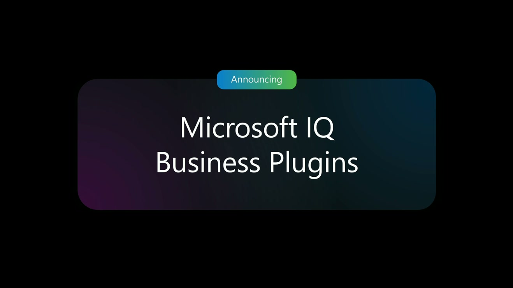

</td><td valign="top">

- Dipti hands over to Josh Caplan to announce **Microsoft IQ business plugins** and demo them live ("first live demo since the pandemic for me").

</td></tr></table>

## 16. A sea of context across every agent ▶ 11:55

<table><tr><td width="50%" valign="top">

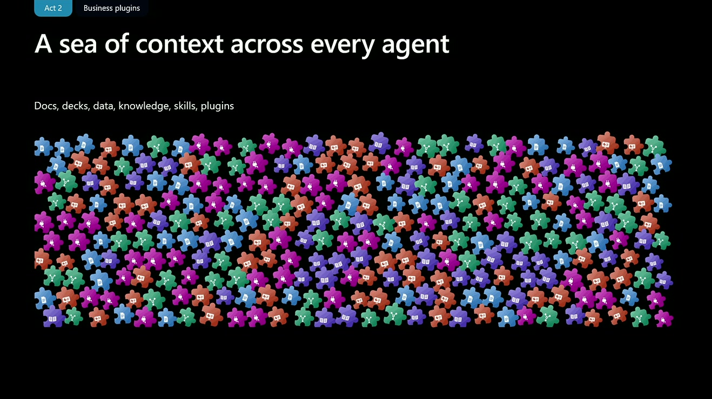

</td><td valign="top">

- Business plugins are **not** more context. You already live in a sea of it: documents, chats, meetings, semantic models and ontologies.
- The hard part is knowing, every time, which things are authoritative and right for an agent to work from.

</td></tr></table>

## 17. Your experts live with the context ▶ 12:38

<table><tr><td width="50%" valign="top">

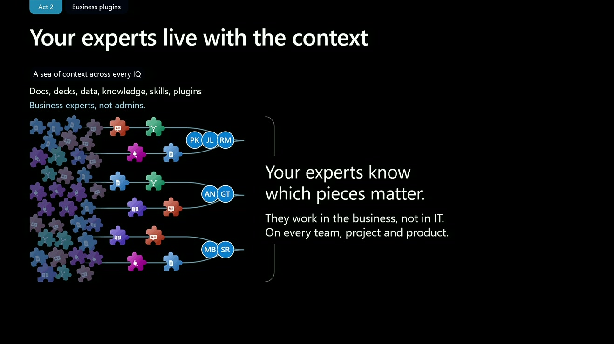

</td><td valign="top">

- The people who know are your business experts, not your admins. They create or work with the context every day and know how the pieces fit, on every team, project and product.
- They just have no place to capture it. Otherwise you teach every agent from scratch, as if it went to school before its first job.

</td></tr></table>

## 18. Experts piece the puzzle together into the full picture ▶ 13:00

<table><tr><td width="50%" valign="top">

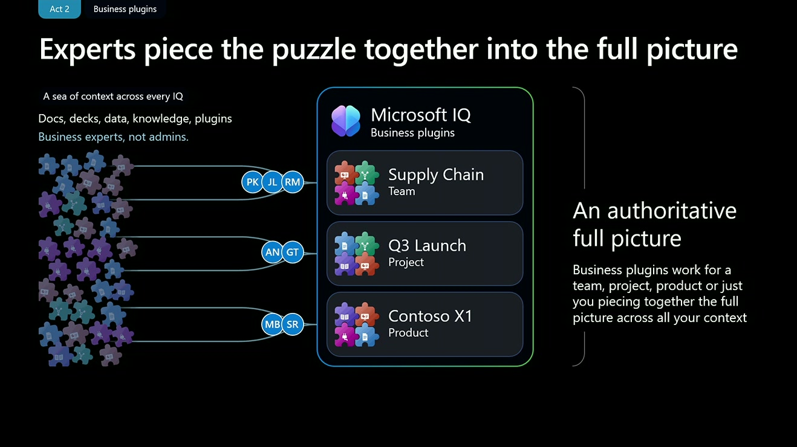

</td><td valign="top">

- A business plugin is where experts piece the puzzle together: an authoritative full picture for a team (Supply Chain), a project (Q3 Launch) or a product (Contoso X1), whatever fits your business.
- That picture then goes to the employees who need it, the agents that serve them and the agents that act on their behalf.

</td></tr></table>

## 19. Your experts build business plugins ▶ 13:31

<table><tr><td width="50%" valign="top">

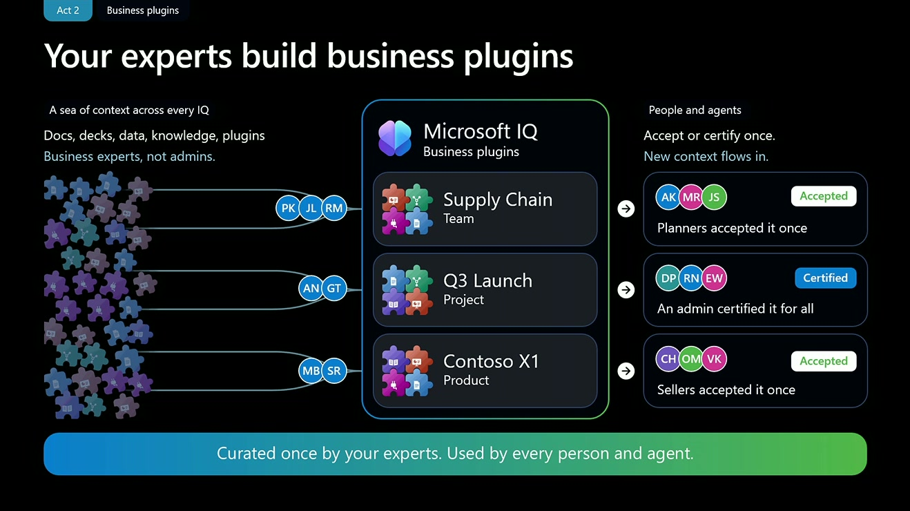

</td><td valign="top">

- Two ways to get a plugin to people and agents:
  - **Accept once:** a person or agent accepts the plugin and a pipe is established. As the plugin evolves, the new context flows in automatically; it's a living document.
  - **Certified:** an admin certifies the plugin as the official one for a team or product, and nobody has to accept it. The context is fed in automatically.
- Curated once by your experts, used by every person and agent.

</td></tr></table>

## 20. One prompt, all your business plugins ▶ 14:20

<table><tr><td width="50%" valign="top">

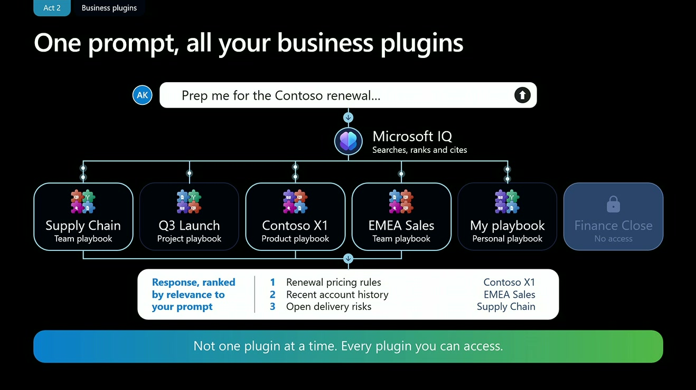

</td><td valign="top">

- Unlike a normal plugin, there's nothing to find or pick. A prompt ("Prep me for the Contoso renewal...") goes to **Microsoft IQ**, which searches **every plugin active for you** (not those you have no access to, such as Finance Close here), finds only what's relevant, ranks it and cites it.
- Only that ranked list, with a little header text on when to use what, goes back to the agent. That keeps token use low and lets the agent choose what to use from a prioritized list.
- "Not one plugin at a time. Every plugin you can access."

</td></tr></table>

## 21. Employees are given a playbook ▶ 15:30

<table><tr><td width="50%" valign="top">

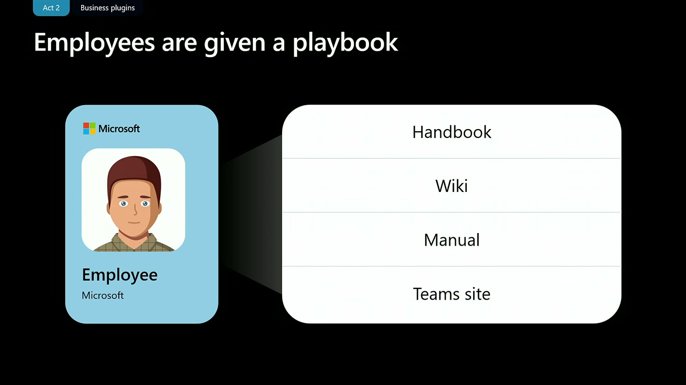

</td><td valign="top">

- New employees aren't put in front of a search engine. They get a handbook, a wiki, a manual or a Teams site that says where to go for what.

</td></tr></table>

## 22. Agents need the same ▶ 15:49

<table><tr><td width="50%" valign="top">

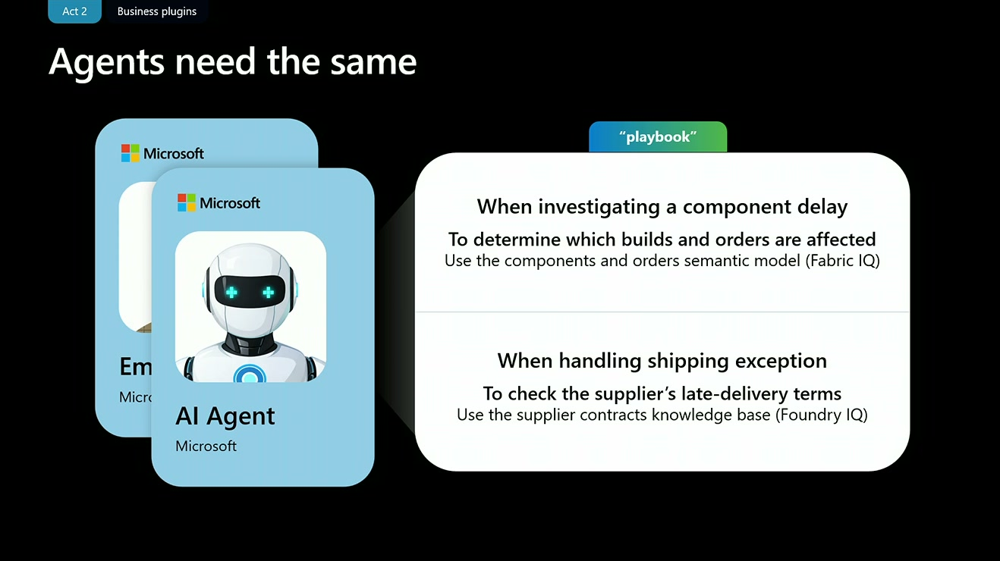

</td><td valign="top">

- A business plugin is that playbook for agents, acting as a router: "when investigating a component delay, use the components and orders semantic model (Fabric IQ)"; "when handling a shipping exception, use the supplier contracts knowledge base (Foundry IQ)".

**Microsoft Learn:**
- [What is Fabric IQ?](https://learn.microsoft.com/fabric/iq/overview)
- [What is Foundry IQ?](https://learn.microsoft.com/azure/foundry/agents/concepts/what-is-foundry-iq)

</td></tr></table>

## 23. Building a business plugin ▶ 16:03

<table><tr><td width="50%" valign="top">

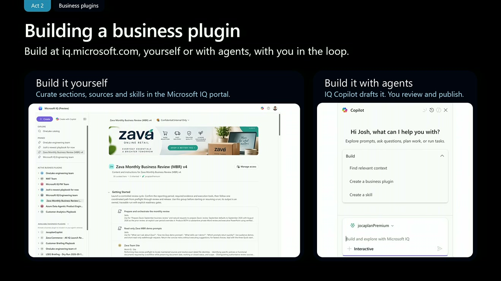

</td><td valign="top">

- Build plugins at **iq.microsoft.com**, which has a new guided experience that feels like writing a wiki for a human:
  - **Build it yourself:** curate sections, sources and skills in the Microsoft IQ portal.
  - **Build it with agents:** IQ Copilot (built in) or your own copilot or chatbot drafts it; you review and publish. Always with a human in the loop to verify it reflects your authoritative guidance.

**Microsoft Learn:**
- [Microsoft IQ documentation](https://learn.microsoft.com/microsoft-iq)

</td></tr></table>

## 24. Demo: Build and publish a business plugin ▶ 17:01

<table><tr><td width="50%" valign="top">

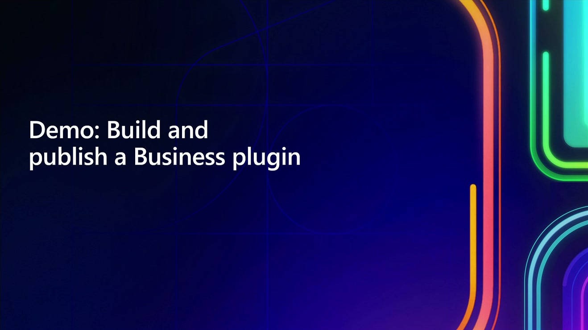

</td><td valign="top">

- **Demo (Josh Caplan, iq.microsoft.com):**
  - Create a business plugin by **describing it in a prompt**: Microsoft IQ looks through Work IQ, Fabric IQ and the other IQs, finds the most relevant context and builds a complete plugin you can then tweak. **Templates** with a short questionnaire do the same.
  - Most people won't build plugins but use curated ones. The **gallery** shows available plugins; badged ones are set up by the organization and already active. Activate others on the fly (the Finance plugin, one click): that's the accept handshake.
  - The **Customer Support** plugin reads like a wiki in natural language and pulls together skills ("check refund amounts"), Word documents, other plugins (internal, or third parties such as Stripe and Salesforce), people, SharePoint sites, Foundry knowledge bases and Fabric IQ. Each item has a summary: what it's for, when to use it and when not to. That's what guides the agent when prompts come in.
  - In **Copilot**: "What do we do when we get P1 support cases?" The first run scanned the whole tenant (a feature flag had been switched off); on the rerun it went straight to the playbook and returned the authoritative P1 checklist: who to check with and how to respond.
  - A follow-up about a teammate who wants to push through a claim they aren't authorized for returns the right approvers by name, from that section of the playbook.
  - The same grounding works for a person in chat, for Autopilot or for a custom agent.

**Microsoft Learn:**
- [Microsoft IQ documentation](https://learn.microsoft.com/microsoft-iq)

</td></tr></table>

## 25. Bring context in. Use it anywhere. ▶ 24:24

<table><tr><td width="50%" valign="top">

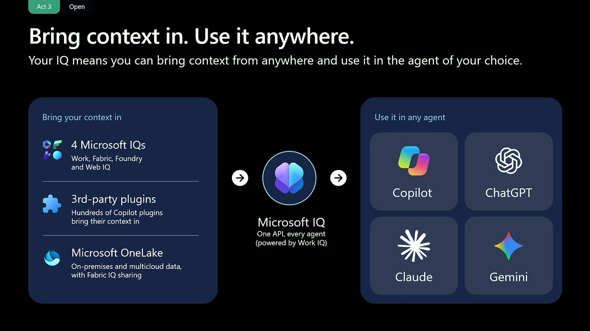

</td><td valign="top">

- **Bring your context in:** the 4 Microsoft IQs (Work, Fabric, Foundry and Web IQ), **3rd-party plugins** (350+ announced today, which bring context and can also take actions) and **Microsoft OneLake** (on-premises and multicloud data, plus context and data from partners across tenants through **Fabric IQ sharing**).
- **Use it in any agent:** Microsoft IQ is one API for every agent (powered by Work IQ): Copilot, ChatGPT, Claude, Gemini and every Microsoft agent.

**Microsoft Learn:**
- [IQ Sharing overview (preview)](https://learn.microsoft.com/fabric/onelake/iq-share/onelake-share-overview)
- [OneLake, the unified data lake](https://learn.microsoft.com/fabric/onelake/onelake-overview)

</td></tr></table>

## 26. Copilot Plugin Partner Ecosystem ▶ 25:32

<table><tr><td width="50%" valign="top">

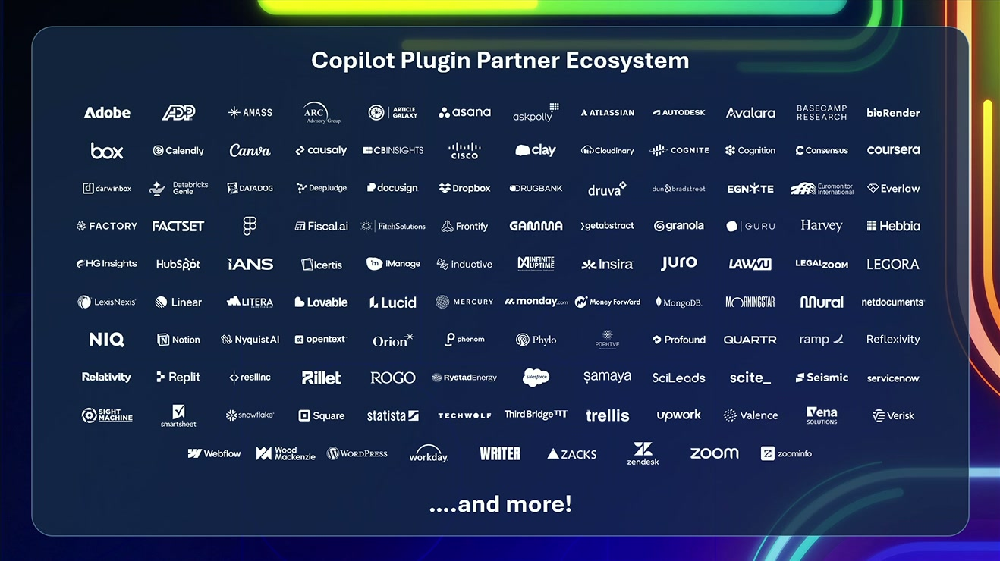

</td><td valign="top">

- About 350 third-party plugins announced today, from Adobe, Asana, Atlassian, Box, Canva, DocuSign, HubSpot, Salesforce, ServiceNow, Snowflake, Workday, Zoom and many more.

**Microsoft Learn:**
- [Available plugins for Copilot Cowork](https://learn.microsoft.com/microsoft-365/copilot/cowork/cowork-available-plugins)

</td></tr></table>

## 27. Compounding intelligence with hierarchical sections ▶ 25:58

<table><tr><td width="50%" valign="top">

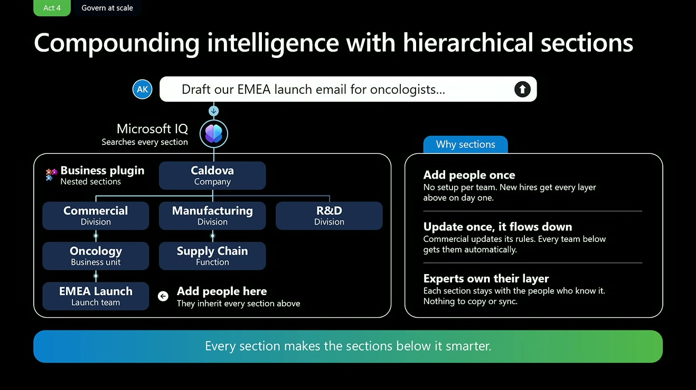

</td><td valign="top">

- Organizations aren't flat: team dashboards, your manager's dashboards for the larger team, company-wide trainings. Business plugins work the same way.
- A plugin has a root and any number of **nested sections** (Caldova company, then Commercial, Manufacturing and R&D divisions, then Oncology and Supply Chain, then an EMEA launch team). Each section has its own owner and expert.
- Add people or agents at the lowest section that fits them; they automatically **inherit every section above** on that path.
  - **Add people once:** no setup per team; new hires get every layer above on day one.
  - **Update once, it flows down:** Commercial updates its rules, and every team below gets them.
  - **Experts own their layer:** nothing to copy or sync.
- The prompt ("Draft our EMEA launch email for oncologists...") doesn't need to know any of this: Microsoft IQ searches every section you have access to.

</td></tr></table>

## 28. Endorsements and certification ▶ 27:42

<table><tr><td width="50%" valign="top">

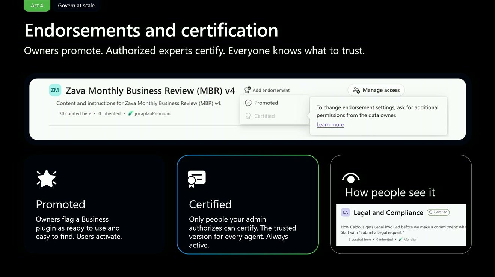

</td><td valign="top">

- **Promoted:** owners flag a plugin as ready to use and easy to find; users activate it.
- **Certified:** only people your admin authorizes can certify. A certified plugin can be made available to every agent and user in scope **without accepting it**; it's automatically injected into context on the first prompt. "Certification is very, very, very powerful."
- Both get a badge, so people see what to trust.

</td></tr></table>

## 29. Access control and data protection labels ▶ 28:50

<table><tr><td width="50%" valign="top">

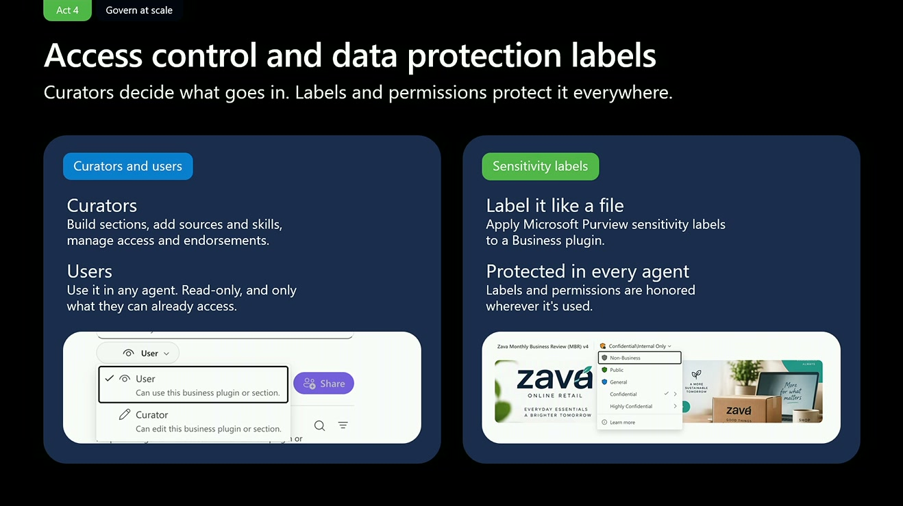

</td><td valign="top">

- **Curators and users:** curators build sections, add sources and skills, and manage access and endorsements. Users can use a plugin in any agent, read-only, and only see what they can already access.
- **Sensitivity labels:** apply Microsoft Purview sensitivity labels to a business plugin, like you label a file. Labels and permissions are honored wherever the plugin is used.

**Microsoft Learn:**
- [Learn about sensitivity labels](https://learn.microsoft.com/purview/sensitivity-labels)

</td></tr></table>

## 30. Demo: Compounding intelligence ▶ 29:19

<table><tr><td width="50%" valign="top">

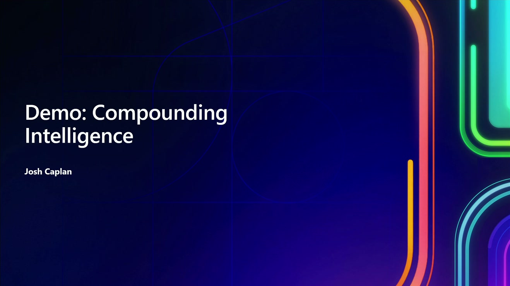

</td><td valign="top">

- **Demo (Josh Caplan):**
  - The **Legal and Compliance** plugin has many sections. The root holds what everyone in legal and compliance needs to know, across all the IQs. As owner of that level, Josh can add context from anything in the tenant (Fabric IQ, Foundry IQ, Work IQ, third-party plugins) or let Copilot suggest more.
  - The **Contracts** section adds its own skills, IQs and contacts, and automatically inherits everything above it, so nothing is maintained at five levels.
  - **Roles:** curators can change anything at their level (but not higher levels without permission there); members get the context of their level and everything above, read-only. The plugin is promoted; certifying it needs the admin's consent. Protection labels can be set here too.
  - In Copilot chat: "How do I check the right signature authority for a contract?" It finds the skill and asks for contract type, amount and state. Josh answers: a negotiated contract of about $500K that he'd sign personally.
  - A combination of skills (that call more skills) and Work IQ documents answers: **don't sign this personally**, these people must sign off, with names and a link to the exact policy document. "Didn't guess at this."
  - That was plain Copilot Chat ("not even in Cowork yet"). The same answers come in **GitHub Copilot**: under customizations, turn on the Work IQ MCP server, which serves Microsoft IQ business plugins. The product team uses plugins like this to check code, write specs and validate.
  - The same works in ChatGPT and Claude.

**Microsoft Learn:**
- [Work IQ MCP overview](https://learn.microsoft.com/microsoft-365/copilot/extensibility/work-iq/mcp/overview)
- [Connect GitHub Copilot CLI to the Work IQ MCP server](https://learn.microsoft.com/microsoft-365/copilot/extensibility/work-iq/mcp/quickstart/github-copilot-cli)

</td></tr></table>

## 31. Open by design, portable by default ▶ 35:21

<table><tr><td width="50%" valign="top">

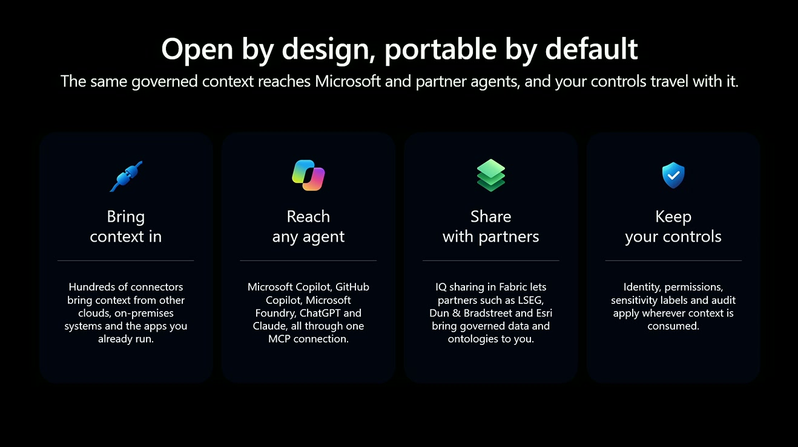

</td><td valign="top">

- The same governed context reaches Microsoft and partner agents, and your controls travel with it:
  - **Bring context in:** hundreds of connectors from other clouds, on-premises systems and the apps you already run.
  - **Reach any agent:** Microsoft Copilot, GitHub Copilot, Microsoft Foundry, ChatGPT and Claude, all through one MCP connection.
  - **Share with partners:** IQ sharing in Fabric lets partners such as LSEG, Dun & Bradstreet and Esri bring governed data and ontologies to you.
  - **Keep your controls:** identity, permissions, sensitivity labels and audit apply wherever context is consumed.
- Partners hold a lot of expertise, which makes them an important part of context curation.

**Microsoft Learn:**
- [IQ Sharing overview (preview)](https://learn.microsoft.com/fabric/onelake/iq-share/onelake-share-overview)
- [Work IQ MCP overview](https://learn.microsoft.com/microsoft-365/copilot/extensibility/work-iq/mcp/overview)

</td></tr></table>

## 32. Partner conversation: Celonis ▶ 36:42

<table><tr><td width="50%" valign="top">

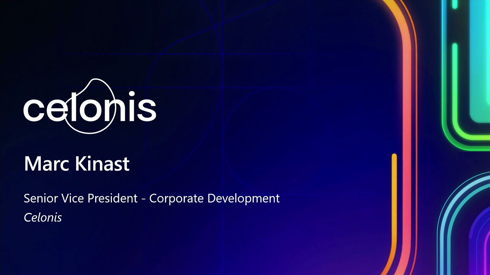

</td><td valign="top">

- Marc Kinast (SVP Corporate Development, Celonis) joins. Celonis's mission is "to make processes work for people, companies and the planet"; it's Microsoft's Global ISV Partner of the Year.
- At the core of the Celonis platform is the **Celonis context model**: a representation of how your business actually runs (processes, tasks, tacit knowledge). On top of it run **hindsight** (what happened), **insight** (why things break down), **foresight** (what happens next) and simulations (what if I change the process).
- That foundation shows how to change processes, and exposes them as context to the agents that run the future processes.
- **Process IQ**, launched today: the Celonis context model delivered natively on Fabric.

**Microsoft Learn:**
- [Microsoft Fabric ISV partner integration (Celonis workload)](https://learn.microsoft.com/fabric/cicd/partners/partner-integration)

</td></tr></table>

## 33. Reinventing order to cash in three steps (Process IQ video) ▶ 39:57

<table><tr><td width="50%" valign="top">

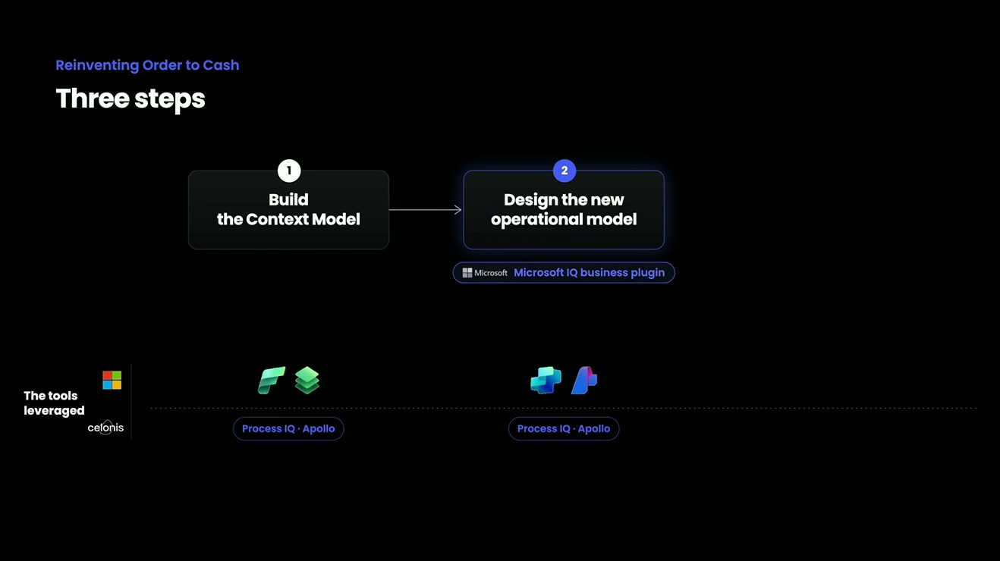

</td><td valign="top">

- A video walks through order to cash with Jordan, a global process owner who wants better on-time delivery and cash flow:
  1. **Build the context model in Fabric:** Jordan adds Celonis **Process IQ** (a native Fabric workload) to her workspace. It reads her **Fabric IQ ontology** directly, so nothing new to stand up or rebuild, and builds the context model on top: how work flows, where and why it breaks, what's likely next.
  2. **Design the new operational model:** Process IQ finds six prioritized agentic opportunities, starting with **credit block triage**, redesigns the process and lets Jordan simulate it. She then publishes an **order-to-cash business plugin** in Microsoft IQ and creates a **Copilot Studio agent** to run it. The plugin turns the process into a step-by-step plan grounded in Process IQ context, governed by OneLake. When the process changes, she updates one plugin, not each agent.
  3. **Supervise and close the learning loop:** the agent flags an order likely to ship late because of a credit block, checks the context model, sees a credit-limit breach and escalates to a human (Sally, an order management clerk). Agent traces flow back into the context model, and Process IQ measures business impact and suggests plugin updates.

**Microsoft Learn:**
- [What is ontology (preview)?](https://learn.microsoft.com/fabric/iq/ontology/overview)

</td></tr></table>

## 34. One Context Model, one business plugin, better agents ▶ 42:58

<table><tr><td width="50%" valign="top">

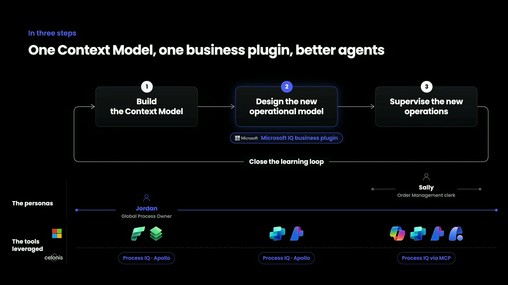

</td><td valign="top">

- The three steps form a loop: build the context model, design the new operational model (published as a Microsoft IQ business plugin), supervise the new operations and close the learning loop. Tools: Process IQ and Apollo, then Process IQ via MCP for the agents.
- Celonis's framework is **ADO: analyze, design, operate**. Analyze and design the process, expose it as a plugin, and operate it on the Microsoft platform, all now available to Microsoft IQ customers.

</td></tr></table>

## 35. Celonis Process IQ: launching in Preview today ▶ 44:07

<table><tr><td width="50%" valign="top">

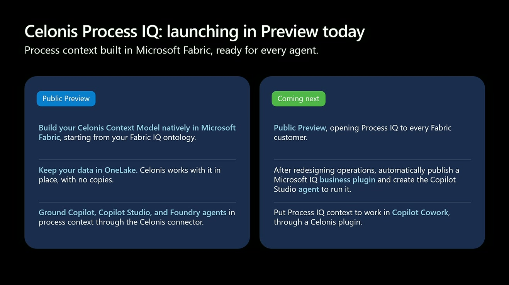

</td><td valign="top">

- **Public preview:** build your Celonis context model natively in Microsoft Fabric, starting from your Fabric IQ ontology; keep your data in OneLake (Celonis works with it in place, no copies); ground Copilot, Copilot Studio and Foundry agents in process context through the Celonis connector.
- **Coming next:** Process IQ opens to every Fabric customer; after redesigning operations, Process IQ automatically publishes a business plugin and creates the Copilot Studio agent to run it; put Process IQ context to work in **Copilot Cowork** through a Celonis plugin.
- Customers are already implementing it.

**Microsoft Learn:**
- [Microsoft Fabric ISV partner integration (Celonis workload)](https://learn.microsoft.com/fabric/cicd/partners/partner-integration)

</td></tr></table>

## 36. Microsoft IQ: A federated operating model ▶ 44:34

<table><tr><td width="50%" valign="top">

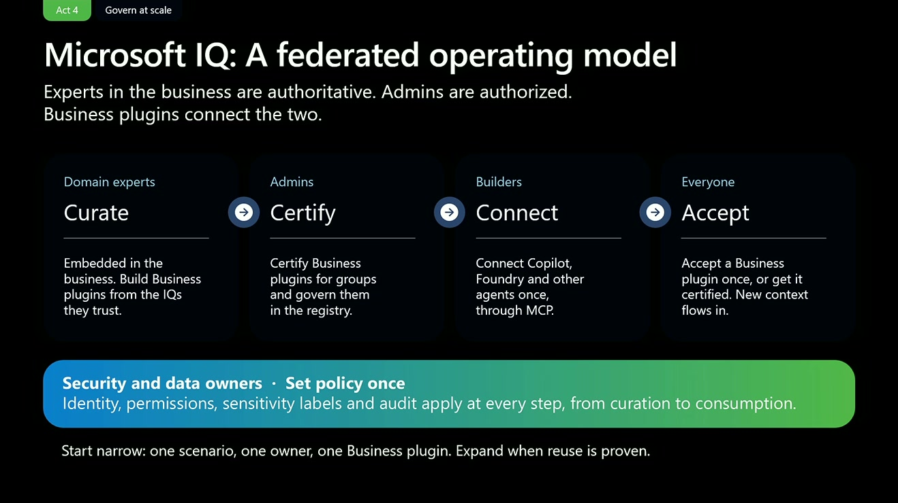

</td><td valign="top">

- Experts in the business are authoritative, admins are authorized, and business plugins connect the two:
  - **Curate** (domain experts): build business plugins from the IQs they trust.
  - **Certify** (admins): certify plugins for groups and govern them in the registry.
  - **Connect** (builders): connect Copilot, Foundry and other agents once, through MCP.
  - **Accept** (everyone): accept a plugin once, or get it certified; new context flows in.
- Security and data owners set policy once: identity, permissions, sensitivity labels and audit apply at every step.
- Start narrow: one scenario, one owner, one business plugin. Expand when reuse is proven.

**Microsoft Learn:**
- [Microsoft IQ documentation](https://learn.microsoft.com/microsoft-iq)

</td></tr></table>

## 37. What good looks like ▶ 44:54

<table><tr><td width="50%" valign="top">

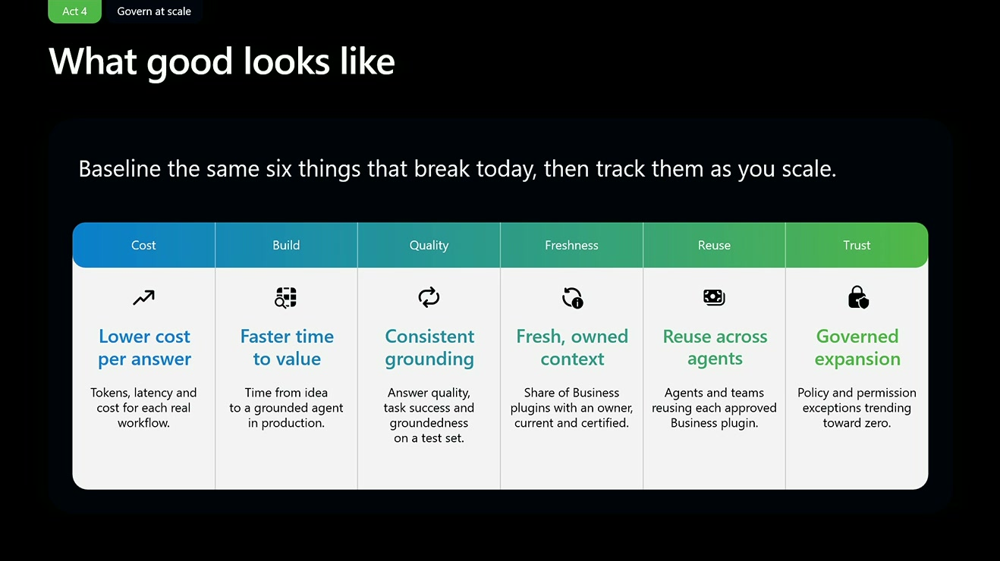

</td><td valign="top">

- Baseline the same six things that break today, then track them as you scale: **lower cost per answer** (tokens, latency, cost per workflow), **faster time to value** (idea to grounded agent in production), **consistent grounding** (answer quality and groundedness on a test set), **fresh, owned context** (share of plugins with an owner, current and certified), **reuse across agents** and **governed expansion** (policy and permission exceptions trending to zero).

</td></tr></table>

## 38. One business plugin, one trusted brief ▶ 45:04

<table><tr><td width="50%" valign="top">

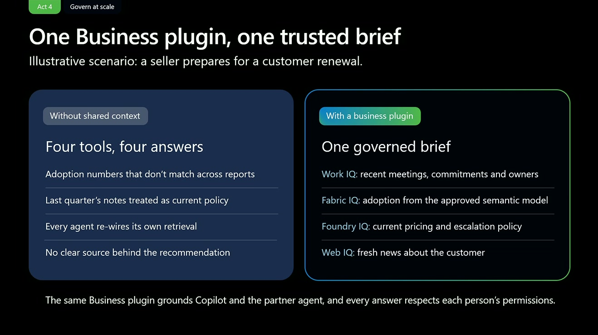

</td><td valign="top">

- Illustrative scenario: a seller prepares for a customer renewal.
  - **Without shared context:** four tools, four answers (adoption numbers that don't match, last quarter's notes treated as current policy, every agent re-wiring its own retrieval, no clear source).
  - **With a business plugin:** one governed brief, with Work IQ (recent meetings, commitments, owners), Fabric IQ (adoption from the approved semantic model), Foundry IQ (current pricing and escalation policy) and Web IQ (fresh news about the customer).
- The same plugin grounds Copilot and the partner agent, and every answer respects each person's permissions.

</td></tr></table>

## 39. Build your IQ with Microsoft IQ ▶ 45:14

<table><tr><td width="50%" valign="top">

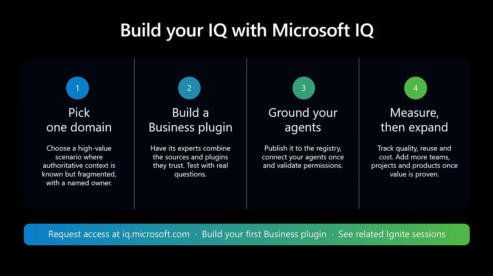

</td><td valign="top">

- Four steps: **pick one domain** (high value, authoritative context that's known but fragmented, a named owner); **build a business plugin** (experts combine sources and plugins, test with real questions); **ground your agents** (publish to the registry, connect agents once, validate permissions); **measure, then expand** (track quality, reuse and cost, add teams and products once value is proven).
- Request access at **iq.microsoft.com**.

**Microsoft Learn:**
- [Microsoft IQ documentation](https://learn.microsoft.com/microsoft-iq)

</td></tr></table>

## 40. Join the Microsoft IQ ecosystem ▶ 45:17

<table><tr><td width="50%" valign="top">

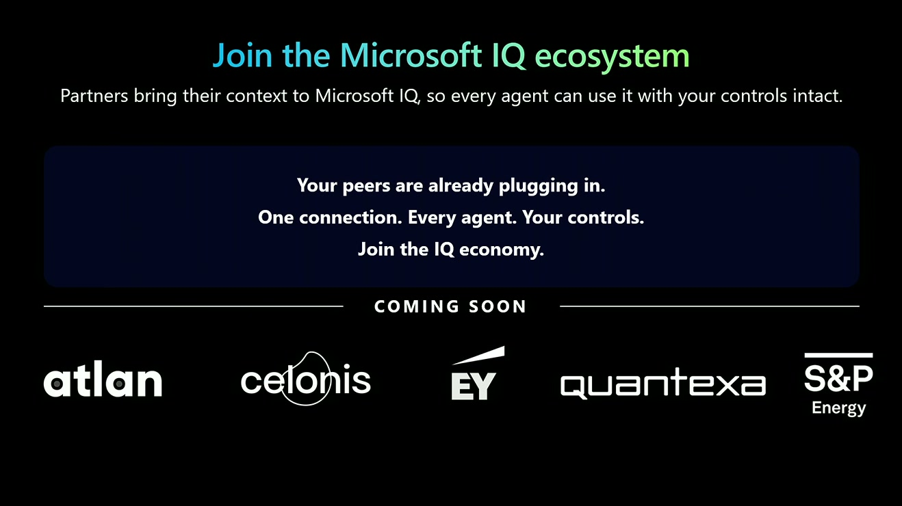

</td><td valign="top">

- Partners bring their context to Microsoft IQ so every agent can use it with your controls intact. Coming soon: Atlan, Celonis, EY, Quantexa and S&P Energy.

</td></tr></table>

## 41. Microsoft IQ: iq.microsoft.com ▶ 45:20

<table><tr><td width="50%" valign="top">

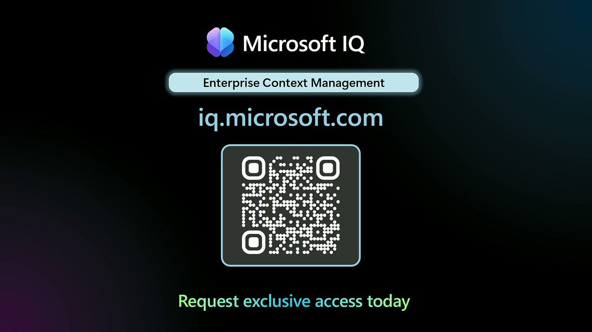

</td><td valign="top">

- Microsoft IQ, Enterprise Context Management: request exclusive access at iq.microsoft.com.

**Microsoft Learn:**
- [Microsoft IQ documentation](https://learn.microsoft.com/microsoft-iq)

</td></tr></table>
