# BRK297: The shift from RAG to context: Grounding agents with Foundry IQ

**Session:** Microsoft Ignite 2026, BRK297 · 45:15
**Speaker:** Pablo Castro (CVP & Distinguished Engineer, Microsoft)

Timestamps refer to the session video (mm:ss). Notes are based on the official English captions. The slides were taken from the video, with one image per slide. Screens from the live demos aren't included as slides, but the notes describe what the demos showed. Where a matching page exists, each section ends with links to Microsoft Learn.

---

## TL;DR

- **From RAG to context:** agents are moving from bespoke, single-purpose bots to general-purpose agents on shared context. **Microsoft IQ** is the enterprise context layer, and **Foundry IQ** (the new name for Azure AI Search) supplies the knowledge bases for unstructured data.
- **Ease of use:** Foundry IQ knowledge bases **managed by the Foundry project** (public preview in December) and **Foundry IQ Serverless GA in December**, with up to 100 TB per service. Every knowledge base is an MCP server.
- **Knowledge graphs (public preview):**
  - **Entity graphs:** schema-guided extraction and GQL queries. 93.5% vs 26.1% correct answers and 64% fewer tokens on SEC filings.
  - **Topic graphs:** unsupervised topic maps for navigation and diversification. Combined, 92% of required facts with 52% fewer tokens.
- **Agentic retrieval:** **Microsoft Retriever 1** and **Microsoft Ranker 3** (public preview) bring agentic retrieval under a second (one demo ran in under 700 ms) with 32% fewer input tokens. You only set `queryType=agentic`.
- **Enterprise readiness:** SharePoint, file upload and Azure SQL indexing are **GA**, with document-level permission propagation. OneLake, Fabric Data Agent and Fabric Ontology sources are in preview. A Foundry IQ plugin with skills (aka.ms/FIQ-plugin) reproduces the demos.

---

## 1. The shift from RAG to context: Grounding agents with Foundry IQ ▶ 00:00

<table><tr><td width="50%" valign="top">

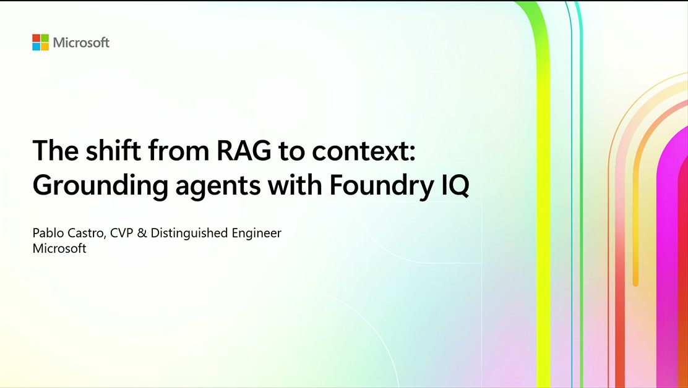

</td><td valign="top">

- Pablo Castro (CVP and Distinguished Engineer, AI Knowledge team in CoreAI) explains how Microsoft now thinks about context for grounding agents, and where Foundry IQ fits.

</td></tr></table>

## 2. The shift from single to general purpose agents ▶ 00:39

<table><tr><td width="50%" valign="top">

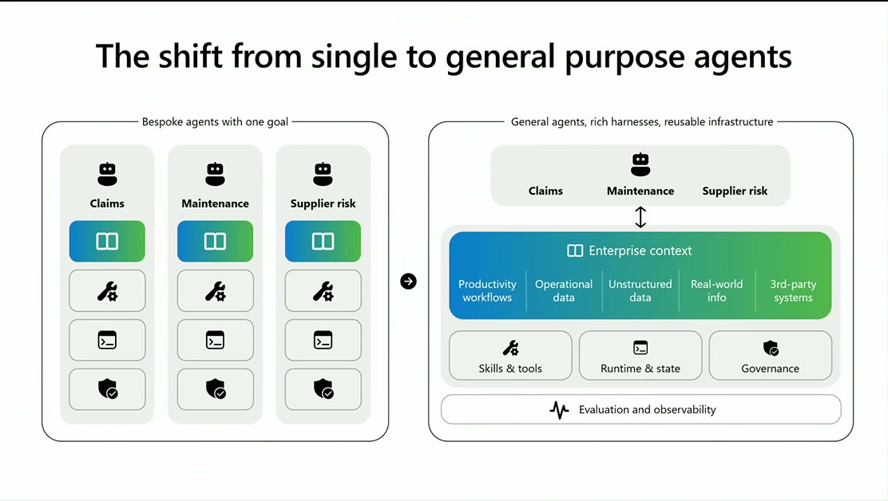

</td><td valign="top">

- **Before:** bespoke agents with one goal, each with its own model, tool loop and data source.
- **Now:** general-purpose agents with rich harnesses on top of shared infrastructure. The knowledge base exists on its own, and agents find the right data for each task.
- Agents such as Copilot Cowork have to "navigate your entire company". That calls for a central entry point, plus discovery, governance and monitoring.

</td></tr></table>

## 3. Microsoft IQ ▶ 03:57

<table><tr><td width="50%" valign="top">

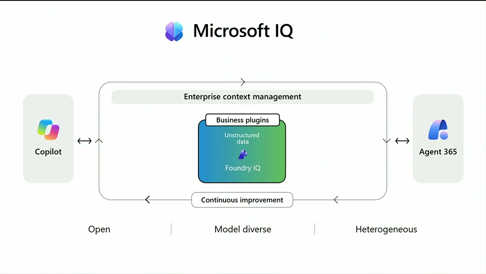

</td><td valign="top">

- **Microsoft IQ** is the "enterprise context management system": one entry point to all of a company's data, through **business plugins**. Agent 365 handles governance and monitoring.
- **Demo:**
  - A "financial analysis" business plugin, built on ten years of Microsoft earnings call transcripts, is connected to a Foundry IQ knowledge base.
  - In Microsoft IQ you can browse and attach existing knowledge bases, and describe what each one contains and when to use it.
  - Copilot then answers from Foundry IQ without the user knowing where the answer came from.

**Microsoft Learn:**
- [Microsoft IQ documentation hub](https://learn.microsoft.com/microsoft-iq)
- [What is Foundry IQ?](https://learn.microsoft.com/azure/foundry/agents/concepts/what-is-foundry-iq)

</td></tr></table>

## 4. Foundry IQ: your unstructured data, engineered for agents ▶ 06:47

<table><tr><td width="50%" valign="top">

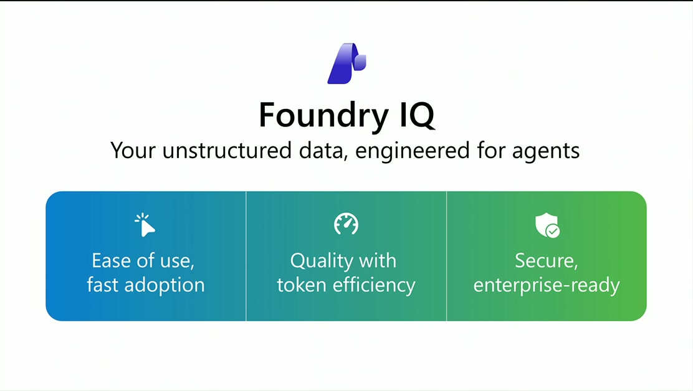

</td><td valign="top">

- Unstructured content is messy. It needs content understanding, layout and image interpretation, and someone to find the hidden structure. That's Foundry IQ's job, and the unit is the **knowledge base**.
- Foundry IQ **is the evolution of Azure AI Search**: the same service, renamed because much of the work is no longer just search.
- Three themes for the session: **ease of use**, **quality with token efficiency** and **enterprise readiness**.

**Microsoft Learn:**
- [What is Foundry IQ (Azure AI Search)?](https://learn.microsoft.com/azure/search/search-what-is-azure-search)
- [What's new in Foundry IQ (Azure AI Search)](https://learn.microsoft.com/azure/search/whats-new)

</td></tr></table>

## 5. Foundry IQ basics ▶ 08:41

<table><tr><td width="50%" valign="top">

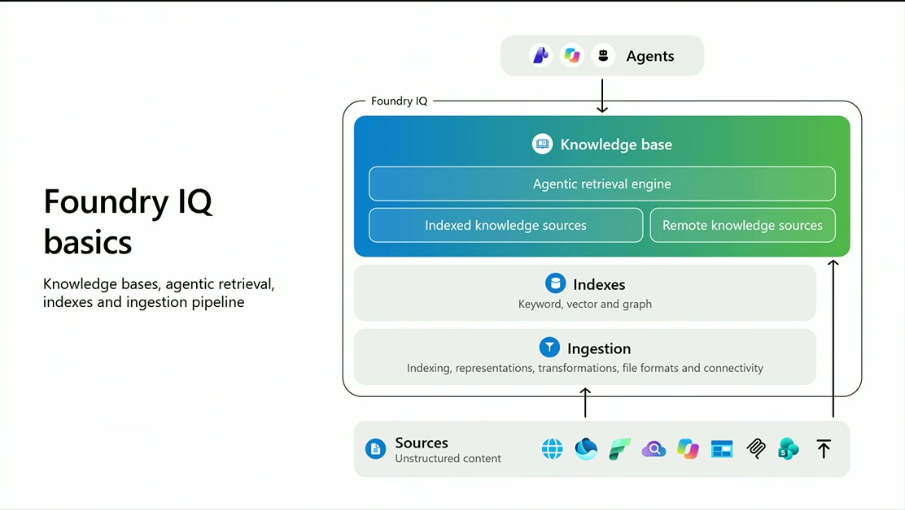

</td><td valign="top">

- The stack, from the bottom up:
  - **ingestion** from sources
  - **indexes** (keyword, vector and graph)
  - a **knowledge base** with an **agentic retrieval engine** over indexed and remote knowledge sources
  - agents on top
- Lexical and vector search, hybrid retrieval and reranking are "already assembled". You choose the mix.

**Microsoft Learn:**
- [Agentic retrieval in Foundry IQ](https://learn.microsoft.com/azure/search/agentic-retrieval-overview)

</td></tr></table>

## 6. Ease of use, fast adoption ▶ 09:34

<table><tr><td width="50%" valign="top">

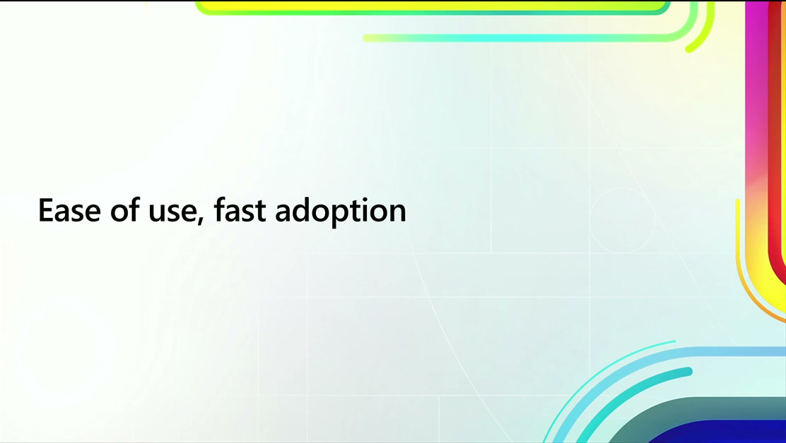

</td><td valign="top">

- Section divider. Until now you started in the Azure portal, the APIs or Foundry. Many people just want a knowledge base for an agent "on the spot" in Foundry.

</td></tr></table>

## 7. Managed Foundry IQ resource in every Foundry project (public preview in December) ▶ 10:02

<table><tr><td width="50%" valign="top">

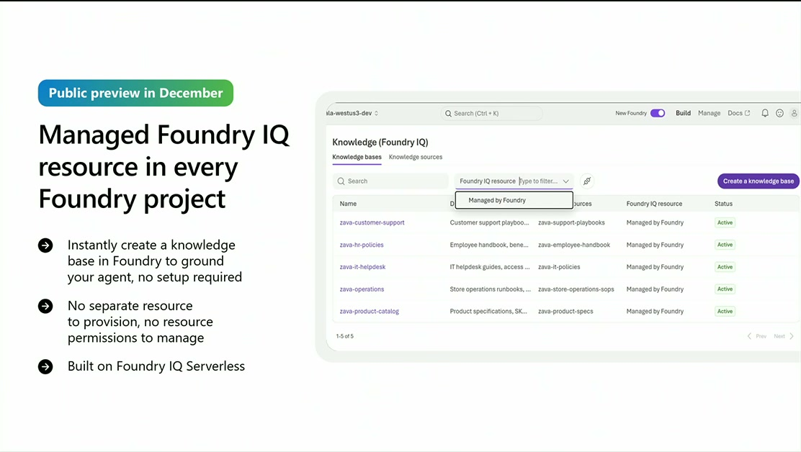

</td><td valign="top">

- Knowledge bases fully **managed by the Foundry project**: nothing to provision or manage, no permissions to set up, and no fixed cost, because it runs on Foundry IQ Serverless.
- **Demo:**
  - Pablo creates a knowledge base in Foundry, managed by Foundry, and uploads the transcripts. Chunking, vectorizing and indexing happen automatically.
  - The knowledge base can be used from Microsoft IQ, **as an MCP server** from any harness, or attached to a Foundry agent.
  - It stays in sync as the source data changes.

**Microsoft Learn:**
- [Create a knowledge base in Foundry IQ](https://learn.microsoft.com/azure/search/agentic-retrieval-how-to-create-knowledge-base)

</td></tr></table>

## 8. Foundry IQ Serverless (GA in December) ▶ 13:01

<table><tr><td width="50%" valign="top">

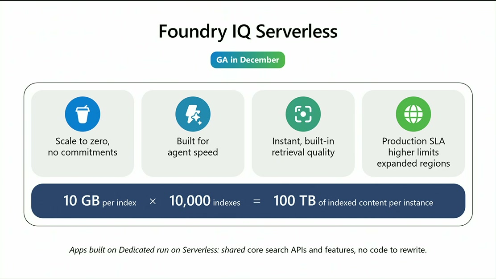

</td><td valign="top">

- **Generally available in December**, with a production SLA. It scales to zero, so an idle service costs only its storage, and it provisions instantly.
- Higher limits: **10 GB per index × 10,000 indexes = 100 TB** of indexed content per service.
- It works with the same APIs as Dedicated tiers ("no code to rewrite"). Dedicated is still the choice for very large scale; some customers have billions of documents.
- In the demo, a Serverless service is created in the Azure portal faster than the client's polling interval.

**Microsoft Learn:**
- [Choose a pricing model and service tier (Serverless vs Dedicated)](https://learn.microsoft.com/azure/search/search-sku-tier)
- [Optimize costs for Foundry IQ Serverless](https://learn.microsoft.com/azure/search/serverless-cost-optimization)
- [Service limits in Foundry IQ](https://learn.microsoft.com/azure/search/search-limits-quotas-capacity)

</td></tr></table>

## 9. Where basic RAG falls short ▶ 17:19

<table><tr><td width="50%" valign="top">

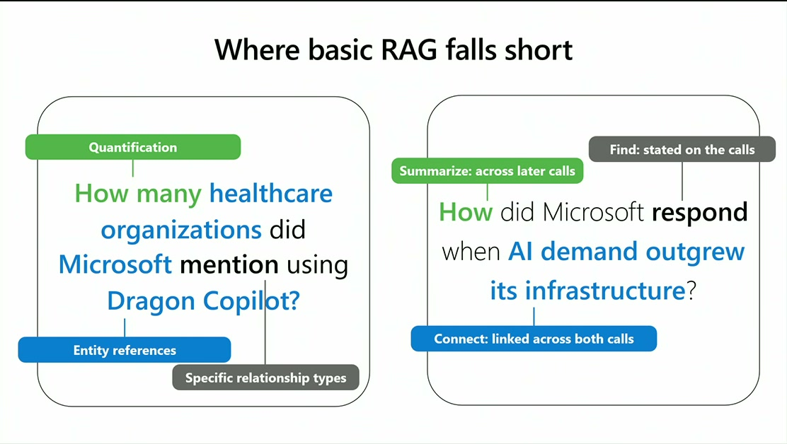

</td><td valign="top">

- "In many scenarios, plain RAG … works really well. … Simple systems are better." The new tools are for when simple doesn't work.
- **Quantification (zoom in):** "How many healthcare organizations did Microsoft mention using Dragon Copilot?" No single chunk holds the answer, and reading every transcript burns tokens.
- **Synthesis (zoom out):** "How did Microsoft respond when AI demand outgrew its infrastructure?"

</td></tr></table>

## 10. Where basic RAG falls short: a complete answer ▶ 18:00

<table><tr><td width="50%" valign="top">

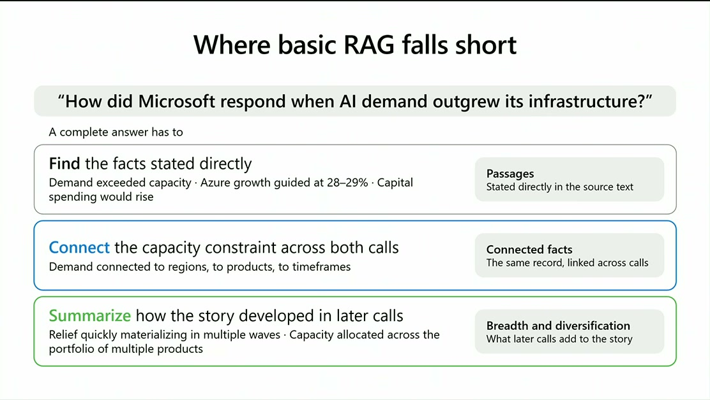

</td><td valign="top">

- A complete answer has to **find** the facts stated directly (passages), **connect** facts across calls (connected facts), and **summarize** how the story developed over time (breadth and diversification).
- No single set of retrieved results contains all of that. "We need more primitives for retrieval."

</td></tr></table>

## 11. Retrieval evolution: expanding what AI can answer ▶ 18:39

<table><tr><td width="50%" valign="top">

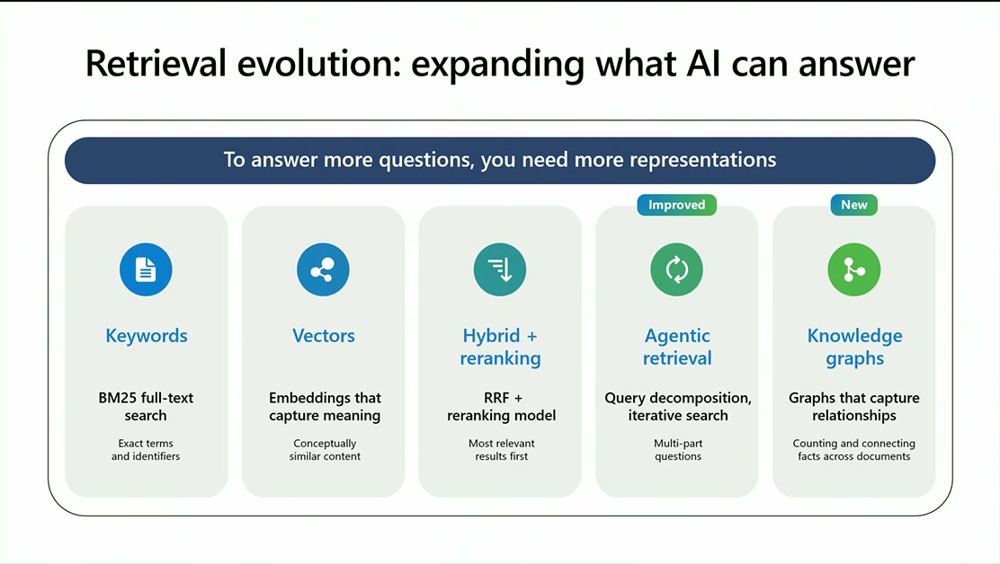

</td><td valign="top">

- "To answer more questions, you need more representations": **keywords** (BM25), **vectors**, **hybrid + reranking**, **agentic retrieval** (improved) and **knowledge graphs** (new).
- Knowledge graphs are a **native primitive inside Foundry IQ**, in "a single system that can represent the same information as text, as vectors, and as graphs".

**Microsoft Learn:**
- [Knowledge graph features overview](https://learn.microsoft.com/azure/search/knowledge-graph-features-overview)

</td></tr></table>

## 12. Knowledge graphs: entities and topics ▶ 19:28

<table><tr><td width="50%" valign="top">

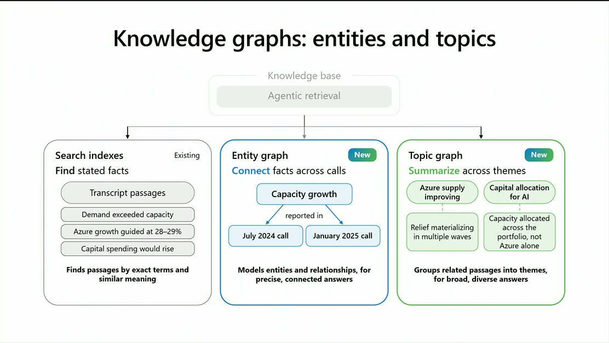

</td><td valign="top">

- **Entity graph (new):** *connect* facts across documents. Entities and relationships for precise, connected answers.
- **Topic graph (new):** *summarize* across themes. A map of the whole corpus, used for navigation and result diversification.
- Both sit next to the existing **search indexes**, which find stated facts.

**Microsoft Learn:**
- [Knowledge graph features overview: compare topic and entity graphs](https://learn.microsoft.com/azure/search/knowledge-graph-features-overview#compare-topic-graphs-and-entity-graphs)

</td></tr></table>

## 13. Entities organize explicit relationships in a network ▶ 20:08

<table><tr><td width="50%" valign="top">

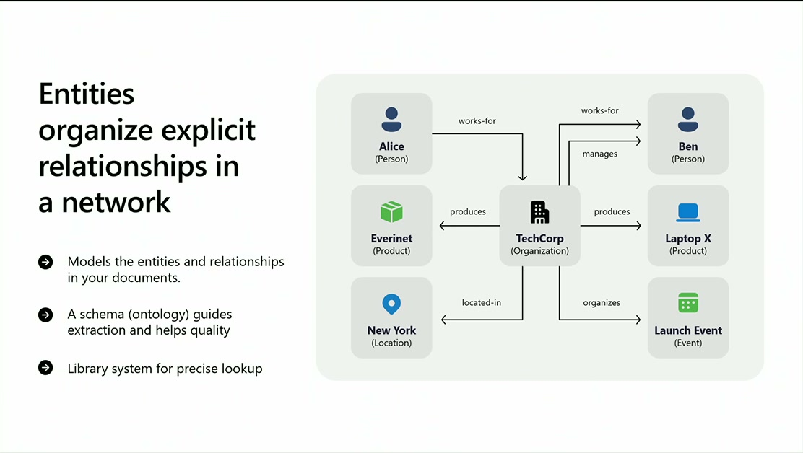

</td><td valign="top">

- You supply a **schema (ontology)** of what matters to you, such as companies, products and people. Then you either push triples or let Foundry IQ run **schema-guided entity extraction** on the raw content, together with chunking and vectorizing.
- **Demo:**
  - Asked "how many healthcare organizations…", plain passage retrieval gets it wrong. Graph retrieval finds the specific organizations mentioned, with a source for each.
  - The query planner mixes searches with a **graph query (GQL)** and then synthesizes the answer. You can also write GQL directly.
- The tools ship as **skills in a plugin** for your coding agent: "just help me do the Ignite thing".

**Microsoft Learn:**
- [Create and query an entity graph (preview)](https://learn.microsoft.com/azure/search/agentic-knowledge-source-how-to-entity-graph)
- [Install the Foundry IQ skills plugin](https://learn.microsoft.com/azure/search/agentic-retrieval-how-to-install-foundry-iq-skills)

</td></tr></table>

## 14. Entities: more correct answers, fewer tokens ▶ 24:33

<table><tr><td width="50%" valign="top">

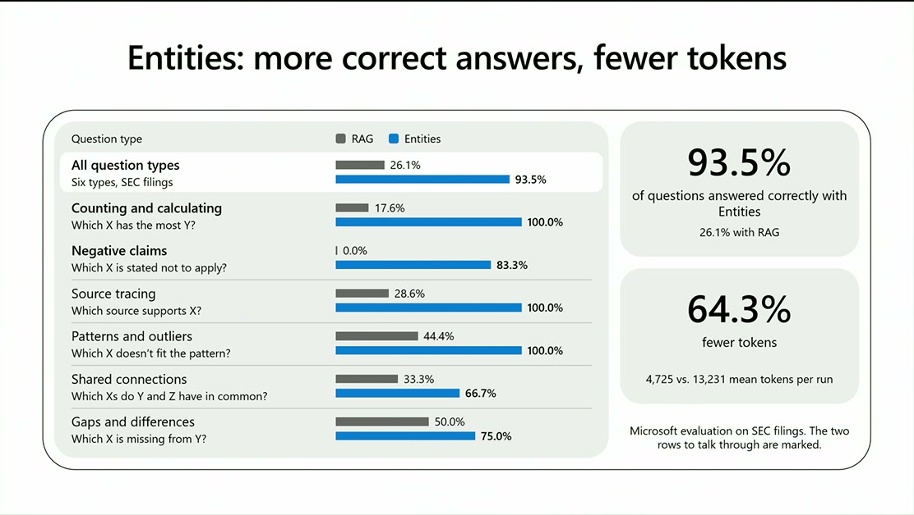

</td><td valign="top">

- Microsoft's evaluation on SEC filings:
  - **93.5%** of questions answered correctly with entities, against **26.1%** with RAG
  - **64.3% fewer tokens**: 4,725 vs 13,231 mean tokens per run
- The biggest gains are on counting and calculating (17.6% → 100%), negative claims (0% → 83.3%), source tracing and patterns.
- Where simple RAG already works, graphs don't add anything.

</td></tr></table>

## 15. Topics map what your documents cover ▶ 25:25

<table><tr><td width="50%" valign="top">

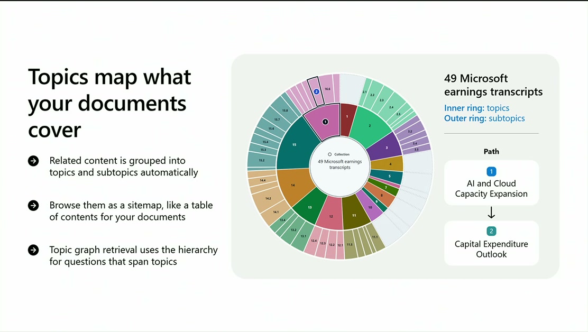

</td><td valign="top">

- Topics group related content into topics and subtopics **automatically and unsupervised**, as a browsable hierarchy or human-readable sitemap. The example: 49 Microsoft earnings transcripts.
- They decide between **local** queries (within one topic) and **global** queries (across topics), help bootstrap your ontology, and power **result diversification**.

**Microsoft Learn:**
- [Configure topic graph retrieval (preview)](https://learn.microsoft.com/azure/search/agentic-knowledge-source-how-to-topic-graph)

</td></tr></table>

## 16. Topics example: evidence from across the corpus ▶ 27:14

<table><tr><td width="50%" valign="top">

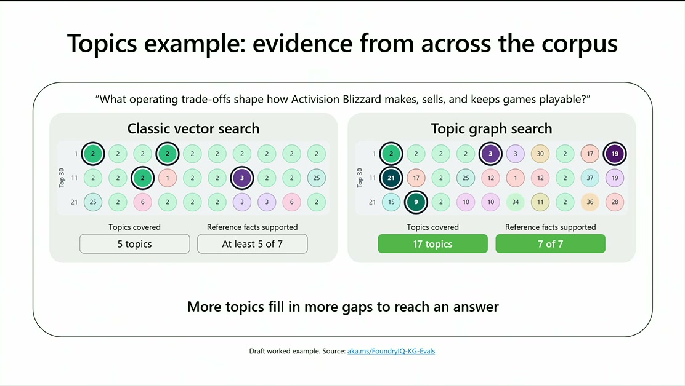

</td><td valign="top">

- Classic vector search clusters its results in a few topics: 5 topics, at least 5 of 7 reference facts.
- Topic graph search spreads results across clusters: **17 topics, 7 of 7 facts**. These aren't the closest matches overall, but the best match from each cluster.

</td></tr></table>

## 17. More facts with 52% fewer tokens ▶ 28:59

<table><tr><td width="50%" valign="top">

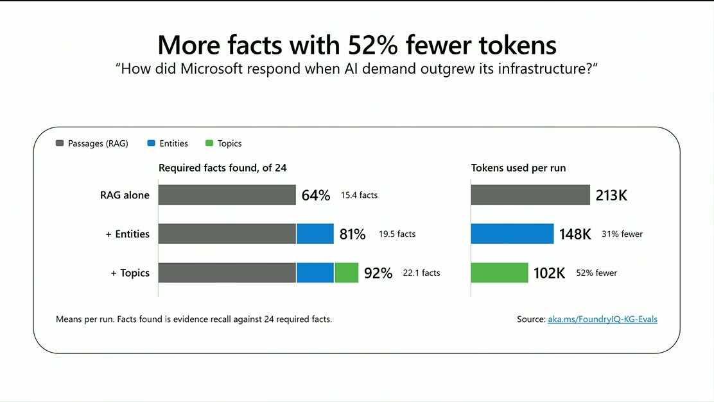

</td><td valign="top">

- On "How did Microsoft respond when AI demand outgrew its infrastructure?", for required facts found (out of 24) and tokens per run:
  - **RAG alone:** 64%, 213K tokens
  - **+ entities:** 81%, 148K tokens (31% fewer)
  - **+ topics:** 92%, 102K tokens (**52% fewer**)
- At scale (customers with "several million PDFs"), letting agents brute-force through the files "is not even thinkable". You need the right primitives.

</td></tr></table>

## 18. Knowledge graphs (public preview) ▶ 30:34

<table><tr><td width="50%" valign="top">

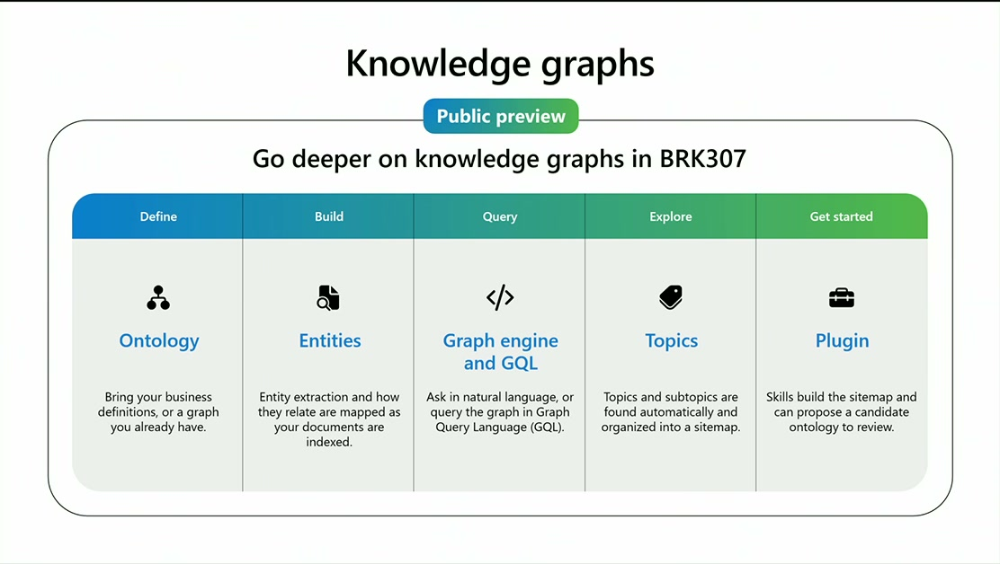

</td><td valign="top">

- **Knowledge graphs are in public preview.** The plugin covers the full workflow: ontology, entities, graph engine and GQL, topics.
- **Direct access to the machinery:**
  - the **triple index**: subject, predicate and object, with confidence scores and links to the source chunks
  - **GQL** queries
  - the **chunk index**, for plain RAG
  - **topic maps**
  - a search API switch to turn on **diversification**
- Every knowledge base is an **MCP server** and picks regular, agentic or graph retrieval automatically.
- Deep dive: **BRK307**.

**Microsoft Learn:**
- [Query a knowledge base using the retrieve action or MCP endpoint](https://learn.microsoft.com/azure/search/agentic-retrieval-how-to-retrieve)

</td></tr></table>

## 19. Agentic retrieval ▶ 35:15

<table><tr><td width="50%" valign="top">

</td><td valign="top">

- Agentic retrieval answers questions a single search can't, but often takes 10–15 seconds. "If you tell me you're going to add 10 milliseconds … that will be a very rough discussion."

</td></tr></table>

## 20. Specialized models inside Foundry IQ (public preview) ▶ 35:54

<table><tr><td width="50%" valign="top">

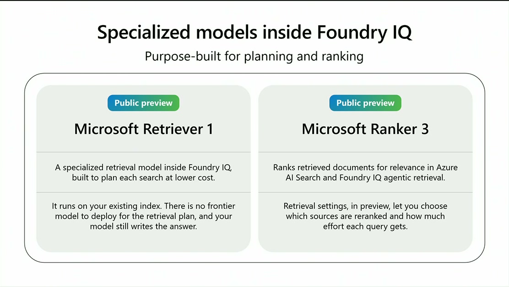

</td><td valign="top">

- **Microsoft Retriever 1:** a small, purpose-built model that plans agentic retrieval. It runs on your existing index, with no frontier model to deploy for the plan. Pablo compares it to Microsoft Decision 1.1 for decision-making.
- **Microsoft Ranker 3:** reranks results in Azure AI Search and Foundry IQ agentic retrieval, with per-source rerank and effort settings.

**Microsoft Learn:**
- [Agentic retrieval in Foundry IQ](https://learn.microsoft.com/azure/search/agentic-retrieval-overview)

</td></tr></table>

## 21. Microsoft Retriever 1: sub-second agentic retrieval ▶ 36:29

<table><tr><td width="50%" valign="top">

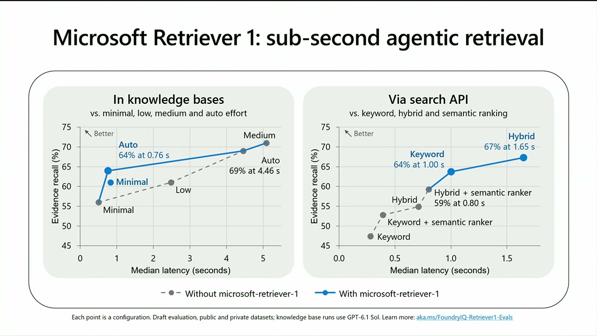

</td><td valign="top">

- **In knowledge bases:** "Auto" with Retriever 1 reaches 64% evidence recall at 0.76 s. Without it, 69% takes 4.46 s.
- **Via the search API:** hybrid with Retriever 1 reaches 67% at 1.65 s, against 59% for hybrid + semantic ranker.
- "Nothing to provision, nothing to configure": set `queryType=agentic`.
- **Demo:** a question about Xbox games on competing consoles. The model learns about "Play Anywhere" from the first results, rewrites the query, and finishes **in under 700 ms**.

</td></tr></table>

## 22. Microsoft Retriever 1: fewer tokens and where it helps most ▶ 39:18

<table><tr><td width="50%" valign="top">

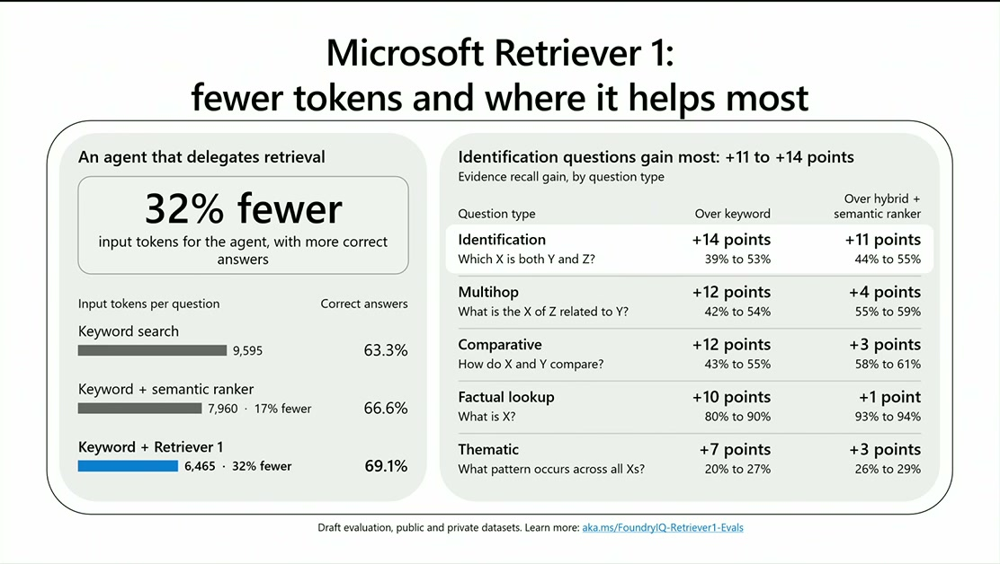

</td><td valign="top">

- With Retriever 1, an agent that hands off retrieval uses **32% fewer input tokens** (6,465 vs 9,595 for keyword search) and gets more answers right (69.1% vs 63.3%).
- The biggest gains are on identification, multi-hop and comparative questions (+12 to +14 points).
- The evaluation is published at aka.ms/FoundryIQ-Retriever1-Evals.

</td></tr></table>

## 23. Enterprise security and content ecosystem ▶ 41:03

<table><tr><td width="50%" valign="top">

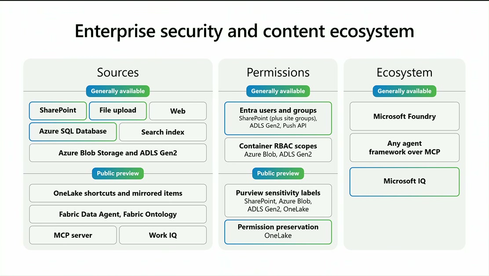

</td><td valign="top">

- **Generally available:**
  - sources: SharePoint, file upload, Web, Azure SQL Database, search index, Blob and ADLS Gen2
  - permissions: Entra users and groups (SharePoint, Blob, ADLS Gen2, push API) and container RBAC scopes
- **Public preview:**
  - sources: OneLake shortcuts and mirrored items, **Fabric Data Agent and Fabric Ontology**, MCP server, Work IQ
  - permissions: Purview sensitivity labels and OneLake permission preservation
- Everything is exposed through **MCP** and shows up in **Microsoft IQ**. On dumping files into a vector DB and leaving the permissions behind: "in most enterprise settings, permissions are a kind of key way of how we work."

**Microsoft Learn:**
- [Document-level access control in Foundry IQ](https://learn.microsoft.com/azure/search/search-document-level-access-overview)
- [Create a Fabric Ontology knowledge source (preview)](https://learn.microsoft.com/azure/search/agentic-knowledge-source-how-to-fabric-ontology)

</td></tr></table>

## 24. SharePoint with permissions (GA) ▶ 43:04

<table><tr><td width="50%" valign="top">

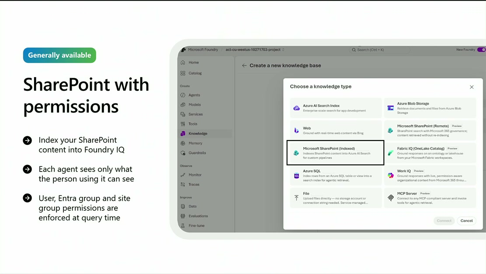

</td><td valign="top">

- SharePoint indexing was "the number one ask" and is now **generally available**: index SharePoint content into Foundry IQ for custom processing or graphs.
- Full **Entra-based permission propagation**: user, Entra group and SharePoint site group permissions are enforced at query time. In the knowledge base wizard it's a single checkbox, "honor document level security".

**Microsoft Learn:**
- [Use a SharePoint indexer to ingest permission metadata](https://learn.microsoft.com/azure/search/search-indexer-sharepoint-access-control-lists)
- [Create an indexed SharePoint knowledge source](https://learn.microsoft.com/azure/search/agentic-knowledge-source-how-to-sharepoint-indexed)

</td></tr></table>

## 25. Next steps ▶ 44:27

<table><tr><td width="50%" valign="top">

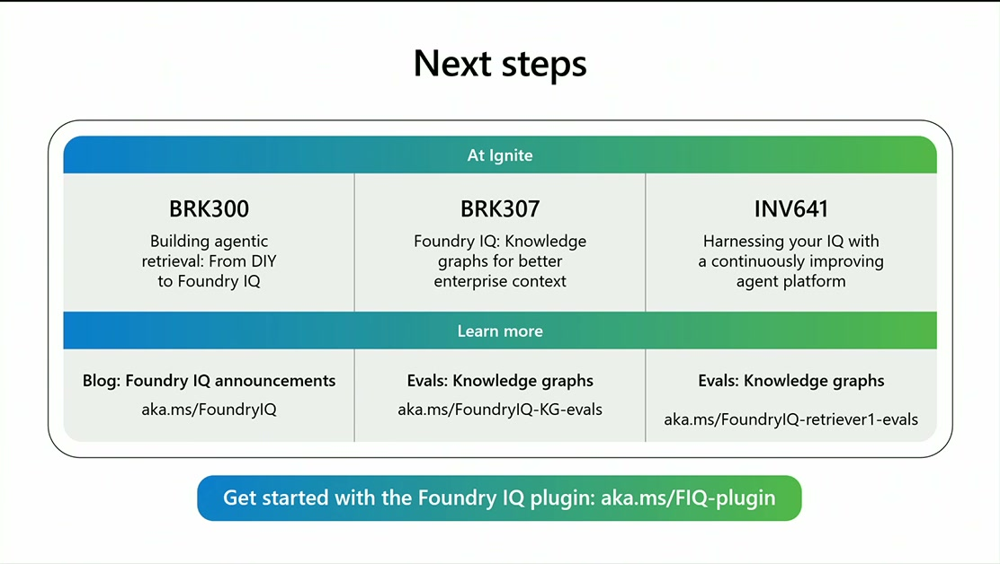

</td><td valign="top">

- Sessions at Ignite: **BRK300** (agentic retrieval: from DIY to Foundry IQ), **BRK307** (knowledge graphs for enterprise context) and **INV641** (harnessing your IQ with a continuously improving agent platform).
- Read more: aka.ms/FoundryIQ (blog), aka.ms/FoundryIQ-KG-evals and aka.ms/FoundryIQ-retriever1-evals.
- **Get started with the plugin:** aka.ms/FIQ-plugin.

</td></tr></table>

## 26. Thank you ▶ 44:59

<table><tr><td width="50%" valign="top">

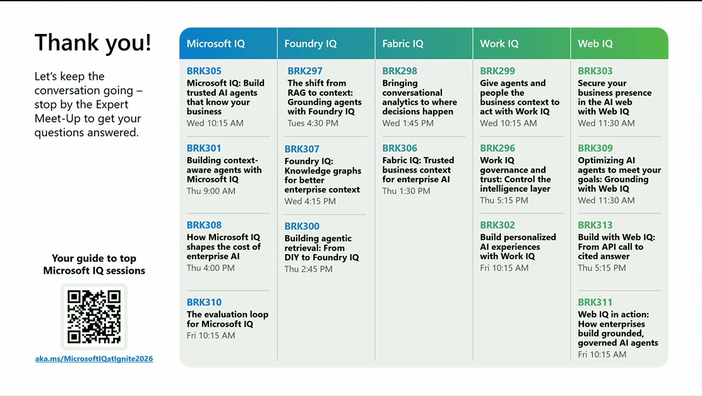

</td><td valign="top">

- Other Microsoft IQ sessions on the slide cover Microsoft IQ (BRK305, 301, 308, 310), Foundry IQ (BRK297, 307, 300), Fabric IQ (BRK298, 306), Work IQ (BRK299, 296, 302) and Web IQ (BRK303, 309, 313, 311).
- Session guide: aka.ms/MicrosoftIQatIgnite2026.

</td></tr></table>
