# BRK356: Microsoft IQ roadmap: The operating system for enterprise AI agents

**Session:** Microsoft Ignite 2026, BRK356 · 39:48
**Speaker:** Dorit Zilbershot (VP, Product Management, Microsoft IQ, Microsoft)

Timestamps refer to the session video (mm:ss). Notes are based on the official English captions. The slides were taken from the video, with one image per slide. Screens from the demo aren't included as slides, but the notes describe what the demo showed. Many slides are marked "Coming 2027": this is a roadmap session, so most of what it shows isn't available yet. Where a matching page exists, a section ends with links to Microsoft Learn.

---

## TL;DR

- **From tasks to processes:** agents are moving from answering questions to running operational processes. The hard part is no longer building an agent in an afternoon, but the six months it takes to get it into production with identity, policy, evals and governance. Microsoft IQ wants to be **the operating system for enterprise apps and agents**.
- **Context:** business plugins combine Work IQ, Fabric IQ, Foundry IQ and Web IQ behind one Microsoft IQ endpoint that also works with Claude, Gemini and ChatGPT. New: **business goals** become part of the context, and an **entity-centric knowledge graph** fuses facts from people (email, chats, meetings) with business entities (coming 2027).
- **Build and deploy:** agents and whole **solutions are defined as files in a repo** (agents, app, context, access, egress, approvals, budget, environments), reviewed like code and deployed through CI/CD. Microsoft IQ provides an **SDK + CLI** for coding agents and provisions database, models, sandbox, network and identities behind the scenes (coming 2027).
- **IQ loop:** the coding agent stays attached after the build, with engineering, business and governance loops that capture signals, evaluate, propose changes and ship them after human approval (coming 2027).
- **Govern:** every agent gets its own identity and an accountable owner, traced through Agent 365 and Azure Monitor, with sandboxed execution, continuous evals and AI-to-human approvals that resolve the right approver.
- **Demo:** Maya, a head of customer success, describes a business problem in Copilot and gets a governed escalation early-warning app with agents and generated evals, which 60 days later has improved itself through approved changes.

---

## 1. Roadmap: Microsoft IQ ▶ 00:00

<table><tr><td width="50%" valign="top">

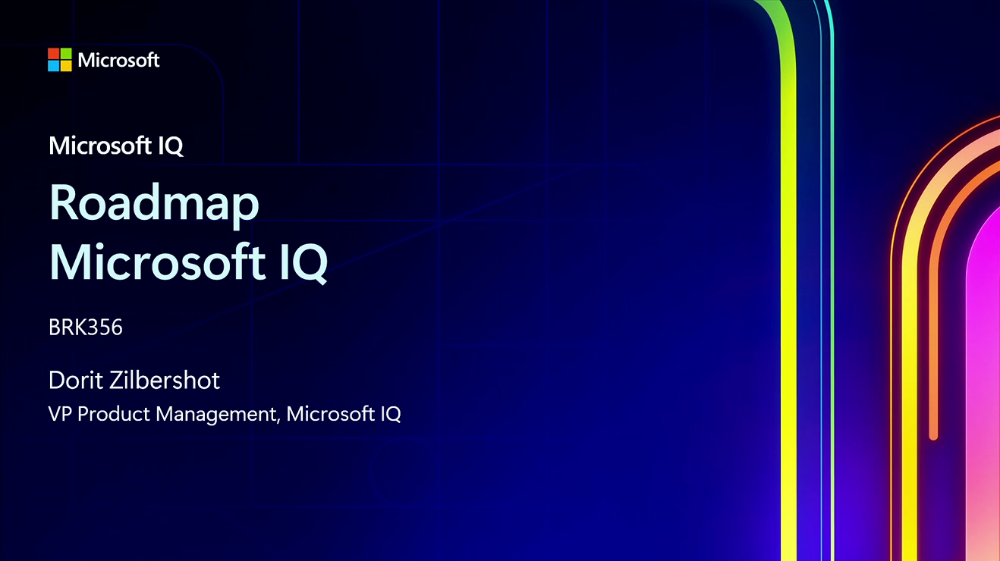

</td><td valign="top">

- Dorit Zilbershot (VP Product Management, Microsoft IQ) gives a look at what the Microsoft IQ team is working on and where it's heading.
- A show of hands: most of the room has built an AI agent, many for their team, and for many it took more than a week.

</td></tr></table>

## 2. Agents shifting from tasks to processes ▶ 00:54

<table><tr><td width="50%" valign="top">

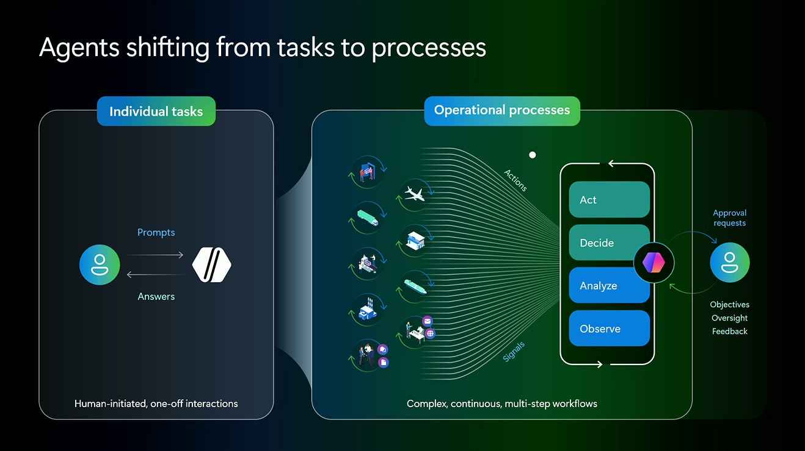

</td><td valign="top">

- **Before:** agents for individual tasks. You ask a question, you get an answer ("help me do my job").
- **Now:** agents that run operational processes: observe, analyze, decide and act, with approvals, oversight and feedback ("do the job").
- Single tasks are easy to build. Something that runs on its own, at scale, under enterprise constraints is much harder.

</td></tr></table>

## 3. Meet Maya ▶ 01:51

<table><tr><td width="50%" valign="top">

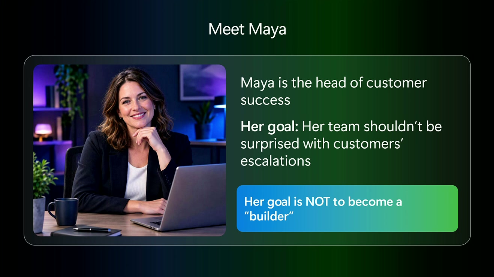

</td><td valign="top">

- Maya is head of customer success. Her goal is that her team is no longer surprised by customer escalations.
- Her goal is **not** to become a "builder". Coding agents still expect you to say what to build (an app, an agent). Maya wants to focus on her business.

</td></tr></table>

## 4. Maya's business problem ▶ 02:33

<table><tr><td width="50%" valign="top">

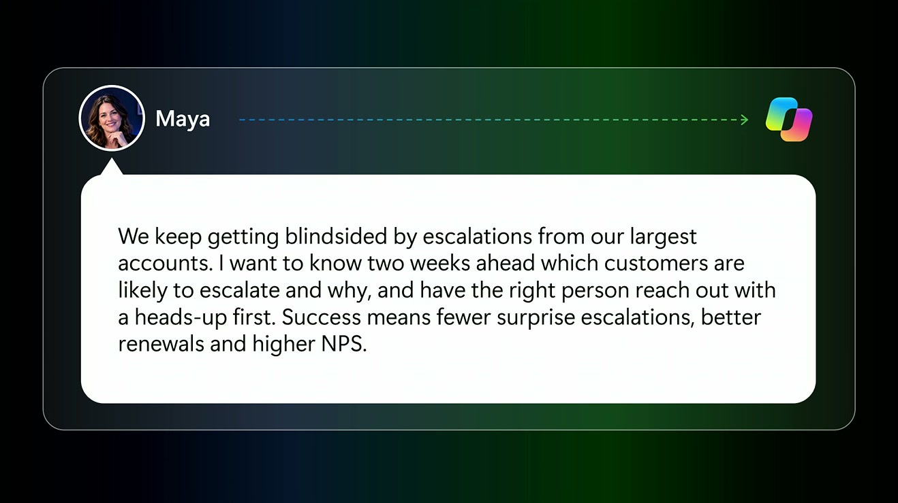

</td><td valign="top">

- Maya's prompt: she keeps getting blindsided by escalations from the largest accounts, wants to know two weeks ahead which customers are likely to escalate and why, and wants the right person to reach out first. Success means fewer surprise escalations, better renewals and higher NPS.
- She never asks for an app or an agent and says nothing technical. She states a business problem.
- The question for Microsoft IQ: how do you get from intent to a solution that works for the whole organization, with governance and compliance?

</td></tr></table>

## 5. The IQ Journey: Build and run solutions you can trust ▶ 03:10

<table><tr><td width="50%" valign="top">

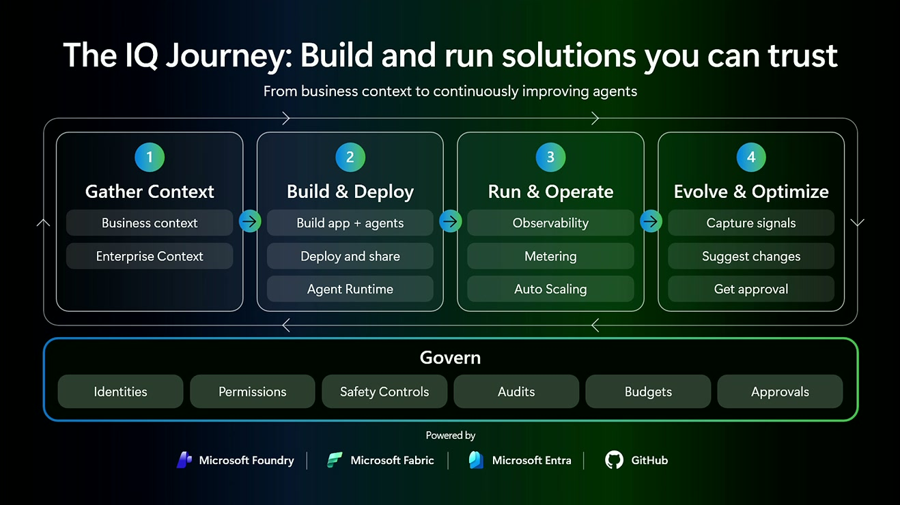

</td><td valign="top">

- The rest of the talk follows five steps:
  1. **Gather context:** how the solution knows what to build (business and enterprise context).
  2. **Build and deploy:** build app and agents, deploy and share, agent runtime.
  3. **Run and operate:** observability, metering, auto scaling.
  4. **Evolve and optimize:** capture signals, suggest changes, get approval ("the day after you ship").
  5. **Govern:** identities, permissions, safety controls, audits, budgets and approvals.
- Powered by Microsoft Foundry, Microsoft Fabric, Microsoft Entra and GitHub.

**Microsoft Learn:**
- [Microsoft IQ documentation hub](https://learn.microsoft.com/microsoft-iq)

</td></tr></table>

## 6. AI models are trained on general knowledge. They don't know your business ▶ 04:11

<table><tr><td width="50%" valign="top">

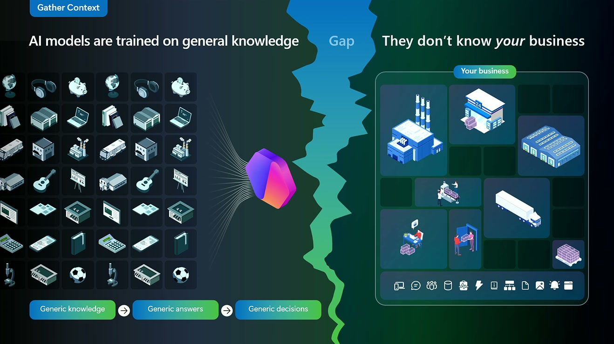

</td><td valign="top">

- Models know a lot, but not your processes, your stakeholders, how your team works or whether you prefer bullets or tables.
- That context matters for business agents, and also for **coding agents**, which need it to know what to build.

</td></tr></table>

## 7. Even if you give it some context, your agents today see an incomplete slice ▶ 04:45

<table><tr><td width="50%" valign="top">

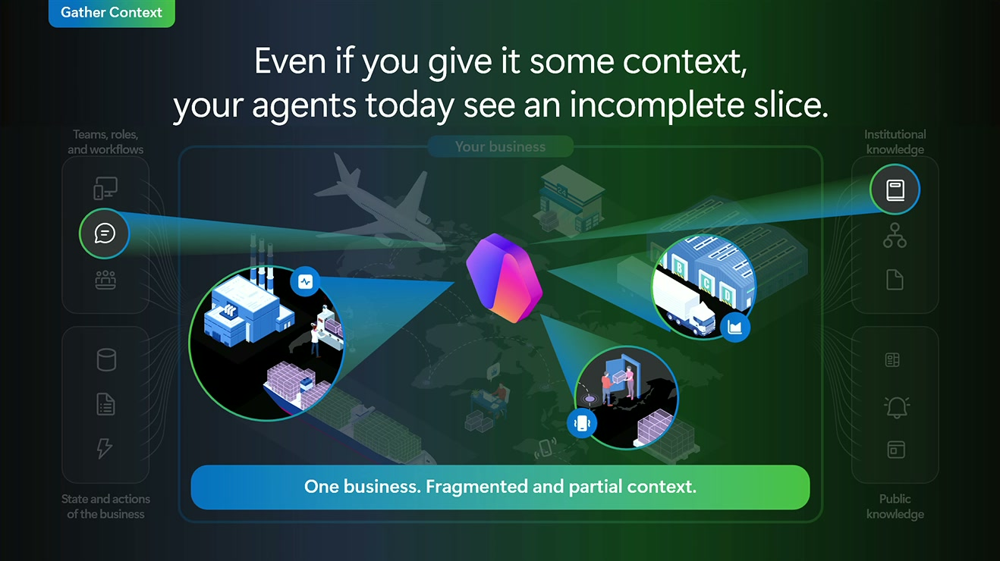

</td><td valign="top">

- Even with some context, agents see only part of the picture: "one business, fragmented and partial context".

</td></tr></table>

## 8. Your agents need the right context, not just more context ▶ 04:57

<table><tr><td width="50%" valign="top">

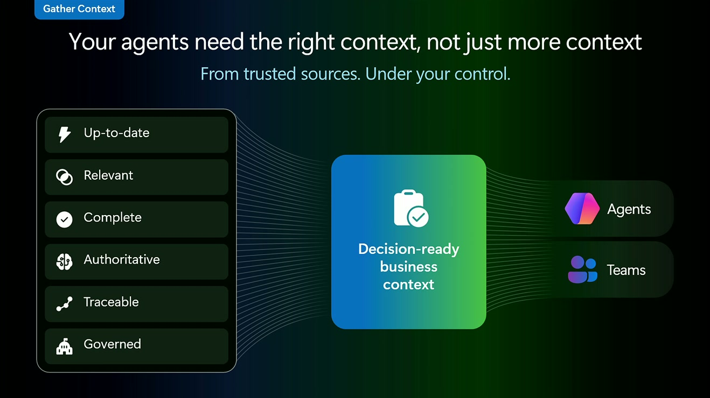

</td><td valign="top">

- Customers say their agents have the right context but not the *accurate* one. An agent answers from the right knowledge article, but misses an email that contradicts it.
- Context has to be up to date, relevant, complete, authoritative, traceable and governed: "from trusted sources, under your control".

</td></tr></table>

## 9. Microsoft IQ: unified context and intelligence for enterprise AI ▶ 05:22

<table><tr><td width="50%" valign="top">

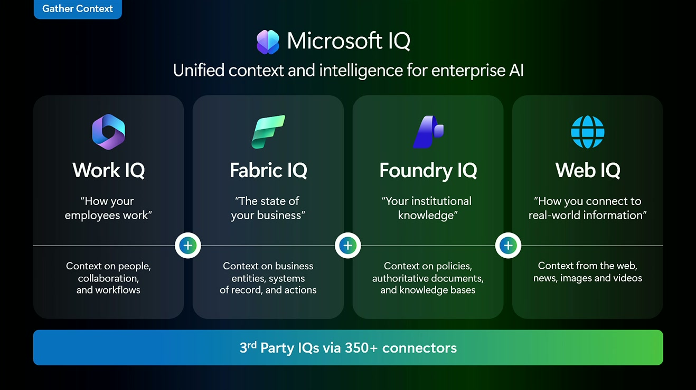

</td><td valign="top">

- The context plugins announced at the keynote:
  - **Work IQ:** how your employees work (email, chats, meetings).
  - **Fabric IQ:** the state of your business (semantic models, ontologies).
  - **Foundry IQ:** institutional knowledge (knowledge bases).
  - **Web IQ:** information from outside the company.
- Third-party IQs through 350+ connectors.

**Microsoft Learn:**
- [Microsoft IQ documentation hub](https://learn.microsoft.com/microsoft-iq)
- [Work IQ overview](https://learn.microsoft.com/microsoft-365/copilot/extensibility/work-iq)
- [What is Fabric IQ?](https://learn.microsoft.com/fabric/iq/overview)
- [What is Foundry IQ?](https://learn.microsoft.com/azure/foundry/agents/concepts/what-is-foundry-iq)
- [Microsoft Web IQ overview](https://learn.microsoft.com/web-iq/overview)

</td></tr></table>

## 10. Business context and expertise made reusable ▶ 05:47

<table><tr><td width="50%" valign="top">

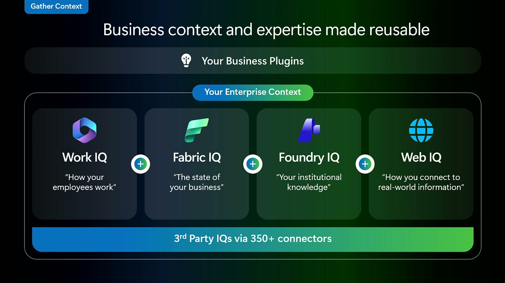

</td><td valign="top">

- **Business plugins** bring the four IQs together in a governed, authored way, so you stay in control of what your agents know.

</td></tr></table>

## 11. One Microsoft IQ endpoint ▶ 05:58

<table><tr><td width="50%" valign="top">

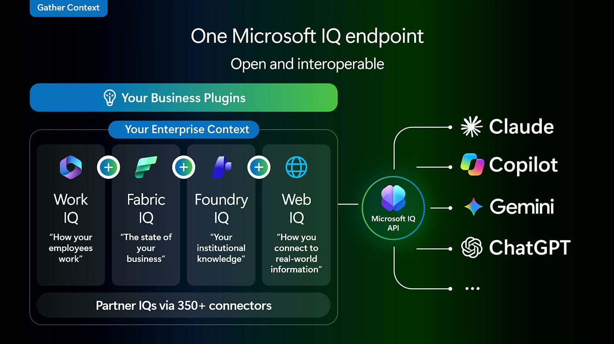

</td><td valign="top">

- Business plugins aren't limited to Copilot. Through one open, interoperable Microsoft IQ API you can plug them into **Claude, Gemini, ChatGPT** and others.

</td></tr></table>

## 12. Goals and business context become the solution blueprint ▶ 06:11

<table><tr><td width="50%" valign="top">

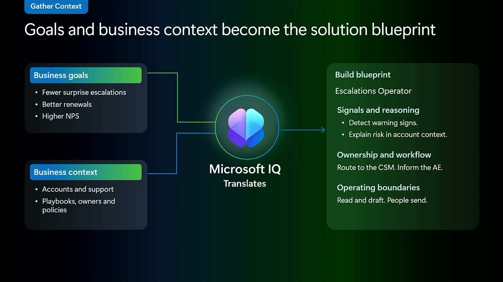

</td><td valign="top">

- **New:** besides business context, Microsoft IQ captures your **business goals** (in the example: fewer surprise escalations, better renewals, higher NPS).
- When a coding agent builds a Microsoft IQ solution, goals and context become a **build blueprint**: signals and reasoning, ownership and workflow, operating boundaries ("read and draft, people send").
- The goals come back later in the optimization loop.

</td></tr></table>

## 13. Business knowledge is fragmented by person ▶ 06:57

<table><tr><td width="50%" valign="top">

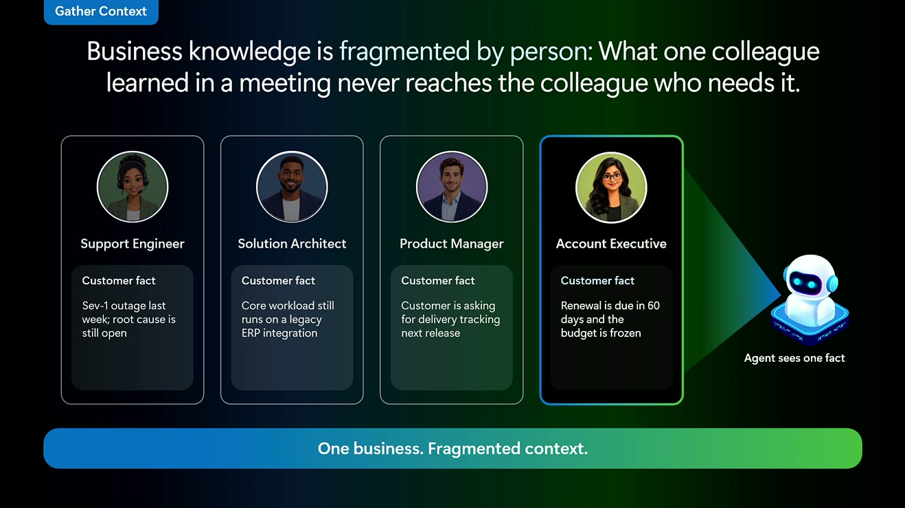

</td><td valign="top">

- Even with all four IQs, an individual doesn't have the full picture. Example: an account executive knows the renewal is due in 60 days and the budget is frozen, but not that:
  - the product manager promised a feature,
  - the solution architect found an issue with a legacy ERP integration,
  - the support engineer is handling a Sev-1 outage.
- That knowledge sits in meetings, emails and people's heads. The challenge is to bring in **individual knowledge**, not just institutional knowledge.

</td></tr></table>

## 14. Facts enrich every entity ▶ 08:10

<table><tr><td width="50%" valign="top">

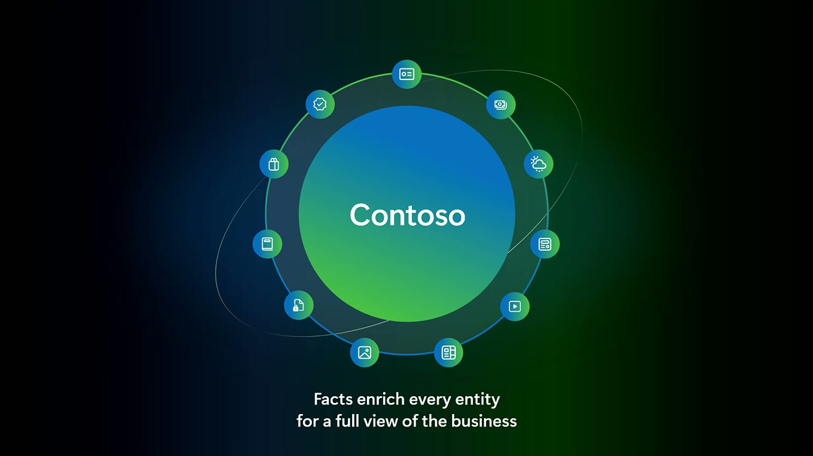

</td><td valign="top">

- Flip the problem around: start from the **business entity** (a customer, vendor, product, anything you define as an entity) instead of from the question.
- Around an approved entity like "Contoso" you collect facts ahead of time: feedback in an email, a completed survey, a meeting with support. The result is a knowledge graph of the organization.

**Microsoft Learn:**
- [What is ontology (preview)?](https://learn.microsoft.com/fabric/iq/ontology/overview)

</td></tr></table>

## 15. Business entities at the center ▶ 08:58

<table><tr><td width="50%" valign="top">

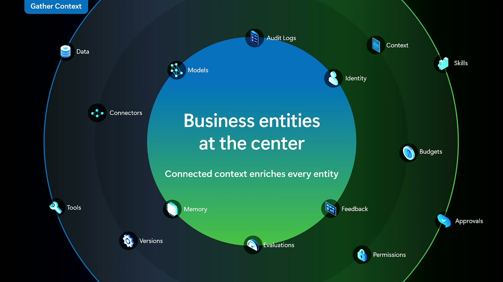

</td><td valign="top">

- The business entity becomes the center, with data, connectors, models, memory, feedback, evaluations, permissions and more around it: "connected context enriches every entity".

</td></tr></table>

## 16. Her agent answers from only what it can see ▶ 09:08

<table><tr><td width="50%" valign="top">

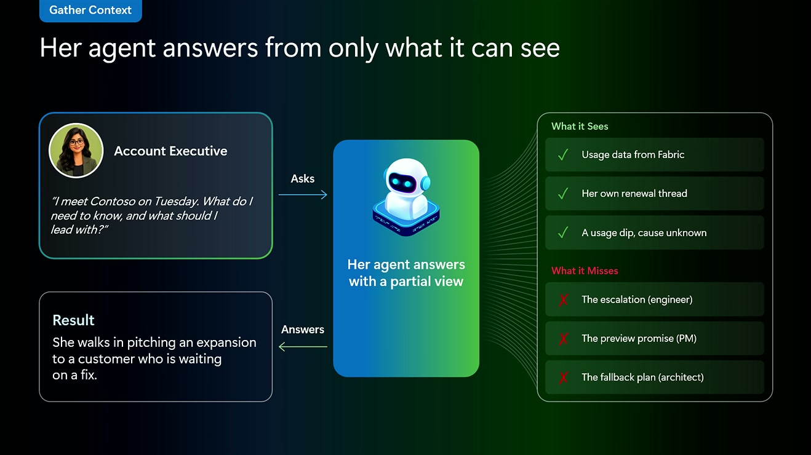

</td><td valign="top">

- Today the account executive asks "I meet Contoso on Tuesday, what do I need to know?" and gets a partial answer: usage data, her own renewal thread, a usage dip with unknown cause.
- She misses the escalation, the PM's promise and the architect's fallback plan, so she walks in pitching an expansion to a customer who is waiting for a fix.

</td></tr></table>

## 17. Agents need the right context. Finding the right data is the hardest problem (coming 2027) ▶ 09:40

<table><tr><td width="50%" valign="top">

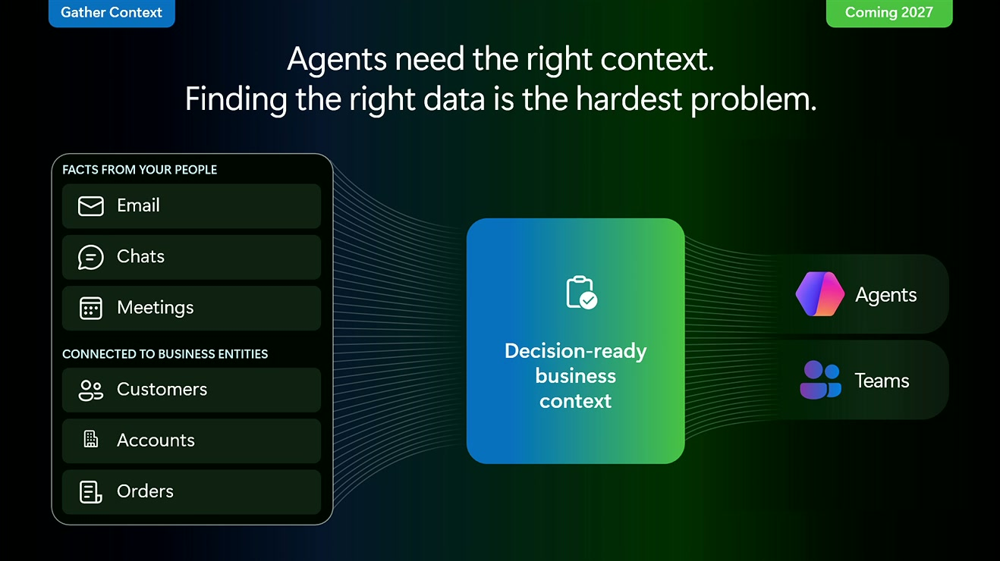

</td><td valign="top">

- **Coming 2027:** combine facts from people (email, chats, meetings) with data connected to business entities (customers, accounts, orders) into **decision-ready business context** for agents and Teams.

</td></tr></table>

## 18. Now her agent sees the full picture (coming 2027) ▶ 10:07

<table><tr><td width="50%" valign="top">

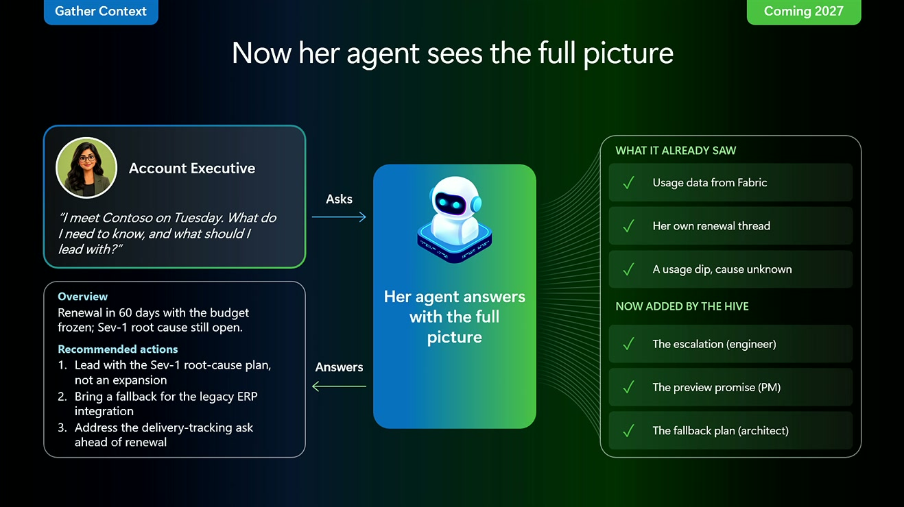

</td><td valign="top">

- The same question now also returns the facts from the product manager (waiting for a feature), the solution engineer (legacy ERP) and support (Sev-1).
- Recommended actions: lead with the Sev-1 root-cause plan instead of an expansion, bring a fallback plan for the ERP integration, address the delivery-tracking ask before the renewal.

</td></tr></table>

## 19. "I can build an agent in an afternoon but it is a 6-month project to bring it to production" ▶ 10:49

<table><tr><td width="50%" valign="top">

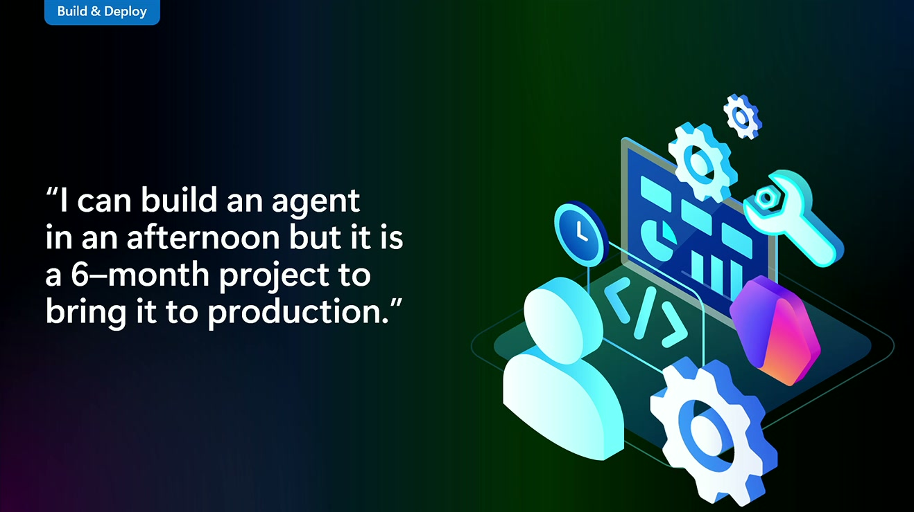

</td><td valign="top">

- On to **build and deploy**. Customers say they build an agent in an afternoon, but getting it used by a team and certified by IT becomes a six-month project.

</td></tr></table>

## 20. Complexity of building agents today ▶ 11:10

<table><tr><td width="50%" valign="top">

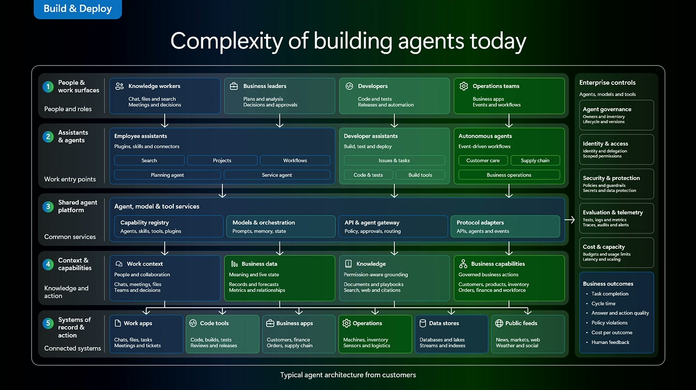

</td><td valign="top">

- A typical customer reference architecture with many boxes. The products exist; the hard part is **the glue** between them and knowing what good architecture looks like.

</td></tr></table>

## 21. Every new agent starts from scratch ▶ 11:44

<table><tr><td width="50%" valign="top">

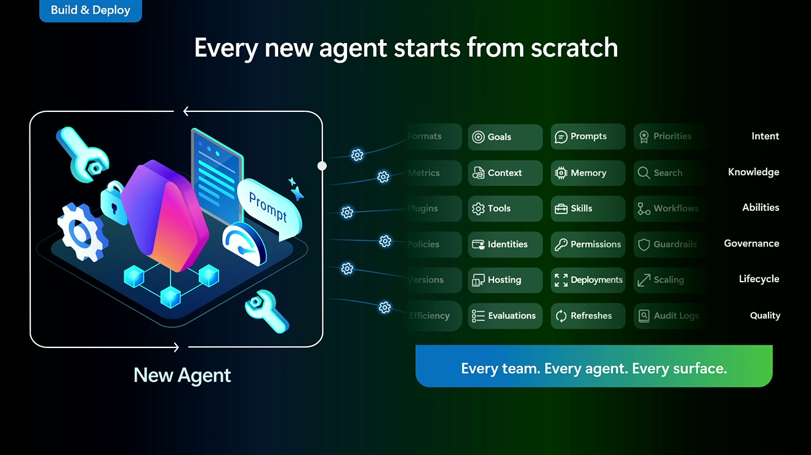

</td><td valign="top">

- Every team, every agent and every surface starts over: goals, prompts, context, tools, identities, permissions, hosting, evaluations. The time spent just building agents explodes.

</td></tr></table>

## 22. Organizations want to focus on the business logic, process, and outcomes ▶ 12:01

<table><tr><td width="50%" valign="top">

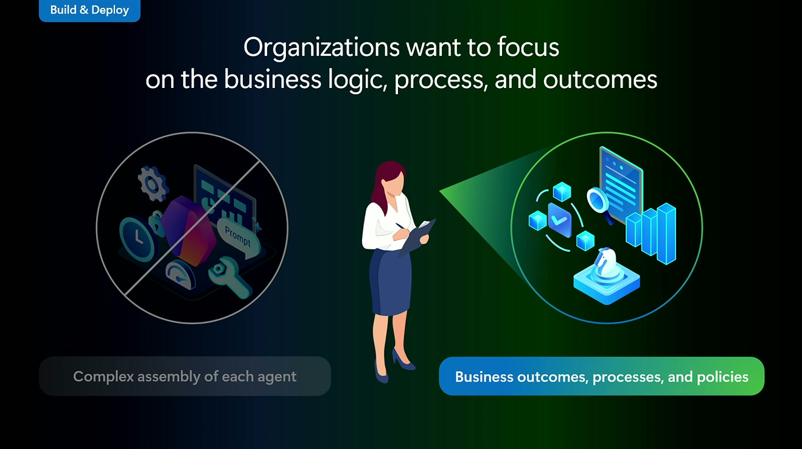

</td><td valign="top">

- Customers don't want to deal with plumbing or the assembly of each agent. They want to focus on business outcomes, processes and policies.

</td></tr></table>

## 23. The integration tax multiplies at enterprise scale ▶ 12:19

<table><tr><td width="50%" valign="top">

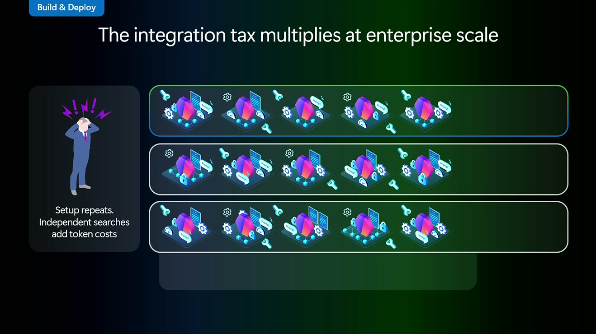

</td><td valign="top">

- Repeated setup and independent searches add token costs, multiplied across the enterprise.

</td></tr></table>

## 24. Apps and agents are becoming one ▶ 12:24

<table><tr><td width="50%" valign="top">

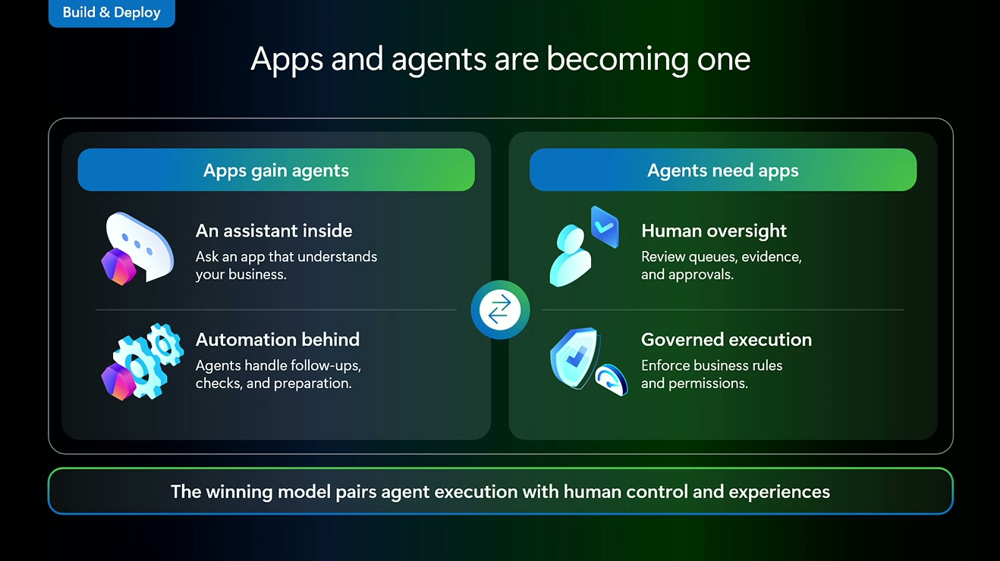

</td><td valign="top">

- It's no longer just agents: every agent needs a UX, and every app needs an agent.
  - **Apps gain agents:** an assistant inside, automation behind.
  - **Agents need apps:** human oversight (review queues, approvals) and governed execution.
- Separate app builders and agent builders are going away. A solution is a hybrid that pairs agent execution with human control and experiences.

</td></tr></table>

## 25. Your agent is an asset, not a chat ▶ 13:23

<table><tr><td width="50%" valign="top">

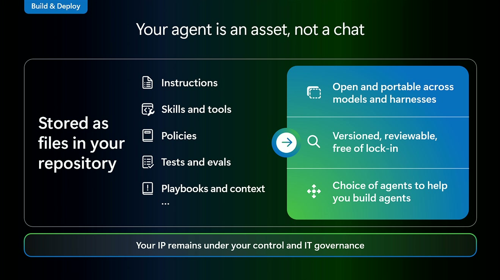

</td><td valign="top">

- An agent is a set of instructions, skills and tools, policies, tests and evals, and playbooks and context, **stored as files in your repository**.
- As files it's your IP: open and portable across models and harnesses, versioned and reviewable, free of lock-in.

</td></tr></table>

## 26. Define an agent with a set of files ▶ 14:02

<table><tr><td width="50%" valign="top">

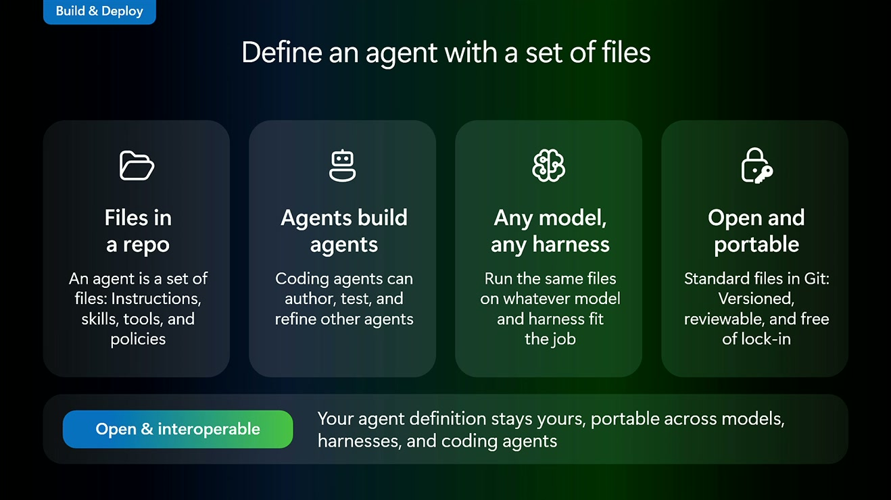

</td><td valign="top">

- Files in a repo; agents can build other agents; any model, any harness; standard files in Git, open and portable.

</td></tr></table>

## 27. Define a solution with a set of files (coming 2027) ▶ 14:17

<table><tr><td width="50%" valign="top">

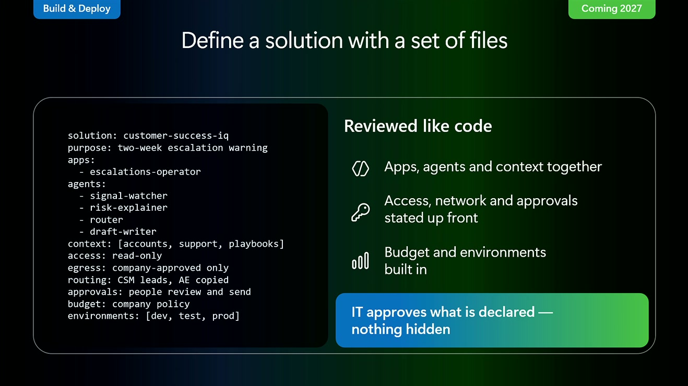

</td><td valign="top">

- **Coming 2027:** a solution (not just an app or an agent) is defined in one file: purpose, apps, agents, context, access, egress, routing, approvals, budget and environments (dev, test, prod).
- Reviewed like code: apps, agents and context together; access, network and approvals stated up front; budget and environments built in. "IT approves what is declared, nothing hidden".

</td></tr></table>

## 28. Deploy from test to production ▶ 14:45

<table><tr><td width="50%" valign="top">

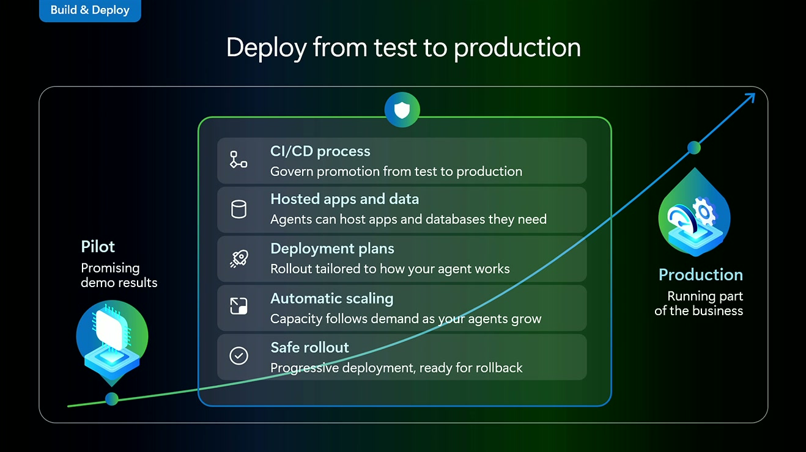

</td><td valign="top">

- Once it's a file, you can put a CI/CD process on it: hosted apps and data, deployment plans, automatic scaling as usage and autonomy grow, and safe progressive rollout with rollback.
- The goal is moving from pilot to production safely without rebuilding the agent each time.

</td></tr></table>

## 29. Microsoft IQ: SDK + CLI (coming 2027) ▶ 15:30

<table><tr><td width="50%" valign="top">

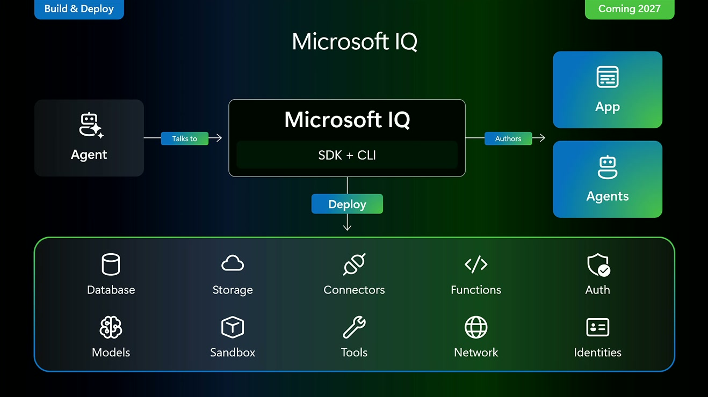

</td><td valign="top">

- Coding agents talk to Microsoft IQ (**SDK + CLI**), get the business context and goals, and produce an app and a set of agents.
- Behind the scenes Microsoft IQ deploys the database, storage, connectors, AI functions, auth, models (several, e.g. for images, simple answers or decisions), a **sandbox**, tools, network configuration and an **identity** for each agent.

</td></tr></table>

## 30. Flexible agentic experiences (coming 2027) ▶ 16:24

<table><tr><td width="50%" valign="top">

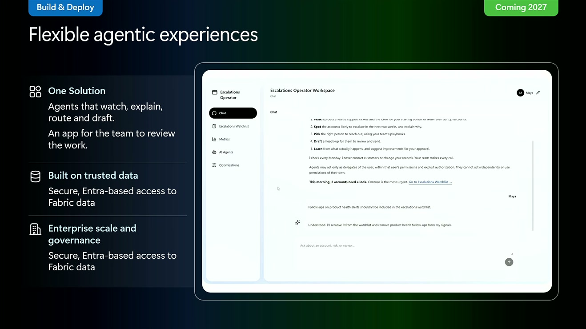

</td><td valign="top">

- One solution: agents that watch, explain, route and draft, plus an app where the team reviews the work.
- Built on trusted data (Entra-based access to Fabric data), with enterprise scale and governance.

</td></tr></table>

## 31. A running solution needs an operating system around it ▶ 16:45

<table><tr><td width="50%" valign="top">

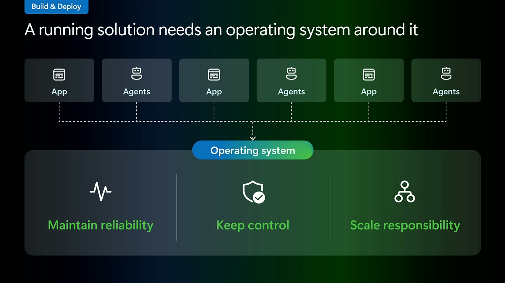

</td><td valign="top">

- Like Windows for applications, **Microsoft IQ aims to be the operating system for your apps and agents**: maintain reliability, keep control, scale responsibly.

</td></tr></table>

## 32. Deploy and scale agents and apps worldwide ▶ 17:20

<table><tr><td width="50%" valign="top">

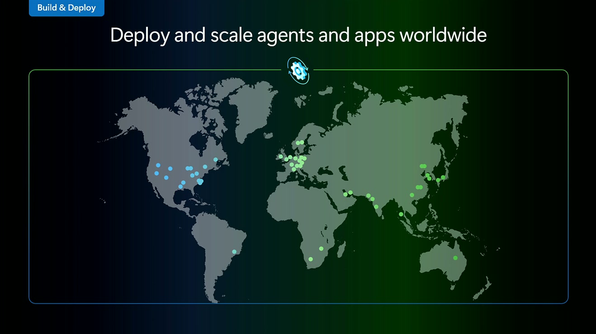

</td><td valign="top">

- Azure underneath gives multi-region deployment and scale.
- Example solutions that need this: customer support agents, IT service management, HR benefits, finance invoice processing.

</td></tr></table>

## 33. Deployed should mean ready to use. Not just provisioned ▶ 18:13

<table><tr><td width="50%" valign="top">

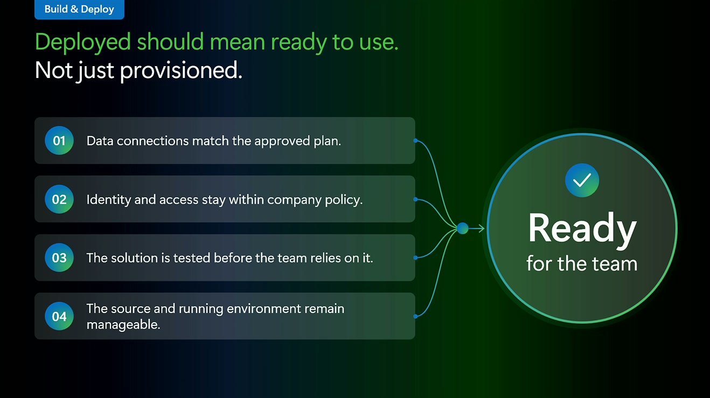

</td><td valign="top">

- Maya never specifies egress, networking or capacity. Microsoft IQ abstracts that, because it knows her business purpose. Ready for the team means:
  1. Data connections match the approved plan.
  2. Identity and access stay within company policy (part of the context).
  3. The solution is tested before the team relies on it: Microsoft IQ **generates the evals** from the data, context and purpose, so Maya doesn't need to be a data scientist.
  4. The source and running environment remain manageable: everything is files in a repo, so an IT pro developer can take over or extend it instead of rebuilding it from scratch.

</td></tr></table>

## 34. Built in an afternoon. Broken over time (coming 2027) ▶ 20:40

<table><tr><td width="50%" valign="top">

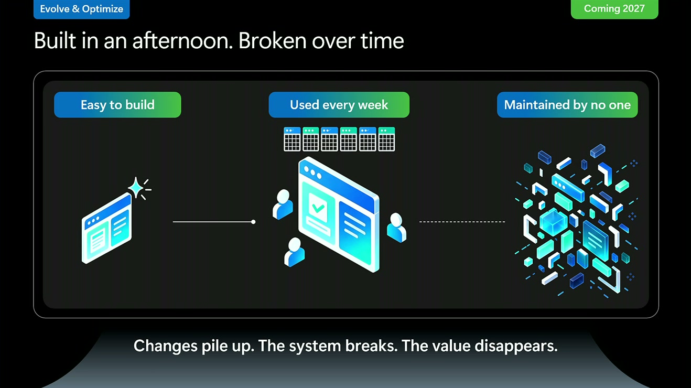

</td><td valign="top">

- Dorit's "favorite piece": easy to build, used every week, maintained by no one. An upstream schema change breaks the app, a KPI changes and the dashboard stops making sense, a missing feature stops adoption.
- You get to 80% quickly; the last 20% is the hard part.
- **Coming 2027:** the coding agent **stays with the application** after the build and keeps watching how the business runs, whether the system is healthy and how people use it. This is the **IQ loop**.

</td></tr></table>

## 35. The IQ Loop connects build and production (coming 2027) ▶ 22:16

<table><tr><td width="50%" valign="top">

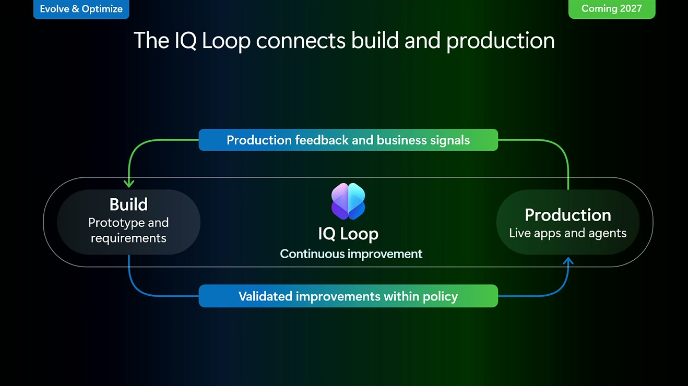

</td><td valign="top">

- Build and production are one loop: production feedback and business signals flow back, and validated improvements ship within policy.
- Signals include business data (a KPI or trend changes) and how users actually use the solution.

</td></tr></table>

## 36. IQ Loop (coming 2027) ▶ 23:01

<table><tr><td width="50%" valign="top">

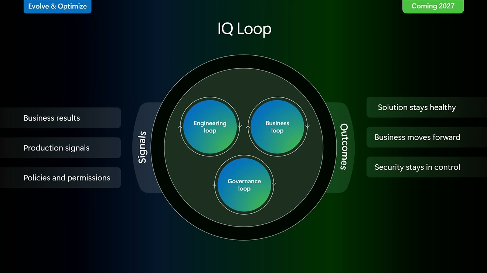

</td><td valign="top">

- A **signals layer** perceives the environment: system logs, usage, business results, policies and permissions, and what data the solution tries to touch that it shouldn't (or didn't last week).
- Three loops:
  - **Engineering loop:** the solution stays healthy.
  - **Business loop:** the goals from Maya's first prompt keep improving and aren't forgotten.
  - **Governance loop:** security stays in control.

</td></tr></table>

## 37. Evolve the solution ▶ 24:04

<table><tr><td width="50%" valign="top">

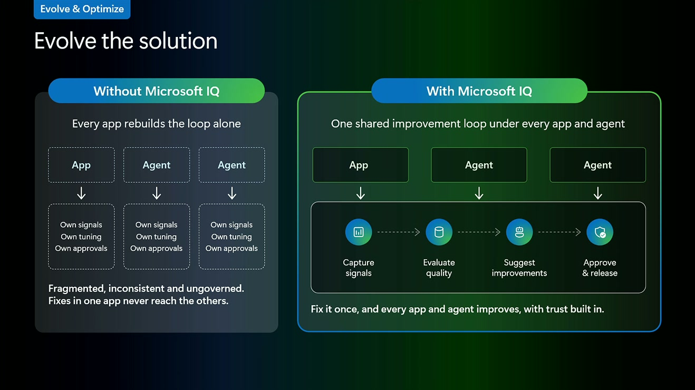

</td><td valign="top">

- **Without Microsoft IQ** every app rebuilds the loop alone (own signals, tuning and approvals): fragmented and ungoverned.
- **With Microsoft IQ** there's one shared loop under every app and agent: capture signals, evaluate quality (including A/B tests), suggest improvements, approve and release. "Fix it once, and every app and agent improves".
- The coding agent doesn't act on its own: it works with an owner who approves.

</td></tr></table>

## 38. What customers are building towards ▶ 25:06

<table><tr><td width="50%" valign="top">

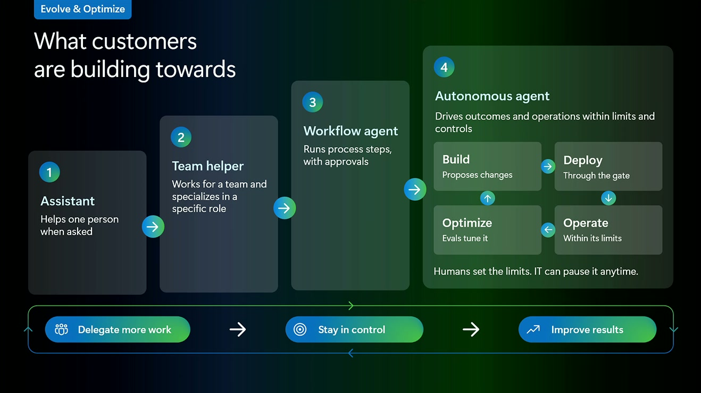

</td><td valign="top">

- The continuum: **assistant** (helps one person when asked), **team helper** (works for a team in a specific role), **workflow agent** (runs process steps with approvals), **autonomous agent** (drives outcomes within limits; humans set the limits and IT can pause it).
- Moving up the ladder also changes who must approve: business users may build assistants and team helpers, a workflow agent may need security approval, an autonomous one finance or IT.
- The same IQ solution evolves along the path instead of being rebuilt.

</td></tr></table>

## 39. Autonomy needs clear boundaries ▶ 27:10

<table><tr><td width="50%" valign="top">

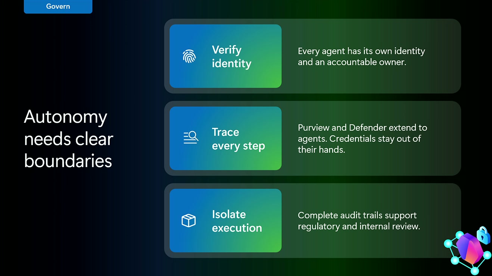

</td><td valign="top">

- **Verify identity:** every agent has its own identity and an accountable owner ("you don't have an employee with no management").
- **Trace every step:** connected to **Agent 365** and **Azure Monitor** to see activity and decisions. Purview and Defender extend to agents; credentials stay out of their hands.
- **Isolate execution:** agents with coding capabilities run in a sandbox so they can't build harmful tools for themselves.

**Microsoft Learn:**
- [What makes an agent governable?](https://learn.microsoft.com/microsoft-agent-365/guidance/agent-identity)
- [Agent 365 observability](https://learn.microsoft.com/microsoft-agent-365/developer/observability)

</td></tr></table>

## 40. Intelligence without trust is a great demo that doesn't get deployed ▶ 28:23

<table><tr><td width="50%" valign="top">

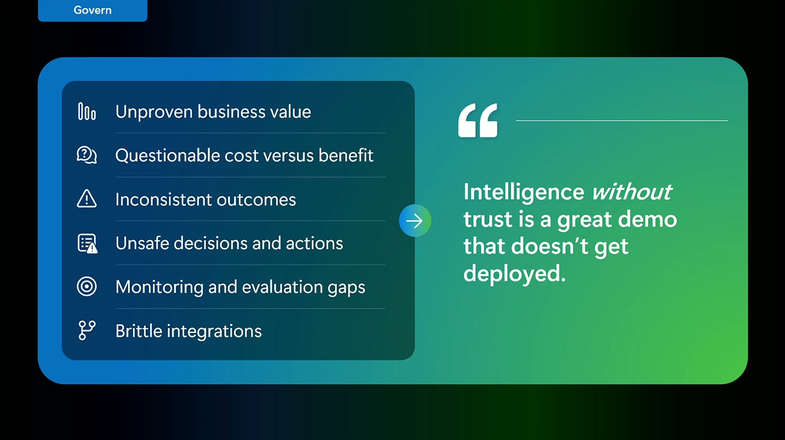

</td><td valign="top">

- Without trust there's no IT, CISO or finance approval. What blocks deployment: unproven business value, questionable cost versus benefit, inconsistent outcomes, unsafe decisions and actions, monitoring and evaluation gaps, and brittle integrations.
- Eval sets must run **continuously** and evolve with the business, not only at build time.

</td></tr></table>

## 41. Governance and trust ▶ 30:03

<table><tr><td width="50%" valign="top">

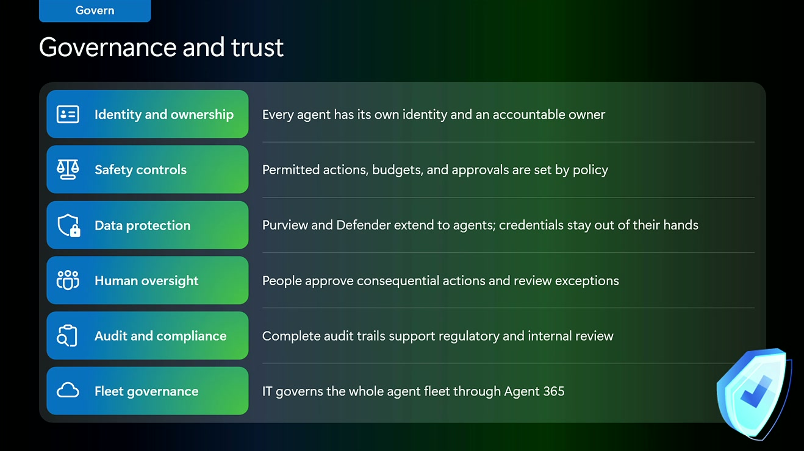

</td><td valign="top">

- Identity and ownership, safety controls (actions, budgets and approvals set by policy), data protection (Purview and Defender), human oversight, audit and compliance, and fleet governance through **Agent 365**.
- **AI-to-human in the loop (in the works):** when an agent needs approval (e.g. an invoice above $50,000), Microsoft IQ resolves who the right approver is, whether they're on vacation and who can stand in, instead of hard-coding a name in instructions.

**Microsoft Learn:**
- [What is Microsoft Agent 365?](https://learn.microsoft.com/microsoft-agent-365/overview)
- [Governing agent identities and access](https://learn.microsoft.com/entra/id-governance/agent-id-governance-overview)

</td></tr></table>

## 42. Give agents autonomy. Keep control ▶ 31:23

<table><tr><td width="50%" valign="top">

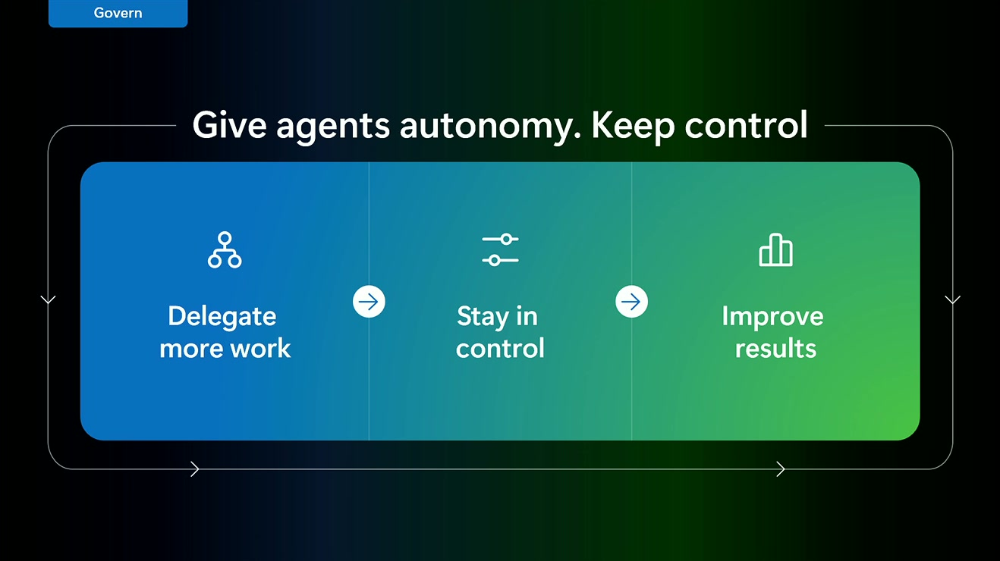

</td><td valign="top">

- Delegate more work, stay in control, improve results.
- **Demo (Maya in Copilot):**
  - Maya pastes her business problem. Microsoft IQ gathers the **business context** through business plugins (stakeholders, how large accounts and ARR are defined) and asks a clarifying question.
  - It finds the **policies**: Maya may only create read-only agents that act as delegates of users, not autonomous ones. The whole solution is shaped by that.
  - She gets an outcome plan with her business outcomes, approves read access, and it builds: a Foundry agent, Azure resources, an agent file with its policies and an app with an escalation watch list.
  - She refines in chat ("don't show follow-ups on product health") and the list updates. Heads-up email drafts go to the escalation owners.
  - It built an **eval set** from 18 months of history, hill-climbed quality, and added the optimization coding agent.
  - Maya shares a link with her team. The enterprise keeps full control and governance, and it wasn't a six-month project.

</td></tr></table>

## 43. 60 days later ▶ 35:29

<table><tr><td width="50%" valign="top">

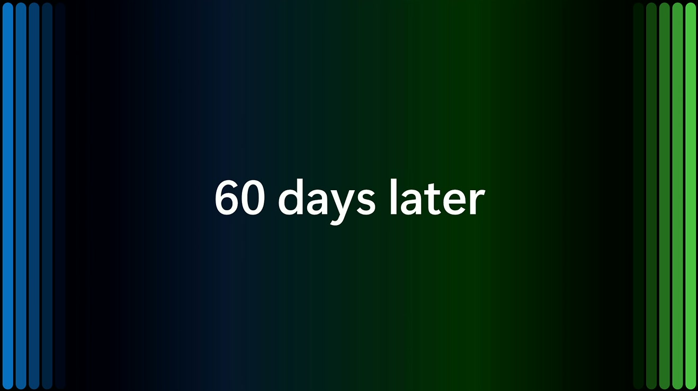

</td><td valign="top">

- **Demo, 60 days later:** the attached coding agent kept capturing signals, running evaluations and making recommendations. Escalations now come with a **12-day** heads-up.
  - **Engineering loop:** an upstream schema change showed up in the logs; it proposed a fix, IT approved it, and the app kept running.
  - **Business/usage loop:** people kept asking about customer cases in chat, so it proposed a new "customer cases" tab.
  - Everyone only looked at high-risk items, so it proposed a high-risk filter. Maya approved; the coding agent implemented, tested and deployed it.

</td></tr></table>

## 44. How Microsoft IQ accelerates your AI journey ▶ 38:04

<table><tr><td width="50%" valign="top">

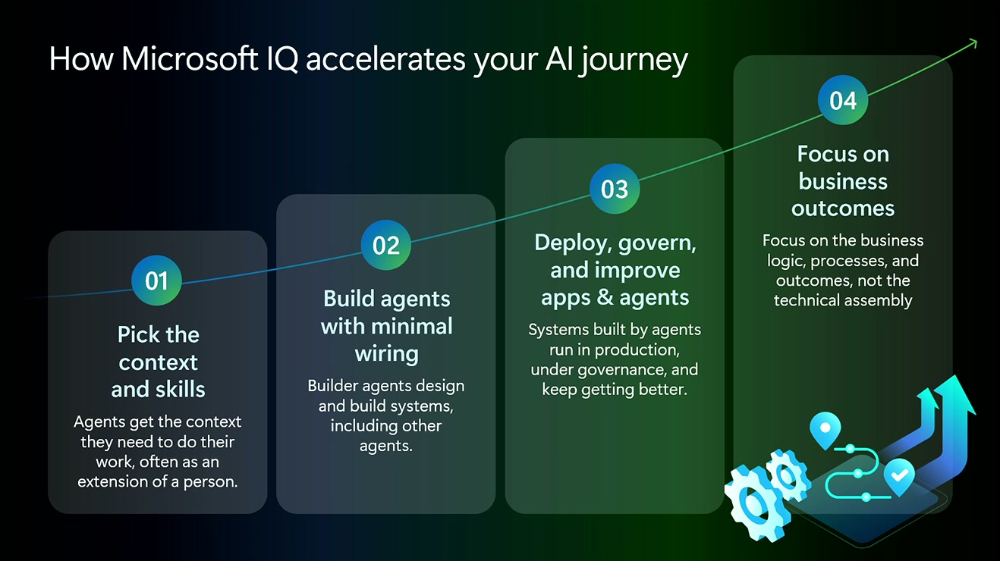

</td><td valign="top">

1. **Pick the context and skills:** get context out of inboxes, meetings and heads into business context for every agent and employee.
2. **Build agents with minimal wiring:** no need to become a cloud or IT engineer.
3. **Deploy, govern and improve apps and agents:** the loop keeps evolving instead of going stale after three months.
4. **Focus on business outcomes:** it's not about becoming a builder or having more tools; every solution has a business purpose at its core.

</td></tr></table>

## 45. Empowering Frontier Transformation ▶ 39:18

<table><tr><td width="50%" valign="top">

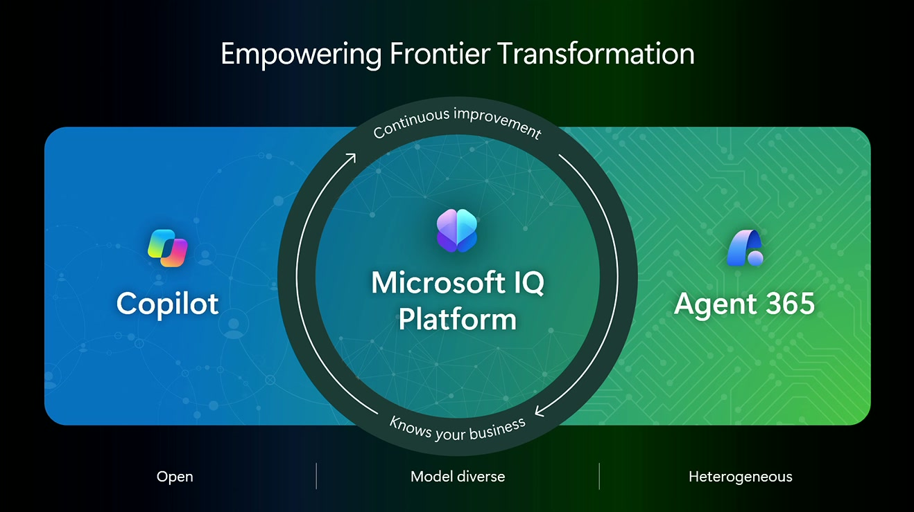

</td><td valign="top">

- The Microsoft IQ platform sits between Copilot and Agent 365: it knows your business and keeps improving. Open, model diverse, heterogeneous.
- A short Q&A followed (not in the captions).

**Microsoft Learn:**
- [Microsoft IQ documentation hub](https://learn.microsoft.com/microsoft-iq)
- [What is Microsoft Agent 365?](https://learn.microsoft.com/microsoft-agent-365/overview)

</td></tr></table>
