# BRK420: Deploy and run Microsoft Foundry models and agents on AKS

**Session:** Microsoft Ignite 2026, BRK420 · 44:58
**Speakers:** Brendan Burns (Corporate Vice President, Microsoft Azure), Jorge Palma (Microsoft)

Timestamps refer to the session video (mm:ss). The slides were taken from the video, with one image per slide. Screens from the live demo aren't included as slides, but the notes describe what the demo showed. Where a matching page exists, each section ends with links to Microsoft Learn.

---

## TL;DR

- **Why AKS for AI:** inference is taking over infrastructure spend, most AI workloads run on Kubernetes, open-weight models are rising and AI is deployed across cloud, on-premises and edge. Running it in production is still very complex.
- **AKS AI Manager for Foundry (announced):** deploy Foundry catalog models, including open-weight ones, onto your own AKS clusters from the Foundry portal, with GPU selection, autoscaling, model streaming and image caching handled for you. **Run Foundry models on AKS** is in limited public preview.
- **Foundry hosted agents on AKS (limited public preview):** a Foundry resource can use AKS compute for agents. Each session runs in its own micro-VM sandbox, under your network, storage, supply chain and observability controls.
- **Flex nodes for AKS (public preview):** join any Linux machine (an NVIDIA Jetson in a factory in the demo) to an AKS cluster, so data like camera images stays on-site while cloud agents call the local model.
- **Agent Grid:** network security for agents that blocks unapproved egress and can allow or deny individual MCP calls, shown in the portal as a flow map.
- **Demo:** a fictional pharma manufacturer (Caldova) fine-tunes Llama 3.3 70B, runs a vision model at the edge and cuts line-stop troubleshooting to about four minutes. When regulation changes, it moves the whole app to a bare-metal AKS cluster on-premises with GitOps.

---

## 1. Agents are rewriting the rules of infrastructure ▶ 00:00

<table><tr><td width="50%" valign="top">

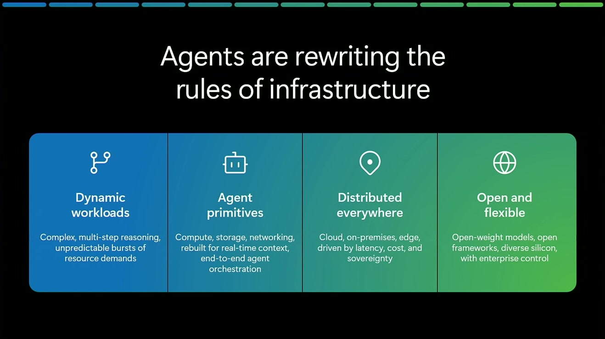

</td><td valign="top">

- Brendan Burns (Corporate Vice President, Azure: cloud native, Kubernetes, open source, Azure Linux) introduces the session; Jorge Palma demos the product.
- Agents change infrastructure in four ways:
  - **Dynamic workloads:** multi-step reasoning with unpredictable bursts of resource demand.
  - **Agent primitives:** fast access to compute, storage and networking for real-time context, plus end-to-end agent orchestration.
  - **Distributed everywhere:** cloud, on-premises and edge, close to the data, driven by latency, cost and sovereignty.
  - **Open and flexible:** open-weight models, open frameworks and diverse silicon, with enterprise control.

</td></tr></table>

## 2. AI is changing how applications are built and run ▶ 02:04

<table><tr><td width="50%" valign="top">

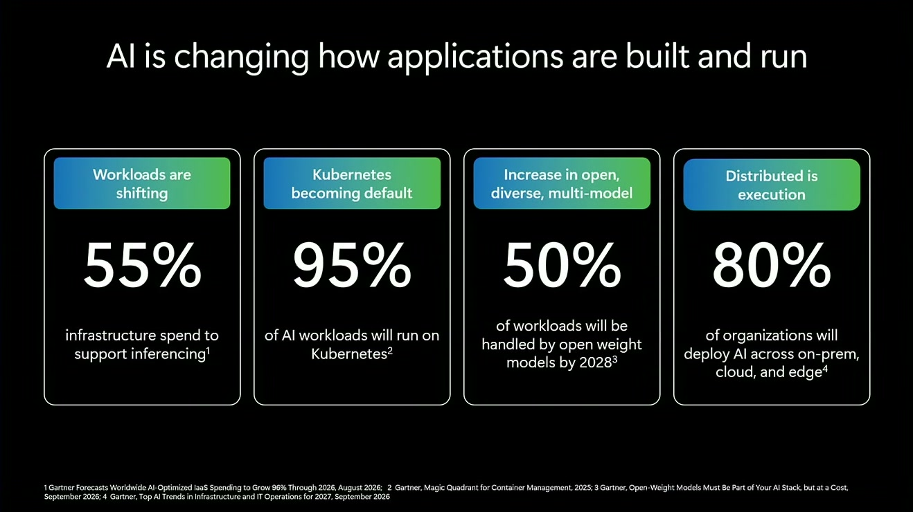

</td><td valign="top">

- Gartner figures on the slide:
  - **55%** of infrastructure spend goes to inferencing (money that used to go to CPU now goes to GPU).
  - **95%** of AI workloads will run on **Kubernetes**, which is now "the absolute foundation" for AI applications.
  - **50%** of workloads will be handled by open-weight models by 2028.
  - **80%** of organizations will deploy AI across on-premises, cloud and edge.
- As in the early container days, the landscape churns constantly. Distributed systems are now the execution model, both for distributed inference across GPUs and for fleets of agents running in parallel.

</td></tr></table>

## 3. Why organizations choose Kubernetes ▶ 03:48

<table><tr><td width="50%" valign="top">

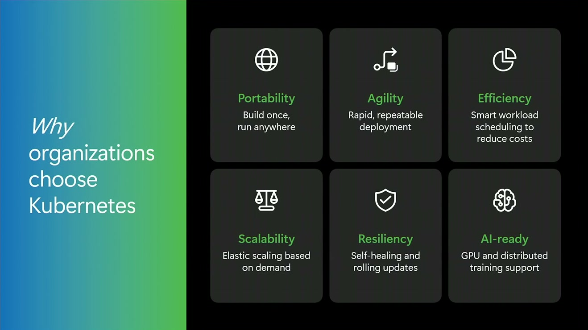

</td><td valign="top">

- The same reasons as for app modernization: portability across clouds and between cloud and on-premises (take the workload to wherever GPU capacity is), agility to iterate fast, efficiency, scalability, resilience and an infrastructure that understands GPUs.

**Microsoft Learn:**
- [AI and ML workloads in AKS](https://learn.microsoft.com/azure/aks/ai-ml-overview)

</td></tr></table>

## 4. Complexity of production AI today ▶ 04:37

<table><tr><td width="50%" valign="top">

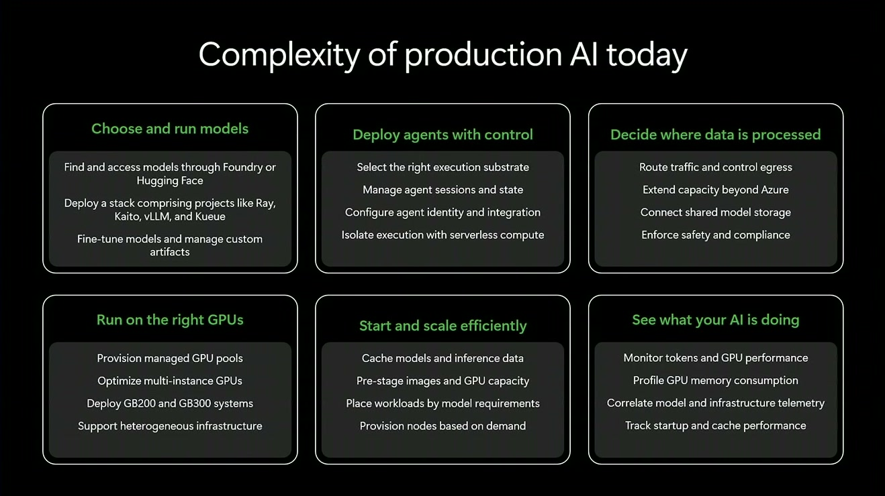

</td><td valign="top">

- A Helm chart gets you part of the way, but production AI is complicated:
  - choose and run models (Foundry or Hugging Face, Ray, KAITO, vLLM, Kueue, fine-tuning),
  - run on the right GPUs (managed GPU pools, multi-instance GPUs, GB200 and GB300),
  - deploy agents with control (execution substrate, sessions and state, identity, isolation),
  - start and scale efficiently (cache models and inference data, pre-stage images),
  - decide where data is processed (traffic and egress, capacity beyond Azure, compliance),
  - see what your AI is doing (tokens, GPU memory, correlated model and infrastructure telemetry).
- The rest of the talk is about making this simpler.

**Microsoft Learn:**
- [Deploy an AI model on AKS with the AI toolchain operator (KAITO)](https://learn.microsoft.com/azure/aks/ai-toolchain-operator)

</td></tr></table>

## 5. Run AI your way on Azure ▶ 05:20

<table><tr><td width="50%" valign="top">

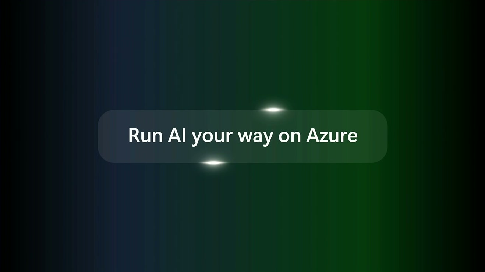

</td><td valign="top">

- An intro video shows where Microsoft is heading: faster, more predictable inference ("more from every GPU"), open models and runtimes from cloud to edge, and isolated, governed agents.
- It introduces the **AKS AI Manager**, which connects the managed Foundry service all the way to Azure Kubernetes Service.

</td></tr></table>

## 6. A connected application journey ▶ 06:12

<table><tr><td width="50%" valign="top">

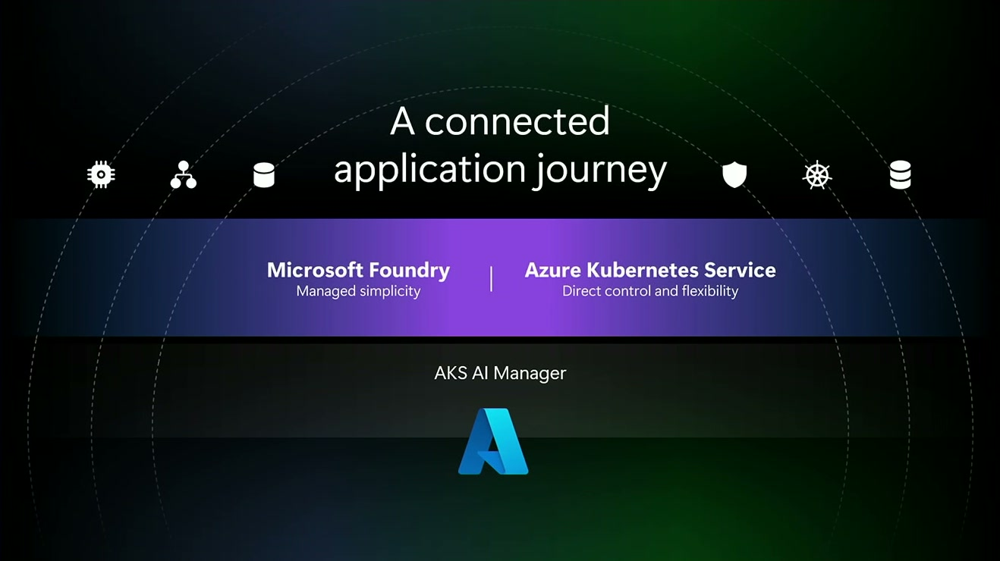

</td><td valign="top">

- One continuum from the "easy button" (deploy a model as a service in **Microsoft Foundry**, managed simplicity) to running open infrastructure and open-weight models on your own clusters (**AKS**, direct control and flexibility), with **AKS AI Manager** in between.
- Jorge Palma takes over: many customers use both Foundry and AKS and asked to run their Foundry models and agents on the AKS infrastructure they already have.

</td></tr></table>

## 7. Announcing: AKS AI Manager for Foundry ▶ 06:57

<table><tr><td width="50%" valign="top">

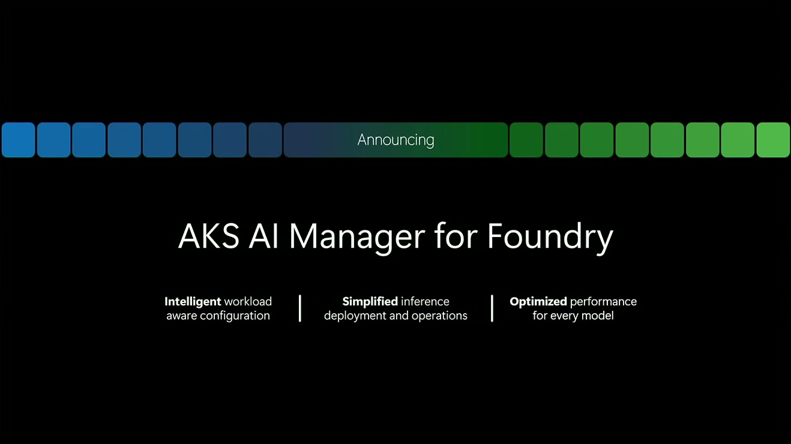

</td><td valign="top">

- **AKS AI Manager for Foundry:** intelligent, workload-aware configuration; simplified inference deployment and operations; optimized performance for every model.

**Microsoft Learn:**
- [AI Manager concepts (preview)](https://learn.microsoft.com/azure/aks/ai-manager/concepts)

</td></tr></table>

## 8. From cloud platform to AI infrastructure ▶ 07:23

<table><tr><td width="50%" valign="top">

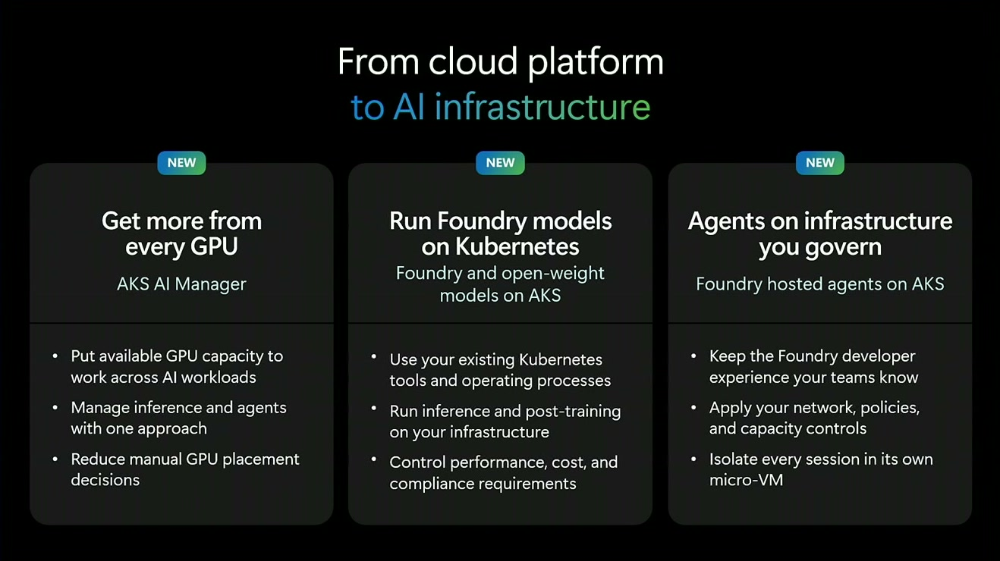

</td><td valign="top">

- Three new capabilities:
  - **Get more from every GPU (AKS AI Manager):** an API that deploys models from Foundry to AKS. No need to install and wire up ten Helm charts yourself, but it's still a fully open-source stack. Run open-weight models from the catalog, or bring your own Hugging Face key.
  - **Run Foundry models on Kubernetes:** use your existing Kubernetes tools and processes, run inference and post-training on your own infrastructure, and control performance, cost and compliance.
  - **Agents on infrastructure you govern (Foundry hosted agents on AKS):** keep the Foundry developer experience, apply your network, policies and capacity controls, and isolate every session in its own micro-VM.

**Microsoft Learn:**
- [AI Manager concepts (preview)](https://learn.microsoft.com/azure/aks/ai-manager/concepts)
- [Hosted agents in Foundry Agent Service](https://learn.microsoft.com/azure/foundry/agents/concepts/hosted-agents)

</td></tr></table>

## 9. Build, run, and govern AI on your terms ▶ 08:31

<table><tr><td width="50%" valign="top">

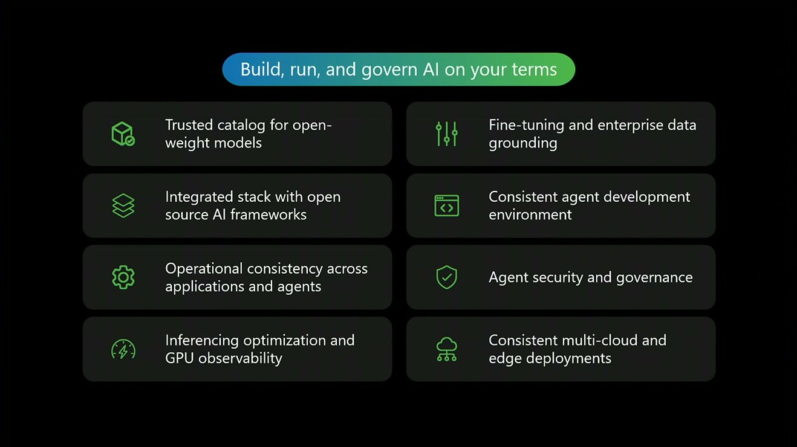

</td><td valign="top">

- What the Foundry and AKS combination keeps:
  - a trusted catalog for open-weight models, and fine-tuning with enterprise data,
  - an integrated stack with open-source AI frameworks and a consistent agent development environment,
  - operational consistency across apps and agents, plus agent security and governance,
  - inference optimization and GPU observability, and consistent multicloud and edge deployments.
- Everything stays observable and auditable on infrastructure you already own.

</td></tr></table>

## 10. Fix the incidents behind recurring micro-stops ▶ 09:06

<table><tr><td width="50%" valign="top">

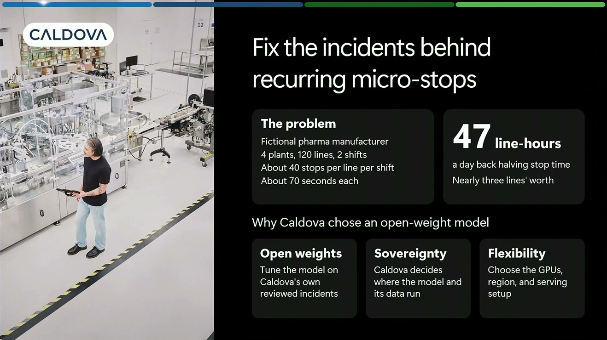

</td><td valign="top">

- **Demo scenario: Caldova**, a fictional pharma manufacturer with 4 plants, 120 lines and 2 shifts. Each line stops about 40 times per shift for about 70 seconds. Halving stop time wins back **47 line-hours a day**, nearly three lines' worth.
- Caldova already runs its applications on AKS: vetted, compliant and approved by regulators. It wants full control over data and infrastructure, and its estate is heterogeneous (multiple clusters, cloud and on-premises).
- Why an open-weight model: **open weights** (tune it on Caldova's own reviewed incidents), **sovereignty** (Caldova decides where model and data run) and **flexibility** (choice of GPUs, region and serving setup).

</td></tr></table>

## 11. Demo: Running Foundry inferencing and agents on AKS ▶ 11:06

<table><tr><td width="50%" valign="top">

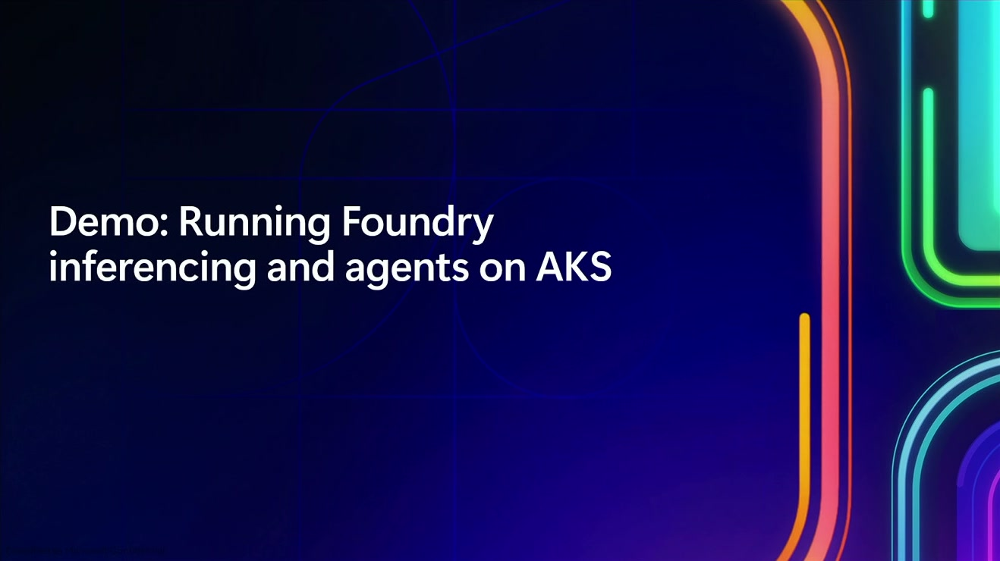

</td><td valign="top">

- **Demo (about 20 minutes):**
  - The production line app shows an issue on line 7. Manual troubleshooting and root-cause analysis can take 40 hours; restarting equipment takes at least 20 minutes.
  - **Create a Foundry resource:** under agent hosting you can now pick **AKS compute** next to Foundry managed compute, with storage and an identity. The resource comes with an agent cluster attached.
  - **Attach clusters in the Foundry portal:** add an inference cluster (West US) next to the agent cluster.
  - **Deploy an open-weight model** (Llama 3.3 70B Instruct) to the AKS cluster. Foundry and AKS pick GPUs and replicas, enable autoscaling, **model streaming** and **image caching/streaming** (container pulls from minutes to seconds). You only click deploy.
  - **Fine-tune** on Caldova's incident data in the same clusters (training failure rate dropped about 70%), then deploy the tuned model the same way.
  - **AI Manager in the Azure portal** shows both deployments and their GPUs.
  - **Flex nodes:** CCTV images of the lines may not leave the plants. An NVIDIA Jetson AGX Thor in a plant joins the AKS cluster as a flex node, and a vision model (Qwen3-VL) is deployed onto it. The agent in the cloud calls that endpoint; images never leave the plant. Model access uses Entra ID with short-lived tokens, not API keys.
  - The cluster shows system, GPU, training (scaled to zero) and edge node pools side by side. **Observability** combines model and infrastructure metrics (latency, throughput, GPU utilization and memory, cost per node pool) so platform and AI engineers can tune together.
  - **Deploy the investigation agent** (Python, tools for the models, image processing and internal APIs) from **VS Code** to Foundry. Because the workspace uses AKS compute, it lands in the cluster in a **sandbox: its own micro-VM** with network and security policies you can inspect and extend.
  - Troubleshooting drops from hours to about **four minutes**. Foundry traces show every step, including the plant camera image.
  - **Agent Grid** blocked the agent from calling a supplier's website (data exfiltration risk). The Azure portal shows the policies, a flow graph with the blocked call in red, and lets you allow or deny specific **MCP calls** (here: only GET calls to the maintenance MCP server). Existing AKS policies (allowed images and so on) keep working.
  - **Regulation change:** Caldova must run the app on-premises. They create a full **bare-metal AKS cluster** on plant hardware (Ubuntu), ask **Copilot** which manifest changes are needed, open a PR, and sync both clusters with GitOps. The app now runs in plant 2.

**Microsoft Learn:**
- [Quickstart: Deploy a model with AI Manager (preview)](https://learn.microsoft.com/azure/aks/ai-manager/quickstart)
- [Flex nodes for AKS overview (preview)](https://learn.microsoft.com/azure/aks/flex-nodes-for-aks-overview)
- [Hosted agents in Foundry Agent Service](https://learn.microsoft.com/azure/foundry/agents/concepts/hosted-agents)
- [What is Azure Agent Grid? (limited preview)](https://learn.microsoft.com/azure/agent-grid/overview)

</td></tr></table>

## 12. One AI system spans Azure and the planet ▶ 31:35

<table><tr><td width="50%" valign="top">

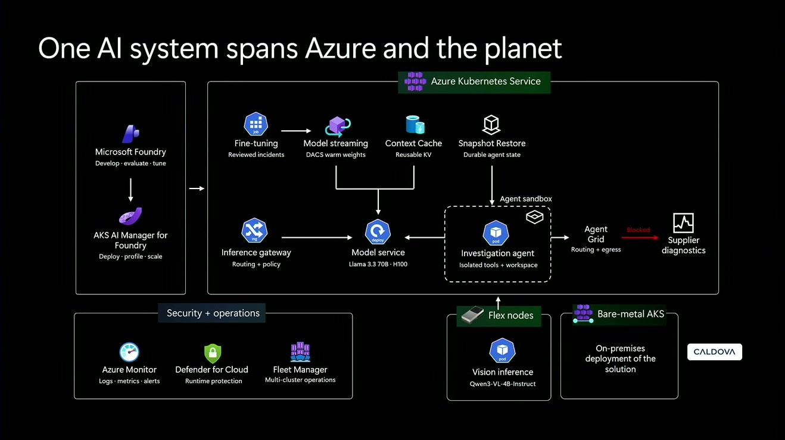

</td><td valign="top">

- The demo architecture: Microsoft Foundry and AKS AI Manager for Foundry deploy, profile and scale. On AKS: fine-tuning on reviewed incidents, model streaming, context cache and snapshot restore, an inference gateway, the model service (Llama 3.3 70B on H100), the investigation agent in an **agent sandbox**, and **Agent Grid** for routing and egress.
- Vision inference (Qwen3-VL) runs on **flex nodes** in the plant; the solution also runs on **bare-metal AKS** on-premises. Azure Monitor, Defender for Cloud and Fleet Manager cover security and operations.

**Microsoft Learn:**
- [What is Azure Agent Grid? (limited preview)](https://learn.microsoft.com/azure/agent-grid/overview)

</td></tr></table>

## 13. Run Foundry models on AKS (limited public preview) ▶ 32:16

<table><tr><td width="50%" valign="top">

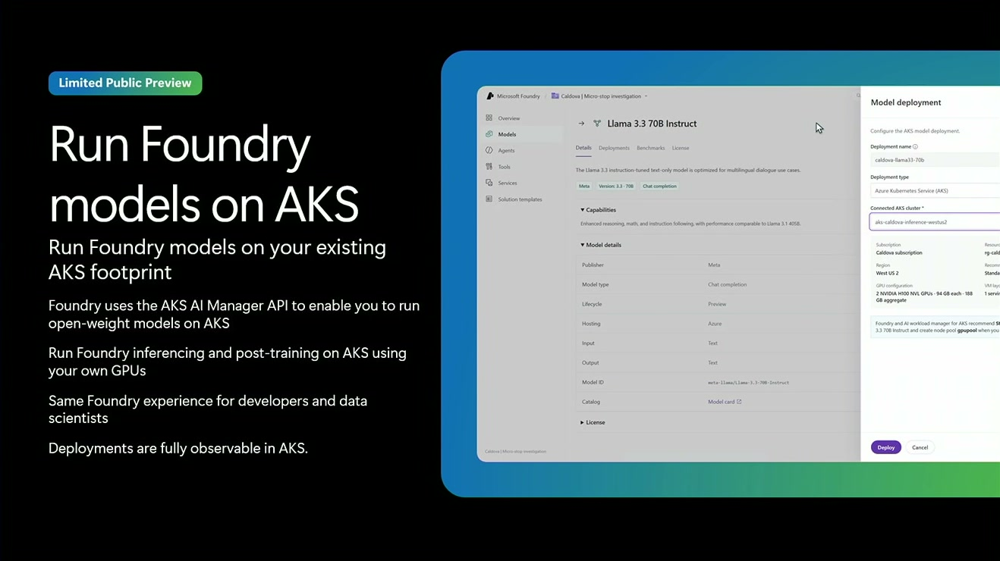

</td><td valign="top">

- Run Foundry models on your existing AKS footprint: Foundry uses the AKS AI Manager API to run open-weight models on AKS.
- Foundry inference and post-training on AKS with your own GPUs, the same Foundry experience for developers and data scientists, and deployments that are fully observable in AKS.

**Microsoft Learn:**
- [AI Manager concepts (preview)](https://learn.microsoft.com/azure/aks/ai-manager/concepts)
- [Quickstart: Deploy a model with AI Manager (preview)](https://learn.microsoft.com/azure/aks/ai-manager/quickstart)

</td></tr></table>

## 14. Flex nodes for AKS (public preview) ▶ 32:28

<table><tr><td width="50%" valign="top">

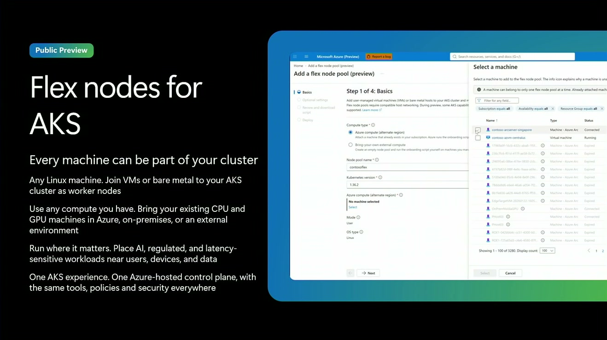

</td><td valign="top">

- "Every machine can be part of your cluster": join any Linux VM or bare-metal machine in Azure, on-premises or in another cloud as a worker node.
- Use any compute you have (CPU or GPU), place regulated or latency-sensitive AI near users, devices and data, with one Azure-hosted control plane and the same tools, policies and security everywhere.

**Microsoft Learn:**
- [Flex nodes for AKS overview (preview)](https://learn.microsoft.com/azure/aks/flex-nodes-for-aks-overview)

</td></tr></table>

## 15. Run Foundry hosted agents on AKS (limited public preview) ▶ 32:39

<table><tr><td width="50%" valign="top">

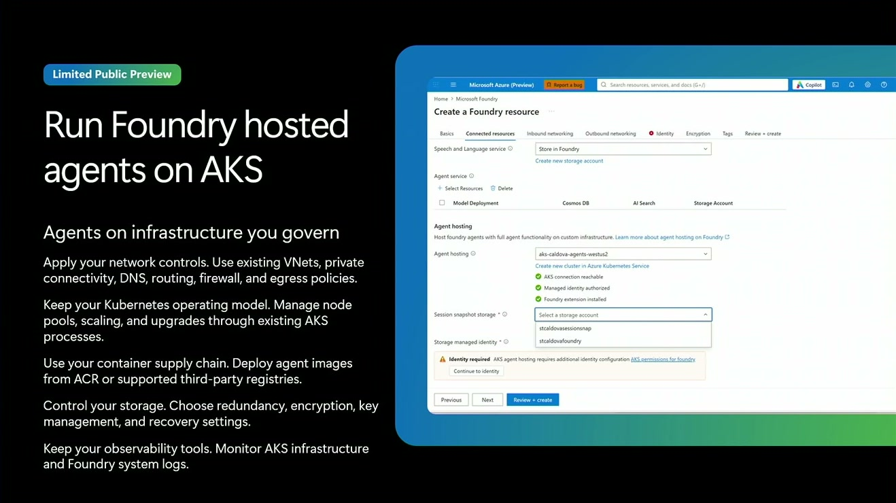

</td><td valign="top">

- Agents on infrastructure you govern:
  - your network controls (VNets, private connectivity, DNS, routing, firewall, egress policies),
  - your Kubernetes operating model (node pools, scaling, upgrades),
  - your container supply chain (images from ACR or supported registries),
  - your storage (redundancy, encryption, key management, recovery),
  - your observability tools (AKS infrastructure and Foundry system logs).
- Isolation comes from micro-VMs (Kata), the agent sandbox and Agent Grid for networking.

**Microsoft Learn:**
- [Hosted agents in Foundry Agent Service](https://learn.microsoft.com/azure/foundry/agents/concepts/hosted-agents)
- [What is Azure Agent Grid? (limited preview)](https://learn.microsoft.com/azure/agent-grid/overview)

</td></tr></table>

## 16. Evolving Azure for the agentic era ▶ 33:01

<table><tr><td width="50%" valign="top">

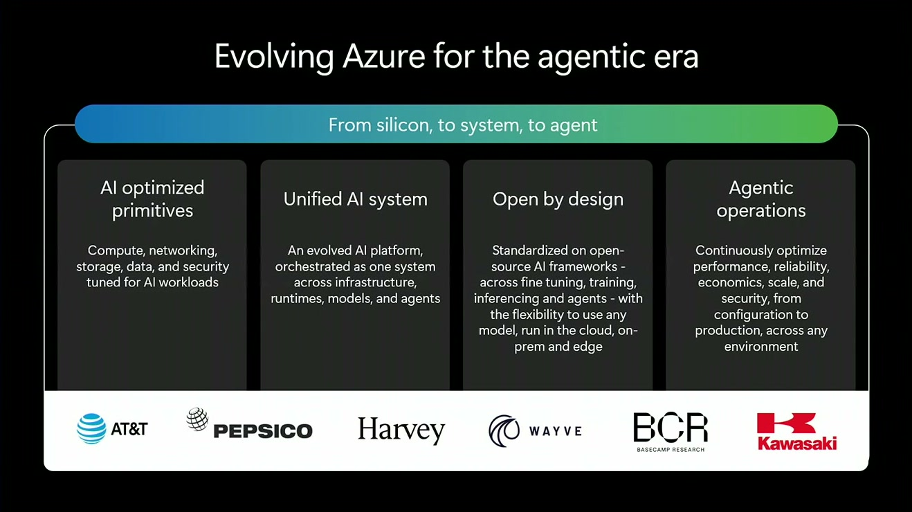

</td><td valign="top">

- "From silicon, to system, to agent":
  - **AI-optimized primitives:** compute, networking, storage, data and security tuned for AI (sandboxes on AKS and ACI from one AKS control plane, context cache).
  - **Unified AI system:** one platform across infrastructure, runtimes, models and agents.
  - **Open by design:** open-source frameworks for fine-tuning, training, inference and agents, in the cloud, on-premises and at the edge.
  - **Agentic operations:** Fleet Manager across clusters and the SRE agent to bring day-two work "close to nothing".
- Customer logos: AT&T, PepsiCo, Harvey, Wayve, BCR, Kawasaki.

**Microsoft Learn:**
- [Azure Kubernetes Fleet Manager overview](https://learn.microsoft.com/azure/kubernetes-fleet/overview)

</td></tr></table>

## 17. One connected journey ▶ 34:06

<table><tr><td width="50%" valign="top">

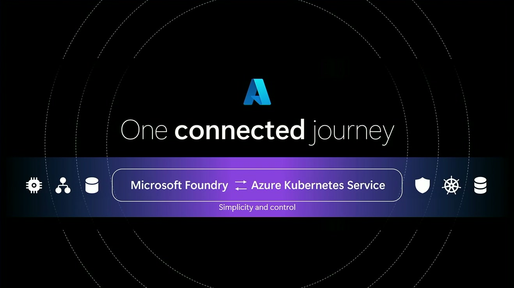

</td><td valign="top">

- Brendan Burns returns: these are capabilities of Azure itself, not just AKS. A unified platform of modular pieces (Agent Grid, context cache, Foundry integration, agent runtimes on AKS) so a choice you make early doesn't lock you in: Microsoft Foundry and AKS, simplicity and control.

</td></tr></table>

## 18. Azure is the foundation of frontier transformation ▶ 35:34

<table><tr><td width="50%" valign="top">

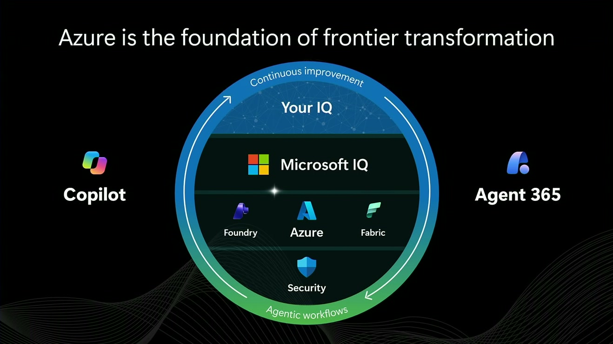

</td><td valign="top">

- Azure sits under Microsoft IQ (Foundry, Azure, Fabric, security), between **Copilot** and **Agent 365**, which shows what agents are doing and puts guardrails in place.

**Microsoft Learn:**
- [What is Microsoft Agent 365?](https://learn.microsoft.com/microsoft-agent-365/overview)

</td></tr></table>

## 19. Related sessions and resources ▶ 36:21

<table><tr><td width="50%" valign="top">

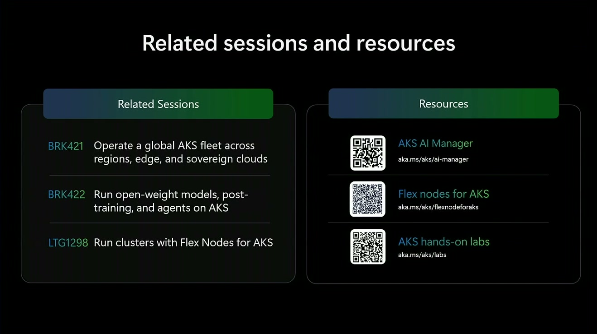

</td><td valign="top">

- **Related sessions:** BRK421 (operate a global AKS fleet across regions, edge and sovereign clouds), BRK422 (run open-weight models, post-training and agents on AKS, with Harvey) and LTG1298 (run clusters with flex nodes for AKS).
- **Resources:** aka.ms/aks/ai-manager, aka.ms/flexnodeforaks, aka.ms/aks/labs.
- **Q&A highlights:**
  - *Cost and security when agents talk to each other:* run on infrastructure you already pay for, with autoscaling, reservations and savings plans; Agent 365 and OpenTelemetry show token use; Agent Grid can shut off egress entirely.
  - You can move the same model between serverless Foundry managed compute (pay per token) and your own GPUs once usage passes a threshold.
  - Turning images into text at the edge is cheaper to ship and to process than sending images to a large model.
  - For sandboxes, start from least privilege and allow explicitly; the demo used allow-lists, not "allow all except".

**Microsoft Learn:**
- [AI Manager concepts (preview)](https://learn.microsoft.com/azure/aks/ai-manager/concepts)
- [Flex nodes for AKS overview (preview)](https://learn.microsoft.com/azure/aks/flex-nodes-for-aks-overview)

</td></tr></table>
