# Microsoft Ignite 2026 — Opening Keynote: Summary

**Video:** [Microsoft Ignite: Opening Keynote 2026](https://www.youtube.com/watch?v=ZR4v1c4CClc) · 2:25:50 · Microsoft

Every ▶ timestamp opens the video at that moment, and you can click a frame to jump to the point where it was taken. Product names are spelled the way they appear in the official captions and on the slides.

---

## TL;DR

The keynote is built on three "durable assets" for the "frontier ecosystem": **human ambition**, **intelligence** and **trust**.

- **Human ambition → Copilot as "the new operating system for work."** Chat, Cowork, Code and Autopilot now sit in one experience, with full Word, Excel and PowerPoint built in. New pieces are *Today*, *Autopilot*, *Workspaces* and role plug-ins, including a Salesforce partnership ("Copilotforce").
- **Intelligence → Microsoft IQ.** Work IQ, Fabric IQ, Foundry IQ and Web IQ are combined into one enterprise context layer with 350+ connectors. Foundry adds a model router, an optimizer and fine-tuning. New MAI models (Code 2, Code 2 Flash, Decision 1.1, Cyber 2 Flash, Image 2.7) are pitched on price/performance, and customers can now license the weights.
- **Trust → Agent 365 and Perception.** Agent 365 covers agent registry, governance, cost controls and the new *Business Analytics*. *Microsoft Perception* is an agentic security system (red, blue and green team agents) and is now GA. There is also a new *Microsoft Transparency Initiative*.
- **Infrastructure:** Azure HorizonDB is GA and is coming into Fabric (one place for transactional and analytical data). Also Maia 300 silicon, the agent-scale GitHub re-architecture and Windows for local "unmetered intelligence."

---

## Part 1 — Satya Nadella: the frontier ecosystem

### Opening film ▶ [00:00:18](https://www.youtube.com/watch?v=ZR4v1c4CClc&t=18s)
[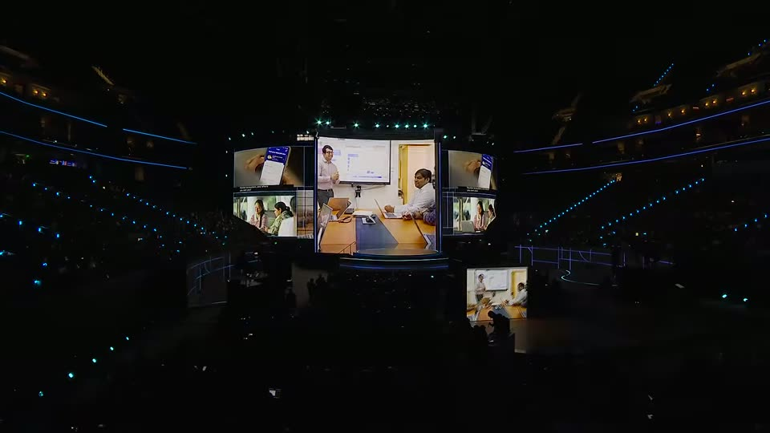](https://www.youtube.com/watch?v=ZR4v1c4CClc&t=40s)
*Opening film — frame at [00:00:40](https://www.youtube.com/watch?v=ZR4v1c4CClc&t=40s)*
"We are in a moment unlike any other." The film introduces the frontier ecosystem, where organizations own their intelligence and AI is "grounded in trust."

### Welcome, and the outage ▶ [00:01:18](https://www.youtube.com/watch?v=ZR4v1c4CClc&t=78s)
[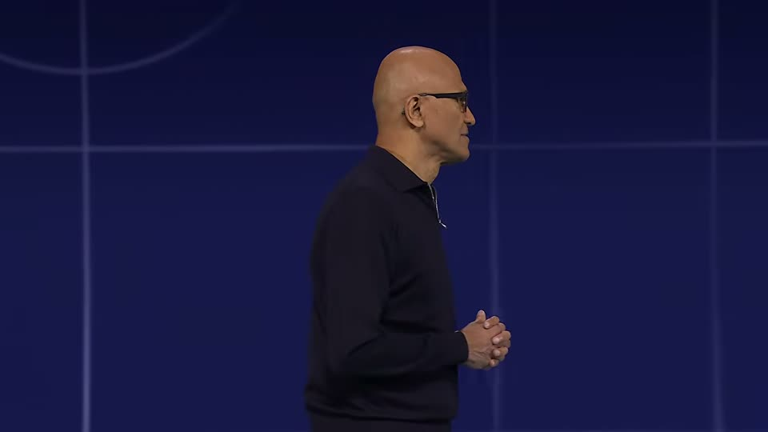](https://www.youtube.com/watch?v=ZR4v1c4CClc&t=105s)
*Satya Nadella opens — frame at [00:01:45](https://www.youtube.com/watch?v=ZR4v1c4CClc&t=105s)*
- He frames the week around two questions: how to capitalize on exponentially growing capability, and how organizations build the capacity to deal with its consequences.
- He refers to **last week's outage**: digital infrastructure is "the dial tone for the world." He says "we have work to do" on resilience and commits to learning and improving.

### Mission and the three pillars ▶ [00:03:11](https://www.youtube.com/watch?v=ZR4v1c4CClc&t=191s)
[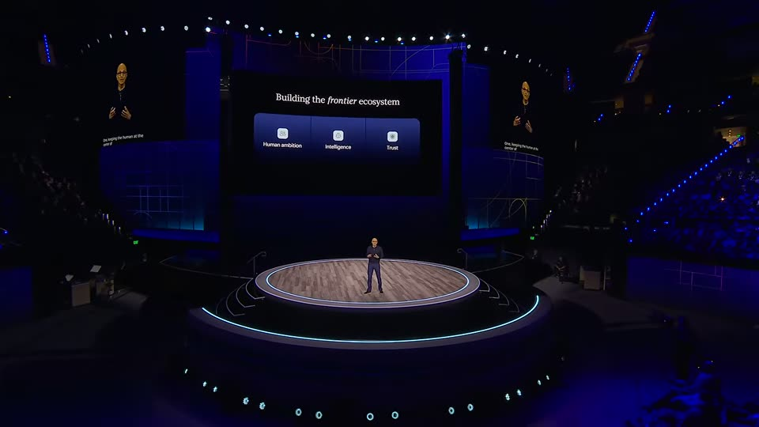](https://www.youtube.com/watch?v=ZR4v1c4CClc&t=240s)
*Building the frontier ecosystem — frame at [00:04:00](https://www.youtube.com/watch?v=ZR4v1c4CClc&t=240s)*
- **Human at the center:** software engineering is shifting "from building software artifacts to building software factories." Expertise and craft still matter, but where the leverage sits changes, and every function will go through the same shift.
- **Intelligence:** firms must build and own their own knowledge. Otherwise the economy "collapses into a couple of models."
- **Trust** ▶ [00:06:38](https://www.youtube.com/watch?v=ZR4v1c4CClc&t=398s): alignment and mechanistic understanding of models are still elusive. So it is "an architectural imperative to **separate the supply of intelligence from the authority over it**."

### Copilot, "the new operating system for work" ▶ [00:06:38](https://www.youtube.com/watch?v=ZR4v1c4CClc&t=398s)
[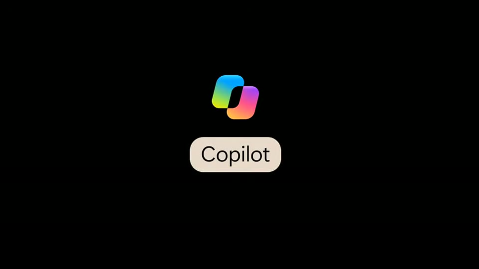](https://www.youtube.com/watch?v=ZR4v1c4CClc&t=425s)
*Copilot — frame at [00:07:05](https://www.youtube.com/watch?v=ZR4v1c4CClc&t=425s)*
- Chat, Cowork, Code and Copilot come together in one experience. "Apps are just plug-ins to Copilot," and all of Office is built in.
- A model system matches the right model to each task. *Home* is the single starting point, and *Code* is "an infinite SaaS factory" for everyone, hosted inside your tenant.

### Autopilot, Work IQ, and general availability ▶ [00:08:20](https://www.youtube.com/watch?v=ZR4v1c4CClc&t=500s)
[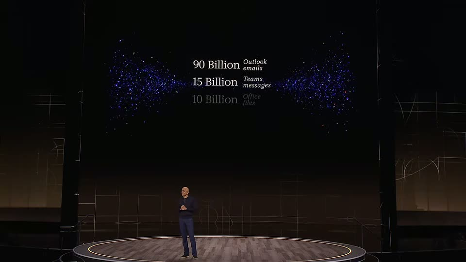](https://www.youtube.com/watch?v=ZR4v1c4CClc&t=535s)
*Work IQ scale stats — frame at [00:08:55](https://www.youtube.com/watch?v=ZR4v1c4CClc&t=535s)*
- **Autopilot** is an autonomous agent that works around the clock wherever your team collaborates, like "an additional teammate."
- **Work IQ** is "perhaps the most important data asset you have": people, relationships, mail, chat and projects.
- **Announcement:** all of this is now **broadly available**.

### Role-based plug-ins: Dynamics 365 and Salesforce ▶ [00:09:23](https://www.youtube.com/watch?v=ZR4v1c4CClc&t=563s)
[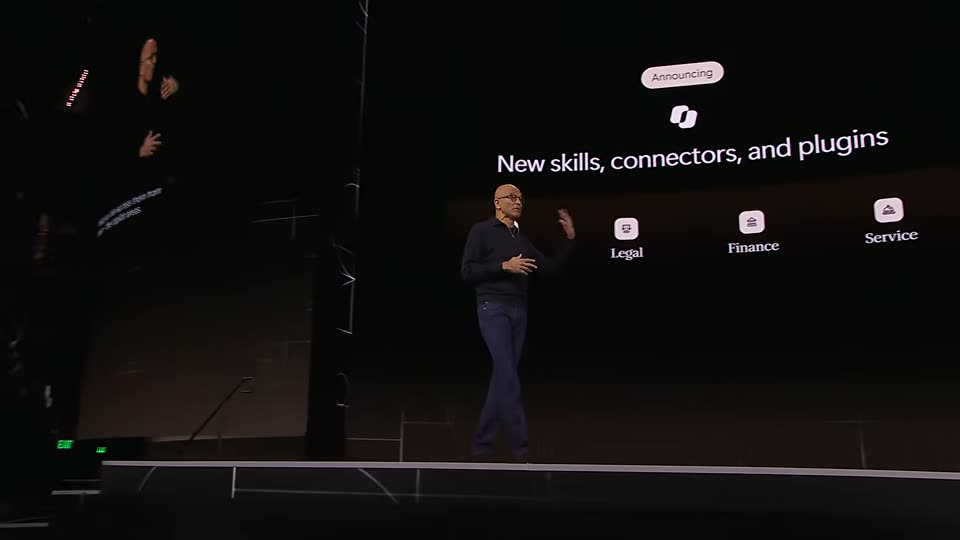](https://www.youtube.com/watch?v=ZR4v1c4CClc&t=590s)
*New skills, connectors and plug-ins — frame at [00:09:50](https://www.youtube.com/watch?v=ZR4v1c4CClc&t=590s)*
- Copilot extends to sales, legal, finance and service through skills, connectors and plug-ins.
- **Business plug-ins for Dynamics 365**, plus a **partnership with Salesforce** to bring Salesforce into Copilot.

### GitHub: goal-driven projects and Fusion ▶ [00:09:58](https://www.youtube.com/watch?v=ZR4v1c4CClc&t=598s)
[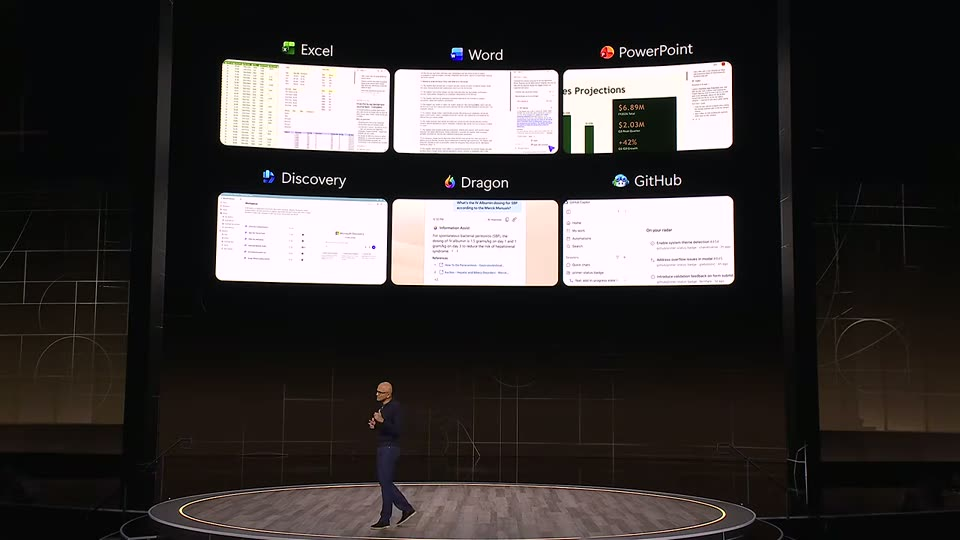](https://www.youtube.com/watch?v=ZR4v1c4CClc&t=635s)
*Copilot across Excel, Word, PowerPoint, Discovery, Dragon, GitHub — frame at [00:10:35](https://www.youtube.com/watch?v=ZR4v1c4CClc&t=635s)*
- New GitHub capability: define a goal, connect one or more repos, and Copilot coordinates the work toward that goal.
- **GitHub/Copilot Fusion** orchestrates multiple models. It is said to rank **#1 on Terminal Bench**, about 5 points ahead, at less than half the cost.

### Copilot Workspaces (multiplayer) ▶ [00:11:33](https://www.youtube.com/watch?v=ZR4v1c4CClc&t=693s)
[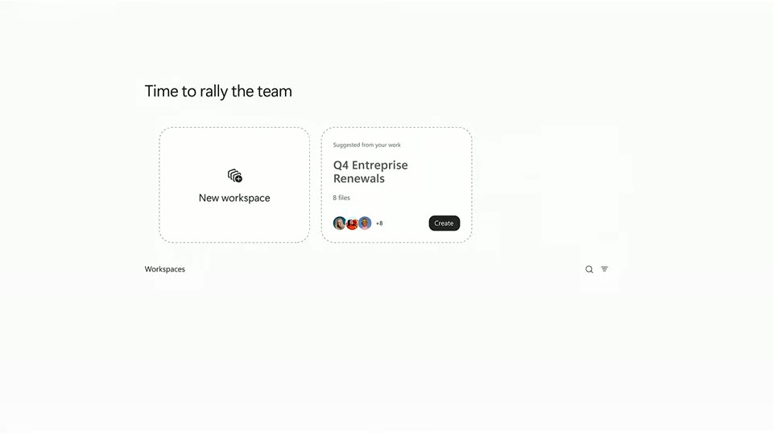](https://www.youtube.com/watch?v=ZR4v1c4CClc&t=735s)
*Copilot Workspaces video — frame at [00:12:15](https://www.youtube.com/watch?v=ZR4v1c4CClc&t=735s)*
Copilot moves from single player to multiplayer: people, their agents and other people work toward a common goal with shared context. Satya says it has changed his own working habits.

### Microsoft IQ: organizational intelligence ▶ [00:13:14](https://www.youtube.com/watch?v=ZR4v1c4CClc&t=794s)
[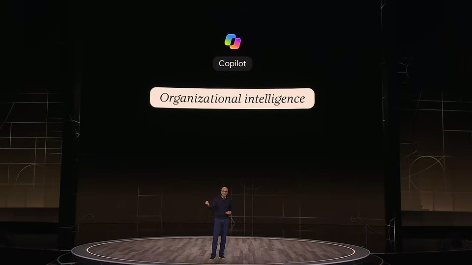](https://www.youtube.com/watch?v=ZR4v1c4CClc&t=850s)
*Organizational intelligence — frame at [00:14:10](https://www.youtube.com/watch?v=ZR4v1c4CClc&t=850s)*
- The system underneath Copilot becomes a first-class platform: **Work IQ + Fabric IQ + Web IQ + third-party context**, with **hundreds of new connectors**. It surfaces as shareable business plug-ins.
- A multi-model system tunes the product, harness, tools and models "as one optimization" for the best economics.

### Decision models: MAI Decision 1.1 GA ▶ [00:15:50](https://www.youtube.com/watch?v=ZR4v1c4CClc&t=950s)
[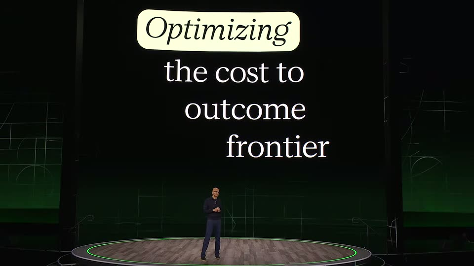](https://www.youtube.com/watch?v=ZR4v1c4CClc&t=980s)
*Optimizing the cost-to-outcome frontier — frame at [00:16:20](https://www.youtube.com/watch?v=ZR4v1c4CClc&t=980s)*
- A "new class" of **decision models** embeds intelligence in software, the way databases once did.
- **Microsoft Decision 1.1 is GA** ▶ [00:16:53](https://www.youtube.com/watch?v=ZR4v1c4CClc&t=1013s). Over 4,000 customers use it: Epic for clinical and back-office decisions, Copilot's own mode/model/effort routing, and Xbox for feedback triage. It is ">10x faster and 200x cheaper than an LLM."

### Foundry models and MAI ▶ [00:17:49](https://www.youtube.com/watch?v=ZR4v1c4CClc&t=1069s)
[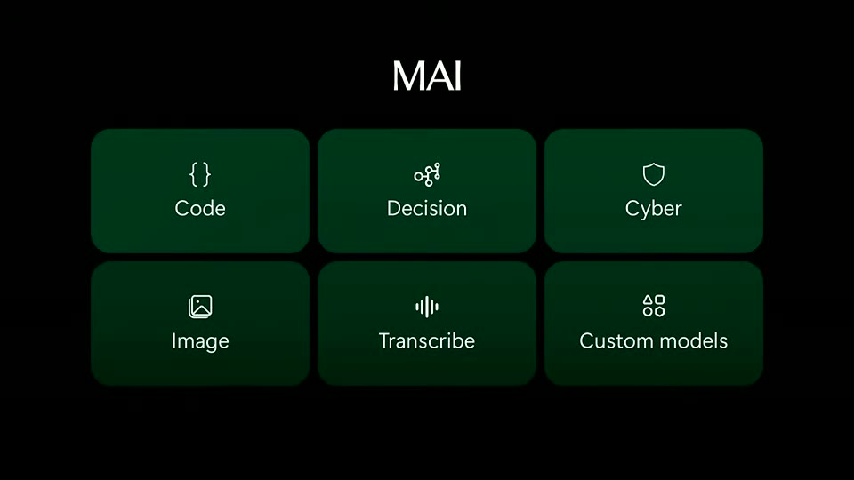](https://www.youtube.com/watch?v=ZR4v1c4CClc&t=1140s)
*MAI model family — frame at [00:19:00](https://www.youtube.com/watch?v=ZR4v1c4CClc&t=1140s)*
- **GPT-6.2** is coming to Foundry, **Claude 5.2** arrived last week, and **Meta's latest models** are coming.
- The MAI family is built to be compute-efficient in training and token-efficient in deployment. Requests are up 12x, and MAI Cyber powers 40%+ of Perception code scans.

### MAI licensed weights, Code 2 and Cyber Flash ▶ [00:19:35](https://www.youtube.com/watch?v=ZR4v1c4CClc&t=1175s)
[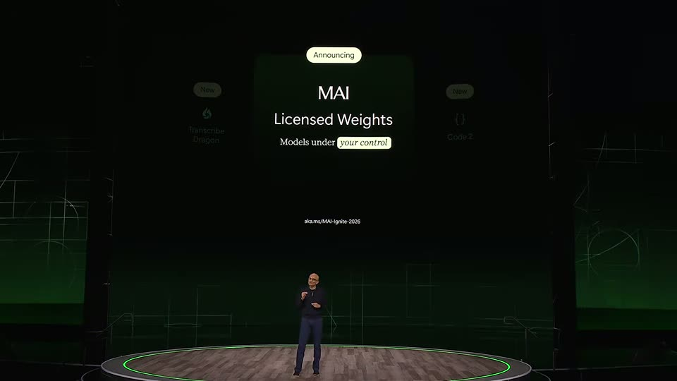](https://www.youtube.com/watch?v=ZR4v1c4CClc&t=1185s)
*MAI Licensed Weights — frame at [00:19:45](https://www.youtube.com/watch?v=ZR4v1c4CClc&t=1185s)*
- **MAI licensed weights:** trusted partners get access to Microsoft model weights.
- **Code 2** (flagship coding) and **Code 2 Flash** (fast, high-volume) ▶ [00:20:00](https://www.youtube.com/watch?v=ZR4v1c4CClc&t=1200s), plus **Cyber Flash**.

[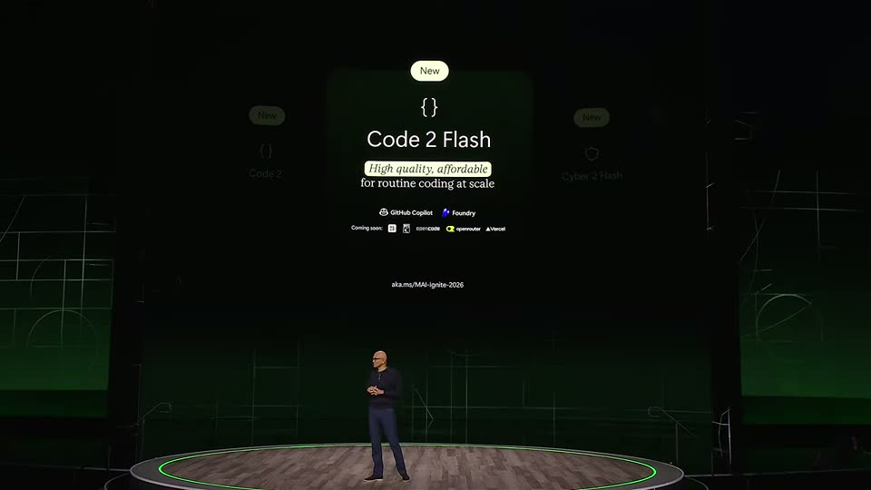](https://www.youtube.com/watch?v=ZR4v1c4CClc&t=1250s)
*Code 2 Flash — frame at [00:20:50](https://www.youtube.com/watch?v=ZR4v1c4CClc&t=1250s)*

### Foundry Hosted Agents: a continuous-improvement loop ▶ [00:21:12](https://www.youtube.com/watch?v=ZR4v1c4CClc&t=1272s)
[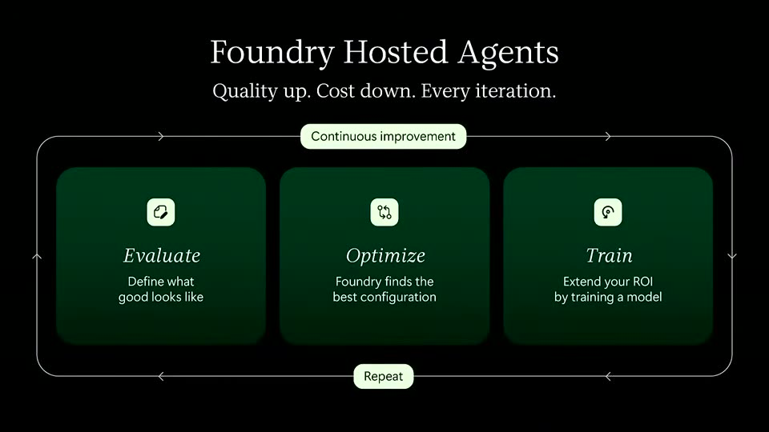](https://www.youtube.com/watch?v=ZR4v1c4CClc&t=1300s)
*Foundry Hosted Agents — Evaluate, Optimize, Train — frame at [00:21:40](https://www.youtube.com/watch?v=ZR4v1c4CClc&t=1300s)*
The same managed agent harness that powers Copilot and GitHub Copilot is now available to customers. You define your own evals, and Foundry improves the agent and the model underneath it from production experience ("Evaluate → Optimize → Train").

### Trust: Agent 365 and Business Analytics ▶ [00:21:50](https://www.youtube.com/watch?v=ZR4v1c4CClc&t=1310s)
[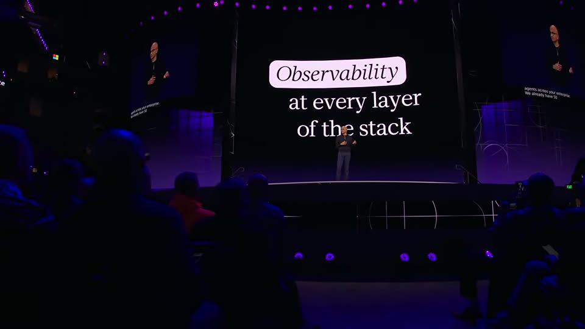](https://www.youtube.com/watch?v=ZR4v1c4CClc&t=1380s)
*Observability at every layer of the stack — frame at [00:23:00](https://www.youtube.com/watch?v=ZR4v1c4CClc&t=1380s)*
- Agent 365 is the control plane for agents. **15 million agents** are already in it.
- **New: Agent 365 Business Analytics** ▶ [00:22:49](https://www.youtube.com/watch?v=ZR4v1c4CClc&t=1369s), "an ERP system of AI usage" that links spend to outcomes and ROI.

### Microsoft Perception (security) GA ▶ [00:23:17](https://www.youtube.com/watch?v=ZR4v1c4CClc&t=1397s)
[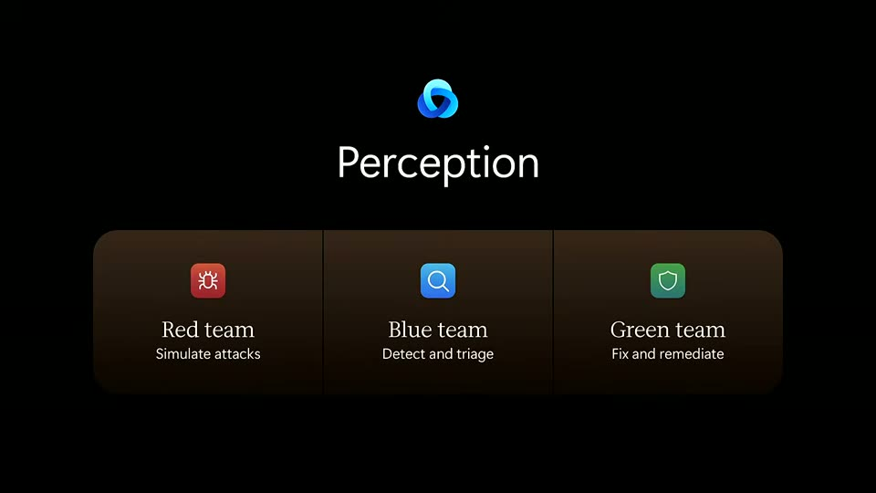](https://www.youtube.com/watch?v=ZR4v1c4CClc&t=1530s)
*Perception: Red team, Blue team, Green team — frame at [00:25:30](https://www.youtube.com/watch?v=ZR4v1c4CClc&t=1530s)*
- Security spans Agent 365 identity, containers, Purview and Defender. In one example, Defender's automatic attack disruption contained an autonomous AI attack framework.
- **Perception** ▶ [00:25:12](https://www.youtube.com/watch?v=ZR4v1c4CClc&t=1512s) has red team agents (simulate attacks), blue team agents (detect) and green team agents (fix), which you combine into playbooks. **It is now GA.**

### Microsoft Transparency Initiative ▶ [00:26:38](https://www.youtube.com/watch?v=ZR4v1c4CClc&t=1598s)
[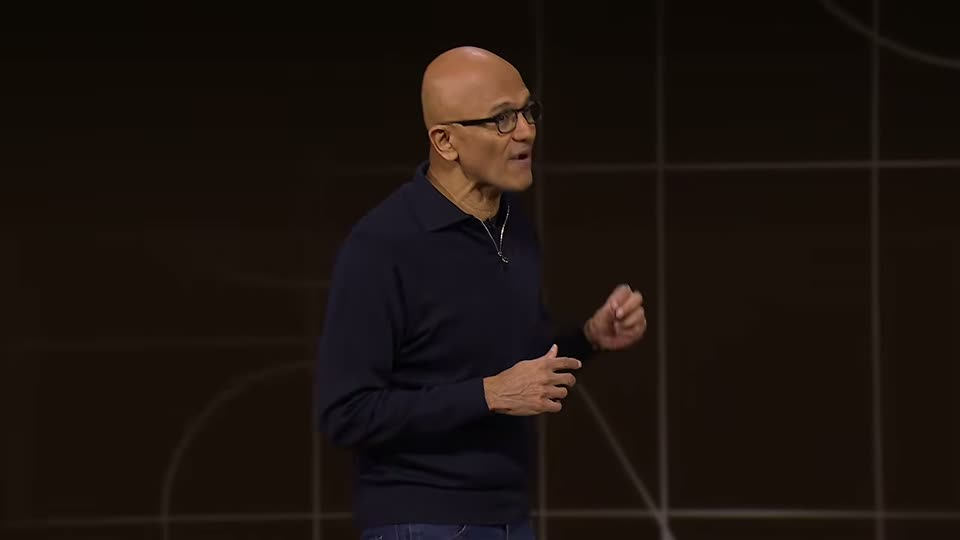](https://www.youtube.com/watch?v=ZR4v1c4CClc&t=1670s)
*Transparency initiative — frame at [00:27:50](https://www.youtube.com/watch?v=ZR4v1c4CClc&t=1670s)*
- You can't see inside models, and a model's account of itself, or one model monitoring another, isn't independent evidence.
- There are three parts: expand work on agent standards, an ecosystem approach (40 organizations already involved), and applying the standards across Microsoft's own products.

### Infrastructure for agentic workloads ▶ [00:28:24](https://www.youtube.com/watch?v=ZR4v1c4CClc&t=1704s)
[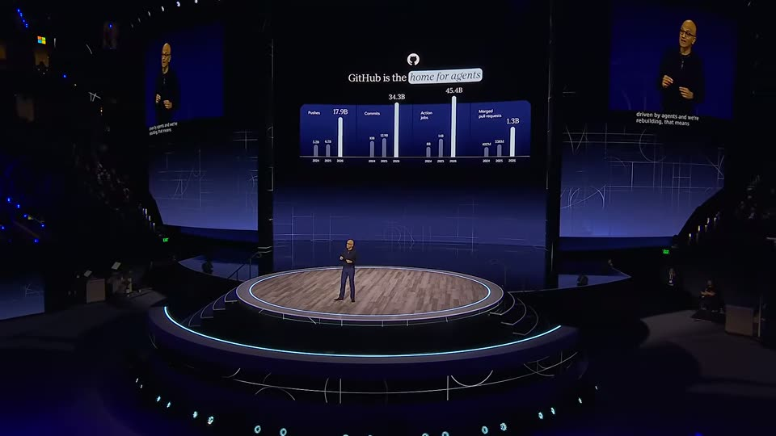](https://www.youtube.com/watch?v=ZR4v1c4CClc&t=1800s)
*GitHub scale — frame at [00:30:00](https://www.youtube.com/watch?v=ZR4v1c4CClc&t=1800s)*
- GitHub was re-architected for agent-driven load (storage and compute decoupled). In a test, 5,000 agents on one repo sustained **7,200 writes/sec, 180x today's throughput** ▶ [00:30:09](https://www.youtube.com/watch?v=ZR4v1c4CClc&t=1809s).
- 500+ datacenters and 80 Azure regions, "community-first" AI infrastructure, 100% renewable matching, 92% server reuse/recycling, and sovereign cloud options.

[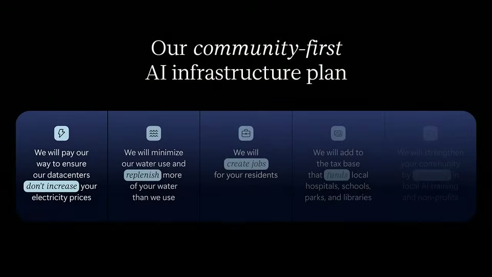](https://www.youtube.com/watch?v=ZR4v1c4CClc&t=1870s)
*Community-first AI infrastructure plan — frame at [00:31:10](https://www.youtube.com/watch?v=ZR4v1c4CClc&t=1870s)*

### Windows at the edge and agent-scale primitives ▶ [00:31:52](https://www.youtube.com/watch?v=ZR4v1c4CClc&t=1912s)
[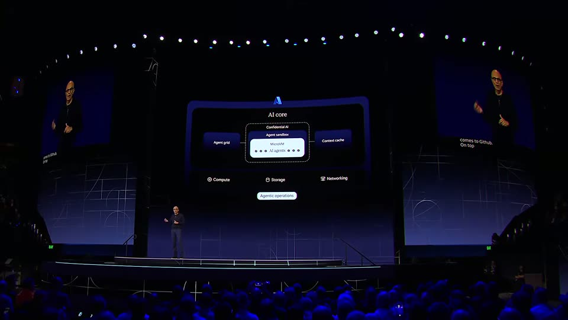](https://www.youtube.com/watch?v=ZR4v1c4CClc&t=1960s)
*Windows and edge — frame at [00:32:40](https://www.youtube.com/watch?v=ZR4v1c4CClc&t=1960s)*
Windows delivers "unmetered intelligence" from local models ("last year's frontier models on your laptop"). Sub-second sandboxed micro-VMs, an **agent grid** for identity, policy and networking controls, and AKS/Foundry provide the agentic primitives.

### Azure HorizonDB GA, and HorizonDB in Fabric ▶ [00:33:38](https://www.youtube.com/watch?v=ZR4v1c4CClc&t=2018s)
[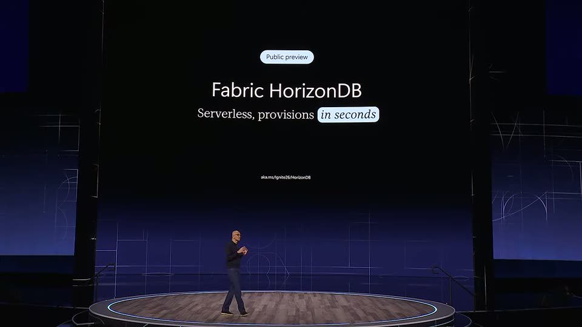](https://www.youtube.com/watch?v=ZR4v1c4CClc&t=2070s)
*Fabric HorizonDB — frame at [00:34:30](https://www.youtube.com/watch?v=ZR4v1c4CClc&t=2070s)*
- **HorizonDB** is a distributed managed SQL database with ultra-low latency, built-in search and AI, and "8x faster." **It is GA.**
- **HorizonDB is coming into Fabric**, unifying transactional and analytical data. Satya calls it the work of 25 years of his life. Copilot can build a live dashboard of "what is happening in my business right now."

[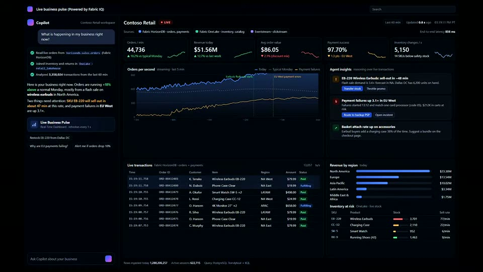](https://www.youtube.com/watch?v=ZR4v1c4CClc&t=2100s)
*Real-time dashboard — frame at [00:35:00](https://www.youtube.com/watch?v=ZR4v1c4CClc&t=2100s)*

### Silicon and close ▶ [00:35:37](https://www.youtube.com/watch?v=ZR4v1c4CClc&t=2137s)
[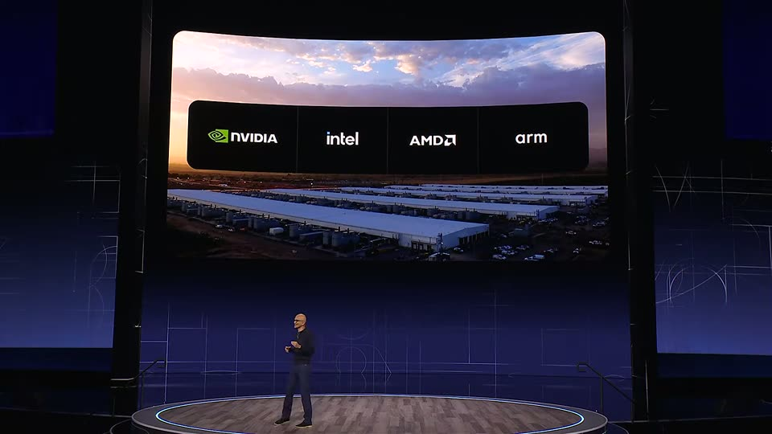](https://www.youtube.com/watch?v=ZR4v1c4CClc&t=2160s)
*Heterogeneous fleet: NVIDIA, Intel, AMD, Arm — frame at [00:36:00](https://www.youtube.com/watch?v=ZR4v1c4CClc&t=2160s)*
A heterogeneous fleet plus Microsoft's own silicon: **Maia 300** (40% more tokens per watt), Azure Boost and Integrated HSM. "We are entering an era of ubiquitous intelligence." He then hands over to Judson ▶ [00:37:22](https://www.youtube.com/watch?v=ZR4v1c4CClc&t=2242s).

---

## Part 2 — Judson Althoff: Human ambition

### Judson's own Sunday in Copilot ▶ [00:37:43](https://www.youtube.com/watch?v=ZR4v1c4CClc&t=2263s)
[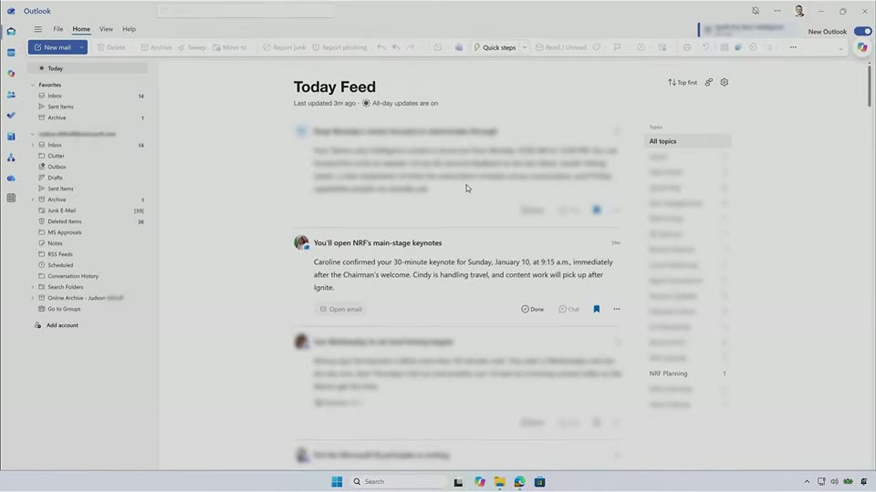](https://www.youtube.com/watch?v=ZR4v1c4CClc&t=2370s)
*Today feed — frame at [00:39:30](https://www.youtube.com/watch?v=ZR4v1c4CClc&t=2370s)*
- "Anything you can do in Claude or ChatGPT you can do better with Copilot and for less."
- Real environment, not a demo. **Today** surfaces a note that he has the lead keynote at NRF in January. A **Project** plus **Cowork** scans Work IQ, web and local files ("hybrid intelligence") and finds 7 NRF themes.
- Full Office runs inside Copilot ▶ [00:41:02](https://www.youtube.com/watch?v=ZR4v1c4CClc&t=2462s): outline in Word, deck in PowerPoint, customer tracker in Excel, with sensitivity labels and track changes.

[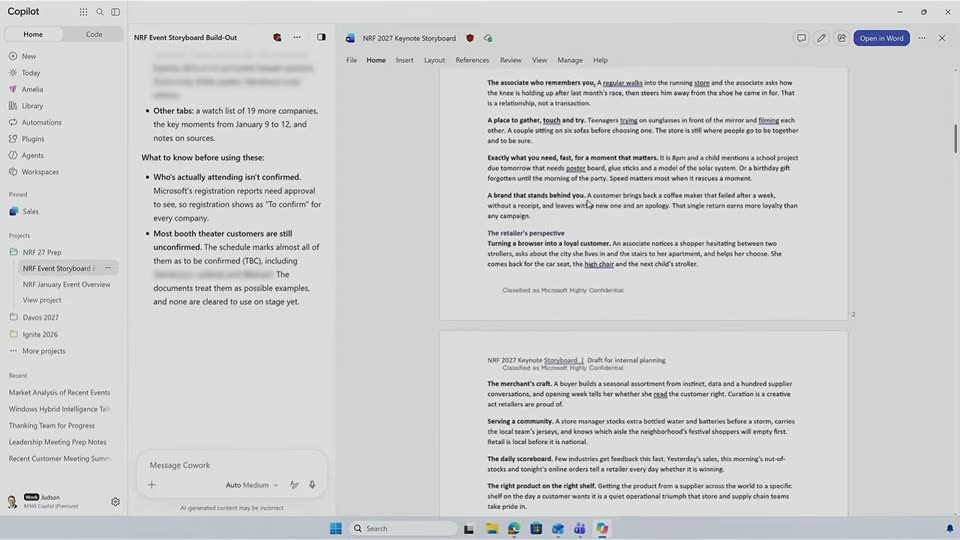](https://www.youtube.com/watch?v=ZR4v1c4CClc&t=2570s)
*Generated deck and outline — frame at [00:42:50](https://www.youtube.com/watch?v=ZR4v1c4CClc&t=2570s)*

### Autopilot "Amelia", Workspaces and a 3-D demo ▶ [00:44:21](https://www.youtube.com/watch?v=ZR4v1c4CClc&t=2661s)
[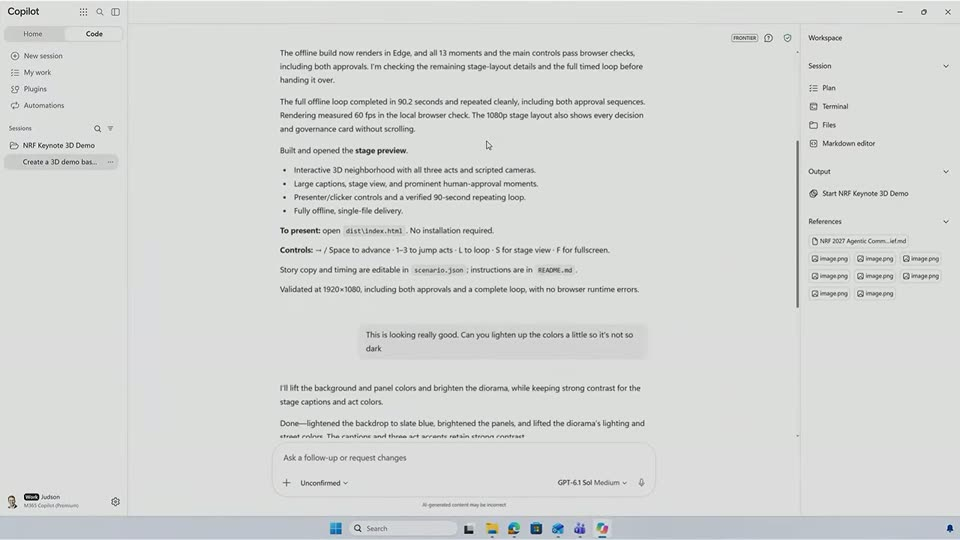](https://www.youtube.com/watch?v=ZR4v1c4CClc&t=2720s)
*Autopilot in Teams — frame at [00:45:20](https://www.youtube.com/watch?v=ZR4v1c4CClc&t=2720s)*
- **Autopilot "Amelia"** sets up its own routines: it keeps the tracker current, attends product meetings and posts to the Teams planning channel. A Workspace maps to that channel.
- Code turns a markdown file into a 3-D demo ("real code behind it").
- **Cost** ▶ [00:45:55](https://www.youtube.com/watch?v=ZR4v1c4CClc&t=2755s): about **10,000 credits, roughly $100**, and two hours of his time.

### Jacob Andreou (EVP Copilot): Home, Office, Code ▶ [00:46:55](https://www.youtube.com/watch?v=ZR4v1c4CClc&t=2815s)
[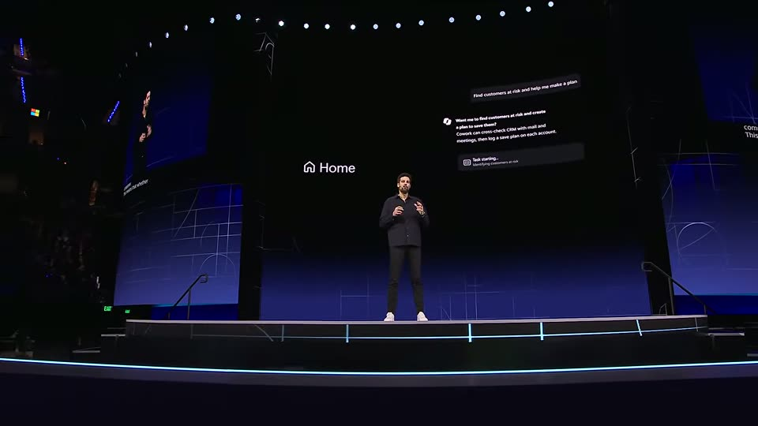](https://www.youtube.com/watch?v=ZR4v1c4CClc&t=2860s)
*Home — frame at [00:47:40](https://www.youtube.com/watch?v=ZR4v1c4CClc&t=2860s)*
- **Home** puts chat and Cowork in a single composer.
- **Full Word, Excel and PowerPoint in Copilot**, compared with the "simplified viewers" from Anthropic and OpenAI. Files stay in your tenant with labels intact, and Office in Copilot is **included in the subscription** ▶ [00:48:34](https://www.youtube.com/watch?v=ZR4v1c4CClc&t=2914s).
- **Code** builds sandboxed apps, hosted in-tenant and as easy to share as a Word doc.

### Chevron: engineering "basis of design" ▶ [00:49:43](https://www.youtube.com/watch?v=ZR4v1c4CClc&t=2983s)
[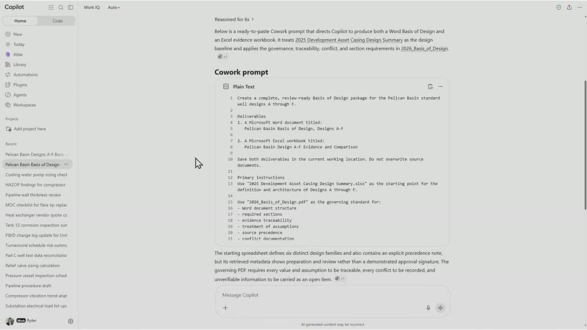](https://www.youtube.com/watch?v=ZR4v1c4CClc&t=3040s)
*Chevron Cowork prompt — frame at [00:50:40](https://www.youtube.com/watch?v=ZR4v1c4CClc&t=3040s)*
- Chat writes a 300-line Cowork prompt. Cowork goes through hundreds of engineering files, and **Fabric IQ** enriches the result with thousands of company designs, including data from a recently acquired company.
- The result becomes a **reusable skill** for every engineer. **Cost** ▶ [00:53:45](https://www.youtube.com/watch?v=ZR4v1c4CClc&t=3225s): about 4,500 credits (~$45), and the work went "from months to minutes."

### Agent 365: IT view of AI spend ▶ [00:54:07](https://www.youtube.com/watch?v=ZR4v1c4CClc&t=3247s)
[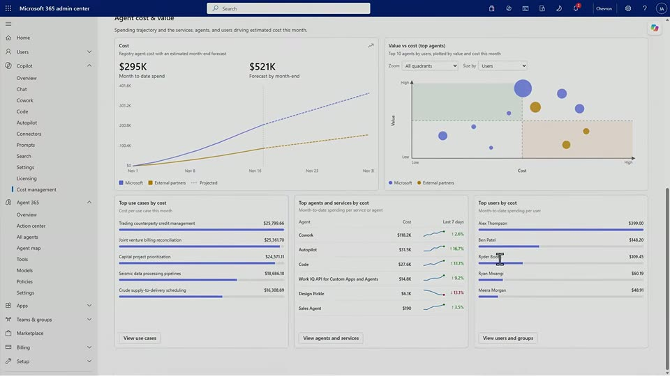](https://www.youtube.com/watch?v=ZR4v1c4CClc&t=3290s)
*Agent 365 spend dashboard — frame at [00:54:50](https://www.youtube.com/watch?v=ZR4v1c4CClc&t=3290s)*
IT sees spend per service, agent, model and user, **sets spend limits before Cowork can be used**, gets alerts, and controls which models are allowed.

### Why Copilot keeps costs down ▶ [00:55:46](https://www.youtube.com/watch?v=ZR4v1c4CClc&t=3346s)
[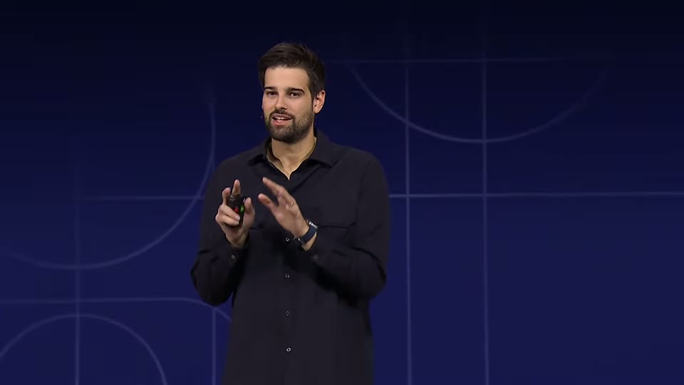](https://www.youtube.com/watch?v=ZR4v1c4CClc&t=3380s)
*Copilot cost model — frame at [00:56:20](https://www.youtube.com/watch?v=ZR4v1c4CClc&t=3380s)*
Jacob gives three reasons: the subscription (everyday AI with no metered charges), **autorouting** (picks mode, model and effort), and **Work IQ grounding** (gets it right the first time).

### Coming in the next weeks: Today, Autopilot, Workspaces, plug-ins ▶ [00:57:24](https://www.youtube.com/watch?v=ZR4v1c4CClc&t=3444s)
[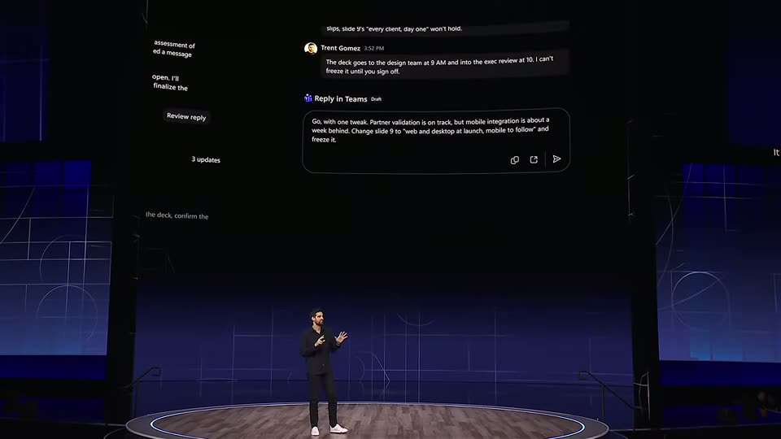](https://www.youtube.com/watch?v=ZR4v1c4CClc&t=3490s)
*Today — frame at [00:58:10](https://www.youtube.com/watch?v=ZR4v1c4CClc&t=3490s)*
- **Today** is a proactive command center that drafts replies and proposes schedule changes, all waiting for your approval.
- **Autopilot** is the "first enterprise-grade long-running agent." It has its own memory, email and computer, so it can use legacy apps.
- **Workspaces** bring people and agents together around shared context ▶ [00:59:12](https://www.youtube.com/watch?v=ZR4v1c4CClc&t=3552s). **Plug-ins** are approved by IT once and then work across chat, Code and Autopilot.

### BlackRock: sales with Dynamics 365 plug-ins ▶ [01:00:28](https://www.youtube.com/watch?v=ZR4v1c4CClc&t=3628s)
[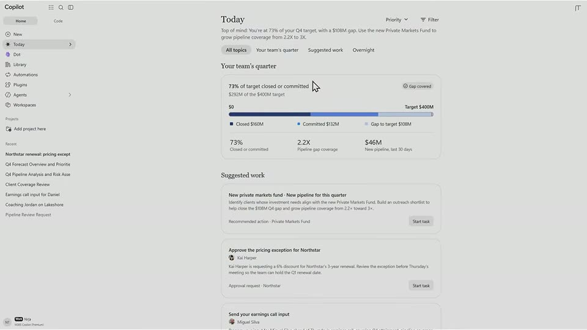](https://www.youtube.com/watch?v=ZR4v1c4CClc&t=3720s)
*Cowork pipeline analysis — frame at [01:02:00](https://www.youtube.com/watch?v=ZR4v1c4CClc&t=3720s)*
- A sales lead's Today view shows 73% of goal and 2.2x pipeline coverage against 3x needed. Cowork identifies $110M of likely commitments and builds client packages that relationship managers approve.
- The relationship manager's Autopilot ▶ [01:03:45](https://www.youtube.com/watch?v=ZR4v1c4CClc&t=3825s) runs daily checks and a Monday intel brief. "Nothing goes out to my clients without my approval."
- **Two weeks later** ▶ [01:06:14](https://www.youtube.com/watch?v=ZR4v1c4CClc&t=3974s): 73% → 81% of goal, with $59M of new pipeline.

[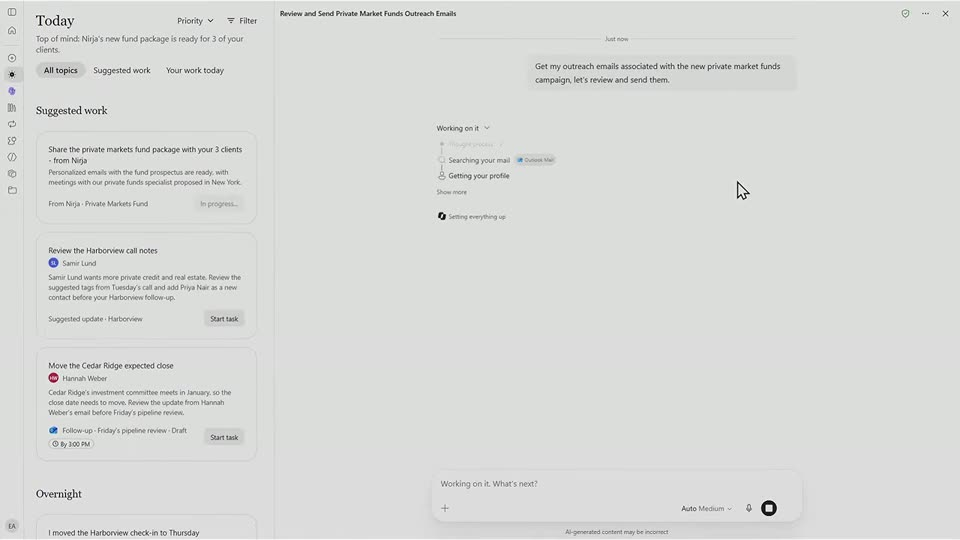](https://www.youtube.com/watch?v=ZR4v1c4CClc&t=3850s)
*Autopilot routines — frame at [01:04:10](https://www.youtube.com/watch?v=ZR4v1c4CClc&t=3850s)*

### Salesforce: Copilotforce ▶ [01:07:01](https://www.youtube.com/watch?v=ZR4v1c4CClc&t=4021s)
[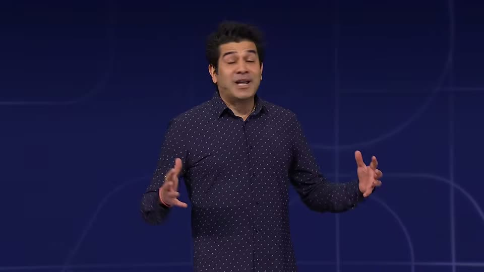](https://www.youtube.com/watch?v=ZR4v1c4CClc&t=4120s)
*Rohan Kumar, Salesforce — frame at [01:08:40](https://www.youtube.com/watch?v=ZR4v1c4CClc&t=4120s)*
- Three announcements: a **Salesforce sales plug-in for Copilot**, **Salesforce in Teams**, and **Data 360 ↔ Fabric zero-copy**.
- **Rohan Kumar** (ex-Microsoft, now Salesforce) ▶ [01:08:02](https://www.youtube.com/watch?v=ZR4v1c4CClc&t=4082s) introduces **Copilotforce**, which brings Salesforce into M365 Copilot and Teams with Salesforce permissions intact.

### Accenture: Copilotforce in practice ▶ [01:10:32](https://www.youtube.com/watch?v=ZR4v1c4CClc&t=4232s)
[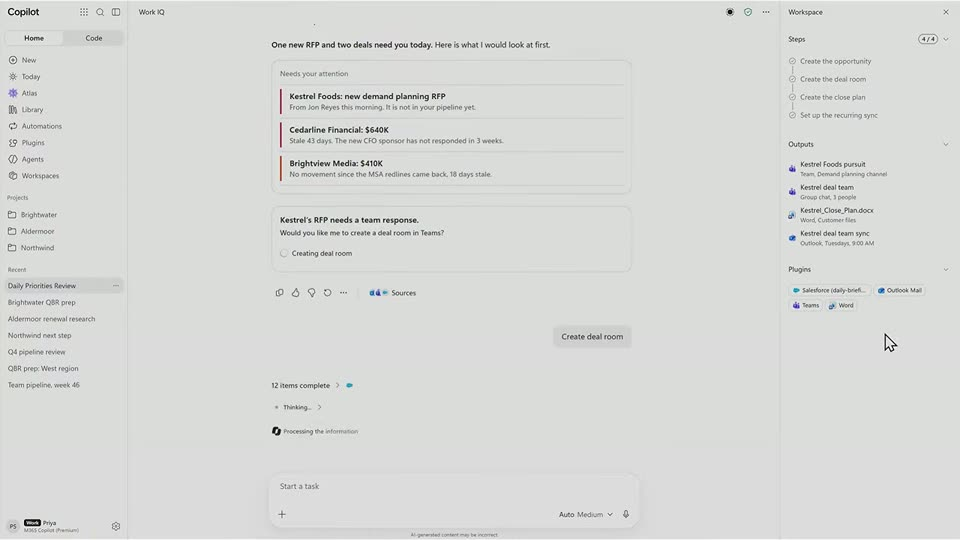](https://www.youtube.com/watch?v=ZR4v1c4CClc&t=4300s)
*Copilotforce in Teams — frame at [01:11:40](https://www.youtube.com/watch?v=ZR4v1c4CClc&t=4300s)*
800,000 people use Teams at Accenture. A seller's Cowork briefing comes from the Salesforce pipeline, an RFP pursuit is set up in one tap, and Salesforce updates are proposed from chats and emails. The manager runs a pipeline-review skill (38+ Salesforce skills are available in Copilot) ▶ [01:12:26](https://www.youtube.com/watch?v=ZR4v1c4CClc&t=4346s).

---

## Part 3 — Intelligence

### Unilever IQ ▶ [01:13:26](https://www.youtube.com/watch?v=ZR4v1c4CClc&t=4406s)
[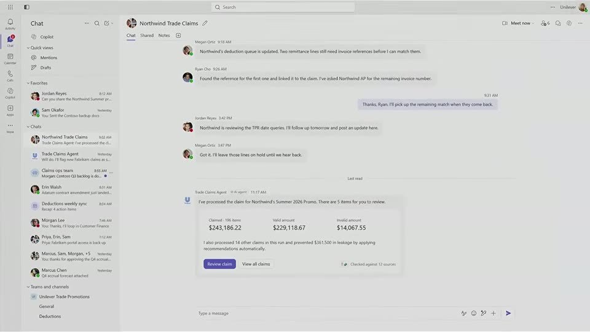](https://www.youtube.com/watch?v=ZR4v1c4CClc&t=4510s)
*Unilever claims agent — frame at [01:15:10](https://www.youtube.com/watch?v=ZR4v1c4CClc&t=4510s)*
- "Intelligence: not artificial, yours." Work IQ, Foundry IQ and Fabric IQ launched last year.
- Unilever handles 3.7B consumers a day, 20M orders and 5M claims a year ▶ [01:14:21](https://www.youtube.com/watch?v=ZR4v1c4CClc&t=4461s). A claims agent catches a $2,000 discrepancy on a single line, finds similar past claims and the people behind them, and learns from the account lead's judgment. That protects about $12,000 on one claim.

### Microsoft IQ launch: Arun Ulag ▶ [01:17:50](https://www.youtube.com/watch?v=ZR4v1c4CClc&t=4670s)
[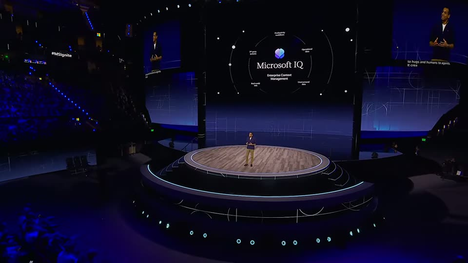](https://www.youtube.com/watch?v=ZR4v1c4CClc&t=4740s)
*Microsoft IQ — frame at [01:19:00](https://www.youtube.com/watch?v=ZR4v1c4CClc&t=4740s)*
- An "enterprise context management system" that yields durable, governed business plug-ins.
- Work IQ (collaboration), Fabric IQ (metrics and semantics, including AWS and Snowflake), Foundry IQ (knowledge bases) and Web IQ, with **350+ connectors**. It is open, so it also works in ChatGPT and Claude ▶ [01:20:04](https://www.youtube.com/watch?v=ZR4v1c4CClc&t=4804s). "Your IQ stays yours."
- Demo ▶ [01:21:18](https://www.youtube.com/watch?v=ZR4v1c4CClc&t=4878s): hierarchical context (company → legal → contracts → claims). It is certified by IT as ground truth and published as a plug-in. Agents load only what they need.

[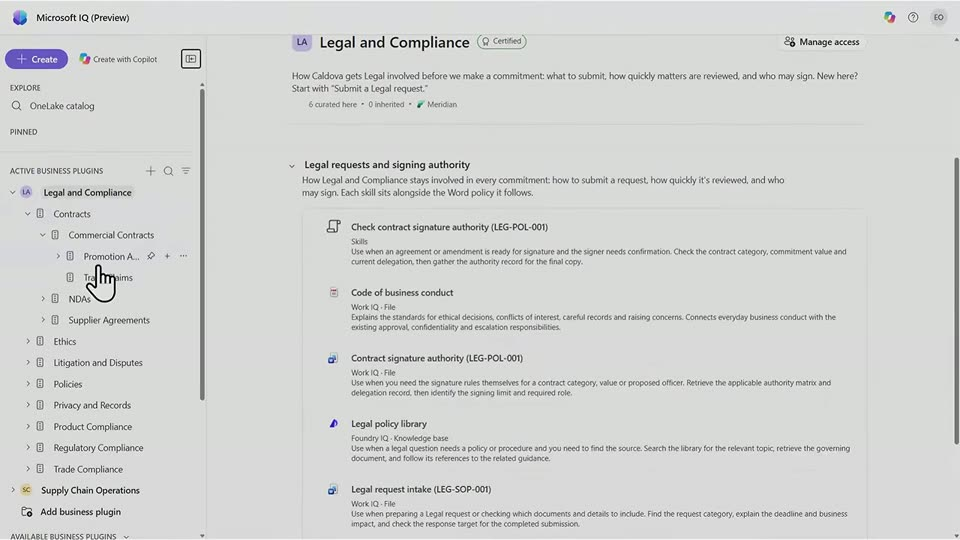](https://www.youtube.com/watch?v=ZR4v1c4CClc&t=4930s)
*Legal & Compliance context hierarchy — frame at [01:22:10](https://www.youtube.com/watch?v=ZR4v1c4CClc&t=4930s)*

### Foundry: models, router and the improvement loop ▶ [01:24:36](https://www.youtube.com/watch?v=ZR4v1c4CClc&t=5076s)
[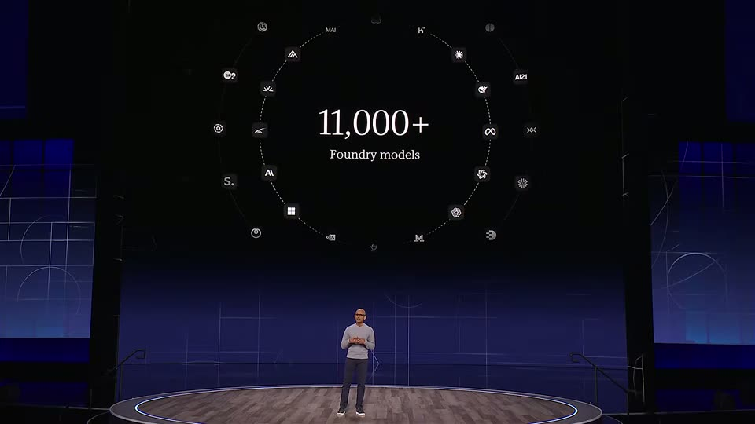](https://www.youtube.com/watch?v=ZR4v1c4CClc&t=5140s)
*11,000+ Foundry models — frame at [01:25:40](https://www.youtube.com/watch?v=ZR4v1c4CClc&t=5140s)*
- **11,000+ models**. The **model router** sends simple requests to small models and complex ones to frontier models, at up to **65% cheaper**.
- Agents improve with use. Foundry finds and tests improvements and shows the quality, speed and cost trade-offs, all the way up to training your own model ▶ [01:26:11](https://www.youtube.com/watch?v=ZR4v1c4CClc&t=5171s).

### Alaska Airlines: ATA maintenance-code agent ▶ [01:27:53](https://www.youtube.com/watch?v=ZR4v1c4CClc&t=5273s)
[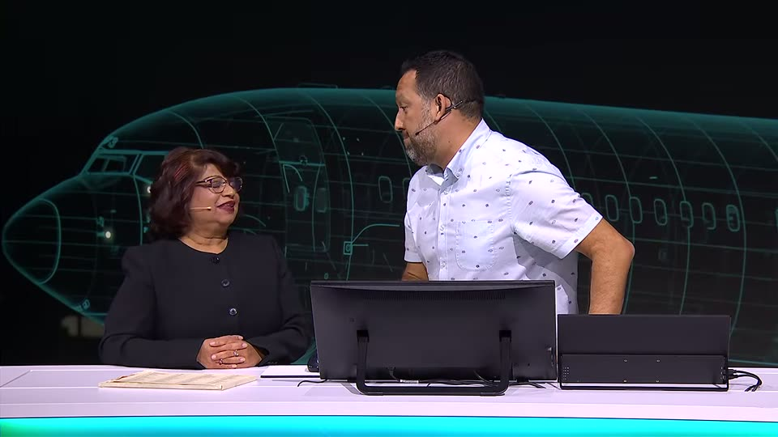](https://www.youtube.com/watch?v=ZR4v1c4CClc&t=5460s)
*Alaska Airlines demo — frame at [01:31:00](https://www.youtube.com/watch?v=ZR4v1c4CClc&t=5460s)*
- An agent suggests precise ATA codes from maintenance text, and the engineer always confirms. Traces, a rubric-based eval ▶ [01:31:08](https://www.youtube.com/watch?v=ZR4v1c4CClc&t=5468s), then **Foundry optimizer** rewrites the prompt and tool descriptions.
- That raised token costs, so they **fine-tuned the model** instead ▶ [01:32:37](https://www.youtube.com/watch?v=ZR4v1c4CClc&t=5557s), reaching about 97% on code match.

[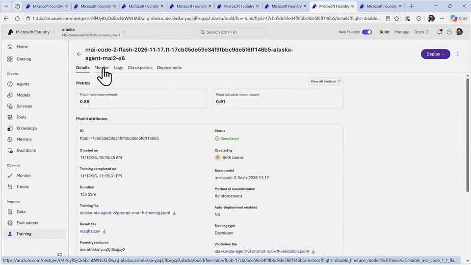](https://www.youtube.com/watch?v=ZR4v1c4CClc&t=5600s)
*Training job in Foundry — frame at [01:33:20](https://www.youtube.com/watch?v=ZR4v1c4CClc&t=5600s)*

### MAI models: price/performance and your own weights ▶ [01:34:53](https://www.youtube.com/watch?v=ZR4v1c4CClc&t=5693s)
[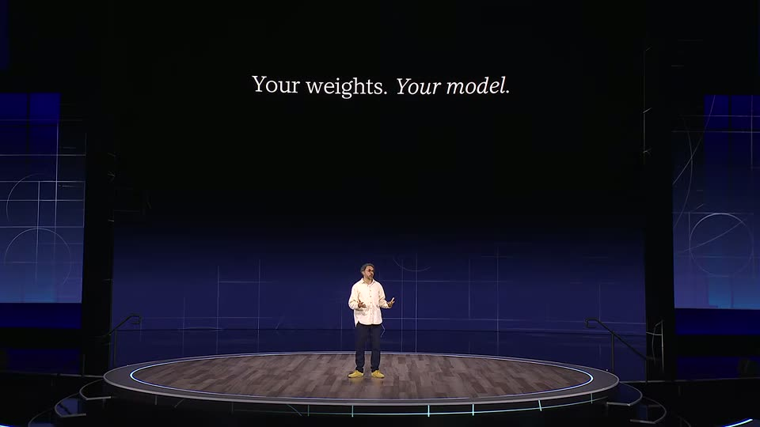](https://www.youtube.com/watch?v=ZR4v1c4CClc&t=5740s)
*Your weights. Your model. — frame at [01:35:40](https://www.youtube.com/watch?v=ZR4v1c4CClc&t=5740s)*
- "At frontier prices the math isn't sustainable." The speaker says **MAI Code 2** gets 98% of the performance at 40% of the cost on everyday enterprise coding, and **Code 2 Flash** matches GPT-6 Luna and Haiku 5.5 on everyday tasks at 65% and 20% of their price.
- **Decision 1.1** handles in-app routing ▶ [01:36:33](https://www.youtube.com/watch?v=ZR4v1c4CClc&t=5793s). The models are explicitly *not* tuned for very long-horizon agentic work. AT&T's custom model beat 6.1 on 5G tasks at 50x less cost.
- **MAI Cyber 2 Flash** costs under 2% per task ▶ [01:38:11](https://www.youtube.com/watch?v=ZR4v1c4CClc&t=5891s). **MAI Image 2.7** is said to be the #1 image-editing model at a fifth of the cost. MAI runs in 10M Dragon encounters a month with half the errors.
- **Models under your control** ▶ [01:40:01](https://www.youtube.com/watch?v=ZR4v1c4CClc&t=6001s): customize a frontier model with your own data, control who has access, and your data stays yours.

[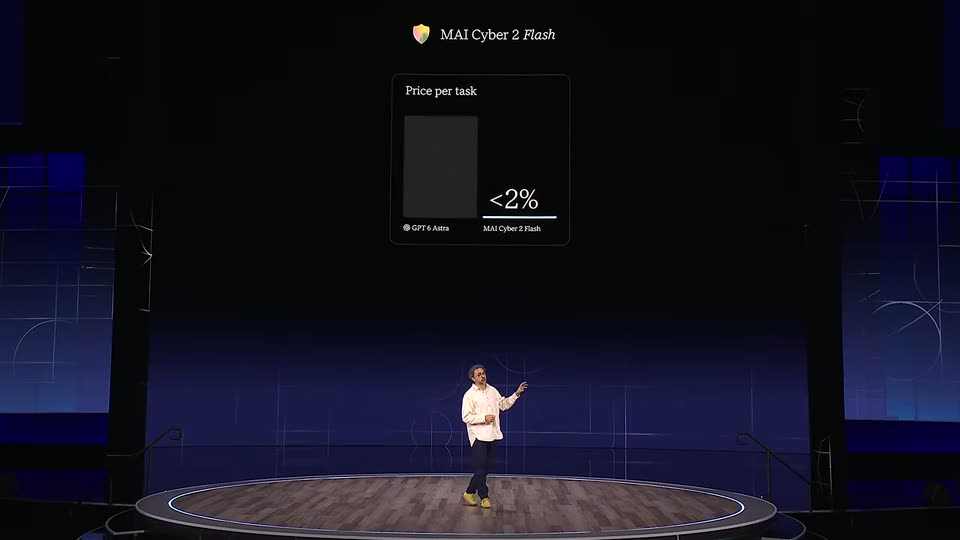](https://www.youtube.com/watch?v=ZR4v1c4CClc&t=5900s)
*MAI Cyber 2 Flash <2% cost — frame at [01:38:20](https://www.youtube.com/watch?v=ZR4v1c4CClc&t=5900s)*

### Publicis: Arthur Sadoun ▶ [01:41:25](https://www.youtube.com/watch?v=ZR4v1c4CClc&t=6085s)
[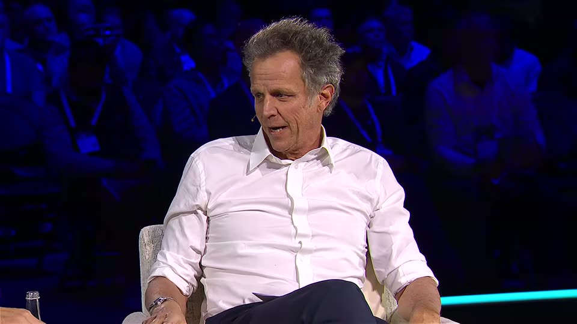](https://www.youtube.com/watch?v=ZR4v1c4CClc&t=6150s)
*Arthur Sadoun — frame at [01:42:30](https://www.youtube.com/watch?v=ZR4v1c4CClc&t=6150s)*
"I should be dead, and I'm here." Advertising was supposed to be killed by AI, but Publicis has grown to 120,000 people. Its three bets were identity and technology, breaking silos ("no silos, no bozos"), and AI-led. Change management is the real work.

---

## Part 4 — Trust

### Agent 365: one year on (Charles Lamanna) ▶ [01:47:25](https://www.youtube.com/watch?v=ZR4v1c4CClc&t=6445s)
[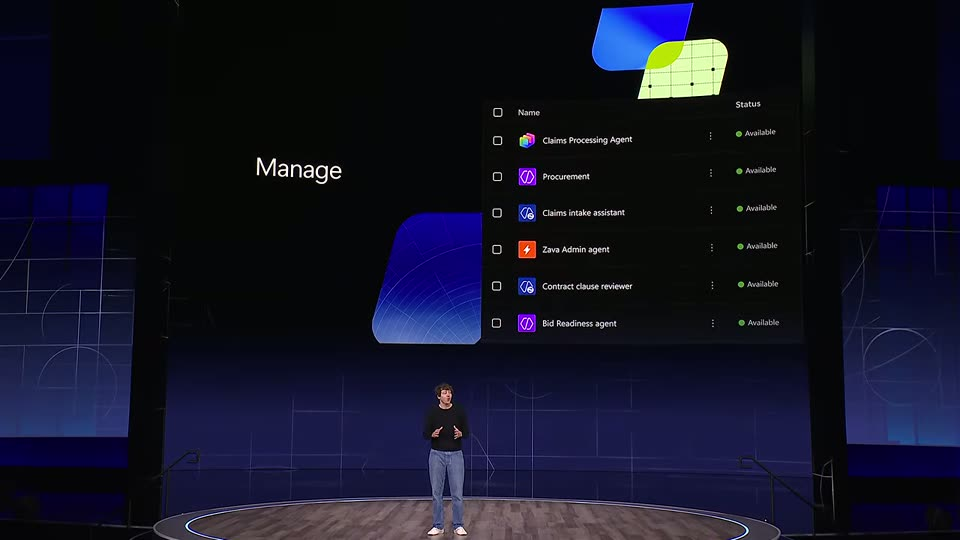](https://www.youtube.com/watch?v=ZR4v1c4CClc&t=6520s)
*Agent 365 — Manage — frame at [01:48:40](https://www.youtube.com/watch?v=ZR4v1c4CClc&t=6520s)*
- One place to manage, govern, secure and track the cost and value of agents, **across Microsoft and non-Microsoft platforms**: AWS, OpenAI, Anthropic, Databricks, Snowflake and Salesforce.
- A registry of agents, plug-ins and skills, plus cost policies. **50M+ agents** are managed ▶ [01:49:31](https://www.youtube.com/watch?v=ZR4v1c4CClc&t=6571s).

### AT&T: 60,000+ agents ▶ [01:50:18](https://www.youtube.com/watch?v=ZR4v1c4CClc&t=6618s)
[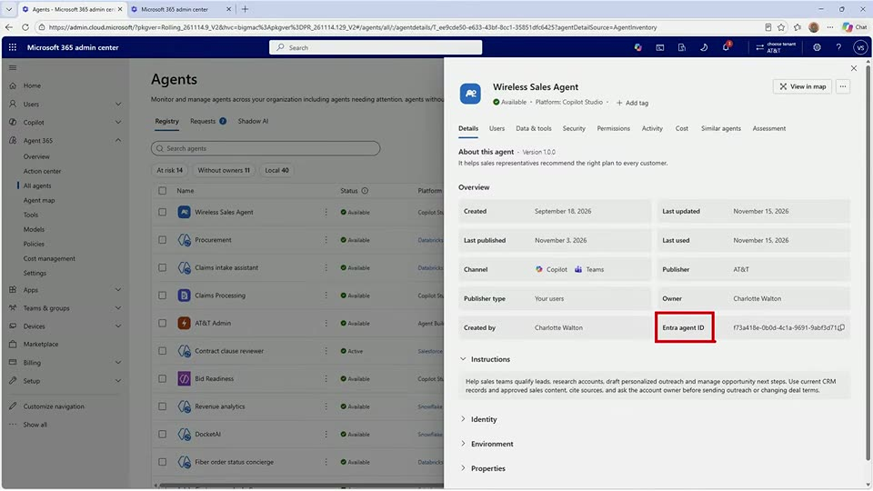](https://www.youtube.com/watch?v=ZR4v1c4CClc&t=6700s)
*Agent registry and map — frame at [01:51:40](https://www.youtube.com/watch?v=ZR4v1c4CClc&t=6700s)*
- Each agent has its own ID and an agent map that highlights errors. **Action Center** ▶ [01:52:17](https://www.youtube.com/watch?v=ZR4v1c4CClc&t=6737s) prioritizes issues and automates cleanup of agents unused for 90 days. "Forgotten agents can become rogue agents."
- Cost spikes come with forecasts and spending policies. **Hard limits** for Microsoft agents, and **spending groups** that let the business set budgets ▶ [01:52:54](https://www.youtube.com/watch?v=ZR4v1c4CClc&t=6774s).

### Agent 365 Business Analytics ▶ [01:55:09](https://www.youtube.com/watch?v=ZR4v1c4CClc&t=6909s)
[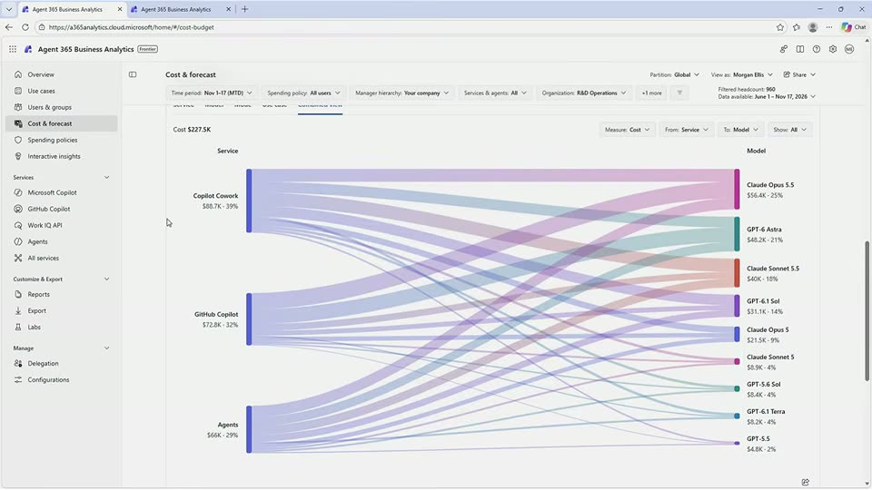](https://www.youtube.com/watch?v=ZR4v1c4CClc&t=7030s)
*Spend flow by service and model — frame at [01:57:10](https://www.youtube.com/watch?v=ZR4v1c4CClc&t=7030s)*
- Spend, adoption and value in one place, measuring "work done, not tokens spent."
- Demo ▶ [01:56:21](https://www.youtube.com/watch?v=ZR4v1c4CClc&t=6981s): an R&D leader forecasts spend across Copilot, Cowork and GitHub Copilot, sees use-case value, and tracks costs for agents on Copilot Studio and **Amazon Bedrock**. Then: "see it, forecast it, budget it, charge it back."
- **Availability** ▶ [01:59:56](https://www.youtube.com/watch?v=ZR4v1c4CClc&t=7196s): frontier public preview today. Delegated spending policies and cost visibility for non-Microsoft agents arrive in **December**.

### Agent 365 security: local agents ▶ [02:01:12](https://www.youtube.com/watch?v=ZR4v1c4CClc&t=7272s)
[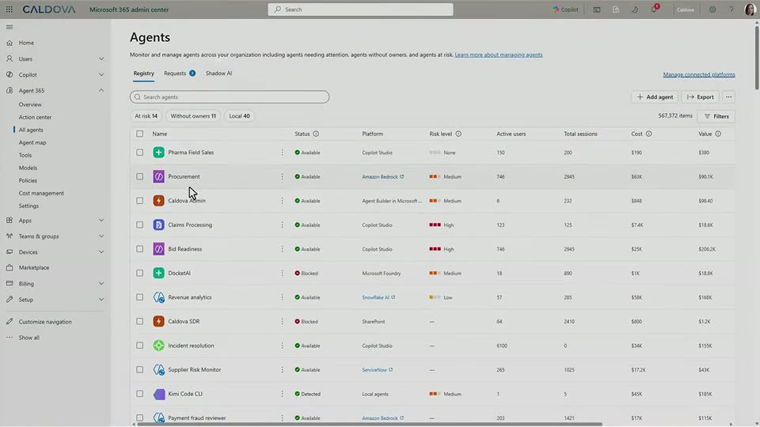](https://www.youtube.com/watch?v=ZR4v1c4CClc&t=7300s)
*Agent 365 security — frame at [02:01:40](https://www.youtube.com/watch?v=ZR4v1c4CClc&t=7300s)*
Discovers agents running on employee devices (65 types, including OpenClaw), with **dynamic risk** scoring tied to security incidents. It can block agents and flag devices that aren't compliant.

### Ales: AI has changed the physics of cyber ▶ [02:03:16](https://www.youtube.com/watch?v=ZR4v1c4CClc&t=7396s)
[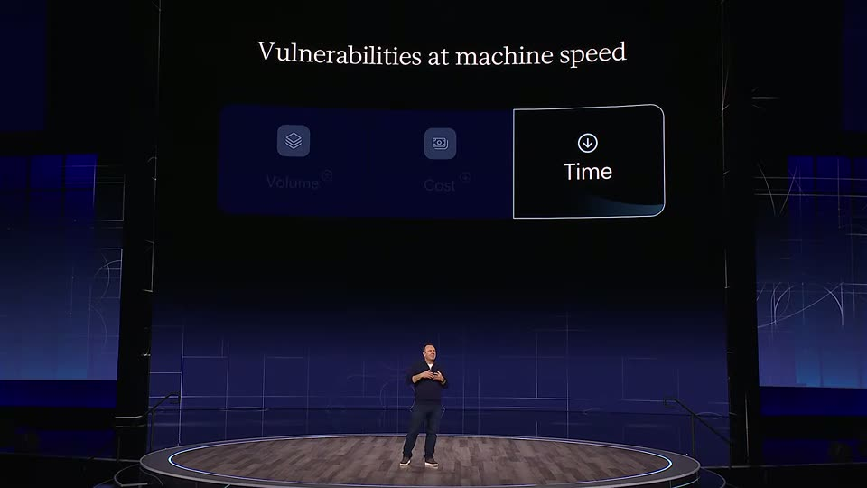](https://www.youtube.com/watch?v=ZR4v1c4CClc&t=7500s)
*Vulnerabilities at machine speed — frame at [02:05:00](https://www.youtube.com/watch?v=ZR4v1c4CClc&t=7500s)*
- **Volume:** Patch Tuesday this month covered 1,000+ vulnerabilities, against fewer than 100 in March (10x).
- **Cost:** high-quality vulnerabilities that bounty programs pay about $300K for can be found for under $5 with AI.
- **Time:** the gap from discovery to exploitation is approaching zero, and coordinated disclosure is collapsing.
- The stack ▶ [02:05:06](https://www.youtube.com/watch?v=ZR4v1c4CClc&t=7506s): Defender, Entra, Purview and Sentinel as sensors and actuators, with 165 trillion signals a day turned into security context for agents.

### Perception demo: David Weston ▶ [02:07:27](https://www.youtube.com/watch?v=ZR4v1c4CClc&t=7647s)
[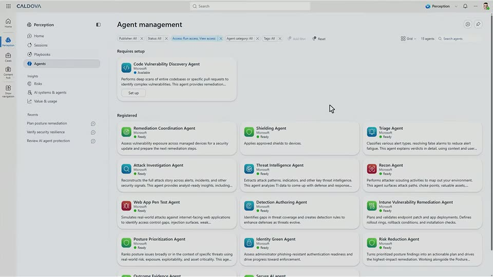](https://www.youtube.com/watch?v=ZR4v1c4CClc&t=7720s)
*Perception playbooks — frame at [02:08:40](https://www.youtube.com/watch?v=ZR4v1c4CClc&t=7720s)*
- Blue, red and green agent teams, custom **playbooks** with upfront cost estimates and triggers, and a **FinOps dashboard** that feeds into Agent 365.
- Ales ▶ [02:09:57](https://www.youtube.com/watch?v=ZR4v1c4CClc&t=7797s): MAI Cyber 2 is "better than GPT-6 Astra at 2% of cost per task."
- Engineer workflow ▶ [02:11:10](https://www.youtube.com/watch?v=ZR4v1c4CClc&t=7870s): an actively exploited Patch Tuesday CVE across 52,000 devices is expedited and covered by the new **endpoint shield**. Alerts are triaged automatically, including from Okta data, and new detections are written and published with one click ▶ [02:14:24](https://www.youtube.com/watch?v=ZR4v1c4CClc&t=8064s).

*Perception vulnerability session — frame at [02:12:00](https://www.youtube.com/watch?v=ZR4v1c4CClc&t=7920s)*

### Agents as insiders ▶ [02:15:43](https://www.youtube.com/watch?v=ZR4v1c4CClc&t=8143s)
Agents are often overprivileged and increasingly autonomous. Perception and Agent 365 share context so they can secure agents "at machine speed."

### BNY: Leigh-Ann Russell (CIO) ▶ [02:16:35](https://www.youtube.com/watch?v=ZR4v1c4CClc&t=8195s)

*Leigh-Ann Russell, BNY — frame at [02:17:30](https://www.youtube.com/watch?v=ZR4v1c4CClc&t=8250s)*
- "Build governance and security in at the heart — that's how you scale fast."
- A **market first:** a Microsoft agent and a BNY agent negotiated a trade through an agentic negotiation protocol, with a human "over the loop" and a human making the final decision ▶ [02:18:06](https://www.youtube.com/watch?v=ZR4v1c4CClc&t=8286s).
- In the Perception preview, her team works "in AI time, not human time." Her themes are coherence, intent, integrity, infrastructure and impact. "Trust is the project" ▶ [02:20:27](https://www.youtube.com/watch?v=ZR4v1c4CClc&t=8427s).

---

## Close — Judson Althoff ▶ [02:21:10](https://www.youtube.com/watch?v=ZR4v1c4CClc&t=8470s)

*What's your biggest ambition? — frame at [02:22:00](https://www.youtube.com/watch?v=ZR4v1c4CClc&t=8520s)*
- Kids' ambition posters: "nowhere do you see the words *prompt engineer*." People want AI in the canvases they already use.
- "Intelligence must compound from within … it's about your IQ" ▶ [02:22:45](https://www.youtube.com/watch?v=ZR4v1c4CClc&t=8565s). On trust: "the only way to gain trust is through observability."
- "Microsoft is the adult in the room" ▶ [02:24:34](https://www.youtube.com/watch?v=ZR4v1c4CClc&t=8674s). "Technology doesn't have ambitions, people do."

---

## Announcements at a glance

| Announcement | Status (as stated) | Where |
|---|---|---|
| Copilot (Home, Cowork, Code, Office in Copilot, Work IQ) | Broadly available | ▶ [00:08:20](https://www.youtube.com/watch?v=ZR4v1c4CClc&t=500s) |
| Today, Autopilot, Workspaces, plug-ins | Rolling out "over the next couple weeks" | ▶ [00:57:24](https://www.youtube.com/watch?v=ZR4v1c4CClc&t=3444s) |
| Dynamics 365 business plug-ins | Announced | ▶ [00:09:23](https://www.youtube.com/watch?v=ZR4v1c4CClc&t=563s) |
| Copilotforce (Salesforce sales plug-in, Salesforce in Teams, Data 360 ↔ Fabric zero-copy) | Announced | ▶ [01:07:01](https://www.youtube.com/watch?v=ZR4v1c4CClc&t=4021s) |
| GitHub goal-driven projects, GitHub/Copilot Fusion | Announced | ▶ [00:09:58](https://www.youtube.com/watch?v=ZR4v1c4CClc&t=598s) |
| Microsoft IQ (350+ connectors) | Launched | ▶ [01:17:50](https://www.youtube.com/watch?v=ZR4v1c4CClc&t=4670s) |
| MAI Decision 1.1 | GA | ▶ [00:15:50](https://www.youtube.com/watch?v=ZR4v1c4CClc&t=950s) |
| MAI Code 2 / Code 2 Flash, Cyber 2 Flash, Image 2.7 | Announced | ▶ [00:19:35](https://www.youtube.com/watch?v=ZR4v1c4CClc&t=1175s) |
| MAI licensed weights / models under your control | Announced | ▶ [00:19:35](https://www.youtube.com/watch?v=ZR4v1c4CClc&t=1175s) |
| GPT-6.2 and Meta models in Foundry (Claude 5.2 last week) | Available | ▶ [00:17:49](https://www.youtube.com/watch?v=ZR4v1c4CClc&t=1069s) |
| Foundry Hosted Agents, optimizer, model router | Shown | ▶ [01:24:36](https://www.youtube.com/watch?v=ZR4v1c4CClc&t=5076s) |
| Agent 365 Business Analytics | Frontier public preview, more in December | ▶ [01:55:09](https://www.youtube.com/watch?v=ZR4v1c4CClc&t=6909s) |
| Agent 365 local-agent discovery and dynamic risk | Shown | ▶ [02:01:12](https://www.youtube.com/watch?v=ZR4v1c4CClc&t=7272s) |
| Microsoft Perception (agentic security) | GA | ▶ [00:25:12](https://www.youtube.com/watch?v=ZR4v1c4CClc&t=1512s) |
| Microsoft Transparency Initiative | Announced | ▶ [00:26:38](https://www.youtube.com/watch?v=ZR4v1c4CClc&t=1598s) |
| Azure HorizonDB | GA; coming into Fabric | ▶ [00:33:38](https://www.youtube.com/watch?v=ZR4v1c4CClc&t=2018s) |
| Maia 300 | Announced (recently) | ▶ [00:35:37](https://www.youtube.com/watch?v=ZR4v1c4CClc&t=2137s) |
