# INV643: Azure and Windows, infrastructure for AI

**Session:** Microsoft Ignite 2026, INV643 · 1:01:49
**Speakers:** Mark Russinovich (CTO, Deputy CISO and Technical Fellow, Microsoft Azure), Pavan and Navjot (Windows), with Josh (PwC) on stage. Speaker names other than Mark Russinovich are as heard in the audio.

Timestamps refer to the session video (mm:ss). This session is a produced video with camera cuts, so most slides come from wide shots of the stage screen rather than clean full-screen slides. Demo screens aren't included as slides, but the notes describe what the demos showed. Where a matching page exists, each section ends with links to Microsoft Learn.

---

## TL;DR

- **Azure as the foundation for AI (Mark Russinovich):**
  - performance: microVMs in under 500 ms, 642 GiB/s Lustre checkpoints, Blob over RDMA saving 95% CPU, and an integrated HSM in every server
  - a new **AI core** with Agent Grid, agent sandboxes in ACI and context cache
  - **AKS AI manager**, plus AKS flex nodes to bring on-premises GPU nodes into Foundry
- **Modernization with agents:** **Azure Catalyst** (formerly Azure Migrate) takes app modernization from discovery to validation and turns months into days.
- **Run AI with confidence:** a broader confidential computing range (CVMs, AKS confidential nodes and Kata containers, confidential PostgreSQL and backups), and sovereign cloud, including **disconnected Azure Local with Foundry Local**.
- **Windows (Pavan and Navjot):**
  - **Trusted foundation:** Windows Endpoint Security Platform (GA), Baseline Protection, Administrator Protection (GA), 1,100+ CVEs fixed in October, Autopatch 40% faster, declarative management.
  - **Hybrid intelligence:** Microsoft Execution Containers (GA, used by Codex and Meta), Windows 365 for Agents, Agent 365 governance on Windows, Copilot on Windows with local context, actions and models, and GitHub Copilot Fusion with local models.
  - **AI infrastructure:** Direct Stream, NVIDIA GPU cloud PCs, and **Windows Server 2028 public preview** with Foundry.
- **Customers:** Columbia, Rockwell, Chevron, Husqvarna, Adobe, OpenAI, Meta, Christie's and PwC.

---

## 1. Opening: AI rewrites the rules of infrastructure ▶ 00:00

<table><tr><td width="50%" valign="top">

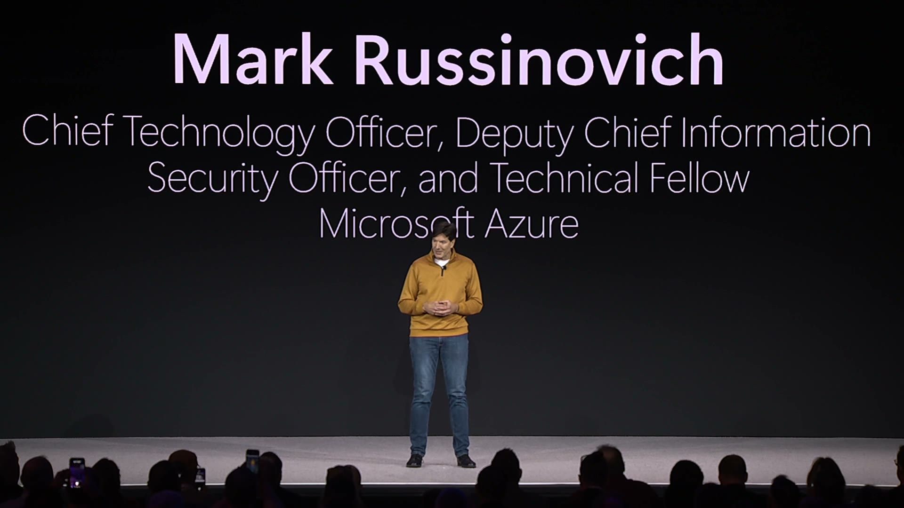

</td><td valign="top">

- Mark Russinovich (CTO, Deputy CISO and Technical Fellow, Microsoft Azure) opens: "infrastructure powers everything" shown in the keynote.
- AI needs four things from infrastructure: **evolving primitives** (for capacity and for containing agents), **optimization from silicon to system**, being **open and governed**, and **intelligence everywhere**, from cloud to edge.

</td></tr></table>

## 2. Azure was built for this moment ▶ 02:50

<table><tr><td width="50%" valign="top">

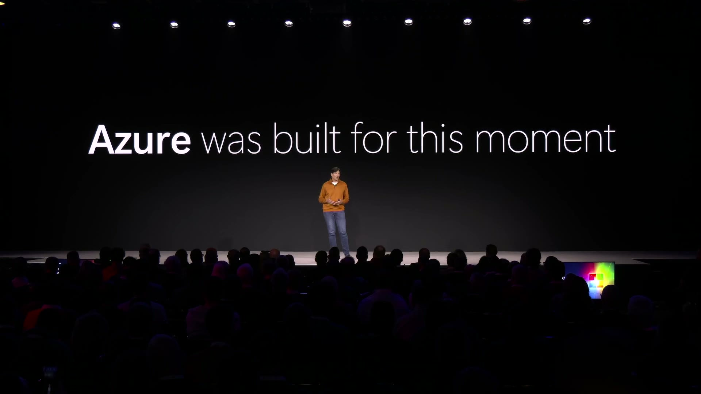

</td><td valign="top">

- Azure was the first public cloud with HPC clusters in the early 2010s, and later built the largest public-cloud AI supercomputers for OpenAI's first models.

</td></tr></table>

## 3. Azure is driving the highest performance ▶ 03:31

<table><tr><td width="50%" valign="top">

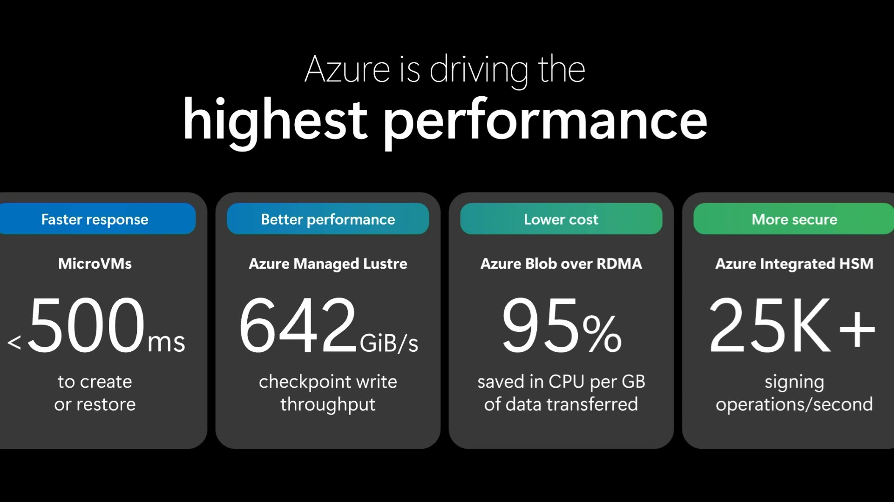

</td><td valign="top">

- **MicroVMs:** created or restored in under 500 ms. Tomorrow's "Inside Azure" talk will show 10,000 sandboxes starting in a second or two.
- **Azure Managed Lustre:** 642 GiB/s checkpoint write throughput.
- **Azure Blob over RDMA:** the first public cloud to offer it, straight into GPU memory, saving 95% CPU per GB transferred.
- **Azure Integrated HSM:** in every server, with 25,000+ signing operations per second. It keeps keys and tokens away from AI models.

**Microsoft Learn:**
- [Azure Managed Lustre overview](https://learn.microsoft.com/azure/azure-managed-lustre/amlfs-overview)

</td></tr></table>

## 4. AI core: Agent Grid, agent sandboxes, context cache (demo: Foundry on AKS) ▶ 05:32

<table><tr><td width="50%" valign="top">

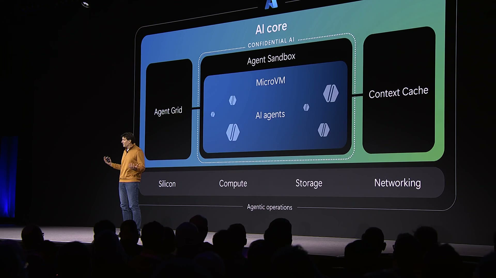

</td><td valign="top">

New "Azure core" layers on top of compute, storage and networking:
- **Agent Grid:** network control right next to the agent sandbox. You decide exactly which sites and resources an agent can reach.
- **Agent sandboxes in ACI:** microVMs that start in under half a second, integrated with Agent Grid, context cache and Foundry.
- **Context cache:** stores model context caches in Azure Storage, so inference doesn't redo work and sessions can move between servers.
- **AKS AI manager:** runs AI and agent workloads on AKS with open-source building blocks and GPU scheduling.
- The range runs from fully managed (Foundry, hosted agents) to do-it-yourself on AKS, with Foundry managing AKS as a middle option.

**Demo:** Caldova's factory has "microstops" on line 7. An AKS inference cluster is attached to Foundry and an open-source model (Llama 3.3 70B) is deployed to it. An on-site GPU node with a camera joins through **AKS flex nodes**. Diagnosis goes from more than 2 hours to 4 minutes.

**Microsoft Learn:**
- [What is Azure Agent Grid?](https://learn.microsoft.com/azure/agent-grid/overview)
- [Serverless AI sandboxes in Azure Container Instances](https://learn.microsoft.com/azure/container-instances/container-instances-ai-sandboxes)
- [Attach external compute as flex nodes for AKS (preview)](https://learn.microsoft.com/azure/aks/flex-nodes-for-aks-overview)
- [Agent Sandbox cluster extension for AKS (preview)](https://learn.microsoft.com/azure/aks/agent-sandbox-cluster-extension)

</td></tr></table>

## 5. Modernize with AI, modernize for AI ▶ 13:04

<table><tr><td width="50%" valign="top">

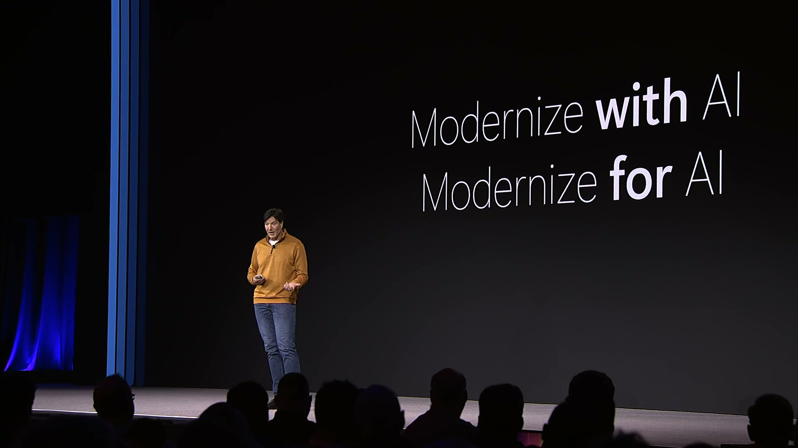

</td><td valign="top">

- Applications have to be modernized before they can use AI, and AI can now do the modernizing.

</td></tr></table>

## 6. Tech debt can't wait (demo: Azure Catalyst) ▶ 13:23

<table><tr><td width="50%" valign="top">

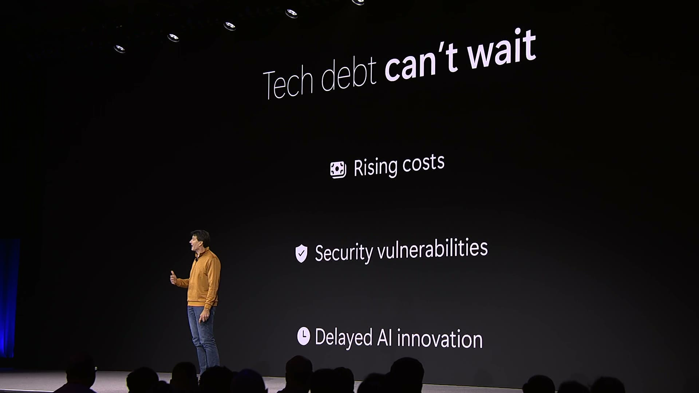

</td><td valign="top">

- Why it's urgent: **rising on-premises costs** (supply chain, GPUs), **security vulnerabilities** (agent-driven attacks against poorly patched on-premises systems), and **delayed AI innovation**.
- Modernizing one small app usually takes months, up to half a year.
- **Azure Catalyst** (new; formerly Azure Migrate) uses agents end to end: discovery, plan, execution and validation, with people able to step in at any point.

**Demo:**
- Catalyst imports a ServiceNow inventory and finds 10 apps and 25 VMs, including their dependencies.
- It builds a business case with costs, Azure Hybrid Benefit and security posture.
- It maps the app to a landing zone: App Service, Azure SQL Hyperscale elastic pool and Azure Files.
- It generates runbooks. The SQL admin and the developer (in GitHub Copilot) work in their own tools inside the same workflow.
- Months of work become days.

**Microsoft Learn:**
- [What is Azure Catalyst (formerly Azure Migrate)?](https://learn.microsoft.com/azure/migrate/migrate-services-overview?view=migrate)
- [Azure Catalyst agent](https://learn.microsoft.com/azure/migrate/azure-copilot-migration-agent?view=migrate)
- [What's new in Azure Catalyst](https://learn.microsoft.com/azure/migrate/whats-new?view=migrate)

</td></tr></table>

## 7. Azure Catalyst customers ▶ 20:13

<table><tr><td width="50%" valign="top">

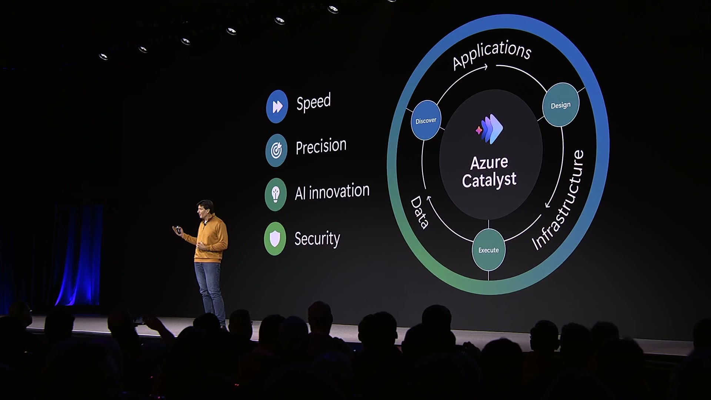

</td><td valign="top">

- Customers report saving time and money, better performance and agent-ready apps.
- In a video, Columbia (Sportswear) says agents propose architectures on day one, they write code the next week, and they made a banking-partner change the same day.

</td></tr></table>

## 8. Run AI with confidence ▶ 23:06

<table><tr><td width="50%" valign="top">

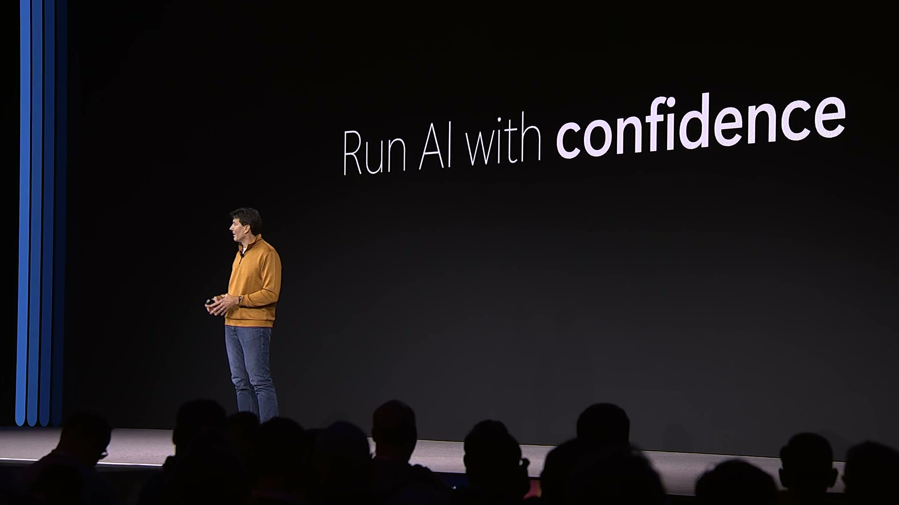

</td><td valign="top">

- Control over **how** AI runs (security controls) and **where** it runs (public cloud or on premises).

</td></tr></table>

## 9. Confidential computing: root of trust in hardware ▶ 23:57

<table><tr><td width="50%" valign="top">

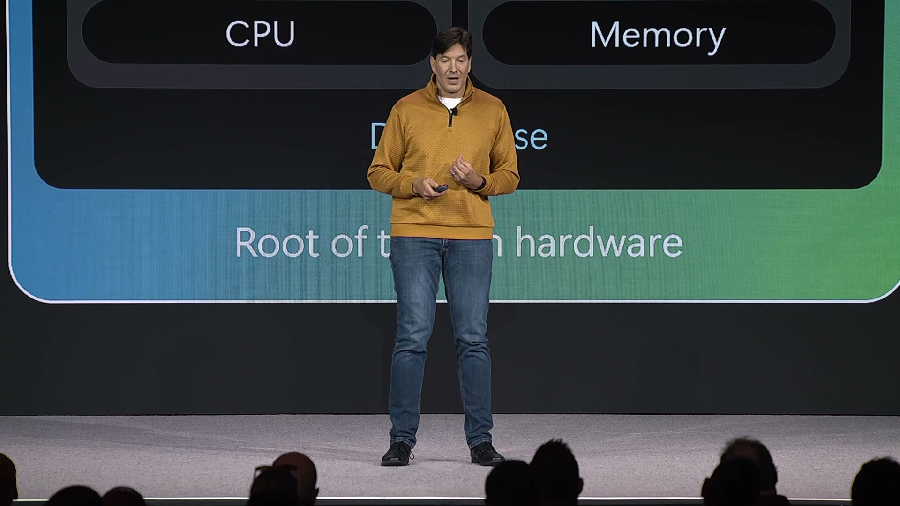

</td><td valign="top">

- Confidential computing protects **data in use** inside hardware trusted execution environments, on top of protection at rest and in transit.
- Azure was the first cloud to offer it, in 2017.

**Microsoft Learn:**
- [What is confidential computing?](https://learn.microsoft.com/azure/azure-sovereign-clouds/public/confidential-computing)
- [Azure confidential computing offerings](https://learn.microsoft.com/azure/confidential-computing/overview-azure-products)

</td></tr></table>

## 10. Security investments ▶ 24:13

<table><tr><td width="50%" valign="top">

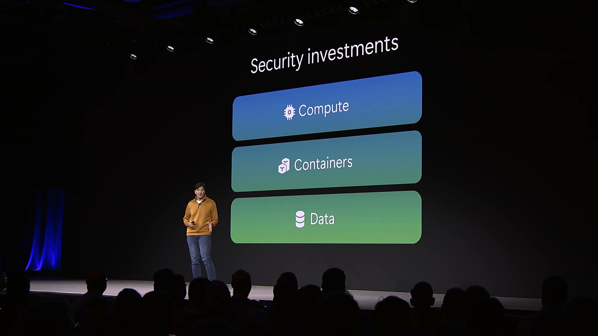

</td><td valign="top">

- The confidential portfolio covers **compute** (confidential VMs), **containers** (confidential ACI) and **data** (confidential data services).

</td></tr></table>

## 11. Security roadmap ▶ 24:29

<table><tr><td width="50%" valign="top">

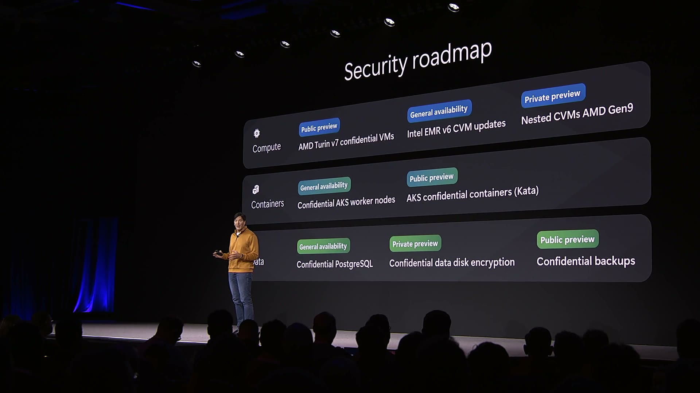

</td><td valign="top">

New at Ignite, according to the slide:
- **Compute:** AMD Turin v7 confidential VMs (public preview), Intel EMR v6 CVM updates (GA), nested CVMs on AMD Gen9 (private preview).
- **Containers:** confidential AKS worker nodes (GA), AKS confidential containers with Kata (public preview).
- **Data:** confidential PostgreSQL (GA), confidential data disk encryption (private preview), confidential backups (public preview).

**Microsoft Learn:**
- [Confidential containers on AKS](https://learn.microsoft.com/azure/confidential-computing/confidential-containers)

</td></tr></table>

## 12. Microsoft Sovereign Cloud (demo: disconnected Azure Local + Foundry Local) ▶ 25:37

<table><tr><td width="50%" valign="top">

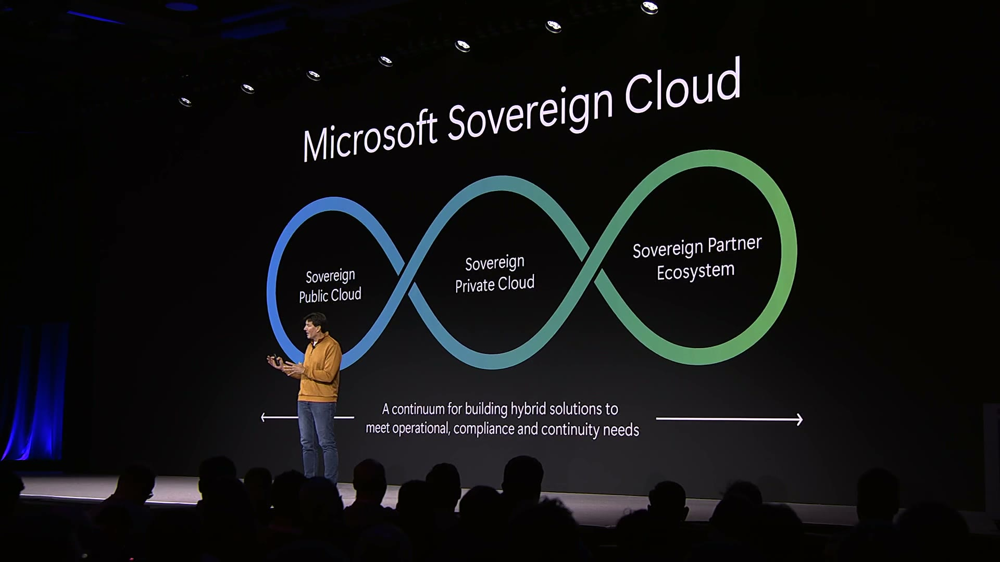

</td><td valign="top">

- Three options: **Sovereign Public Cloud**, **Sovereign Private Cloud** and a **Sovereign Partner Ecosystem**.

**Demo:**
- A sovereign control panel shows residency, encryption and business continuity.
- The workload moves to **Azure Local**, which a script then **disconnects** from public Azure.
- **Foundry Local** keeps running a clinical research assistant agent with local SharePoint documents, fully air-gapped.

Customer examples include Rockwell Automation, Chevron and Husqvarna. Mark then hands over to Pavan (Windows).

**Microsoft Learn:**
- [Disconnected operations for Azure Local](https://learn.microsoft.com/azure/azure-local/manage/disconnected-operations-overview?view=azloc-2610)
- [Foundry Local](https://learn.microsoft.com/azure/foundry-local/what-is-foundry-local)

</td></tr></table>

## 13. Windows ▶ 30:35

<table><tr><td width="50%" valign="top">

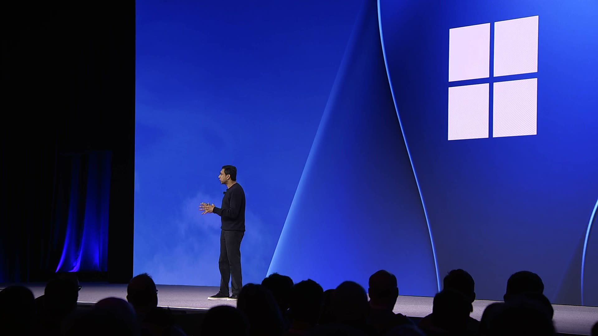

</td><td valign="top">

- Pavan: "Windows extends that infrastructure across cloud and edge." Agents are the next shift in computing.
- Leaders are past debating AI adoption. They now ask how to run agents securely and within budget.

</td></tr></table>

## 14. More secure and reliable with every update ▶ 31:15

<table><tr><td width="50%" valign="top">

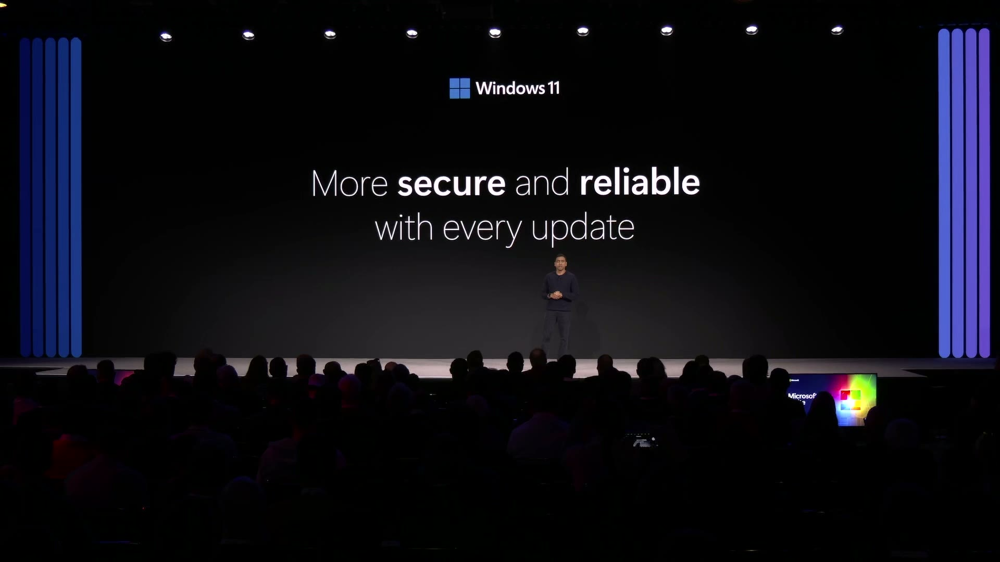

</td><td valign="top">

- According to the Digital Defense Report, weaponizing a vulnerability "now just takes one prompt", and new vulnerabilities are doubling this year.
- "Move quickly and take new risks or move carefully and risk being disrupted." Pavan's answer: "You shouldn't have to choose."

</td></tr></table>

## 15. Three pillars: trusted foundation, hybrid intelligence, AI infrastructure ▶ 31:45

<table><tr><td width="50%" valign="top">

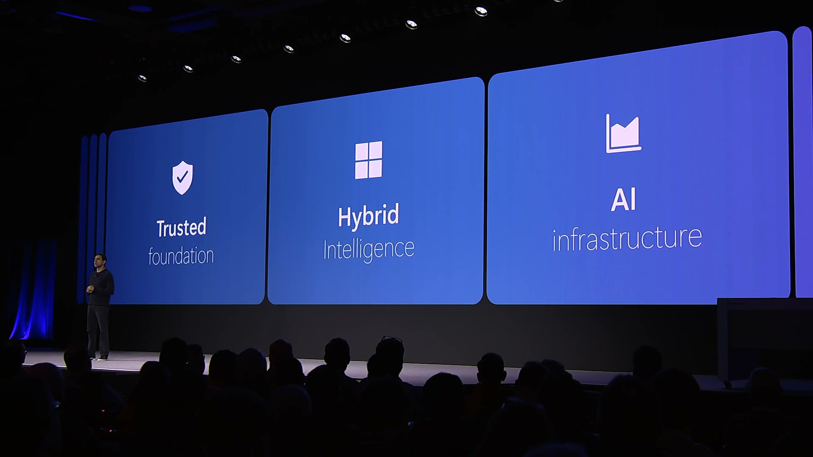

</td><td valign="top">

1. **Trusted foundation:** for employees, with IT in control.
2. **Hybrid intelligence:** built on the most secure platform for agents.
3. **AI infrastructure:** connected from cloud to edge.

</td></tr></table>

## 16. Building more resilient endpoint protection ▶ 31:59

<table><tr><td width="50%" valign="top">

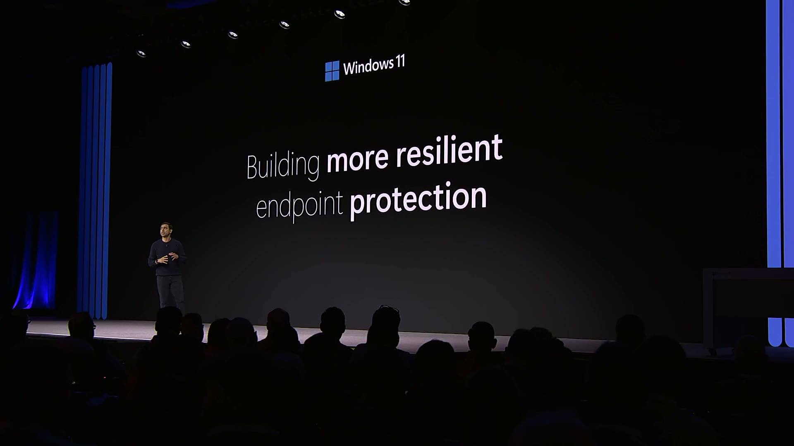

</td><td valign="top">

- Some protections used to run in the Windows kernel, where one failure took down the whole device. In 2024, Microsoft and its security partners started on more resilient endpoint protection.

</td></tr></table>

## 17. Windows Endpoint Security Platform (GA) ▶ 32:24

<table><tr><td width="50%" valign="top">

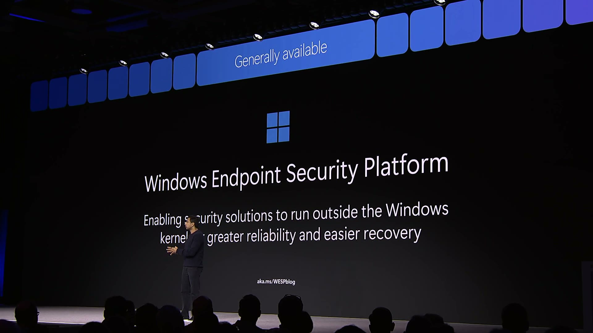

</td><td valign="top">

- **Generally available today:** security vendors can move critical protections from kernel mode to user mode, for more reliability and easier recovery.

</td></tr></table>

## 18. Windows Endpoint Security Platform partners ▶ 32:39

<table><tr><td width="50%" valign="top">

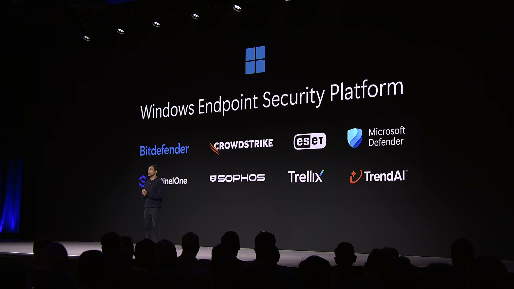

</td><td valign="top">

- Partners on the slide: Bitdefender, CrowdStrike, ESET, Microsoft Defender, SentinelOne, Sophos, Trellix and TrendAI.

</td></tr></table>

## 19. Windows Baseline Protection ▶ 33:13

<table><tr><td width="50%" valign="top">

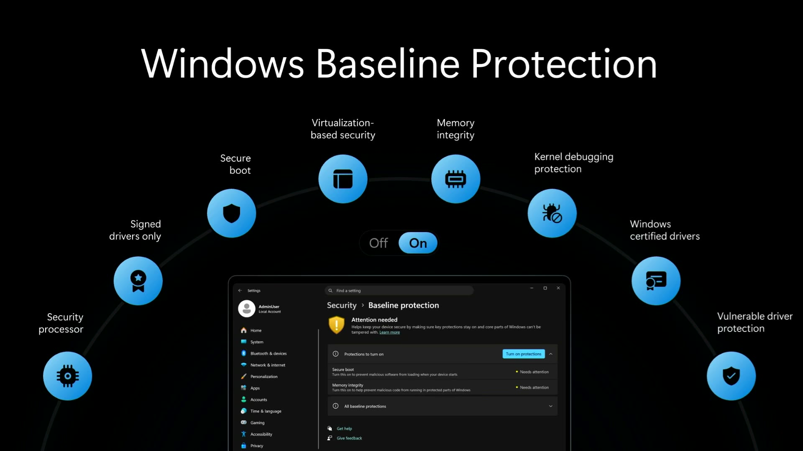

</td><td valign="top">

- **Announced:** one easily verifiable security state that combines secure boot, VBS, memory integrity, signed drivers, vulnerable driver protection and more.
- Users see their device's status, and IT gets a clear yes/no signal per device. Baseline protection will get new versions as the bar rises.

**Microsoft Learn:**
- [Windows baseline protection](https://learn.microsoft.com/windows/security/operating-system-security/system-security/windows-baseline-protection)

</td></tr></table>

## 20. Windows Baseline Protection partner ecosystem ▶ 33:23

<table><tr><td width="50%" valign="top">

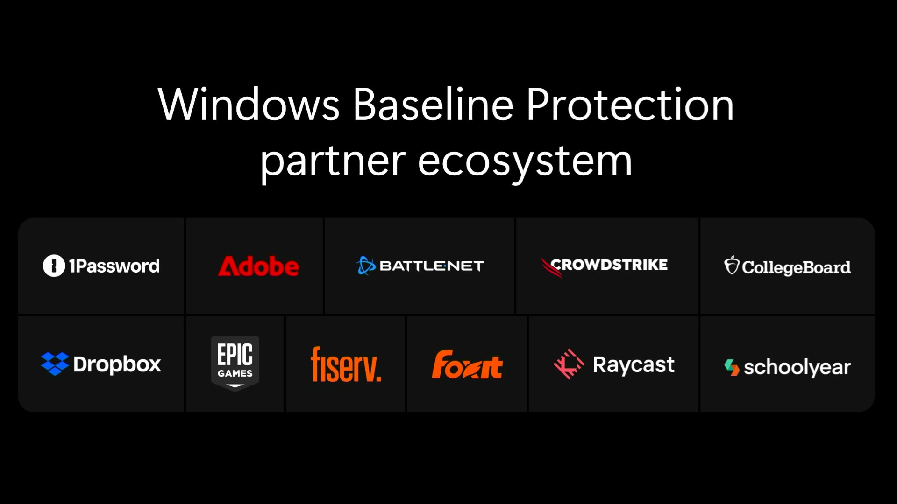

</td><td valign="top">

- Partners on the slide: 1Password, Adobe, Battle.net, CrowdStrike, CollegeBoard, Dropbox, Epic Games, Fiserv, Foxit, Raycast and Schoolyear.
- In a video, Adobe says trust starts at download and install, and the OS-level signal helps fight counterfeit and modified software.

</td></tr></table>

## 21. Windows Administrator Protection (GA) ▶ 34:43

<table><tr><td width="50%" valign="top">

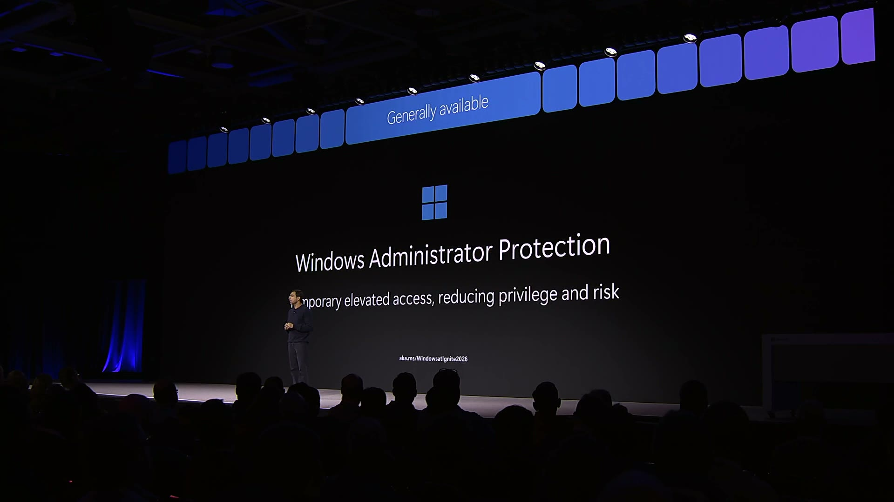

</td><td valign="top">

- **Generally available:** local admins run as standard users and elevate only when needed, verified by Windows Hello. The rights last only for that task.

**Microsoft Learn:**
- [Administrator protection](https://learn.microsoft.com/windows/security/application-security/application-control/administrator-protection/)

</td></tr></table>

## 22. Moving faster than threats emerge ▶ 35:13

<table><tr><td width="50%" valign="top">

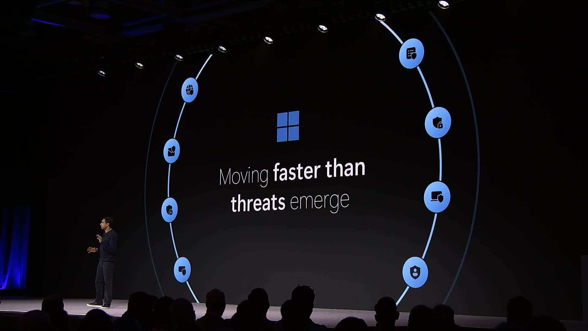

</td><td valign="top">

- AI agents such as **MDASH** scan Windows code at scale. In October alone, Microsoft shipped fixes for more than **1,100 CVEs**, more than in all of 2025.

</td></tr></table>

## 23. Fastest customers deploy updates within one week ▶ 35:53

<table><tr><td width="50%" valign="top">

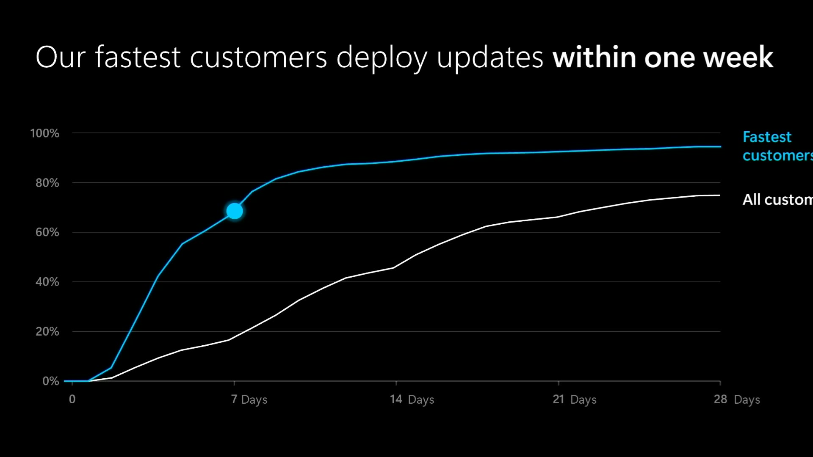

</td><td valign="top">

- The fastest customers patch most of their devices within a week of a Windows security update. Modern management is a big part of that.

</td></tr></table>

## 24. Windows Autopatch ▶ 36:06

<table><tr><td width="50%" valign="top">

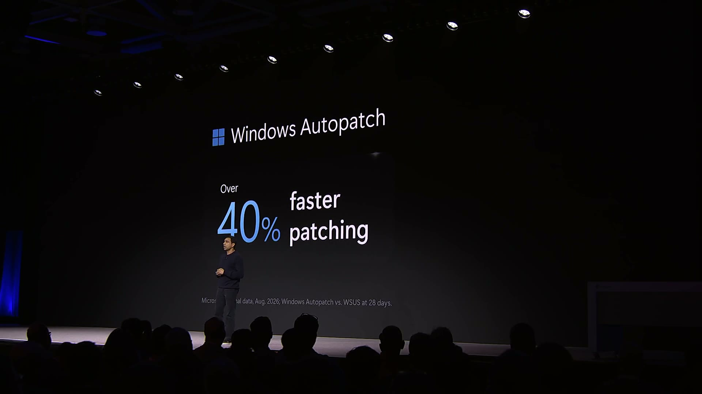

</td><td valign="top">

- Autopatch customers deploy updates **over 40% faster** than customers with on-premises management. Usage grew 50%+ in a year, to 150M+ devices.
- New: more control over updates, visibility into features, and one reboot a month.

**Microsoft Learn:**
- [Start using Windows Autopatch](https://learn.microsoft.com/windows/deployment/windows-autopatch/prepare/windows-autopatch-start-using-autopatch)

</td></tr></table>

## 25. Intune Enterprise App Management ▶ 36:43

<table><tr><td width="50%" valign="top">

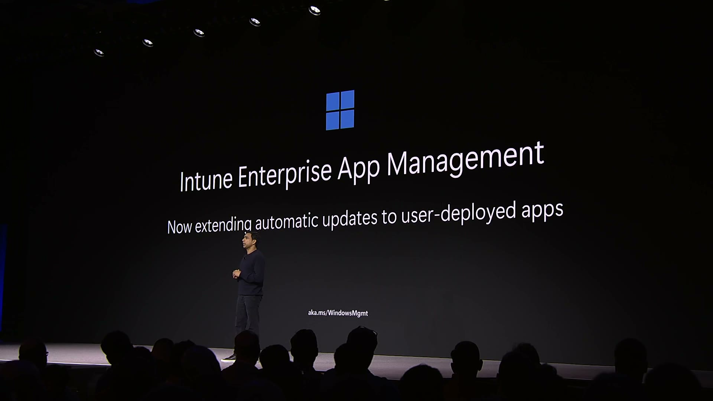

</td><td valign="top">

- **Preview:** automatic updates now also for apps that users installed themselves, with Autopatch-style controls and deadlines.

</td></tr></table>

## 26. Declarative Management ▶ 37:11

<table><tr><td width="50%" valign="top">

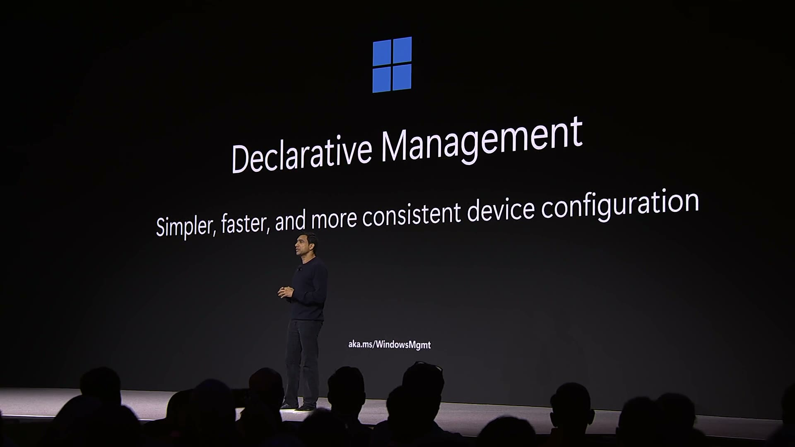

</td><td valign="top">

- Windows is standardizing on declarative device configuration. Policies such as Wi-Fi and VPN reach devices within minutes and are protected from drift, even offline.

</td></tr></table>

## 27. Trusted foundation ▶ 37:34

<table><tr><td width="50%" valign="top">

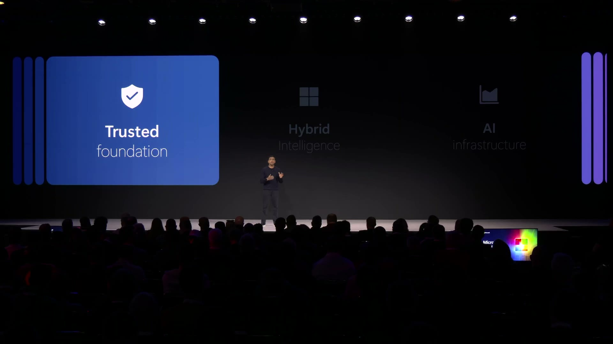

</td><td valign="top">

- Summary of the first pillar. The same foundation now extends to AI and agents: you need to know what an agent can access and do.

</td></tr></table>

## 28. Hybrid Intelligence ▶ 38:10

<table><tr><td width="50%" valign="top">

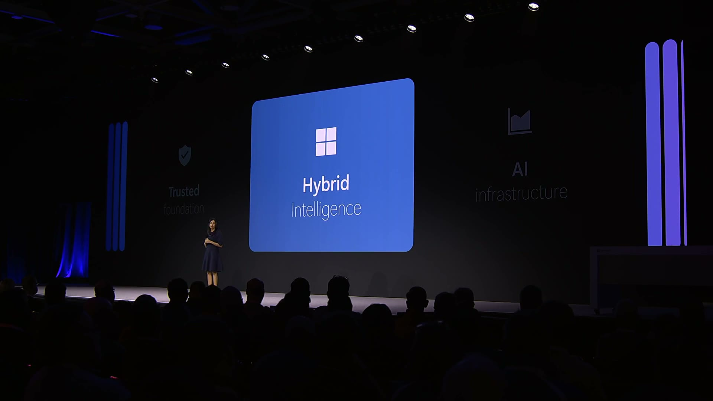

</td><td valign="top">

- Navjot (Windows) takes over. Three questions: are my agents secure, is my AI budget going as far as it can, and are employees getting value?

</td></tr></table>

## 29. Microsoft Execution Containers ▶ 38:28

<table><tr><td width="50%" valign="top">

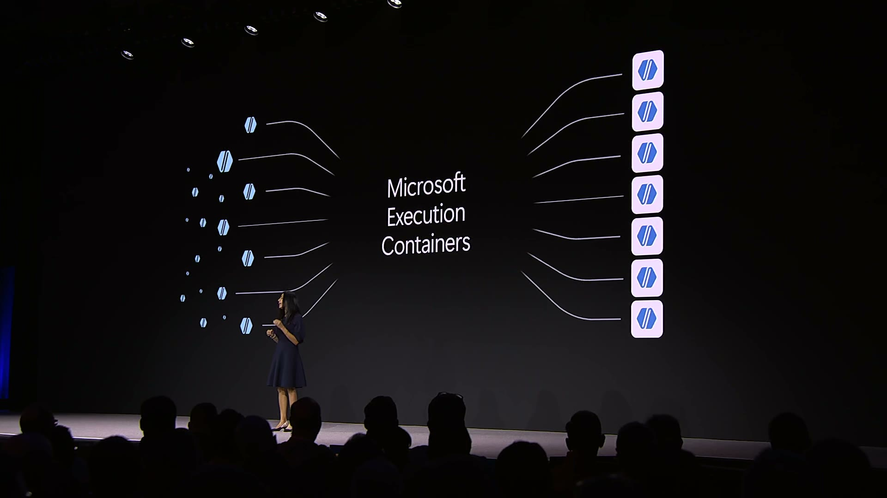

</td><td valign="top">

- **MXC** became generally available last month. Agents get a contained Windows environment, IT sets file and network access with Intune, and Windows enforces it at runtime.

</td></tr></table>

## 30. Microsoft Execution Containers (GA, demo) ▶ 39:04

<table><tr><td width="50%" valign="top">

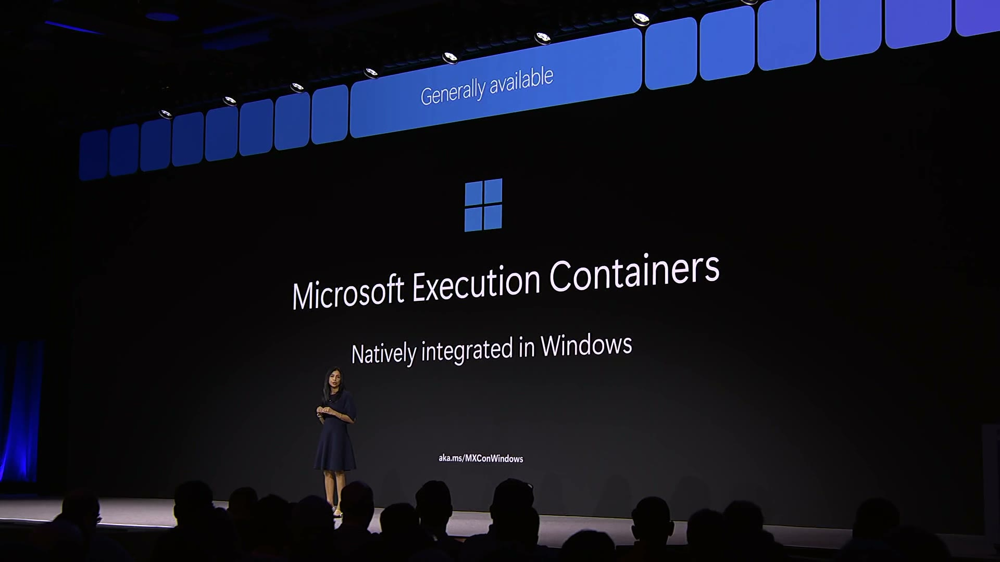

</td><td valign="top">

- New since GA: process, session and WSL containers, and agent identity that's harder to tamper with. MXC runs on Windows, Linux and macOS, but is built into the OS only on Windows.

**Demo:**
- The Contoso agent runs in its own **session container**, as its own Entra-backed user in Task Manager.
- Summarizing a contract runs in a **process container** with access to that one file.
- Testing suspected malware runs in a throwaway **local micro VM**.

In videos, OpenAI says **Codex** uses MXC by default on Windows, and Meta runs MXC on 30,000+ Windows devices.

</td></tr></table>

## 31. Execution container types ▶ 42:23

<table><tr><td width="50%" valign="top">

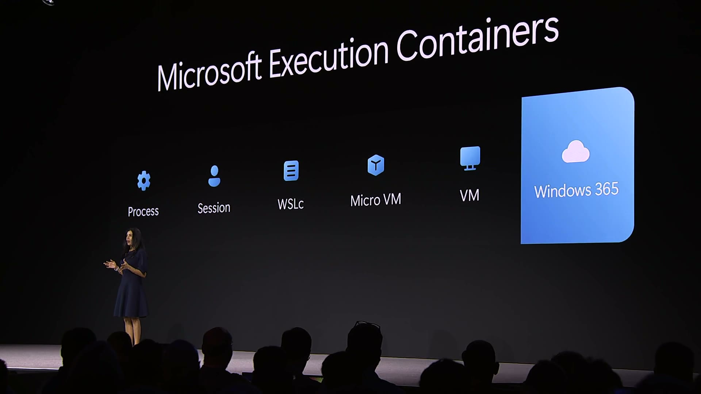

</td><td valign="top">

- The containment options range from **process**, **session**, **WSL**, **micro VM** and **VM** to a full **Windows 365** cloud PC.

</td></tr></table>

## 32. Windows 365 for Agents ▶ 42:40

<table><tr><td width="50%" valign="top">

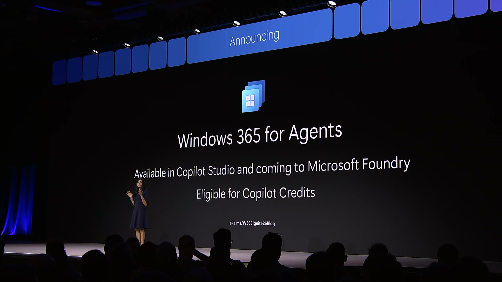

</td><td valign="top">

- **Announced:** give agents their own secure cloud PC, managed like any other PC. It's available as a computer use tool in **Copilot Studio**, coming to **Foundry**, and eligible for Copilot Credits.
- Microsoft's own order processing saved 60% of processing time.

**Microsoft Learn:**
- [Windows 365 for Agents](https://learn.microsoft.com/windows-365/agents/introduction-windows-365-for-agents)

</td></tr></table>

## 33. Agent 365 on Windows ▶ 43:16

<table><tr><td width="50%" valign="top">

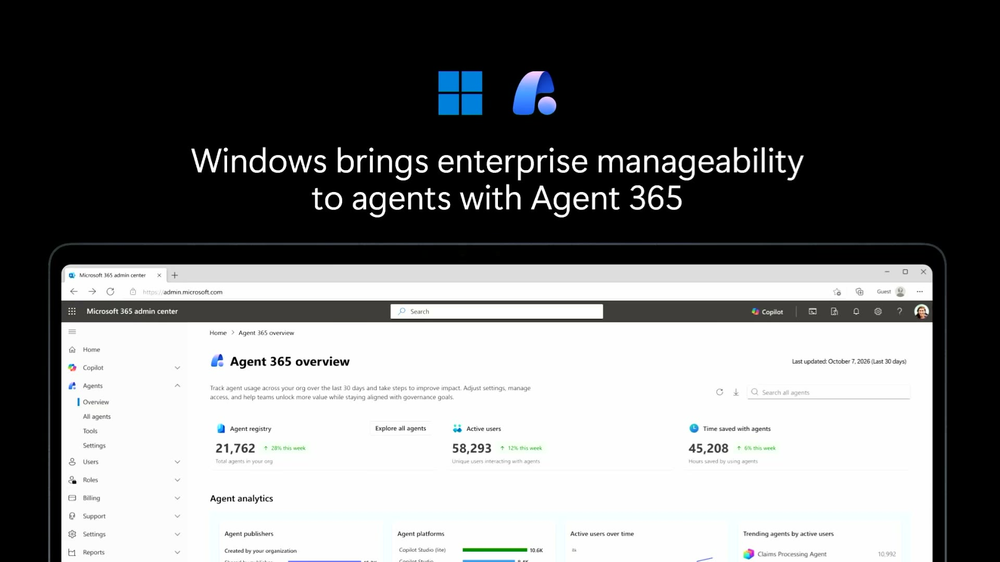

</td><td valign="top">

- **Agent 365 governance now reaches Windows endpoints.** IT sets a policy once and Windows enforces it on every managed device, for every agent.

</td></tr></table>

## 34. Hybrid Intelligence: local and cloud ▶ 43:23

<table><tr><td width="50%" valign="top">

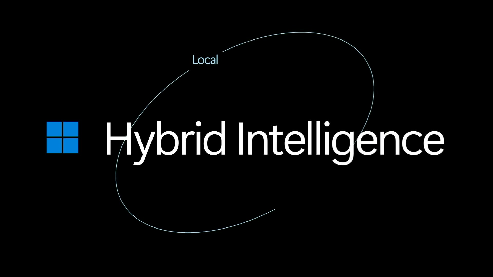

</td><td valign="top">

- As AI use scales, costs add up. Hybrid intelligence uses the best of local and cloud so the AI budget goes further.

</td></tr></table>

## 35. New Windows Search experience ▶ 43:47

<table><tr><td width="50%" valign="top">

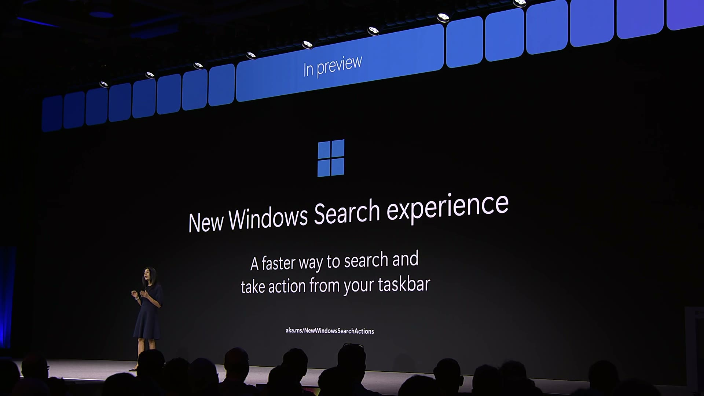

</td><td valign="top">

- **Preview:** faster search for apps, settings and files, plus thousands of quick actions from the taskbar (snap layouts, Do Not Disturb, VPN, virtual desktops).

</td></tr></table>

## 36. Copilot on Windows (demo) ▶ 44:47

<table><tr><td width="50%" valign="top">

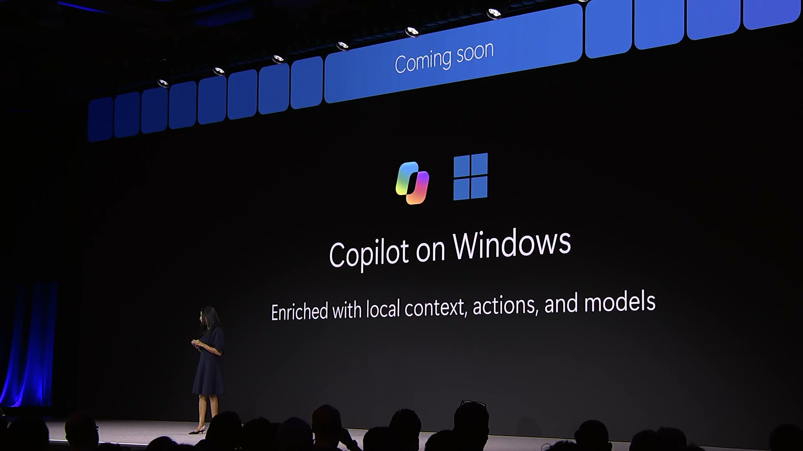

</td><td valign="top">

- **Coming soon to Copilot+ PCs:** Copilot with **local context** (files, recent activity, with permission), **local actions**, and increasingly **local models**, using the cloud only when needed.
- **Demo:** Copilot fixes headphones that weren't working (audio was set to the wrong device) without an IT ticket, then moves analyst reports from Downloads to a OneDrive folder after asking permission.

</td></tr></table>

## 37. Powered by Hybrid Intelligence ▶ 47:28

<table><tr><td width="50%" valign="top">

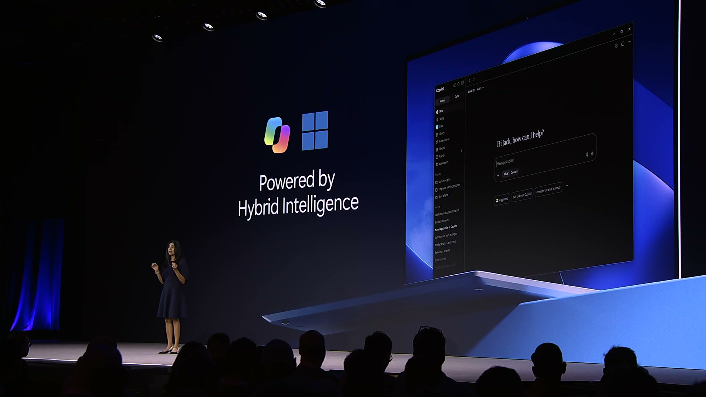

</td><td valign="top">

- Fewer support tickets and time back for employees, with the security and control IT needs.

</td></tr></table>

## 38. GitHub Copilot Fusion ▶ 47:48

<table><tr><td width="50%" valign="top">

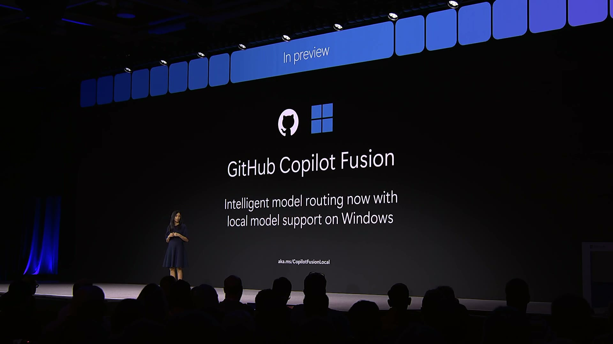

</td><td valign="top">

- **Preview:** Copilot Fusion with hybrid intelligence can use **local models**, such as the MAI coding model on NVIDIA RTX Spark PCs and now AMD Ryzen AI Max. Several Fortune 500 companies are piloting it.

</td></tr></table>

## 39. Local agent ecosystem ▶ 48:20

<table><tr><td width="50%" valign="top">

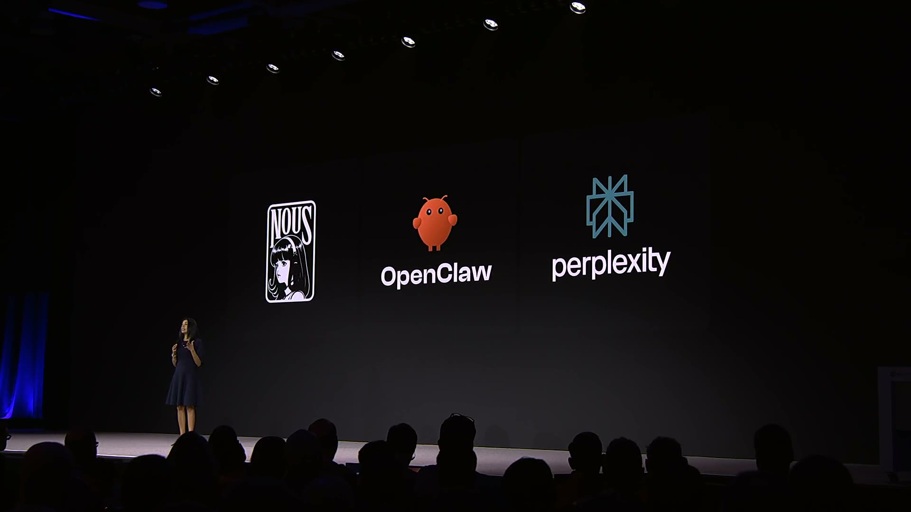

</td><td valign="top">

- Agents building on these capabilities include Nous, OpenClaw, Perplexity and Replit.
- In a video, Christie's uses Replit's local agent on Windows for private art collection data that never leaves the device, with MXC sandboxing.

</td></tr></table>

## 40. PCs are part of your AI infrastructure ▶ 50:42

<table><tr><td width="50%" valign="top">

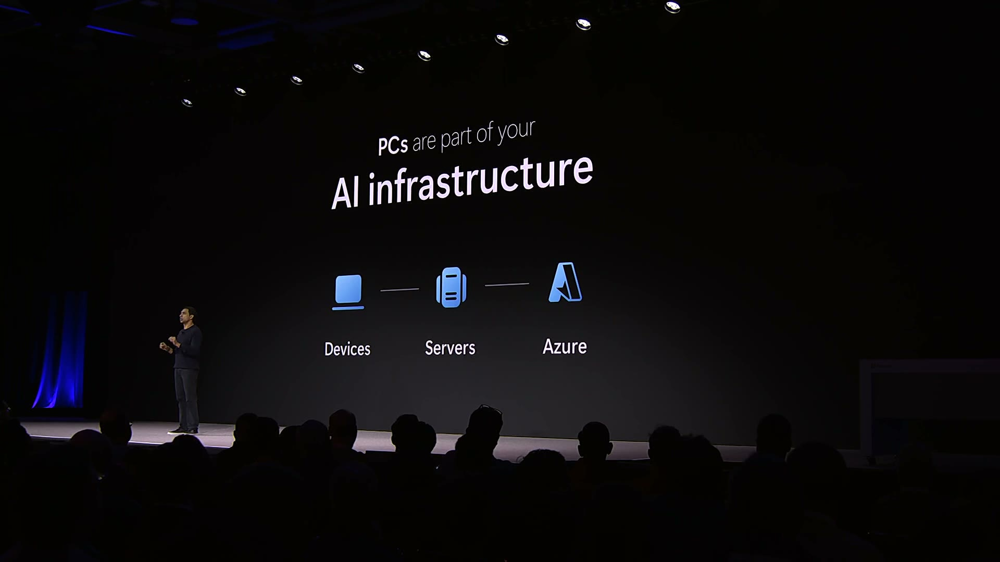

</td><td valign="top">

- Pavan returns. Windows connects devices, servers and Azure as one system, so you can match the model and compute to the work.

</td></tr></table>

## 41. Designed as an ecosystem ▶ 51:41

<table><tr><td width="50%" valign="top">

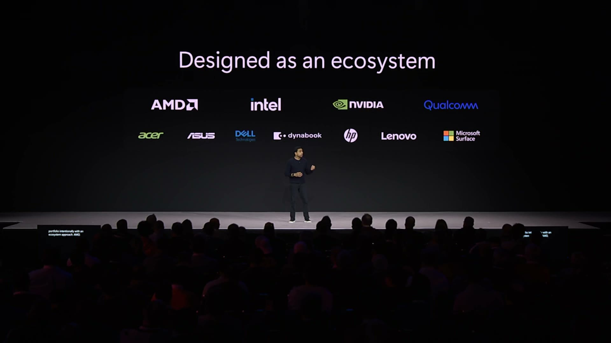

</td><td valign="top">

- Copilot+ PCs (many with Intel Core Ultra), RTX Spark devices such as Surface Laptop Ultra, AMD Ryzen AI Max, and NVIDIA DGX Station for Windows with trillion-parameter models at the desk.
- Partners on the slide: AMD, Intel, NVIDIA, Qualcomm, Acer, ASUS, Dell, Dynabook, HP, Lenovo and Microsoft Surface.

</td></tr></table>

## 42. Windows 365 ▶ 52:21

<table><tr><td width="50%" valign="top">

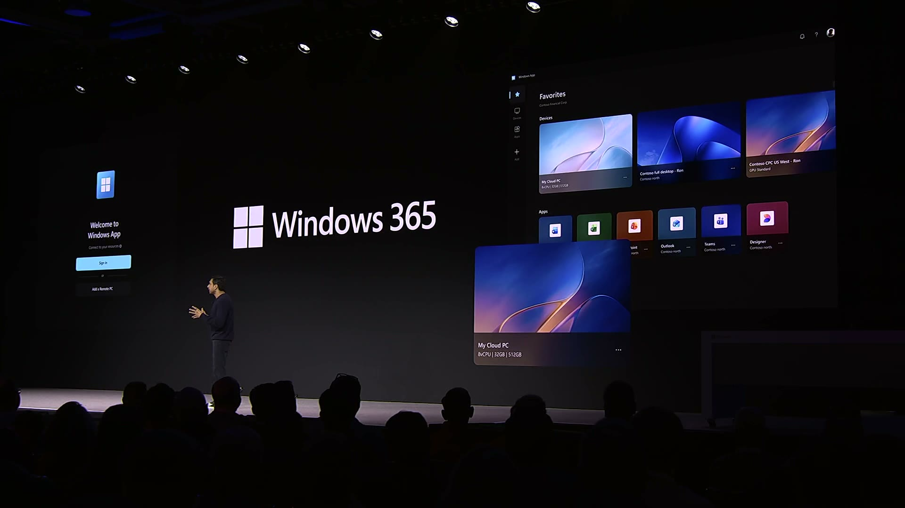

</td><td valign="top">

- Five years of Windows 365: the same Windows, apps and identity, running in the cloud. Tens of thousands of organizations use it.

</td></tr></table>

## 43. GPU-enabled Cloud PCs ▶ 52:55

<table><tr><td width="50%" valign="top">

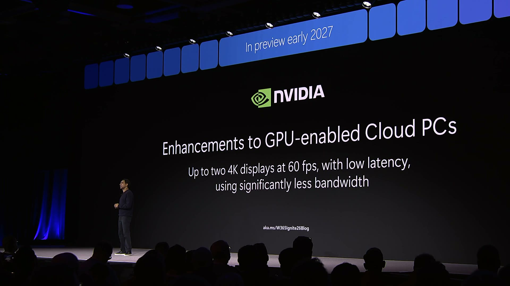

</td><td valign="top">

- **Direct Stream** is the name for Windows 365's streaming technology, with nearly 300% better reliability on poor networks.
- **NVIDIA GPU cloud PCs (preview early 2027):** two 4K displays at 60 fps using half the bandwidth.

**Microsoft Learn:**
- [What's new in Windows 365 (week of November 16, 2026)](https://learn.microsoft.com/windows-365/enterprise/whats-new)

</td></tr></table>

## 44. Windows 365 for everyone ▶ 53:37

<table><tr><td width="50%" valign="top">

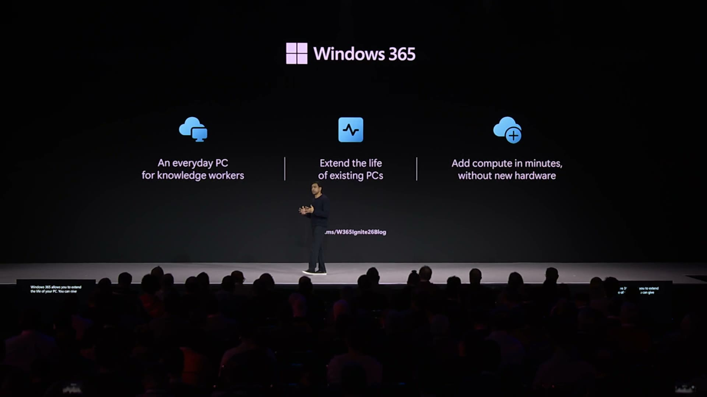

</td><td valign="top">

- Cloud PCs as an everyday PC for knowledge workers, a way to extend the life of existing PCs (PC prices are up 40%+), and compute in minutes without new hardware.

</td></tr></table>

## 45. Windows Server 2028 ▶ 54:28

<table><tr><td width="50%" valign="top">

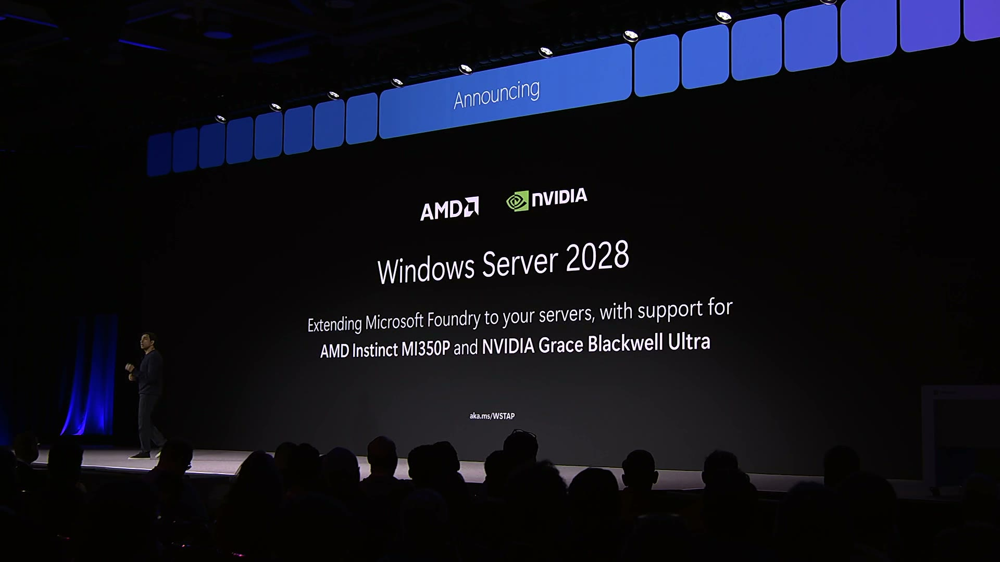

</td><td valign="top">

- **Public preview:** a hardened baseline and trusted launch VMs. Servers can be managed with Intune and patched with Autopatch, alongside Azure Arc.
- **Foundry extends to Windows Server 2028**, with support for AMD MI350P and NVIDIA DGX Station on GB300.
- Moving high-volume AI work to hybrid intelligence can "cut five year TCO by more than half". Advice: plan your PC refresh around Copilot+ PCs plus Windows 365, and test Server 2028.

**Microsoft Learn:**
- [What's new in Windows Server 2028 Preview](https://learn.microsoft.com/windows-server/get-started/whats-new-windows-server-2028)

</td></tr></table>

## 46. PwC x Windows 11 ▶ 57:01

<table><tr><td width="50%" valign="top">

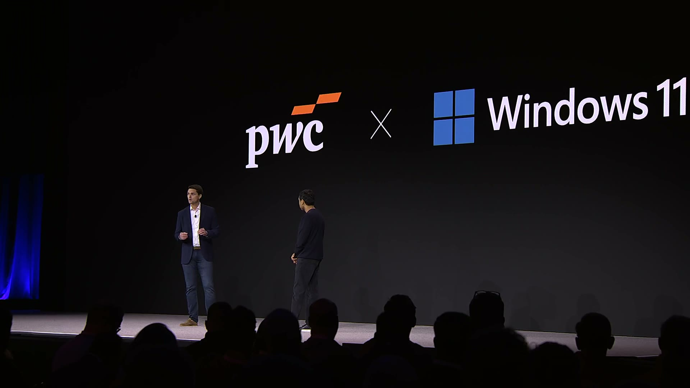

</td><td valign="top">

- Josh, PwC's global digital workplace leader, joins on stage. PwC manages 360,000+ devices in 130+ countries.
- AI should be like electricity, "you just flip a switch". The PC has become "strategic AI infrastructure".
- Data sovereignty, security, speed and cost pull AI onto the device, within a hybrid architecture.
- Hardware is standardized but tailored per persona (consultant vs developer). "It's not just the hardware": persona, hardware and software all have to fit.
- The next challenge is managing models, skills and versions at scale.

</td></tr></table>

## 47. Closing ▶ 61:39

<table><tr><td width="50%" valign="top">

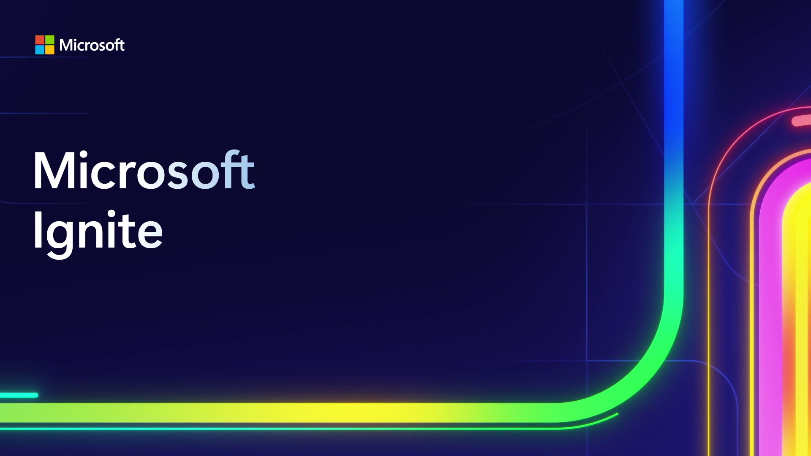

</td><td valign="top">

- Pavan's closing: Windows as "the OS for hybrid intelligence". The most secure platform for agents, a bigger return on the AI budget, and the estate as connected AI infrastructure.

</td></tr></table>
